# 数据科学的高级统计：31：基函数导论 🧮


在本节课中，我们将要学习最小二乘法的一个特殊且重要的实例，即当设计矩阵 **X** 是正交且满秩的情况。我们将探讨其数学原理、几何解释以及在实际应用中的意义。


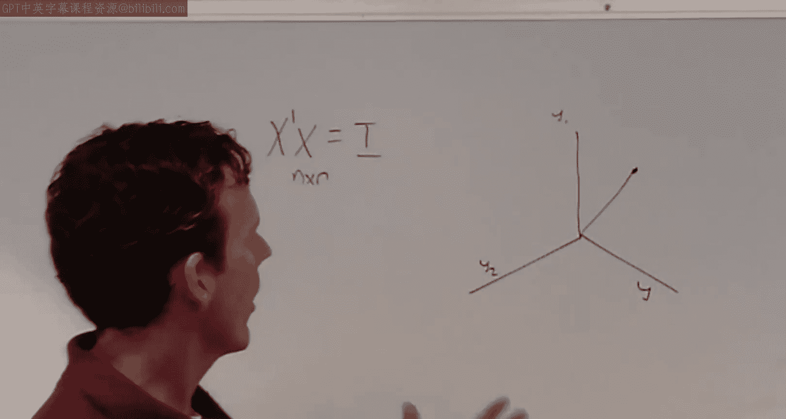

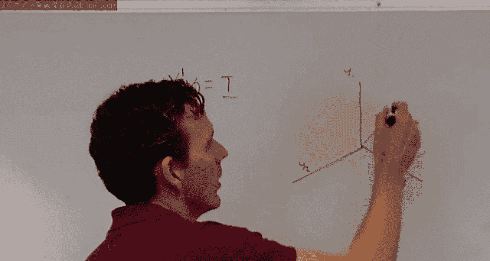

---

上一节我们介绍了最小二乘法的基本形式，本节中我们来看看一个特殊情形。考虑以下情况：**X** 是一个 **N × N** 的矩阵，并且满足 **XᵀX = I**，即 **X** 是正交矩阵，同时也是满秩的。

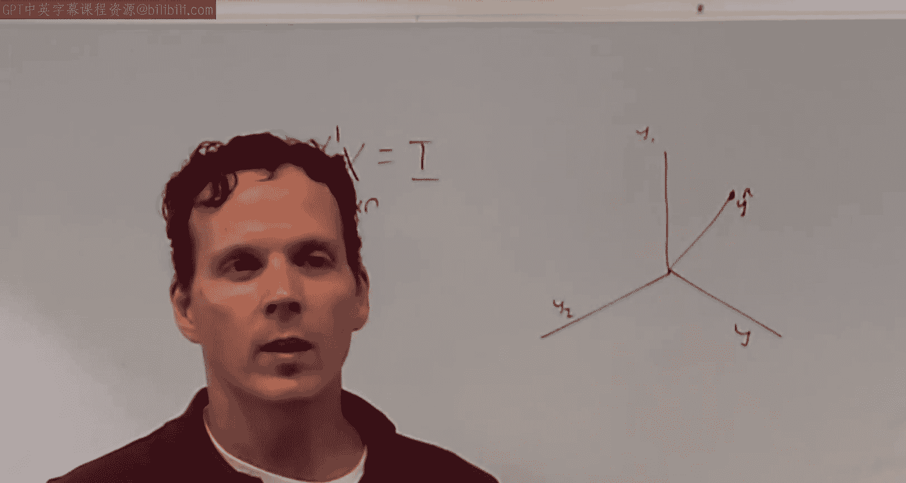

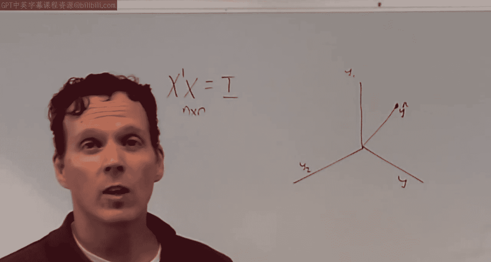

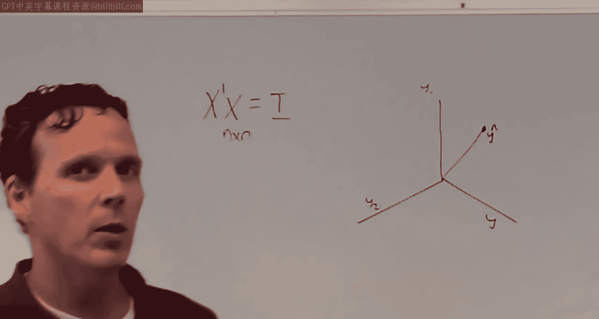

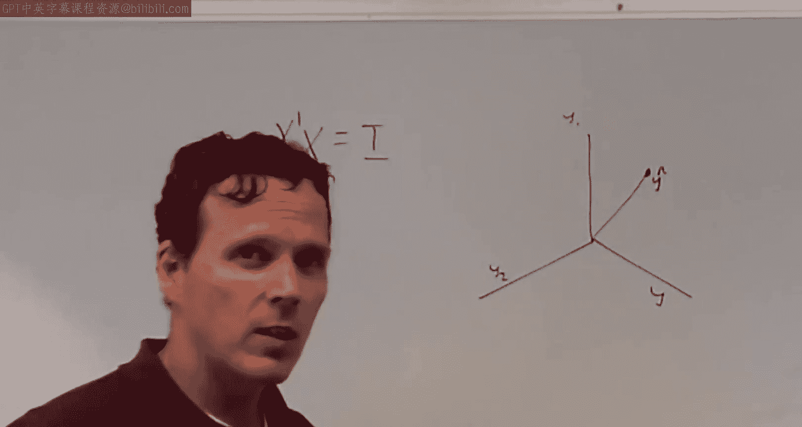

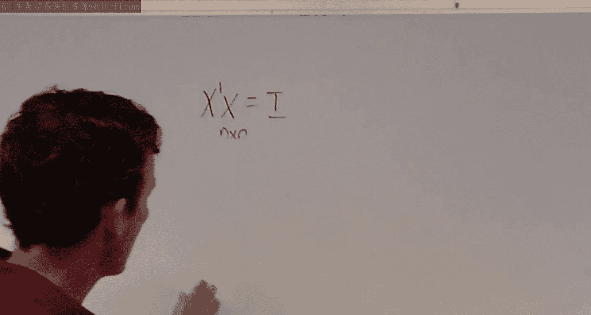

这看起来可能有些奇怪。回想一下，如果我们的响应变量 **y** 是三维的（例如 y₁, y₂, y₃），而我们的设计矩阵 **X** 也是三维的，那么通过最小二乘法得到的拟合值 **ŷ** 将恰好等于 **y**。这是因为我们试图投影到的空间维度（3维）与原始数据的维度相同。这个结论可以推广到 **N** 维。因此，如果我们有一个满秩的 **N × N** 矩阵 **X**，进行最小二乘拟合似乎没有意义。我们稍后会解释这一点。


现在，如果我们想求解最小二乘方程：
```
minimize ||y - Xβ||² with respect to β
```
其估计值 **β̂** 的公式为：
```
β̂ = (XᵀX)⁻¹ Xᵀy
```
在当前的特殊情况下，由于 **XᵀX = I**，公式简化为：
```
β̂ = Xᵀy
```

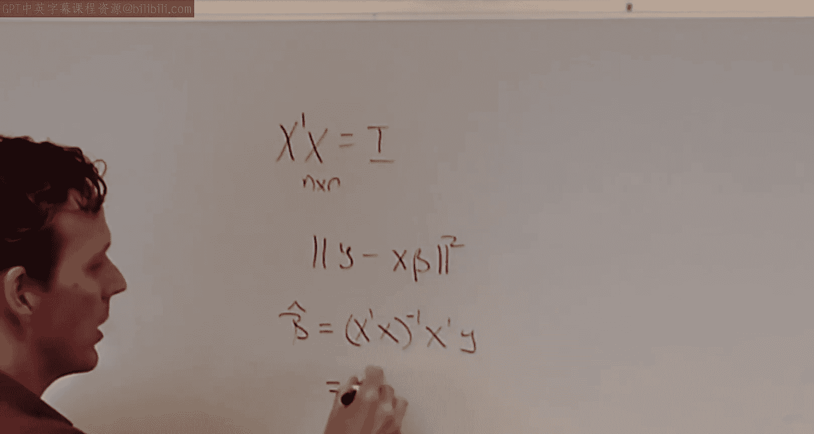


让我们更具体地分析。如果 **X** 的列向量为 **x₁, x₂, ..., x_N**，那么 **β̂** 的计算意味着：
```
β̂₁ = x₁ᵀy
β̂₂ = x₂ᵀy
...
β̂_N = x_Nᵀy
```
也就是说，每个系数 **β̂_i** 就是对应的基向量 **x_i** 与响应向量 **y** 的内积。


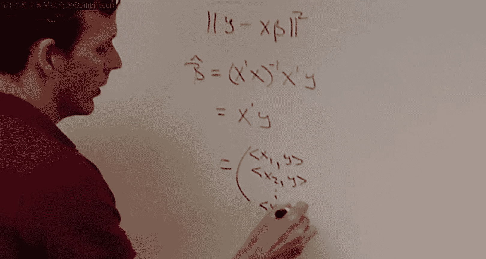

接下来，我们的拟合值 **ŷ** 为：
```
ŷ = X β̂ = X (Xᵀy)
```
这可以展开为：
```
ŷ = Σ_{i=1}^{N} (x_i (x_iᵀy))
```

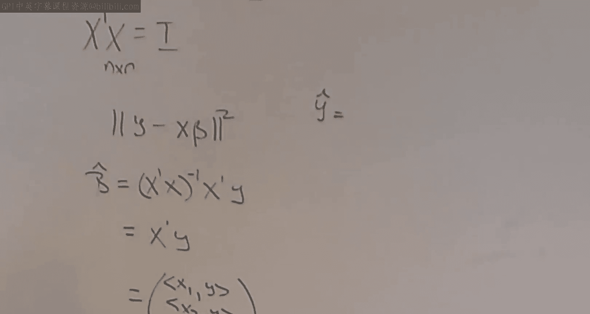


这个形式非常有趣。现在，让我们想象另一种情况：我们不是使用完整的 **X**，而是只使用它的一个列子集，记为 **X_S**，它只包含 **P** 个列（P < N）。由于 **X** 的列是正交的，其任意子集 **X_S** 的列也满足 **X_Sᵀ X_S = I**。

那么，仅用这个子集进行拟合的论证过程完全适用。此时，拟合值 **ŷ_subset** 为：
```
ŷ_subset = Σ_{i ∈ S} (x_i (x_iᵀy))
```
其中 **S** 是所选列索引的集合。

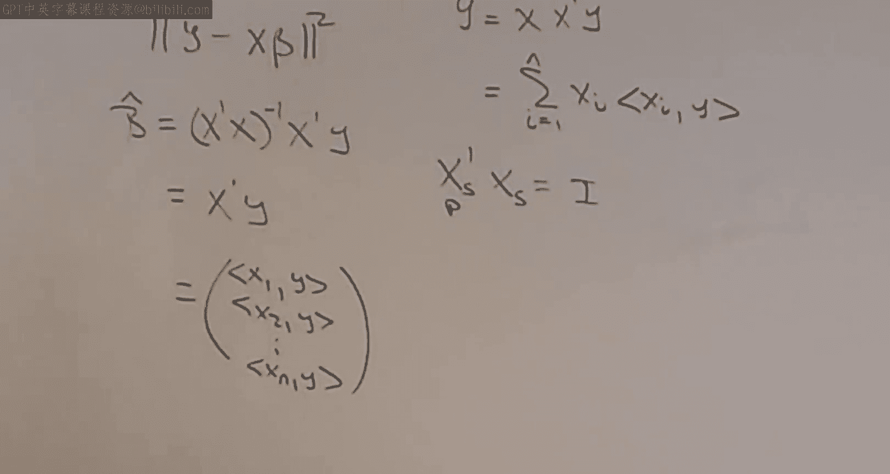


这意味着什么？如果我们有一个完整的、正交的设计矩阵作为 **R^N** 空间的一组基，那么我们的系数就是每个基向量与 **y** 的内积。如果我们不想使用完整的 **N** 维基，而只想使用一个 **P** 维的子集，我们只需简单地选取对应的那部分系数（即那些内积）即可。这为灵活地选择模型特征（基函数）提供了极大的便利。

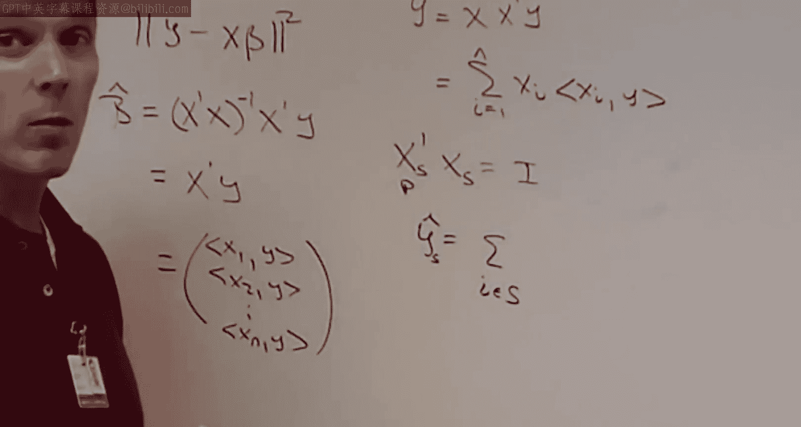

---

本节课中我们一起学习了当设计矩阵 **X** 为正交矩阵时，最小二乘法的简化形式。我们看到了系数如何简化为内积，以及如何通过选择基函数的子集来构建更简单的模型。这为理解更复杂的基函数展开（如傅里叶级数、小波变换）奠定了基础。