# 约翰霍普金斯大学《数据科学的高级统计｜Advanced Statistics for Data Science》中英字幕（deepseek p107 33_基函数3：奇异值分解.zh_en -BV1htPjeYEFH_p107-

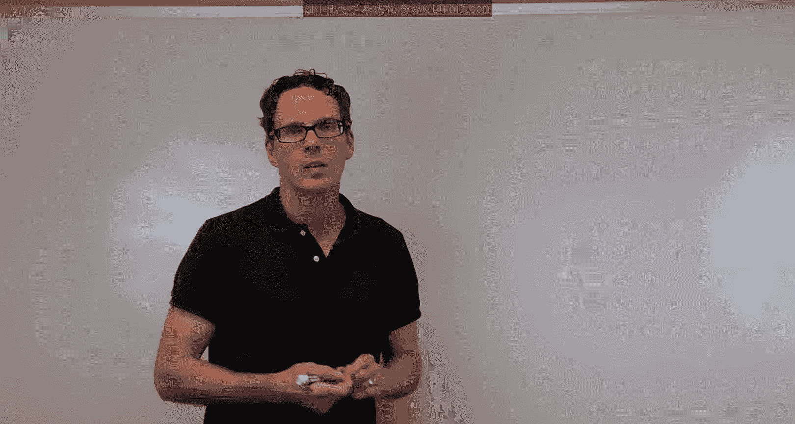

So let's talk about another instance of an north and normal basis that comes up quite frequently。

 so imagine our x is n by p， and let's still assume that p is less than or equal to n。

 but imagine if we have a large number of subjects or record， so n is large。

 and then p is also large， so we want some way to reduce the dimension of x to make it a little bit more manageable。

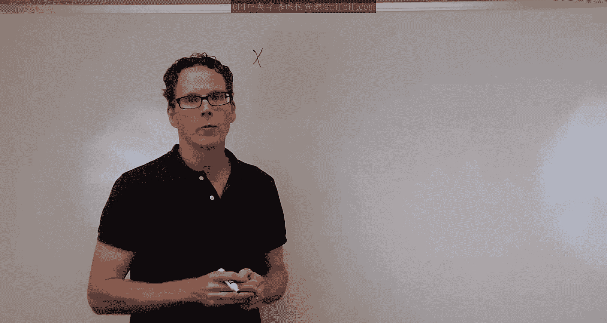

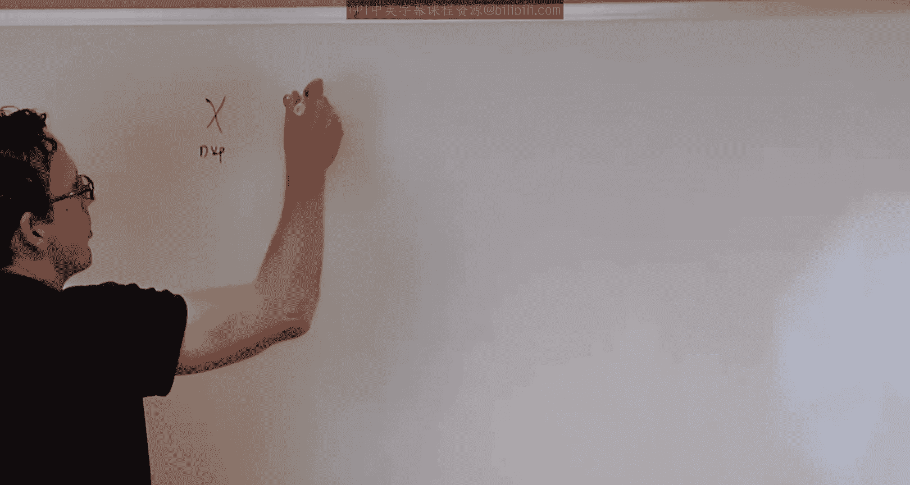

Consider the singular value decomposition of x， so x is M by P of full column rank。

 so we can decompose it into U Dv transpose where U is M by P。

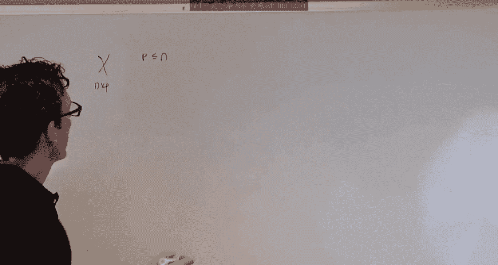

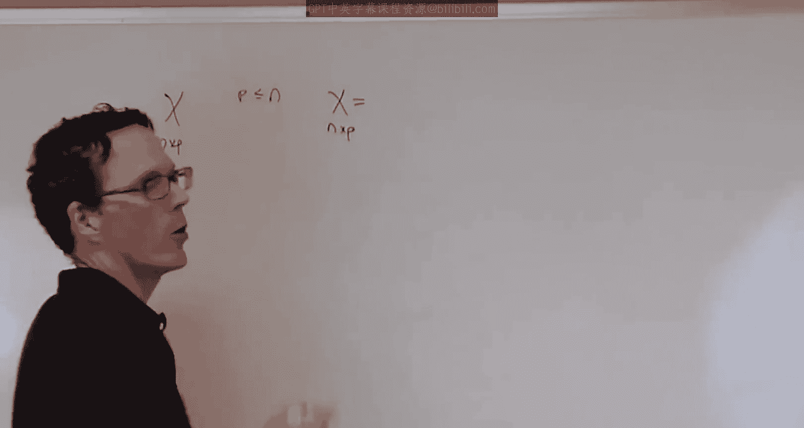

D is a P by P diagonal matrix of singular values， and is a v transpose is a P by P matrix。

 and these are such that u transpose U equals v transpose V。

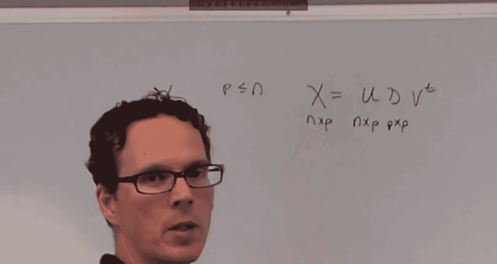

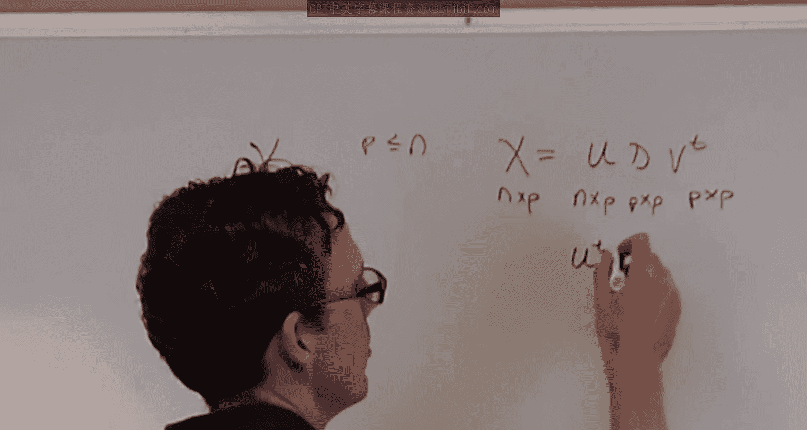

Equals I。O。So one thing I want to know is imagine。Imagine for the time being that x has been centered in the sense that all of its column means are zero。

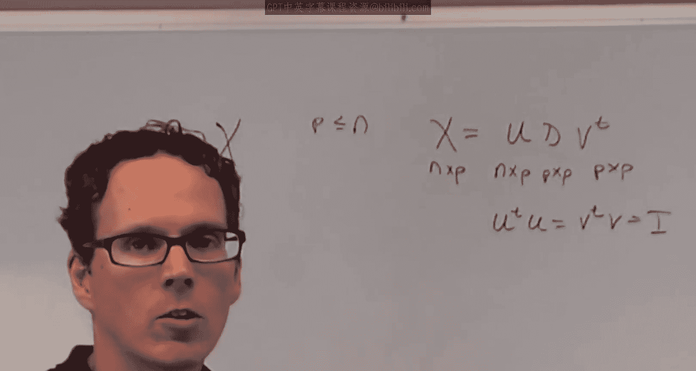

And consider x transpose x， which is effectively the variance covariance matrix of the x matrix。

 disregarding the n minus1。

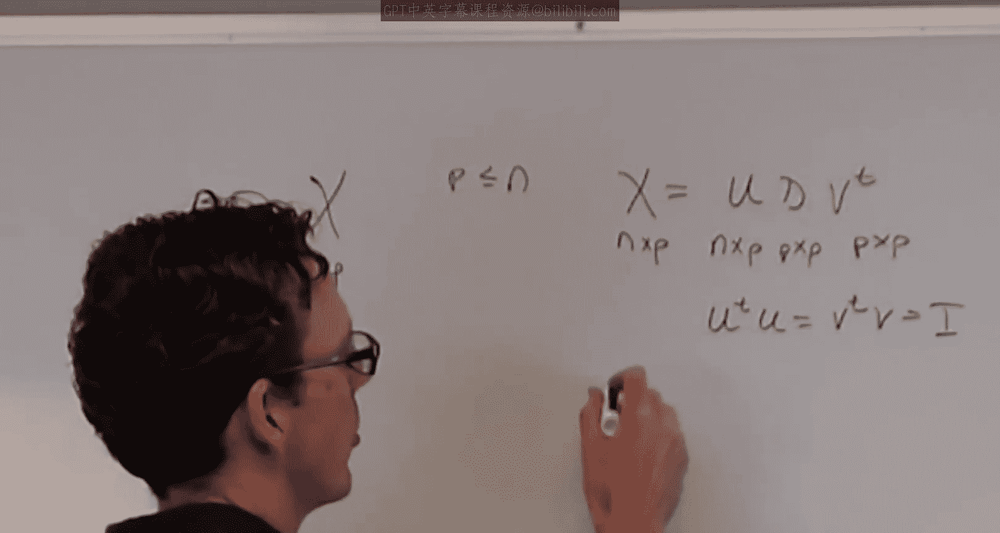

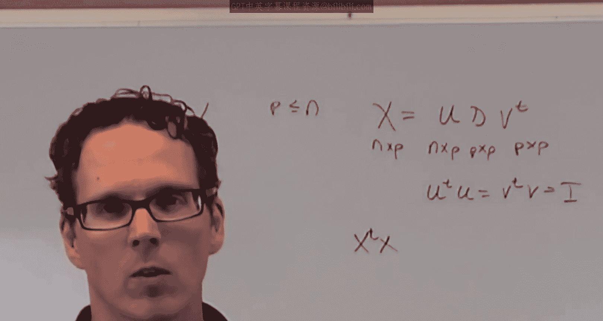

Well， that's equal to。Using this result and this result， that's equal to V。

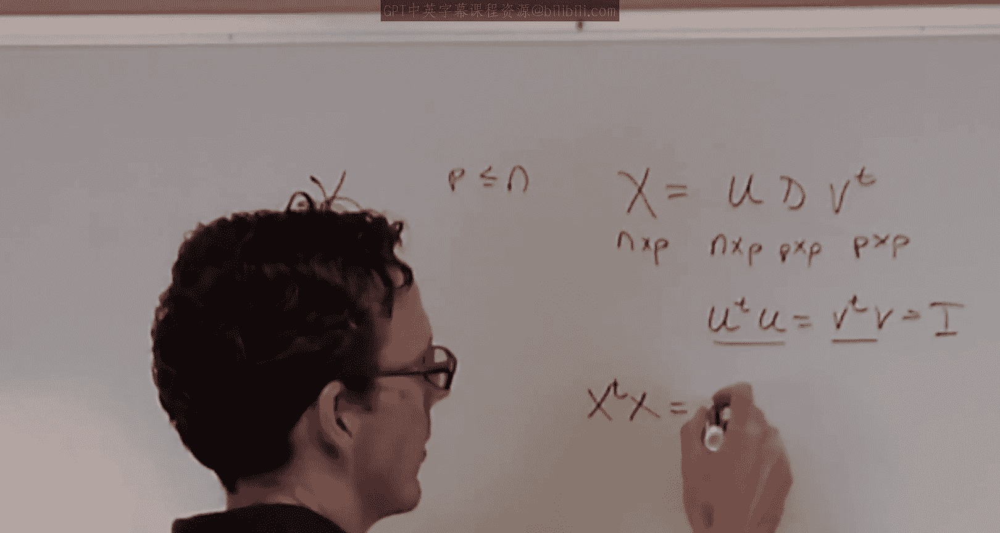

D U transpose U， D V， which is equal to V d squared v transpose。

 so the eigenvalue decomposition of x transpose x is related to the singular value decomposition of x by itself。

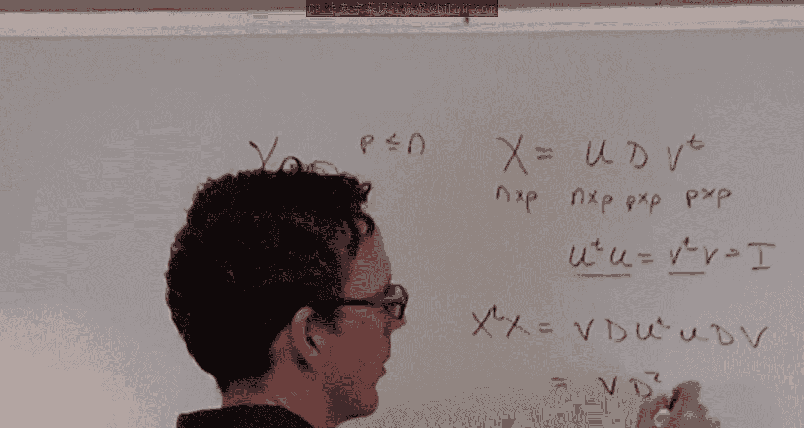

The squared singular valuess， the eigenvalues from the eigenvalue decomposition。

Help summarize the variance in the x transpo x matrix， which is itself a variance covariance matrix。

 and these are usually ordered so that the larger d squared values are earlier。

 so they're usually ordered in decreasing as decreasing number， so the first one is the largest。

 the second one is the second largest and so on。And so consider the fact that the trace。

Of x transpose x is equal to the trace。Of Vd squared V transpose。

 and then I can move that V over there since trace A V is trace B， V transpose v is I。

 so the trace of x transpose x is equal to the trace。The sum of my eigenvalues squared。

And so what this means is the eigenvalues are summarizing the variability in the sense that the trace is the total variability in my x transpose x matrix by taking all the diagonal。

 the sum of all the diagonal， sum of all the variances。Okay。

 so what we could do is say take the first three components of our。

Of our decomposition and see what percentage of the total variation they explain。

 Let's suppose they explain 90% of the variation that we might consider reducing x。

By only taking those first three eigenvalues。first three eigenvectors。So。Consider。The way to do this。

 okay， notice that v transpose x。Wrong direction。Times D inverse is equal to U。

 So a way to think about how we get at。How we get at the scores。

 these are the so-called scores that U the vectors associated with U is by multiplication of x by V。

 so what V does is it combines the columns of x in such a way that it gives us these scores and then the Dmverse is sort of a normalization term right the D's are you can think of as variances so multiplication by Dmverse is sort of like normalizing in the sense of dividing by a standard deviation。

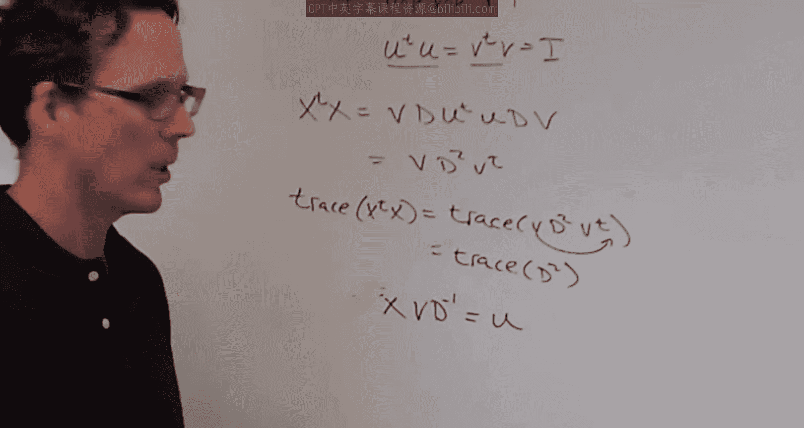

Okay， so what we could do if。To every column of V， which is an eigenvector。

 is associated an eigenvalue， which is the element of d squared。

 we might take the top three and then only say take the first three elements of this U matrix we might so by only taking the first three elements of V and only take the first three elements of D。

 or we could just of course do the singular value decomposition which will give us U D and V and just take first three vectors of U。

So we could then try to minimize。

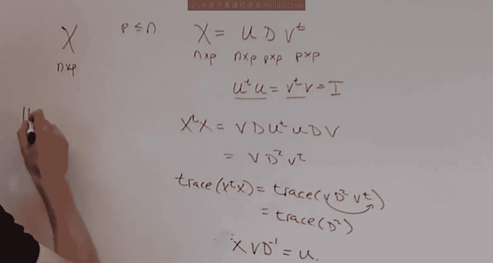

Y minus？U gamma， let's say squared。ok。Where I'm going to put a little three under my U because I just happened to grab the first three。

 three， columns of U and what this would mean is I'm trying to regress why with a design matrix U。

 but my U was selected in a way to capture as much variation as possible as I could in my X of course I'm just using three as an example you could use any number of the number of columns of u to do this with。

 but you want to explore what percentage of the variation they explain and how tolerable that percentage is to your goals。

But at any rate， our discussion from orthoormal bases notes that because of course U is orthoormal。

 grabbing any three columns of U， especially the first three columns of U is also going to be orthoormal。

 and so our estimate of gamma， our gamma hat is just going to be u3 transpose times y。Okay。

 so what we find is that the。The way in which we get sort of principal components regressors is simply by taking the singular value decomposition of our centered x matrix。

 taking the relevant columns from our score， our vector left singular values。

 which if we think about it in terms of principal components as our scores。

 and then if we simply multiply them by y，Multiply the transpose of them times y we actually get the associated coefficients。

 Okay， so this just goes to show how we can use these nice。

Operations that we get out of least squares in this particular in this particular case。

 So using the singular value decomposition to come up with the ortho normalmal basis。

 I think represents of the three most important basis concepts and statistics。

 certainly I would describe wavelelets Fourier transforms and principal components bases as the three and I think you can see that in this case。

 it fits very nicely into the topic of regression， and it also fits very nicely if we have a large x matrix with a lot of columns that we want to summarize one caveat I I would suggest to be careful of。

 again， we get U， we can think of you as these linear combination of our columns of x。

 if the units of x don't make sense to combine。Then this procedure may not make a lot of sense to do so if the first column of x is a particular kind of units and the second column of x is a different kind of units。

 then the interpretability of your scores may really suffer as a result so again。

 there's a lot of intricacies to do this and I think if you wanted to learn more about this a class on multivariant statistics would be the way to go。

 but I just wanted to reinforce this point that when we have an design matrix that is ortho theormal we work out with a really simple solution for the coefficients。

Okay and next we'll go through a coding example where we go through some of these sorts of examples。

