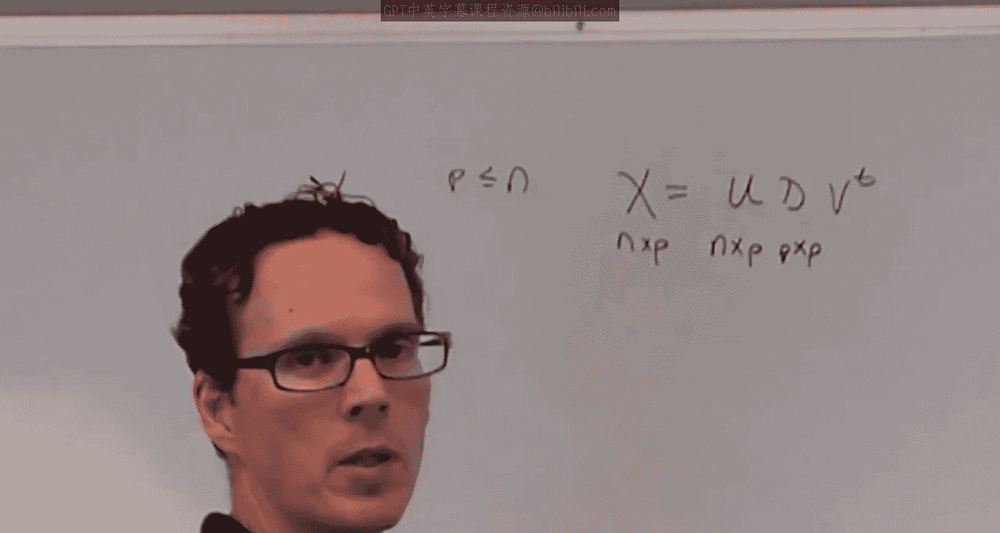
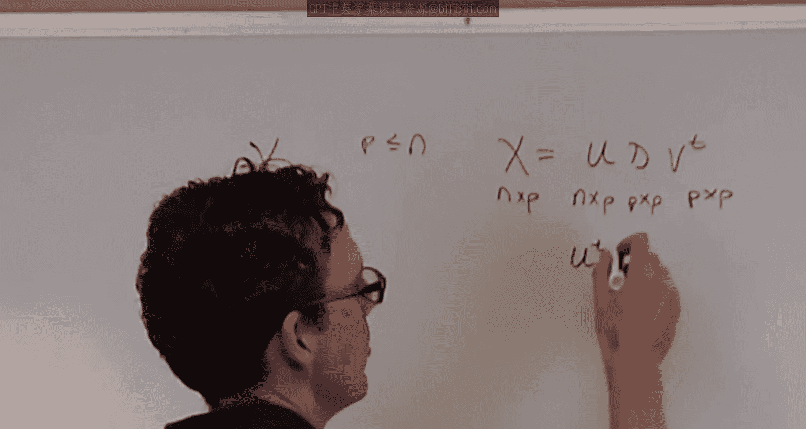
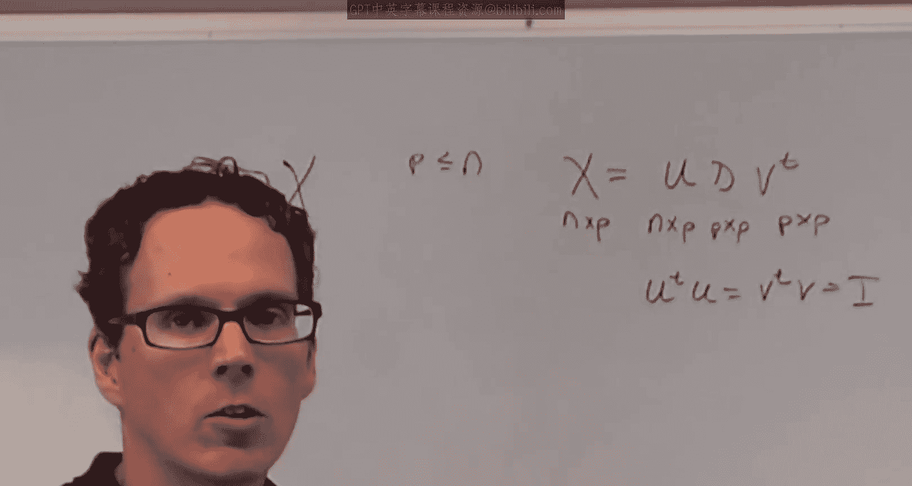
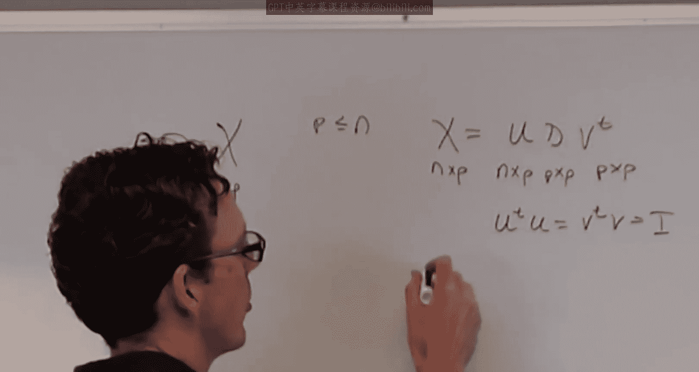
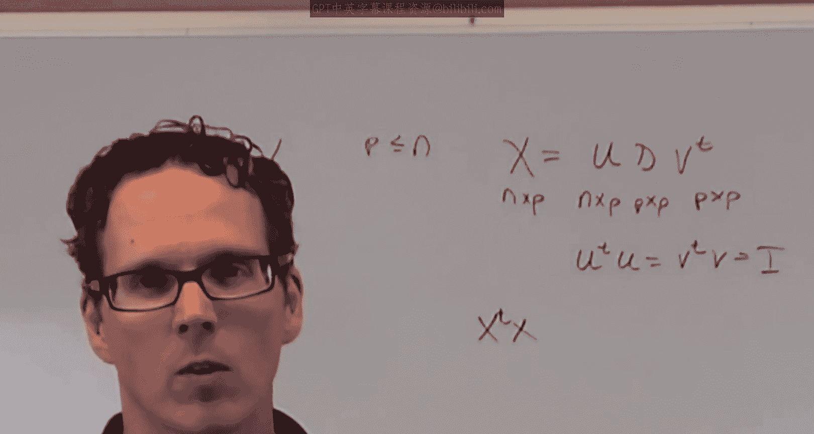
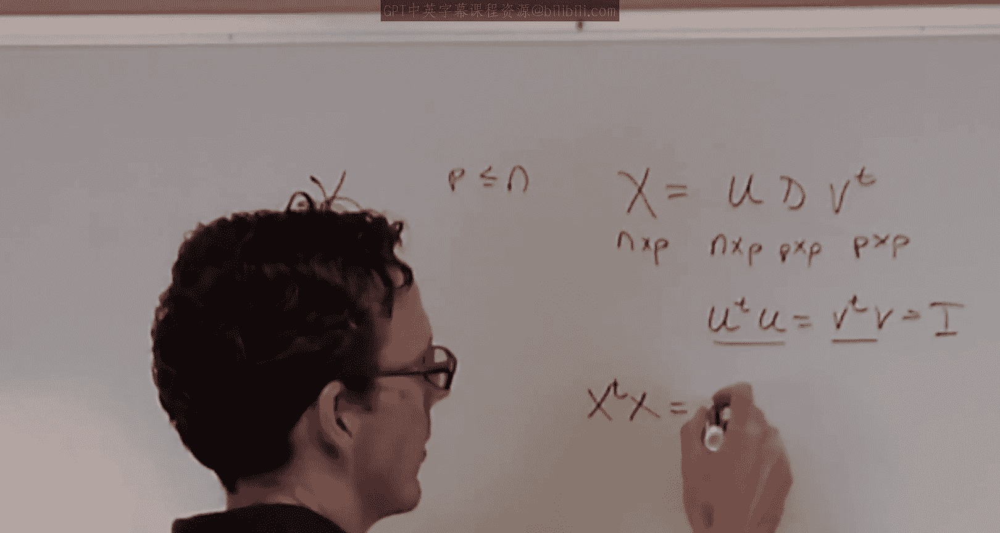
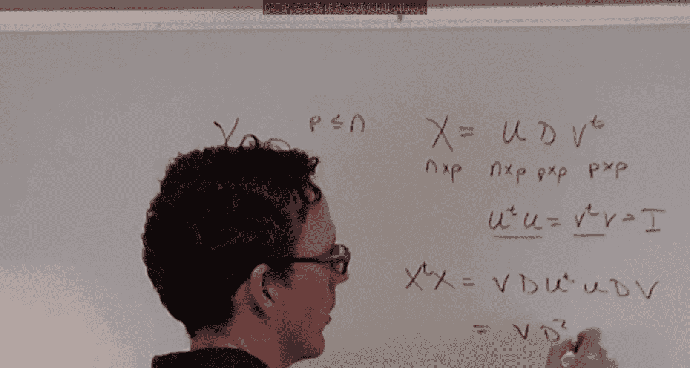
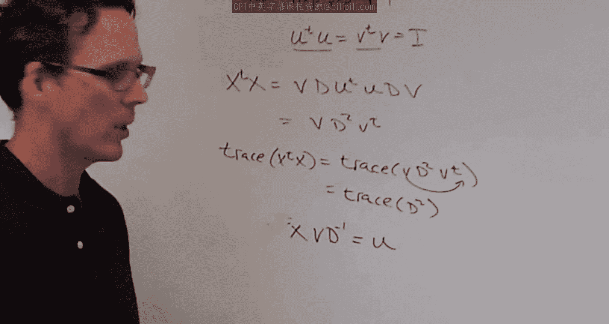
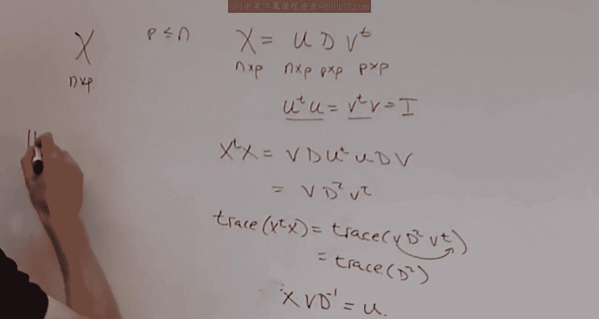

# 数据科学的高级统计：107：基函数3：奇异值分解 📊

在本节课中，我们将要学习另一种常见且重要的正交基实例：奇异值分解。我们将探讨如何利用SVD来处理高维数据，并理解其在降维和回归分析中的应用。

---

## 正交基的另一个实例

上一节我们介绍了正交基的概念，本节中我们来看看另一个频繁出现的正交基实例。

假设我们的数据矩阵 **X** 是 `n` 行 `p` 列，并且 `p` 小于或等于 `n`。现在，想象一下我们拥有大量的观测记录，即 `n` 很大，同时变量 `p` 也很大。我们希望找到一种方法来降低 **X** 的维度，使其更易于处理。

---

## 奇异值分解

考虑对矩阵 **X** 进行奇异值分解。假设 **X** 是 `n x p` 的满列秩矩阵。我们可以将其分解为以下形式：

**X = U D Vᵀ**

其中：
*   **U** 是一个 `n x p` 的矩阵。
*   **D** 是一个 `p x p` 的对角矩阵，其对角线元素是奇异值。
*   **Vᵀ** 是一个 `p x p` 的矩阵。

这些矩阵满足正交性条件：**UᵀU = VᵀV = I**，其中 **I** 是单位矩阵。

---

## 与协方差矩阵的联系

现在，我们暂时假设矩阵 **X** 已经过中心化处理，即其每一列的均值都为零。考虑 **XᵀX**，这实质上就是 **X** 矩阵的方差-协方差矩阵（忽略 `n-1` 的系数）。

利用SVD的结果，我们可以得到：

**XᵀX = (U D Vᵀ)ᵀ (U D Vᵀ) = V D Uᵀ U D Vᵀ = V D² Vᵀ**

由此可见，**XᵀX** 的特征值分解与 **X** 本身的奇异值分解密切相关。**D²** 中的元素（即奇异值的平方）就是 **XᵀX** 特征值分解中的特征值。

---

## 解释方差

这些特征值（或奇异值的平方）有助于总结 **XᵀX** 矩阵（即协方差矩阵）中的方差信息。它们通常按降序排列，第一个值最大，第二个次之，依此类推。

考虑矩阵 **XᵀX** 的迹（trace），它等于其对角线元素（即各个变量的方差）之和。利用上述分解，我们可以得到：

`trace(XᵀX) = trace(V D² Vᵀ) = trace(D²) = Σ dᵢ²`

这意味着，特征值之和代表了数据的总变异性。因此，我们可以通过检查前几个最大的特征值所解释的方差比例来进行降维。

以下是降维的基本思路：
1.  计算奇异值分解。
2.  检查前 `k` 个（例如前3个）奇异值所解释的方差占总方差的比例。
3.  如果这个比例很高（例如90%），我们就可以考虑仅使用这前 `k` 个成分来近似表示原始数据 **X**。

---

## 主成分得分与回归

那么，如何具体实现降维并用于回归分析呢？注意到以下关系：

**Vᵀ X = D Uᵀ**，进而可得 **U = X V D⁻¹**

矩阵 **V** 的列向量（右奇异向量）定义了如何线性组合 **X** 的列以得到主成分得分（即 **U** 的列）。**D⁻¹** 的作用类似于标准化，除以了奇异值（可视为标准差）。

如果我们取 **V** 的前 `k` 列（对应最大的 `k` 个奇异值），并相应地取 **U** 的前 `k` 列，我们就得到了降维后的主成分得分矩阵 **Uₖ**。

现在，我们可以尝试用这个新的设计矩阵 **Uₖ** 来拟合回归模型：

最小化：`|| Y - Uₖ γ ||²`

由于 **U**（以及其子集 **Uₖ**）是正交的，根据正交基回归的结论，系数 **γ** 的估计会变得非常简单：

**γ̂ = Uₖᵀ Y**

---

## 总结与注意事项

本节课中我们一起学习了如何利用奇异值分解为数据矩阵 **X** 构建一个正交基，并应用于主成分回归。

这种方法的核心优势在于，当设计矩阵正交时，回归系数的求解变得极其简单。它特别适用于变量众多（`p` 很大）且我们希望进行降维和摘要的场景。

然而，有一个重要的注意事项需要牢记：**U** 中的得分是 **X** 各列的线性组合。如果 **X** 中不同列的单位或量纲差异很大，或者组合起来没有实际意义，那么这些主成分得分的可解释性可能会很差。在这种情况下，直接应用此方法需格外谨慎。若想深入了解，建议学习多元统计相关课程。

---

接下来，我们将通过一个编程示例来具体演示这些概念的应用。