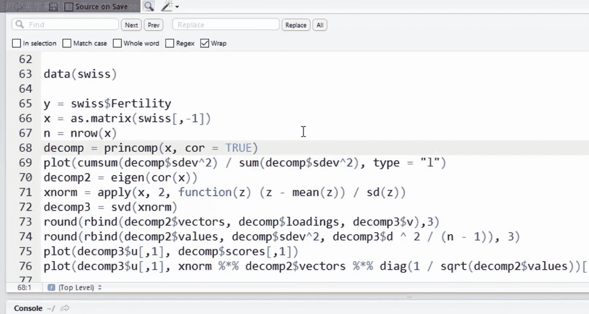
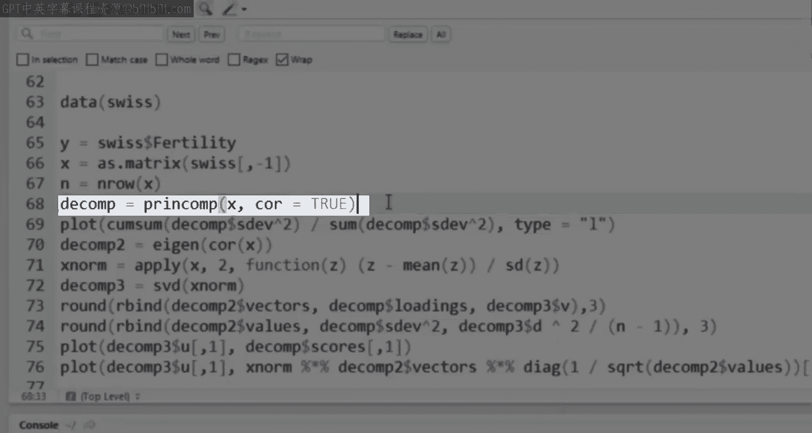
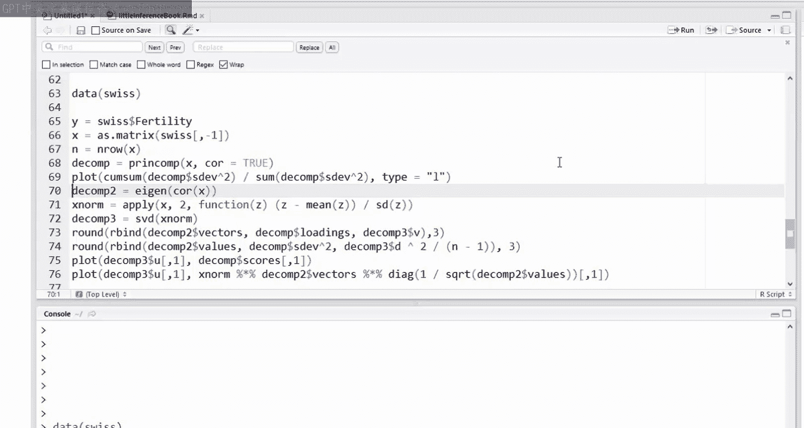
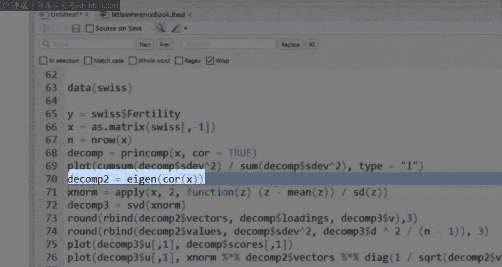
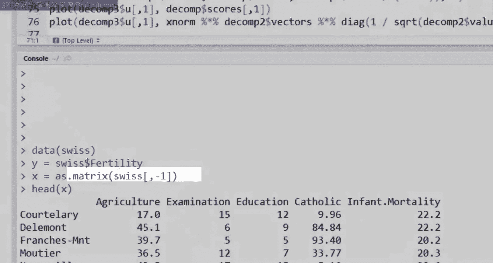
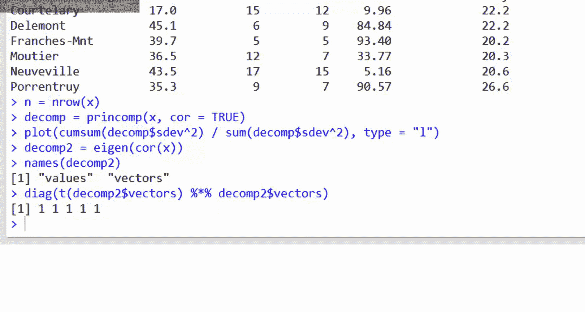
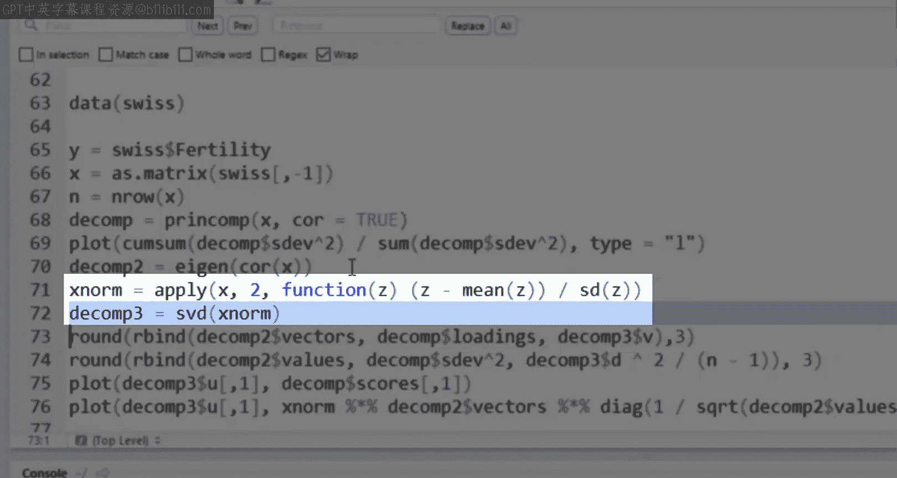
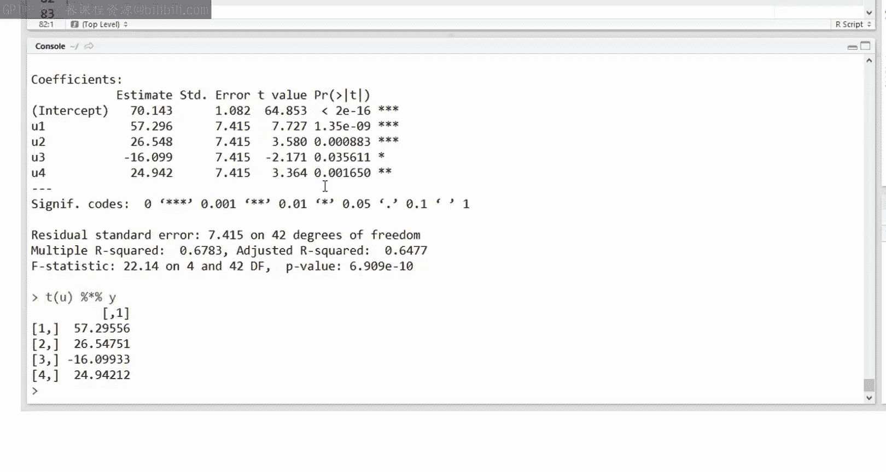

# 约翰霍普金斯大学《数据科学的高级统计｜Advanced Statistics for Data Science》中英字幕（deepseek p108 34_基函数编程示例.zh_en -BV1htPjeYEFH_p108-

Okay， so let's work through some examples with using。Mattrix decomposition。

 So I'm going to use the Swiss data set。And I'm going to define find my Y is fertility。

And I'm going to define my x is everything in this matrix except the fertility。

 so just let's look at head。Of X， and you can see it has agriculture examination， education。

 Catholic and infant mortality。Let me just for convenience divine and is the number of row of eggs。

So probably the easiest way to get at these things is to do so called principal components。

 there is a print comp function in R。

The print comp function。s I'm putting core equals true here and the reason is because these the I'm not so sure about the units of these measurements。

 and so I want them to be comparable so if we do a decomposition on the correlation matrix。

 that's a little bit more comparable cross variables than a raw decomposition So for example。

 if I were to plot the cumulative cumulative eigenvalues。

Versus the cumulative sum of the eigenvalues versus their overall sum。

 That's the percentage of variation explained by that component。 So one component。

 one principal component explains just under 60% of the variation in the data。

 two principal components。 So that's including the first in the second principal component explains over 70% of the variation。

3 principal components almost explains 90% of the variation，4 explains close to。Close to 100%。

 and then five explains 100% because five at that point is just a reorganization of the matrixtri X。

So let me just show you， so remember that our。ThePal components is the decomposition of the correlation matrix。

 In this case， it's either the correlation matrix or the covariance matrix。 In this case， again。

 we did the correlation matrix just to get rid of the units of the variables。

 So we could do it directly by。

Taking decomp by taking eigen of the correlation matrix。 So coreva here。

Just calculates the correlation matrix of x。 So a 5 by 5 matrix in this case。

 an eigen just calculates the eigenvalue decomposition of that。 So if I look at， for example。

 names decom 2， it gives me my values and my vectors。 So， for example， if I were to do dig of。

Dcom。Decomp 2。嗯。You see the transpose of this。Factors。Times。Decomp 2。So， if I take the。

V transpose V that should just give me a vector ones okay so that's just saying that v transpose V。

 the diagonal of that is ones we know that all the off diagonals are zero。

 that's just reminding us that V transpose V that V is an ortho normalormal basis for R5 in this case。

So another way to do exactly the same thing is through the singular value decomposition first we need to normalize our columns。

 so here I just go over the columns and replace them with their normalized values。

 subtract it off the mean and divided by the standard deviation and then I directly take the singular value decomposition now decom 3 is the singular decom was the principal component decomposition decom 2 was the eigenvalue decomposition of the correlation matrix and decom 3 was the singular value decomposition of the normalized x matrix so decom 3 let me show you the names and variables it returns。

So it decom 3 gives me three variables。 D， the singular values， U， the left hand。

 left singular vectors， V， the right singular vectors。

 So just to show you that these are all getting at the same thing， let me combine the。嗯。

Eigenvectors from the eigenvalue decomposition of the correlation matrix and I'll do it with what are called the loadings from the print comp function。

 and then I'll do it I'll also grab what is the V matrix from the singular value decomposition。

And here are those three。Quantities， notice， like take， for example， this first column， comp 1。

 Com 2， Com 3， Com 4。05240。258 and so on， okay， then if I go down to the output from printcom， 0。

524 0。258 negative 0。003， there's no reason， by the way that the signs should have to agree in this case。

 I think we're just fortunate that we did because they're using underlying the same exact numerical libraries。

 but there's no reason that there's a sign imvariance to all these decompositions。And then。

 of course， the singular value decomposition gives us the same things。

 And then if we go through the second row。It's the same thing again。Okay。

 so what we see is that the three。The three different approaches are giving us the same V matrix。

And then if I were to plot my eigenvalues。Okay， here's the first row are the eigenvalues。

 the eigenvalues from the。Eigenvalue decomposition of the correlation matrix。

 The second one are the eigenvalues。From the print comp function that it calls those standard deviations。

 so we have to square them to get the eigenvalues this。

And then the third one are the squared singular vectors。 Now， I had to divide by n -1。

Because remember， there was this idea that when I wrote the formulas up on the board。

 I was omitting that one over n minus1。Now let's look at the scores so I'm going to take the singular value decomposition scores and plot them versus the scores from the printcom function and if you look of course they perfectly agree now notice the scale is off here and again that's that n minus1 factor that when we take the correlation it's divided by n minus1 whereas when we just take x transpose x we have not divided by n minus1 so it's off by that's what's representing this change in scale。

 The other thing is we could manually calculate the u matrix from the eigenvalue decomposition of the correlation matrix so we need to take the normalized x factor。

 multiply it times the eigenvectors from that decomposition and then multiply it times1 over the score root of the eigenvalues。

And。There again， we see that they just agree if you look at the plot。

Now let's show you how you might use these things， let's just take the singular vectors from the singular value decomposition and I'm going to just take。

 let's say the first four of them so I've omitted one variable。Okay。

 and I'm going to try doing a linear model with my y with my U as my set of predictors and look at the r squared。

OkayIt's about 70%。 And then I'm going to compare that to the linear model using all the x's。

 which in this case gives me about 70% as well。 So by virtue of removing that extra variable。

 we have。liminated you know we have basically found the linear combination of our regressors that retains the most amount of variability in our x's。

 and so we can remove a reggressor and still have just about the same amount of variation explained in our Y。

And then the last thing I want to show you is。So if I were to do summary。L。Why till the you。Okay。

 we see these estimates 70， 57， 26， native 16，24， because U is ortho the normalmal， I can just do。

Tea of you。Star y， and that should give me the same things，57，26， name 1624。 In this case。

 the intercept is taken care of。In。In in you， because it's orthogonal to the， to the intercepts。

 we'd centered the acts before we had。Before we had done anything。At any rate。

 that's how we start using principal component decompositions and more than anything I know this is probably a little bit far along relative to where the class should be at this point。

 more than anything， what I'd like to have for people to have gotten out of these series of lectures is how convenient things kind of work out when we have ortho theormal bases in linear regression。

And how nice the calculations are， and then second in specific I hope you might sum a little bit of the language of singular value decompositions and principal component decompositions will have rubbedbb off in you and also to show you via the computing that none of this stuff is magical。

 the printcom function is just a collection of singular and eigenvalue decompositions that we could do manually and the printcom function just makes it a little bit easier。

Okay， so we're looking forward to seeing you in the next class。

