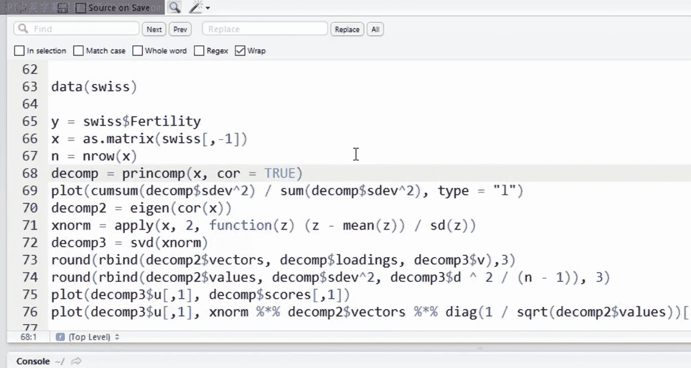
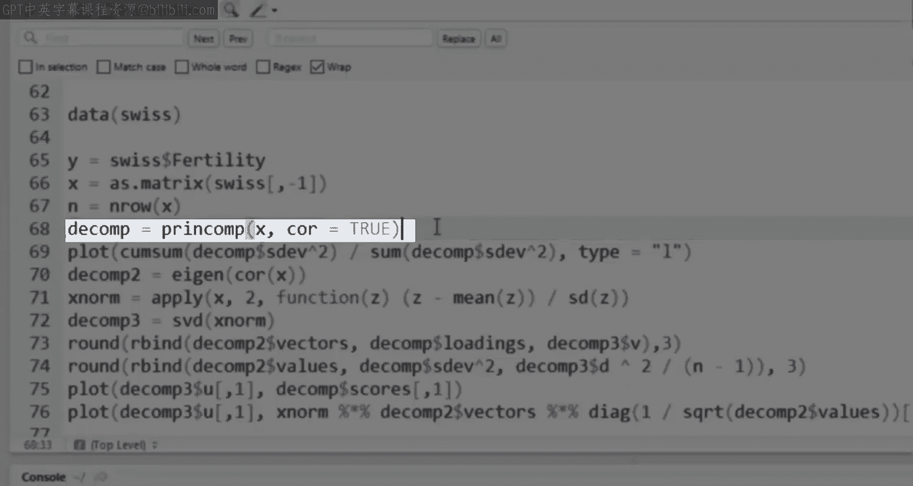
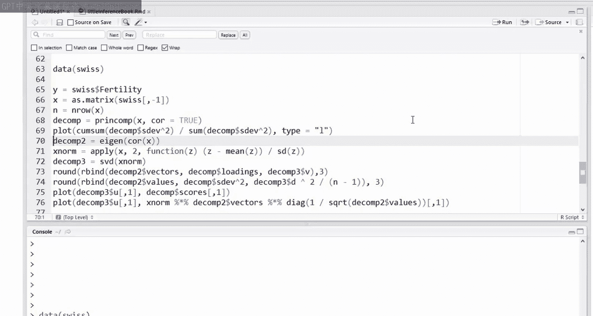
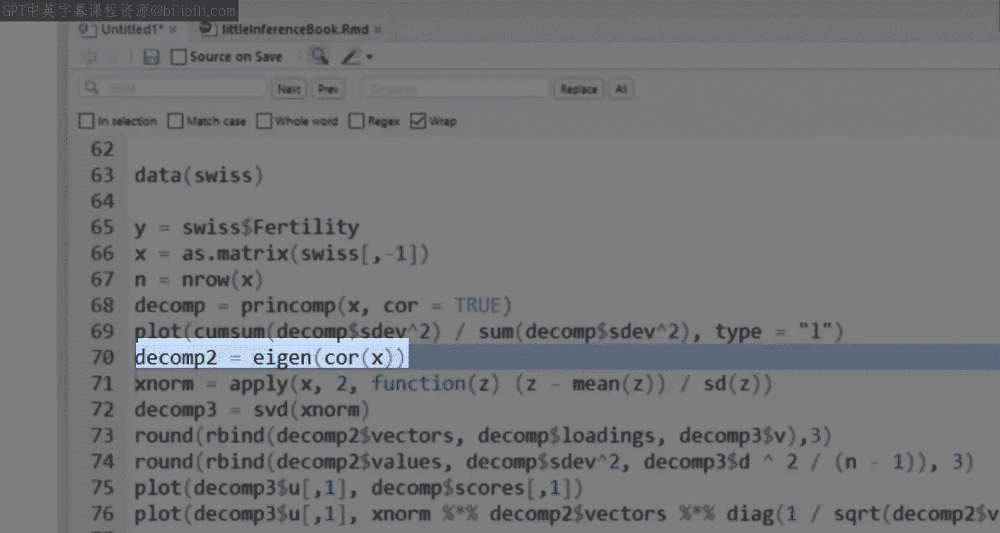
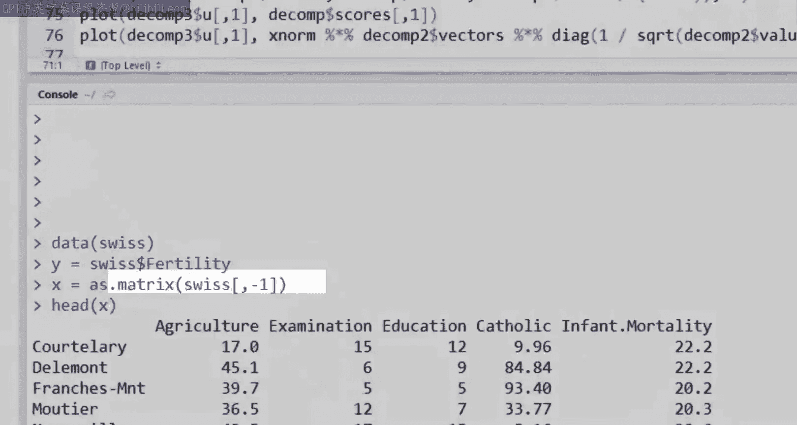
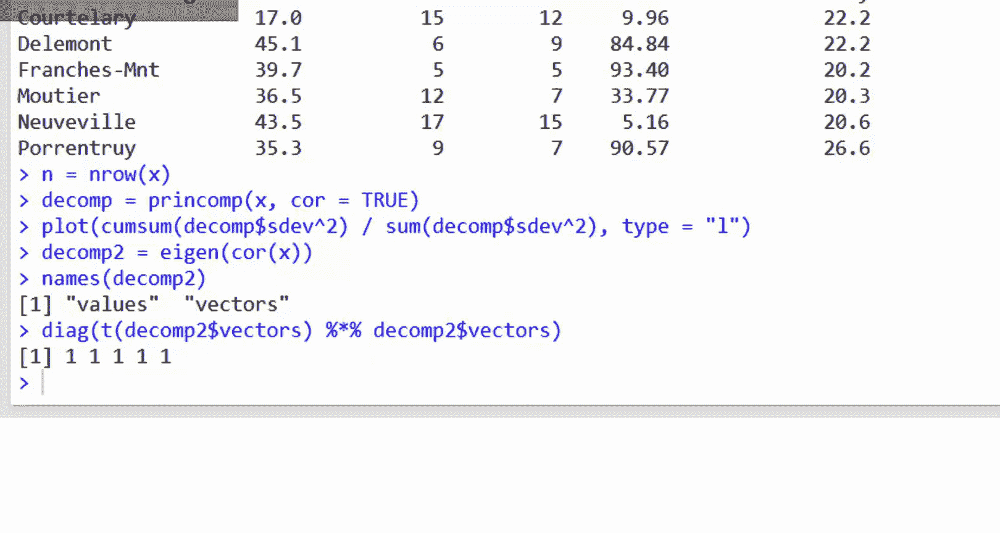
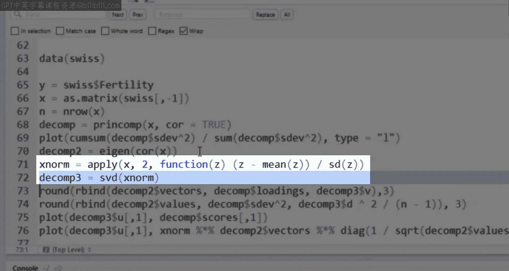
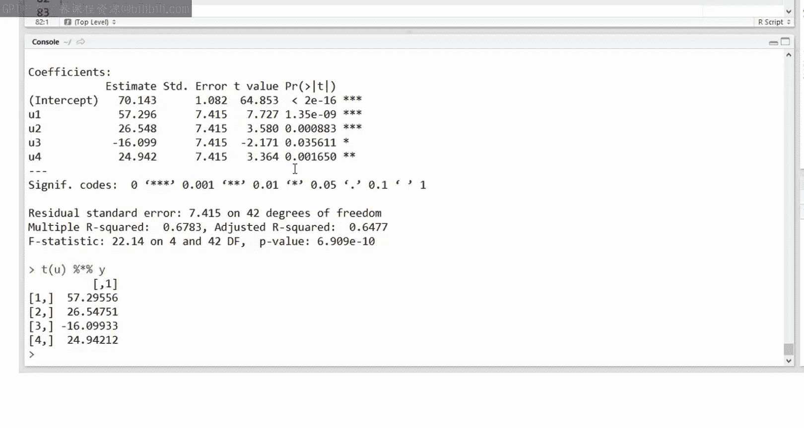

# 高级统计：第34讲：基函数编程示例 🧮

在本节课中，我们将通过一个具体的编程示例，学习如何使用矩阵分解技术，特别是主成分分析（PCA）。我们将使用R语言和瑞士数据集，演示如何执行PCA，并解释其结果。

## 概述



我们将使用瑞士数据集，以生育率（Fertility）作为响应变量Y，其他变量（农业、考试、教育、天主教徒、婴儿死亡率）作为预测变量矩阵X。我们将通过三种不同的方法计算主成分：`prcomp`函数、相关矩阵的特征值分解以及奇异值分解（SVD），并验证它们的一致性。最后，我们将展示如何使用主成分进行回归分析。

## 数据准备与初步分析



首先，我们加载数据并定义变量。Y是数据集的`Fertility`列。X是包含其他所有预测变量的矩阵。

```r
# 假设数据已加载为swiss
Y <- swiss$Fertility
X <- as.matrix(swiss[, -1]) # 排除Fertility列
n <- nrow(X)
```

查看X的前几行，确认其包含农业（Agriculture）、考试（Examination）、教育（Education）、天主教徒（Catholic）和婴儿死亡率（Infant.Mortality）这些变量。

## 使用prcomp函数进行主成分分析



最简便的方法是使用R内置的`prcomp`函数。为了确保不同量纲的变量具有可比性，我们使用相关矩阵而非协方差矩阵进行计算。

```r
pca_prcomp <- prcomp(X, scale. = TRUE)
```





我们可以绘制累积特征值图，以查看每个主成分解释的方差比例。

```r
# 计算累积解释方差比例
cumulative_variance <- cumsum(pca_prcomp$sdev^2) / sum(pca_prcomp$sdev^2)
plot(cumulative_variance, type="b", xlab="主成分数量", ylab="累积解释方差比例")
```

结果显示，第一个主成分解释了接近60%的方差，前两个主成分解释了超过70%，前三个解释了近90%，而四个主成分就解释了接近100%的方差。第五个成分解释100%，因为它只是对原始5维空间的一个重组。

## 通过相关矩阵的特征值分解进行PCA



我们也可以直接对相关矩阵进行特征值分解来实现PCA。这能让我们更深入地理解其数学原理。



```r
# 计算X的相关矩阵
cor_matrix <- cor(X)
# 对相关矩阵进行特征值分解
eigen_decomp <- eigen(cor_matrix)
```

分解结果包含特征值（`eigen_decomp$values`）和特征向量（`eigen_decomp$vectors`）。特征向量矩阵V是标准正交的，即满足 **V^T V = I**。

## 通过奇异值分解（SVD）进行PCA

第三种方法是对标准化后的X矩阵直接进行奇异值分解。首先需要将X的每一列标准化（减去均值，除以标准差）。

```r
# 标准化X
X_scaled <- scale(X)
# 进行奇异值分解
svd_decomp <- svd(X_scaled)
```

SVD返回三个矩阵：奇异值向量`d`、左奇异向量矩阵`U`和右奇异向量矩阵`V`。

## 验证三种方法的一致性

上一节我们介绍了三种计算主成分的途径。现在，我们来验证它们是否得到相同的结果。

以下是关键的一致性检查步骤：

1.  **比较特征向量/载荷**：`prcomp`的`rotation`矩阵、特征值分解的`vectors`以及SVD的`v`矩阵，它们应代表相同的方向（可能符号相反）。
2.  **比较特征值/奇异值**：`prcomp`的`sdev^2`、特征值分解的`values`以及SVD的`d^2/(n-1)`应相等。
3.  **比较主成分得分**：`prcomp`的`x`矩阵与通过`X_scaled %*% V`计算出的得分应成比例。

通过绘图和数值比较，我们可以确认这三种方法在数学上是等价的，只是`prcomp`函数封装了这些操作，使用起来更为方便。

## 在主成分回归中的应用

了解了如何提取主成分后，本节我们来看看如何将其用于回归分析，即主成分回归（PCR）。

我们使用SVD得到的左奇异向量矩阵`U`的前四列作为新的预测变量。这意味着我们使用了四个主成分，舍弃了信息量最少的一个成分。

```r
# 使用前4个主成分（U的前4列）进行回归
U_reduced <- svd_decomp$u[, 1:4]
model_pcr <- lm(Y ~ U_reduced)
summary(model_pcr)$r.squared
```

该模型的R平方约为70%。现在，我们将其与使用所有原始预测变量X的线性模型进行比较。

```r
# 使用所有原始变量进行回归
model_full <- lm(Y ~ X)
summary(model_full)$r.squared
```

完整模型的R平方也约为70%。这个结果表明，通过移除信息量最少的主成分（即一个变量），我们找到了能保留X中最多变异性的线性组合。因此，在减少一个预测变量的情况下，我们仍然能够解释响应变量Y中几乎相同比例的变异。

此外，由于U是标准正交的，回归系数可以通过一个更简单的公式计算：**U^T Y**。这与通过`lm`函数得到的结果一致（截距项因数据已中心化而被处理）。

## 总结

本节课中，我们一起学习了矩阵分解在数据科学中的实际应用。我们通过瑞士数据集的例子，演示了：
1.  使用`prcomp`函数、特征值分解和奇异值分解三种方法进行主成分分析。
2.  验证了这些方法在数学上的一致性。
3.  实践了如何将主成分用于回归分析（PCR），并观察到在减少变量后仍能保持相近的解释力。



更重要的是，本讲旨在展示当我们在线性回归中使用标准正交基时，计算会变得非常简洁和优雅。同时，希望大家能熟悉奇异值分解和主成分分析的基本概念与语言，并认识到`prcomp`这类函数背后并无“魔法”，它们只是对我们能手动完成的矩阵分解进行了便捷的封装。