# 约翰霍普金斯大学《数据科学的高级统计｜Advanced Statistics for Data Science》中英字幕（deepseek p109 35_残差分析导论.zh_en -BV1htPjeYEFH_p109-

In this lecture， we're going to talk about residuals， which we usually label by E。

 our residuals are defined as y minus y hat， where our Y hat is the hat matrix。Times y。

 where the hat matrix is defined as x。X transpose x inverse， x transpose。 So it's。

The hat matrix is a very useful matrix。 We'll talk about that a lot more as the course progresses。

 We can factor the y out and get I minus H of x。

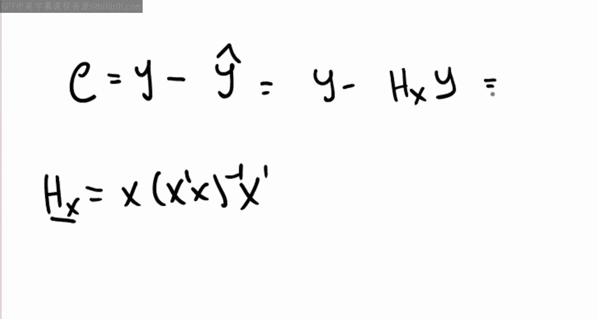

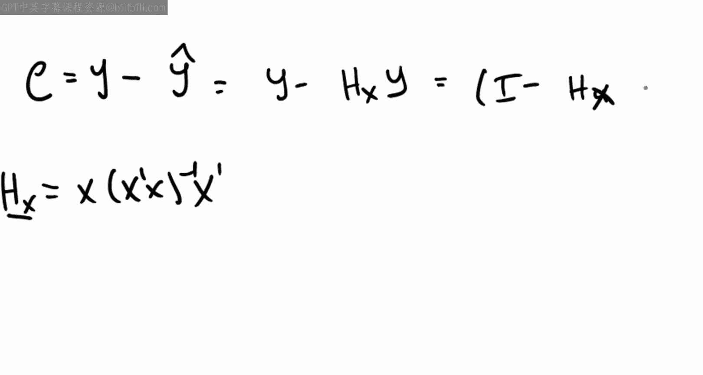

Times y。Let's talk a little bit about the residuals。 So first of all。

 remember if our Y was an element of R 3。 So some point in R 3 and our space gamma X was in a matrix of full column rank。

 that's 3 by 2。 and our gamma was。

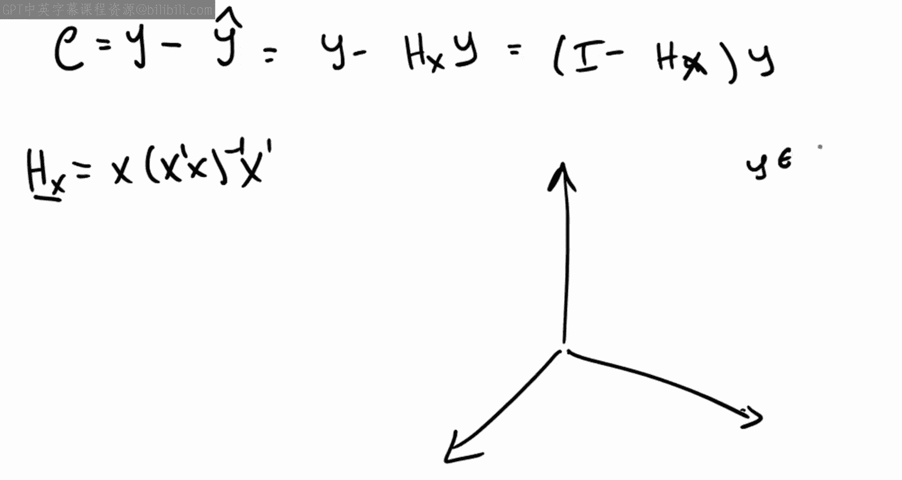

The upper case gamma was the set of elements x beta， such the beta is in R2。

So we could draw gamma as a two dimensional plane cutting through our three dimensional space。

 so why hat？Was the projection of y onto that space。 So here's Y there's Y hat。

 the residual E is merely the difference。So you can see， I didn't maybe draw this the best。

We see they can get it better。Version of it。 this is E。So you can see that E， if we move it around。

E should be orthogonal to every other point in gamma。 In other words。

 that E should be orthogonal to any point。 That's a linear combination of the columns of x。

 We can see that very clearly because if we take E transpose times some point。

 that's a linear combination of the columns of x。 So x times lowercase gamma or gamma is any element of R2。

 Okay， that is y transpose I minus H of x transpose。

 which is just h of x because that matrix is symmetric times。

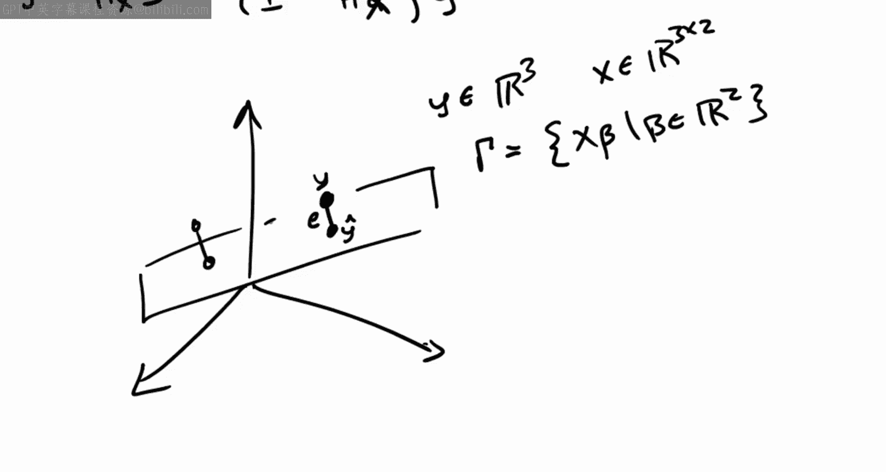

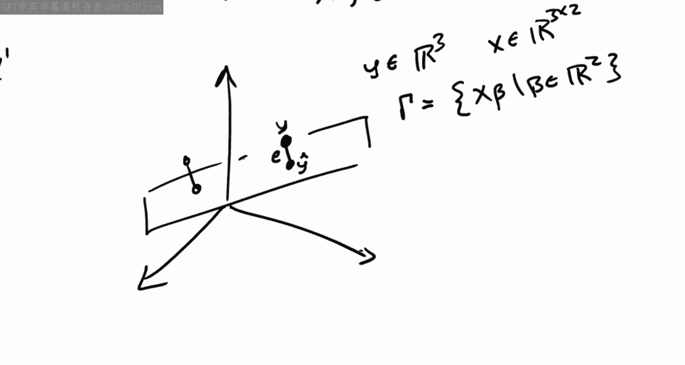

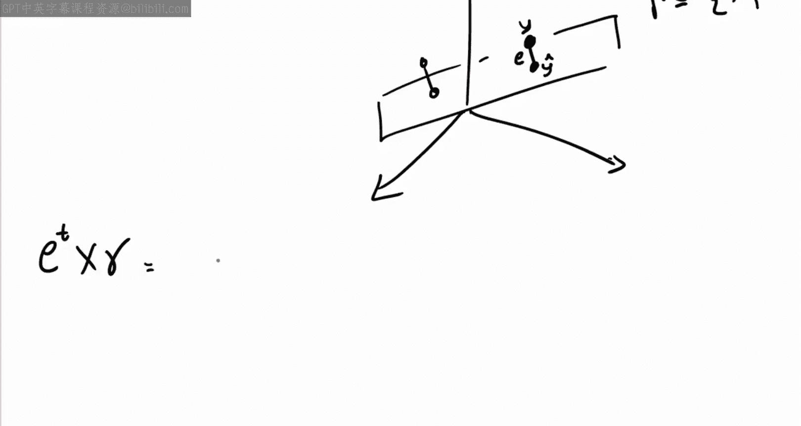

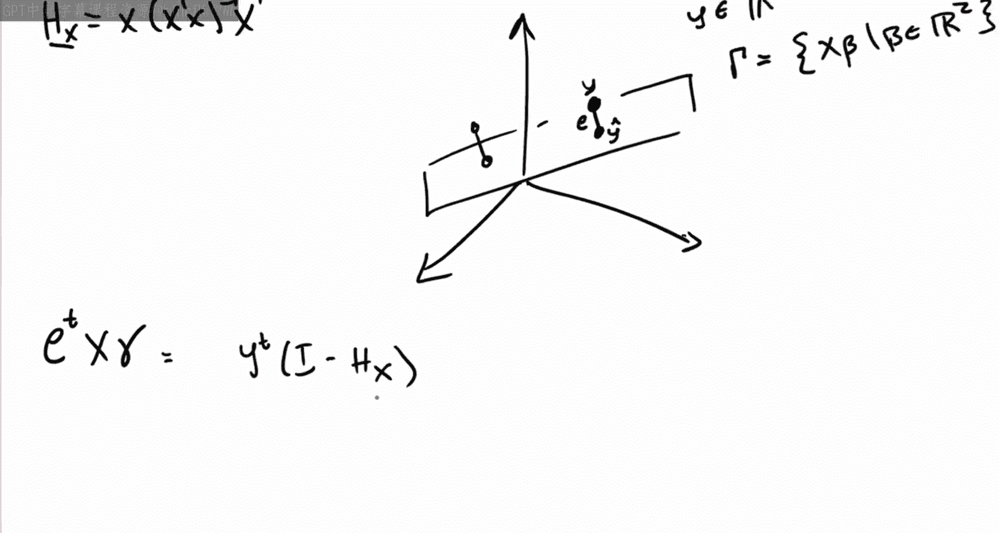

X gamma。Okay， so let me just write over here that H of x times x is x x transpose x inverse x transpose then times x again。

So x transpose x times x transpose x inverse is just I， so H of x times x is just x。Okay。

 so this is equal to y transpose x minus h of x times x times gamma， but h of x times x is just。X。

 so we get x minus x， plus at0， reminding us that E is orthogonal to any other element of the space uppercase gamma。

 which is any other element that is a linear combination of the columns of x。

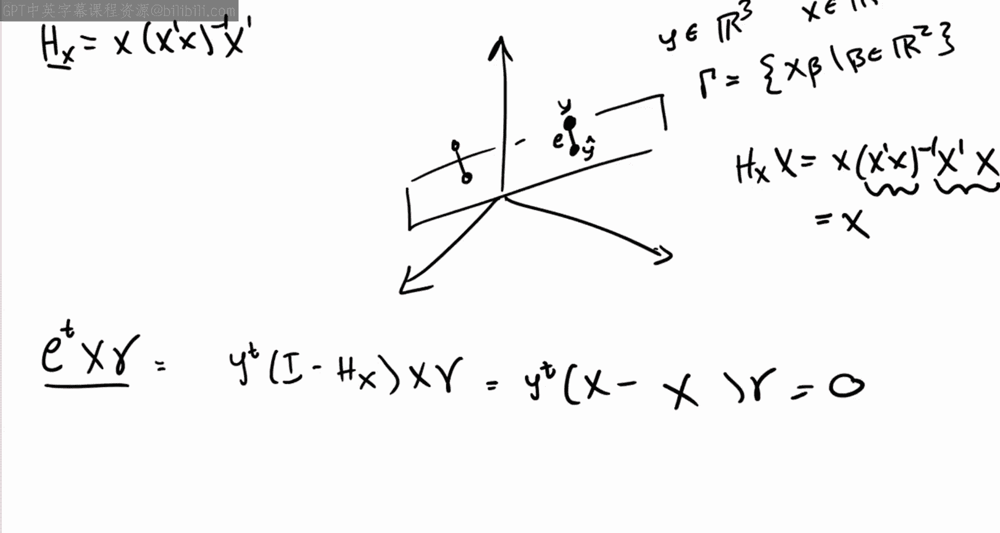

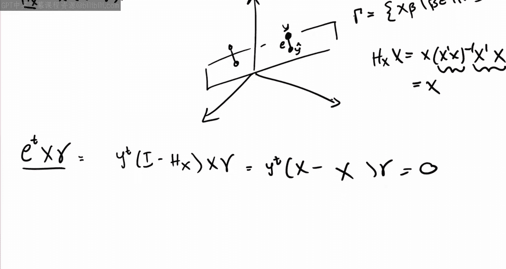

Another。

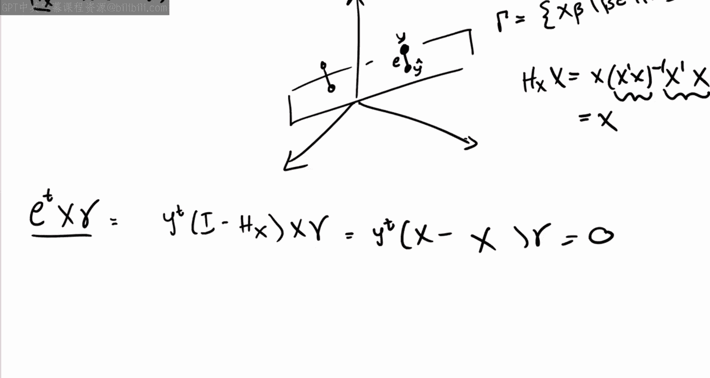

Interesting fact about E。Is that if x contains an intercept。

 then the vector 1 is in the column space of our residuals so that e transpose times Jn is equal to I'm sorry。

 if our x contains an intercept， then the vector J N is in the column space of x。

 therefore it is accommodate a linear combination of the columns of x。 Therefore。

 e transpose Jn equals 0。 or in other words， if we have an intercept among our regressors。

 both the sum and the mean of our residuals will be 0。 Finally。

 I would look at the some of the squared residuals， which is e transpose E。

That is gonna be Y transpose I minus H of x。I minus H of x。Times y。

But notice that if you take H of x and multiply it times H of x， that's equal to x。

 x transpose x inverse， x transpose X x transpose X inverse x transpose。 So this cancels with that。

 and we get x x transpose x inverse x transpose or H of x again。 So H of x is item potent。

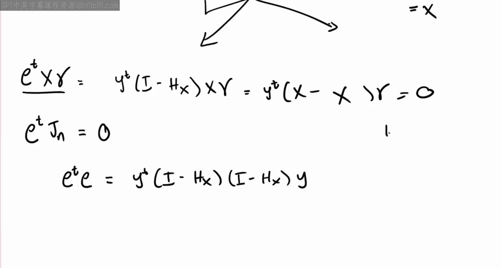

Okay， so if we were to multiply this out， we'd get y transpose I minus h of x。

So that's the I times the I gives us this I right here， H of x times I gives us that one right here。

 this I times that h of x gives us another minus h of x。

 and then H of x times H of x gives us one more H of x。

So we have minus H of x minus H of x plus H of x。 so we could just write all this。Ass minus H of x。

And so we see that this matrix itself， I minus H of x， I minus the hat matrix is also item potent。

 but at any rate the。

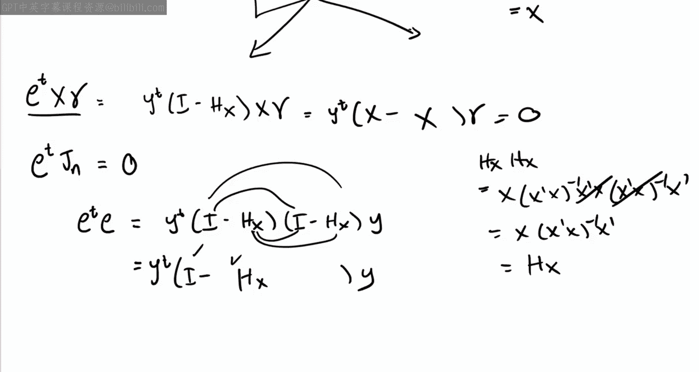

The sum of the squared residuals works out to be a quadratic form with the Y on the outside。And。

I minus H of x on the interior will use this quantity to define。

Things like estimates of the residual variance for the time being。

 I would just like you to know that the residuals are by definition， Y minus y hat。

 They take the form given by I minus H of x times y。

And that they're orthogonal to every other linear combination of the columns of x。

 we'll talk a lot more about residuals and all the different variations of the residuals later on in the class。

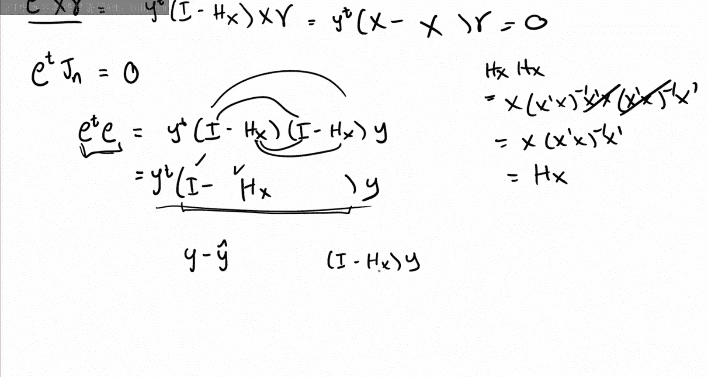