# 约翰霍普金斯大学《数据科学的高级统计｜Advanced Statistics for Data Science》中英字幕（deepseek p11 10_随机向量与独立性.zh_en -BV1htPjeYEFH_p11-

Hi， my name is Brian Kaho， I'm in the Department of Biosstatistics at the Johns Hopkins Bloomberg School of Public Health。

 and this is Mathematical Biosstatistics Boot Camp Leture 4。

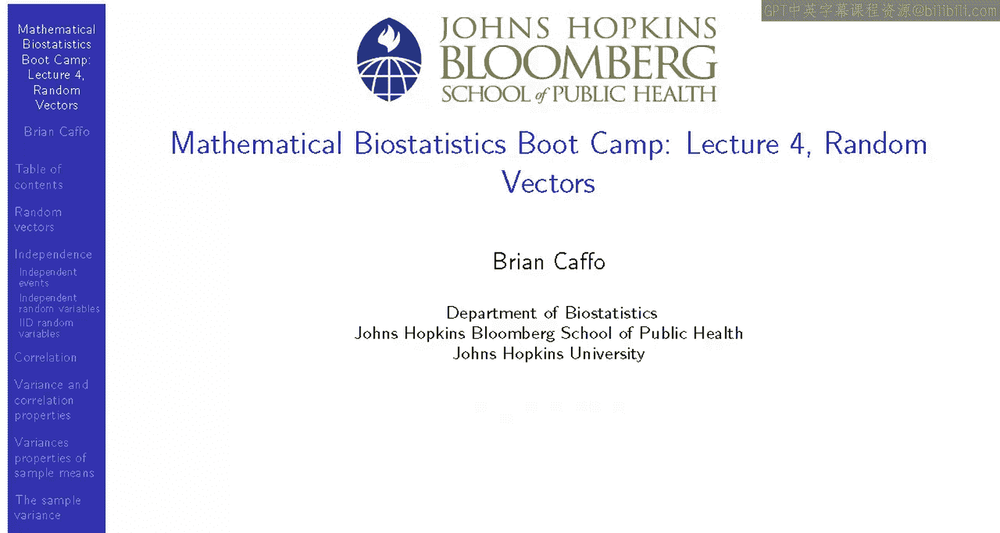

Today we're going to talk about random vectors and independence In is a key ingredient in simplifying statistical models。

 independence is a useful assumption and we frequently use it in statistics to get a handle on complex phenomenon in addition we'll find that independence and identically distributed random variables are going to be our canonical model for what we might think of as a random sample。

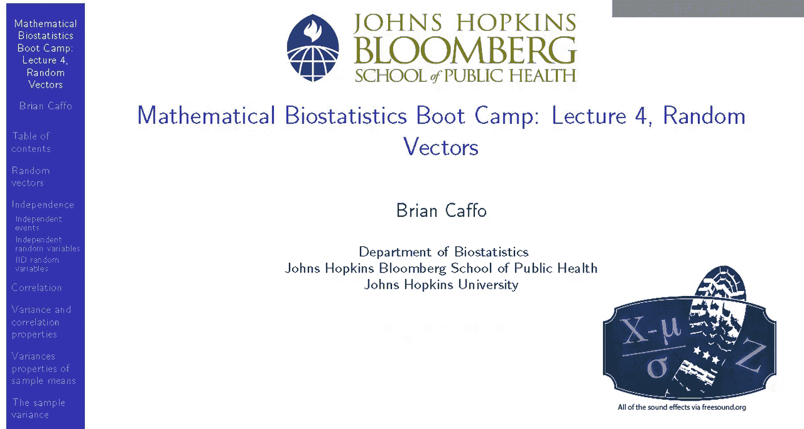

So let's just briefly talk about what we're going to cover today， random vectors。

 which are simple collections of random variables， then we'll talk about independence and you probably have a rough idea of what is meant by independence to begin with。

 but we're going to talk about the mathematical formalism a little bit。

We'll talk about correlation and then go over various mathematical properties of the correlation and covariance operators。

 and then we'll use our facts about independence and variance and correlation to talk about properties of the sample mean and then we'll cover the sample variance end with some discussion。

This lecture is actually one of the hardest things in all of statistics I think if you can kind of understand this lecture you've understood what the goal of probability modeling and this kind of population modeling really is。

 you might want to consider listening to it over and over again。

And it's incredibly difficult concepts until you internalize them and then once you internalize them。

 they seem simple， so what I'm hoping in this lecture do is to help you internalize them。

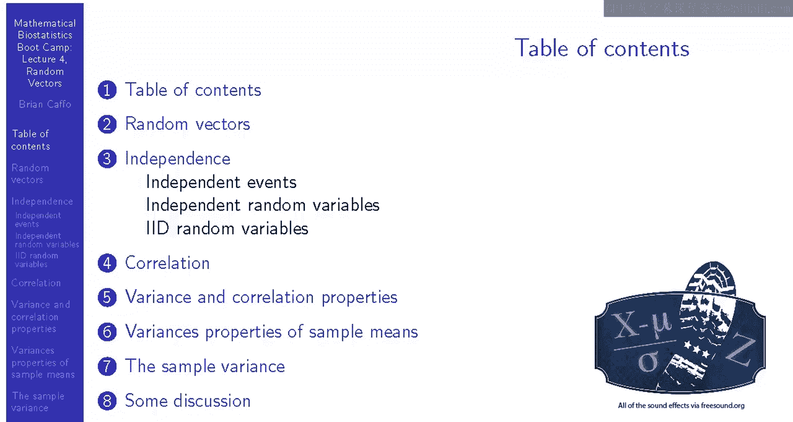

Okay。So random vector is nothing other than an ordinary vector with random variables as its entries。

 so if you have x and y as random variables， then simply the ordered collection x comma y is a random vector。

So just like。Individual random variables have densities and mass functions or distributions that govern their probabilistic behavior。

 random vectors have joint densities and joint mass functions and joint distribution functions that govern their probabilistic behavior。

 Let's just simply talk about densities in mass functions to begin with a joint density F of x comma Y。

First of all it has to satisfy that it's positive everywhere， it's the two dimensional random vector。

 so this surface F exists on the two dimensional plane and the fact that F is greater than zero suggests that its height everywhere is above the horizontal plane。

And it has to integrate to one， but when you integrate over the whole Xy plane。

 so the z direction has to be greater than0 and the integral over the Xy plane has to be1。

 so it's a direct extension of the ordinary one dimensional probability density function and I think from this definition you should probably be able to guess what the definition of a joint density is for five n random variables and then for discrete random variables。

 let's say F now is a joint probability mass function。

Then the joint probability mass function F maps possible values of x and y here。

 so lower x and lowercase y are the possible combined values of x and Y。

Two probabilities so to satisfy the definition of being a joint probability mass function。

 f has to be bigger than zero for all possible combinations of x and Y。

 and then the sum over all possible combinations has to equal 1。By the way。

 the joint density function exactly works like a univariate density function in that in this case volumes under it。

 so integrals under it correspond to probabilities and so the total areas one and in the same case with the joint mass function。

 sums of collections of possible values of x and y yield the probability of that collection so for this class a general discussion of random vectors is probably too much so we're only going to focus on one specific kind of joint densities particularly manageable type and that's when the random variables x and y are independent and what we'll see is that for say a joint density or a joint mass function。

 if the random variables x and y are independent， then the joint density just factors into the product of the two individual densities。

 the f of x and G of y and basically this is what in mathematically independence does force us a lot。

Is it turns complicated multivariate structures into products。

We're going to use this fact a lot and we'll explain some of the intuition behind this。

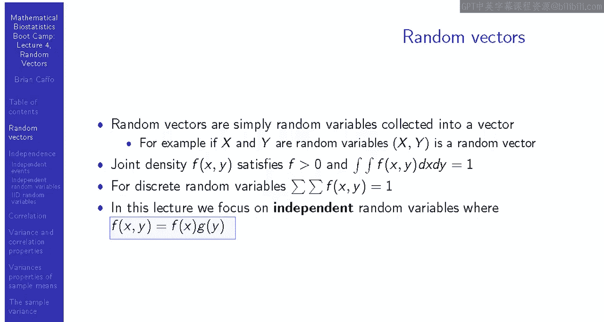

Thinking back to our early definitions of probability。

 we were discussing the sample space and events。Two events are independent if the probability of their intersection is equal to the product of their probabilities。

 so probability of a intersect B is probability of a times the probability of B so A and B are independent incidentdentally if this is true then A is independent of B complement B is independent of A complement and a complement is independent of B complement and the mathematical definition of independence is equivalent to our kind of intuition of what it means to be independent A is unrelated to B。

That's what the mathematical definition implies and we'll kind of get a better sense of that For two random variables。

 we would maybe define that they're independent if you have any two sets A and B that probably the x lies in a and y lies and B is the product of the probably the x lies in A regardless of what y is doing and probably that y lies in B regardless of what X is doing and so that's just simply a direct extension of the definition of independence above that I think probably everyone is maybe a little bit familiar with。

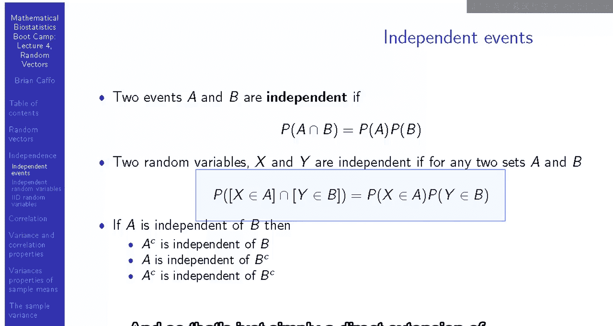

We automatically think of independence all the time already so if you were to ask nearly anyone who has a basic amount of mathematical training。

 what's the probability of getting two consecutive heads on two consecutive coin flips they would probably say okay well the probability of getting ahead on the first one is a half and the probability getting ahead on the second one is half so it's probably a quarter right well that is just an exact execution of the independence rule let a be the event that you get ahead on flip1 B be the event that you get ahead on F2 then basically what you're saying is you want the probability of the intersection ahead on F1 and two and so then the probability of that intersection is exactly the product of the probabilitybabilities via independence probability of a times the probability of B so 0。

5 times 0。5 which is 0。25 or a quarter。

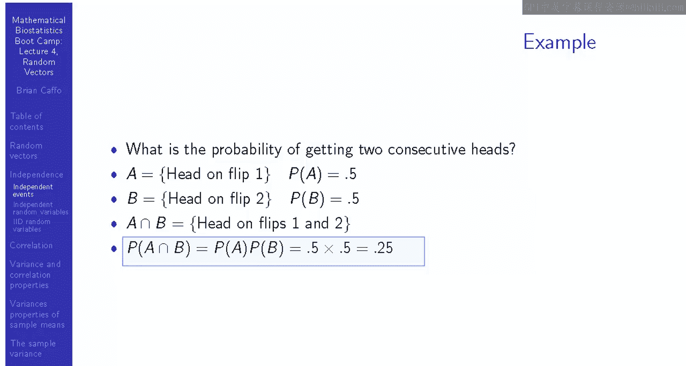

So we use independence all the time and you know the main consequence of independence is that probabilities of independent things multiply to obtain the probability of both occurring。

But this creates a problem in that people have then gone on to extend this rule to where they just multiply probabilities regardless of whether they're independent and this can lead to tragic consequences。

 here's a great example in science Vole 309， they report on a physician who gave expert testimony in a criminal trial。

And he was giving expert testimony on sudden infant death syndrome SiIDS。

 which is this tragic phenomenon where a baby dies， for example。

 in the middle of the night and no one exactly knows why。

So a woman was on trial because she had two consecutive children who died of SiIDS and there was a court case that then considered whether or not。

This was too unlikely to happen by chance and that there really wasn't SiidDs。

 it was something malicious on the part of the mother。

So the person who was testifying did the following calculation， the person said that well。

 the probability of SIDs is one out of 8，543。I'm not 100% clear where they got that number。

 but let's assume for the case that's correct， then the person giving the testimony said， well。

 then the probably that you have two SIidDs would be the product of that number twice or the square of that number。

 one over 8543 squared。Based on this evidence， the mother was convicted of murder。

 so what was this physician's mistake in this case？

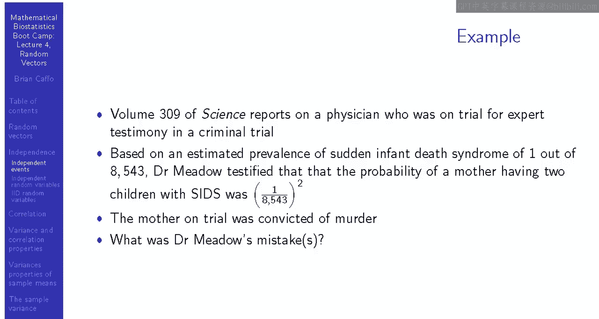

For the purpose of this class， there was actually quite a bit of discussion you could have over ethics。

Probability， evidence。And culpability based on this case。

 there's quite a collection of complicated issues that intersect when you're discussing a case like this。

 for example。Where and how does this probability of acidd come from， What's the evidence for it。

 How do you， you know， balance medical evidence when convicting a person or not convicting a person in a trial for the purpose of this class。

 Let's just simplify the discussion down to， is this。

Direct calculation warranted of simply multiplying this number twice， given that it's correct。 Well。

 if a1 is the event that the first child died of SiIDs and the A2 is the event that the second child did。

 then the inherent calculation that or the inherent assumption being made is that a1 is independent of A2 so that you can multiply probability of a1 times the probability A2。

 but this logic fails immediately， there's no reason to believe that the event of a second SiID is independent of the event of a first SiD。

 So in this case， and in many cases in biology， biological processes that have a genetic or familial component would tend to be dependent within family so you couldn't multiply the marginal probabilities to obtain the intersection。

Then there's other problems I outlined an example of one here with this estimate。

 the prevalence was obtained from an unpublished report on single cases and quite a bit of the discussion surrounding this case revolved around these and other issues。

 but the point I'm trying to make for the purposes of this class is you can't just go around multiplying probabilities Willy nilly the random variables or events that you're discussing have to actually be independent Okay。

 so。

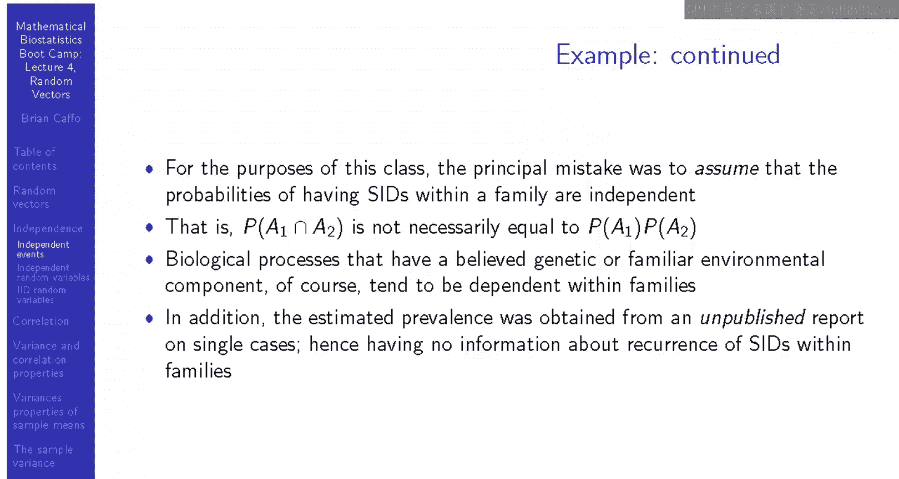

We'll use the following fact extensively in this class and we'll use it as a basic simplifying principle if we have a collection of random variables that are independent x1 up to XN。

Then the joint distribution of x1 to Xn or the joint density function is the product of the individual densities or mass functions。

So in other words， the density of f of x1 up to Xn is the product of the individual densities。

And here I have Fi。Of Xi indicating that every Xi could potentially have a different density。

 the most common model that we'll be dealing with is the instance where x1 x2 all the way up to Xn are from the same distribution and this particular case we would say that the X's are independent and identically distributed to independent being that x1 is independent from x2 and so on and identically distributed in that F1 is equal to F2 is equal to all the way up to FN IID samples are very important in the subject of statistics and the reason for that is because IID random variables are basic kind of default model for random samples if you have a collection of things that are in essence we believe exchangeable then we treat them as if they are IID。

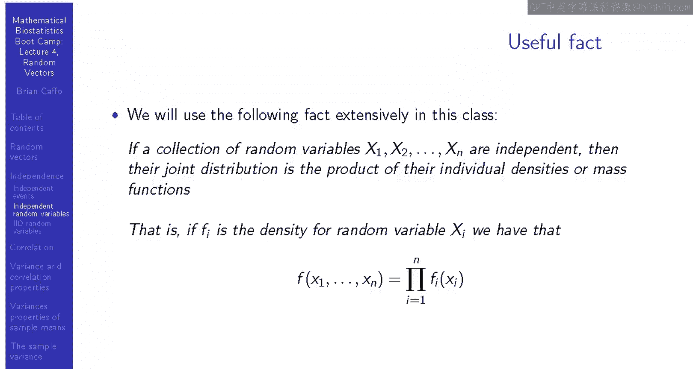

And many of the important theories of statistics are founded on the assumption that variables。

IIID so to give you an example of IID random samples imagine just simply rolling a die each role of a die is a draw from the uniform distribution on the numbers one to6 So when we say that a process when we model a process as if it's IID we're saying it's like we're rolling a die for each variable that we're modeling from some population level distribution I just want to comment on the broader discussion on probability modeling This is never actually the case right it's probably a very good model for rolling a die but we use IID to model things where surely the variables themselves are not IID we can rarely guarantee that our sample is actually a random draw from some population distribution F over and over again the point is is that it's a statistical。

Model used to simplify calculations and simplify our discussion。

 but whenever we use this statistical model， we have to be cognizant of the fact that it is a model and it's an enormously simplifying assumption。

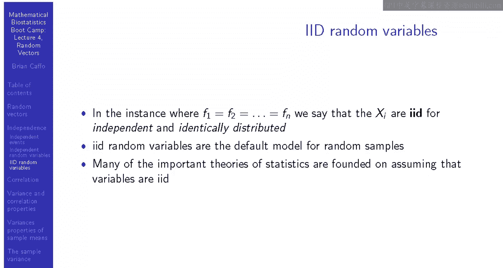

Let's just go through a very important example of flipping a coin so imagine if we have a biased coin and remember if we have a biased coin let's say the probability of a head or a success probability is P and we flip at n times well what's the joint density of the collection of possible outcomes？

Recall each coin flip here is a Bernoulli random variable。With success probability P。

And recall we wrote out the density in the form p to the x 1 minus p to the 1 minus x and notice that's a very easy form right so if you plug an x equal 1 you get the probability p of a head of or of a1 and if you plug in x equals 0 we get 1 minus p for the probability of a tail or a0。

 so this density is a nice way to represent it。And you'll see why we represent it specifically this way in the next line。

 so the joint density is the joint mass function F x1 to Xn。

 if they're independent coin flips right is simply the product of the individual densities and you'll see from this formula we get p raised to the summation X1 minus p raised to the n minus summation X so if the x's are all zeros and ones。

 this works out to be p to the number of heads，1 minus p to the number of tails and that's basically why we write out the density this way because if we have a bunch of independent coin flips then it's convenient that the mass functions multiply and we wind up with this nice form for the joint mass function。

Yeah。So if you wanted to say for example， if I have a biased coin with success probability P and I had four coin flips and I wanted to know what's the probability of getting a1 and then a0 and then a1 and then another one。

 so 1011 you would just simply plug into this formula and notice the order of10 there we got three heads and one tail notice the order doesn't matter。

 we would need p to the3，1 minus p to the1 would be the probability of that occurrence and notice it's the same probability regardless of what order the ones and zeros occurred so this formula makes it easy to calculate the joint probability for a collection of ones and zeros from a potentially biased coin flip。

I just want to mention again that this model is tremendously important。

 so imagine for example we want to model the prevalence of hypertension in a population。

 one way we might go about doing that is to say that our sample is IID and again that's often a big assumption that people are IID draws for individuals are coin flips。

And what we would like to know is their success probability of having hypertension and so that success probability is the prevalence of hypertension in the population。

 and we would use this。Joint mass function to model that process for our collection of data。

 and that's the idea behind where we're going with this。

 but notice there's a lot of assumptions that go into that right I just want to emphasize this fact quite a bit。

 we're assuming that we're randomly drawing people from the population that we're interested in or not even that we're randomly drawing them。

 but that we can model the collection of people。Their hypertension status。

 as if they were a bunch of independent coin flips with the prevalence being the success probably。

 that's ultimately what our model is stating。So it's important to always keep that in mind。

 so let's stop here and we'll next talk about some of the mathematical properties associated with random variables and covariance and correlation and their consequences when variables are independent。

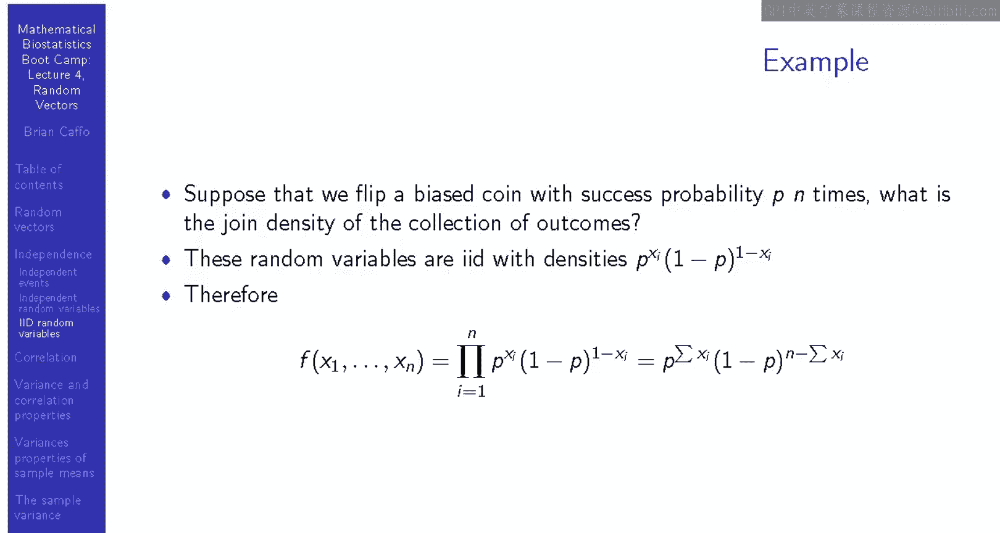