# 约翰霍普金斯大学《数据科学的高级统计｜Advanced Statistics for Data Science》中英字幕（deepseek p110 36_变异分解.zh_en -BV1htPjeYEFH_p110-

In this lecture， we're going to talk about partitioning variability。

 so assume my x matrix includes a one， so it has a vector， let's just call it J。

That's a vector of one。 So it includes an intercept， and then it includes other stuff， other columns。

So I'm going to define， well， first of all， let me define H J as J J transpose J inverse J transpose and Hx as X。

 X transpose x inverse， x transpose now since。My H， and since my x contains an intercept。Then， my。

Then J can be written as a linear combination of the columns of x。

 If I just take the vector that grabs the first column of x。 So a vector that's1。

 and then a bunch of zeros and multiply it times x that will grab the first column。

 which is the intercept。 So I know from the previous lecture。 that if I take I minus H of x。

 And I multiply it by any vector。 that's a linear combination of the columns of x。

 let's say x times gamma。 In this particular case， I've set up gamma so that it grabs J。

 Then this has to be equal to0。 Well， that's going to imply that j minus h of x times j equals0。

 or in other words， J is equal to H of x times J。 So squirrel。

That little pearl of wisdom right there away， and we're going to use that later。Now。

 let me define as the total variation， or the sum of the squares of total as the norm of y minus y hat。

Y minus y y bar。Times J。Okay。So y minus y bar times J。We can also write that as。Y minus。

 And remember that y bar， which is a scar。 So I probably should have put it on this side of the J。

 We could write this quantity right here as H J times y。Norm squared。

And so we could write it out as y transpose I minus。HJ。Times y。

Then let me write out the residual sums of squares as the norm of the residuals。

The norm of E squared， which is。Norm y minus y hat or y hat is the fitted values from the full model with x in it。

That we know is Y transpose I minus H of x。Times y。

 So this is the numerator of the variability estimate that we would get if we only included in an intercept and this is the numerator of the variability estimate that we would get if we include in an intercept plus all the other regressors。

 so presumably or not presumably but of course， the residual sum of squares is going to be smaller than the total sum of squares because those extra columns are going to explain some amount of the variation in y。

So let me make a third definition， which is the sum of the squares for regression。

 which is the difference， the distance between the fitted value。

 if I only include an intercept and the fitted value， if I include the intercept。

 plus all these other regressors squared。Which I can write as。Norm， H。Zy。Times y minus。H X times y。

 Let me squared。 So let me work with this term a little bit。

 The regression sums the squares a little bit。 And so I'm going to write this as y transpose。

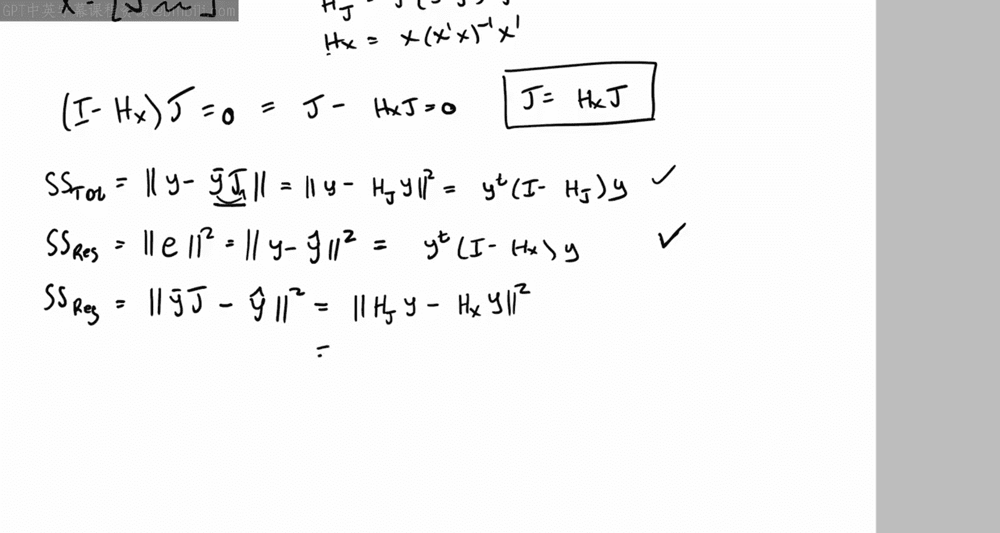

Times H J minus H of x。Times H J minus H of x。 And I don't have to worry about the transpos for those terms。

 because both H J and H of X are symmetric。

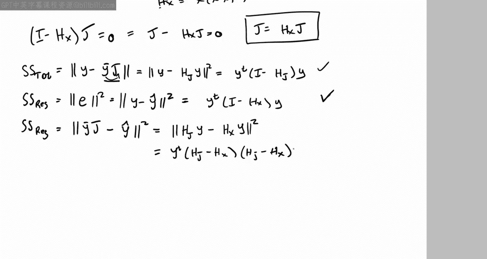

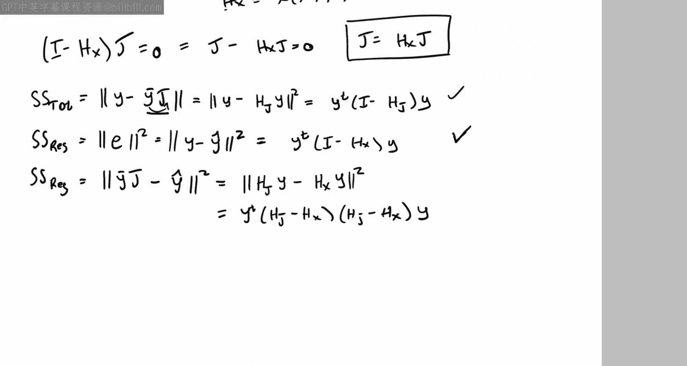

Okay， and then let me。Write this out now as y transpose times HJ is item potent。

 So H J times HJ is just going to H J squared is just going to be HJ。And then， H of x times。Hj。

mininus。That's from that one。And then HJ。Times H of x。That's going to be that one。

 and then h of x squared， remember h of x is id potent， so that's plus h of x。Okay， times y。

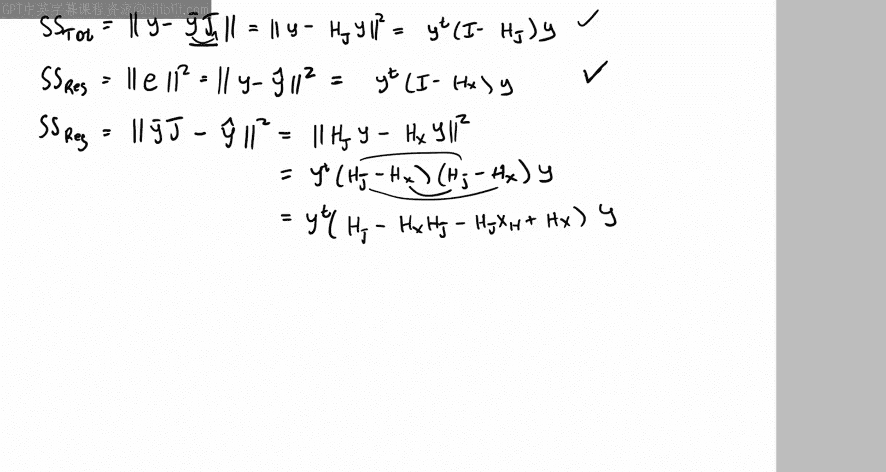

Now， remember this fact up here。J is equal to H of x times J， but I could。Similarly。

Multiply here by a。J transpose J inverse， J transpose and multiply here by J transpose J inverse J transpose。

 so I haven't done anything。 And then what I get is that h of j that is implied is that H of j is equal to H of x times H of j and then by taking the transpose I can get and because their symmetric。

 I also see that H of j is also equal to H of j times H of x so this quantity right here is h of x。

This quantity right here is H of x。 So we get H J minus1 H of x minus another H of x plus1 H of x。

 So we get that y transpose is。H J minus H of x times y。

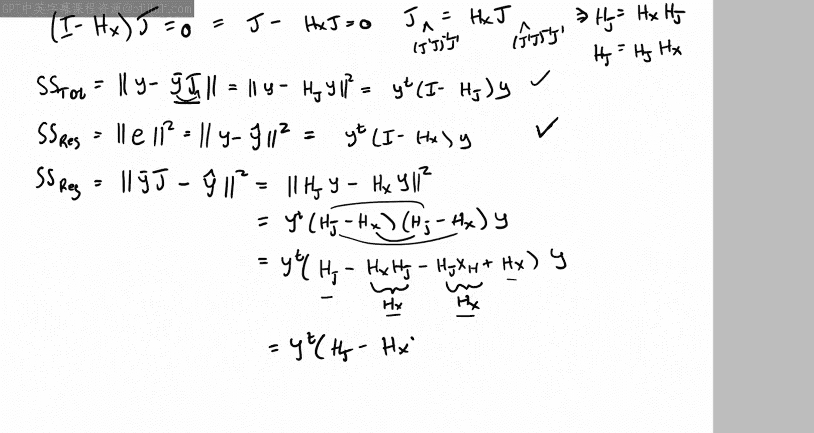

Now。I'll get to my point。Let me take my sum of the squares for total。

Which is the norm of y minus y bar times J。Squared， which we wrote out before， as y transpose。

Times I minus H J。Times why。H。H O J Time Y on the outside of the princess。So let me add and subtract。

Subtract and then add， I guess。And then let me organize it this way。

 Hopefully you'll see what I'm doing here。 H of x plus H of x minus H of J。Times y。Okay。

 so I haven't done anything going from this line to this line other than adding or subtracting an H of x。

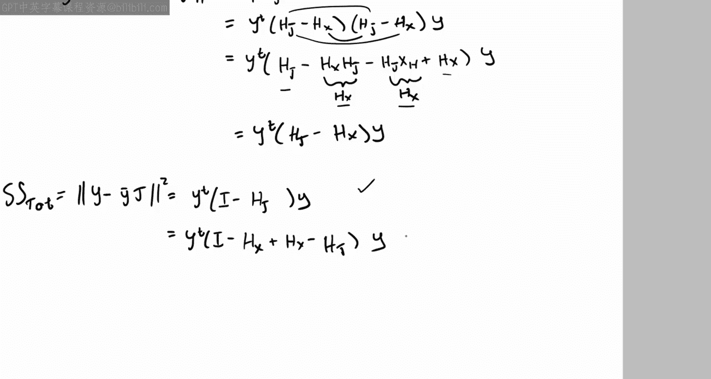

Then I get y transpose I minus H of x。Times y plus y transpose。H X， minus。Hj。Times y。And。This。

Term right here is the sum of the squares。4。Residual。And this。

Right here is the sum of the squares for regression Okay。

 so this small distinction is that I have hx minus Hj down here and Hj minus Hx up there。

 but I would like you to prove for homework that the order of subtraction doesn't matter in this quadratic form that the two are equal。

Okay， and so here it comes to the broader point。 So the total S total。

 the total variation decomposes into the residual variation and the regression variation。

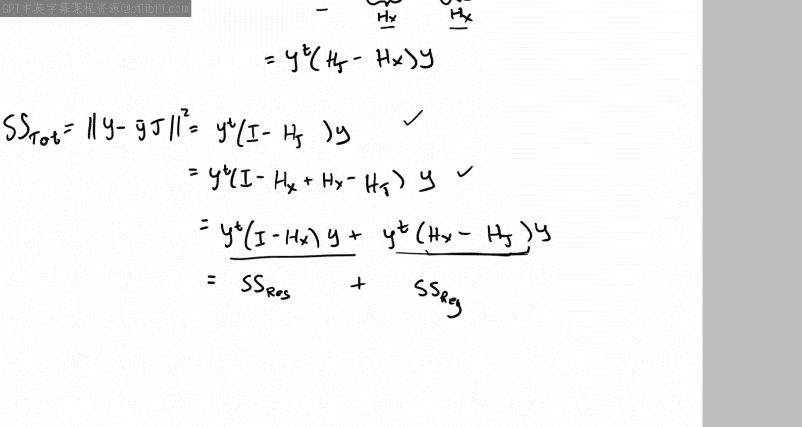

So my total variability in my response gets。Decomposed into the variability explained by my regression model and the remaining variability left unexplained by my regression model。

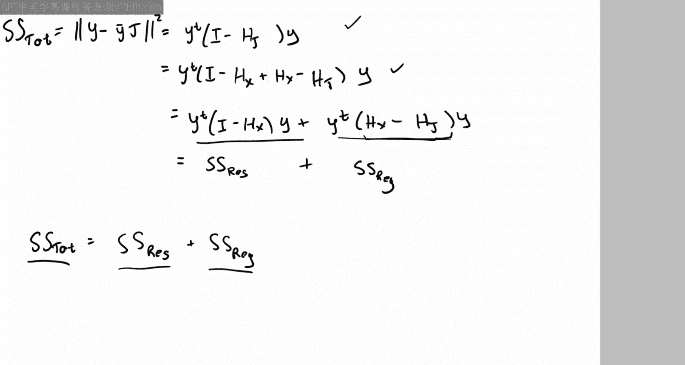

All these are positive。All these are positive because they're all sums of squares。

 And so what is very common thing to do is take S regression the amount。

A variability explained by my regression model， and divide it。By the total variation。

 And then what is that going to give us， That is going to give us the percentage。Of。

The total variability。Total variability。Explained。By the linear association。With。Li。Added。

Progressors。I guess if I want this to be a percentage， Ill multiply times 100。So， that quantity。

That quantity。Usually not expressed as a percentage， but as a proportion is called R squared。

So r squared is interpreted as the percentage of your total variability explained by the linear association with your added regressors。

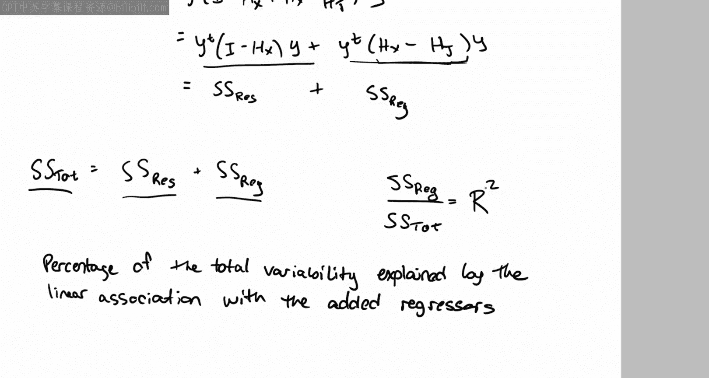

And we see that it was a pretty easy proof to get that the。

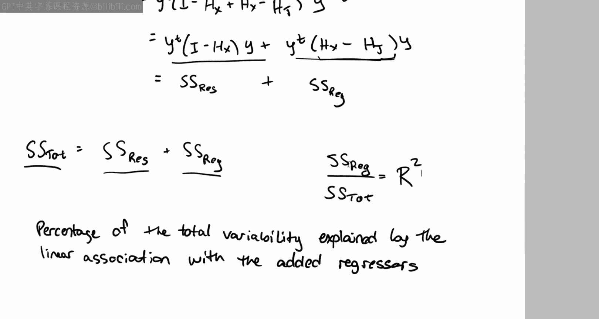

Total variability decomposes into the residual variability and the regression variability。

 And it all involve this little。

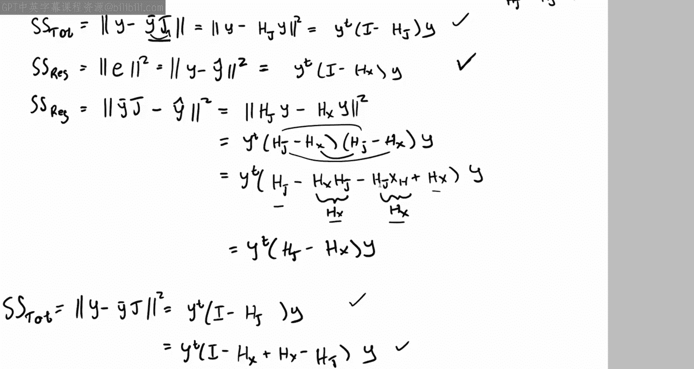

Trick。Up here that said that J was equal to h of x times J。

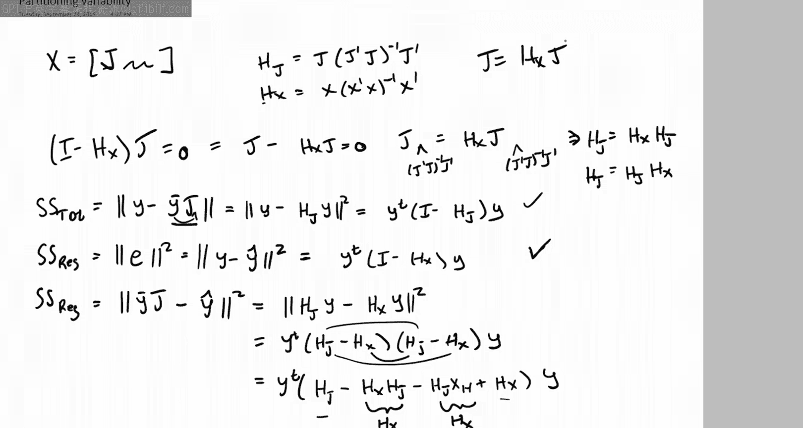

Okay， so in case you were wondering how these things worked out and why everything added up when you were looking at your regression output。

 this is why。Okay， so thank you for listening and we'll talk a lot more about partitioning variability and how that relates to things like FT later on in the course。

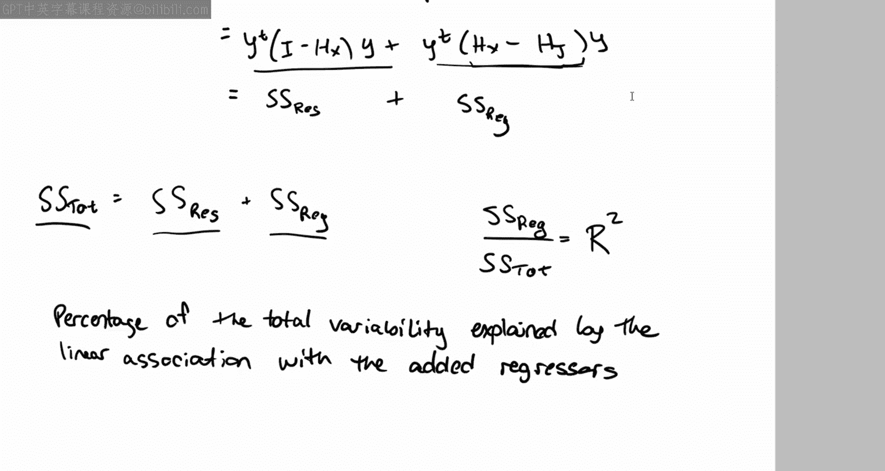