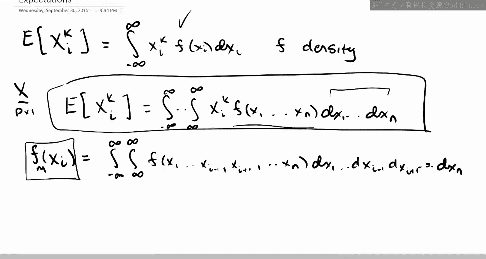

# 约翰霍普金斯大学《数据科学的高级统计｜Advanced Statistics for Data Science》中英字幕（deepseek p112 1_多元期望值基础.zh_en -BV1htPjeYEFH_p112-

Let's talk a little bit about expectations。 So if you're taking this class。

 you already know that the expected value of， let's say the k moment of a random variable X is the integral x to the K。

From say， minus infinity to plus infinity。F of x， D X。Where F is the associated density。

And then this integral would be replaced by a sum if it was a discrete mass function。

So imagine now instead of x being a scalar， x is a p dimensional vector， so x is p by1。

Then the Ca moment。Of the I component。Of the vector X is nothing other than the。

Multivariate integral。X i to the K。Yeah。X1。Up to X n。D， X 1。Up to DxN。

So it's worth asking if this definition is consistent with the prior definition， if we only knew。

 say， for example， the marginal distribution of X I。 So we have two definitions here。

 Let's suppose I'm saying X I is the I component of the。Vectctor X。

 and let's suppose we knew its marginal distribution。We would have that， whereas over here。

 we're saying， let's。Get。Let's get this expected value by integrating over the entire joint distribution。

 the joint multivariate distribution with all of the。Components over all of the components of x。

So let me just say， how would you get？To the marginal distribution， F of X I。

It's a little bit sloppy notation to use F for both the joint and the marginal。

 but I hope you understand what I mean。Write that a little bit。F of X， I。

So the way we get at that marginal distribution， let me just put a little M over it。

I we would take the joint distribution。And integrate it。All the way up。Over all the variables。

Except for。X I。Okay， so that's how we would get the marginal distribution。

 but then if you look at this multivariate。Definition。Of the expected value we could reorder。

These collections of integrations into whatever order we want。 And so we could first。

Get rid of or do the integral with respect to every one of these variables except X I。

 and then we would just simply be calculating。This marginal distribution。

 And then we would be back to the the to this definition above。 So the point being that。

If you have a， let's say a bivariate normal distribution and you calculate the expected value of one of the components of that bivariate normal。

 you get the same expected value is if you have only the associated marginal distribution associated with that normal distribution for that one variable So everything is consistent if you do it not with the n dimensional joint distribution。

 but you find the distribution of just five components， for example。

 of that vector and Xi happens to be one of those five components and you calculate the expected value over those five components you're still going to get the same answer。

 So in other words， the expected value of a element of a random vector is the same no matter which collection of either the joint or whatever。

Whatever joint distribution or the marginal distribution for that variable that you use。

 it's always consistent and then the basic summary as to what an expected value is to a joint distribution。

 it's of a random vector。Is it's just the element wise expected values Okay。

 so that's just to get you started on expected values。

 we're only going to have one particular distribution that we're really going to take expected values with respect to。

 and that is the multivariate normal。

