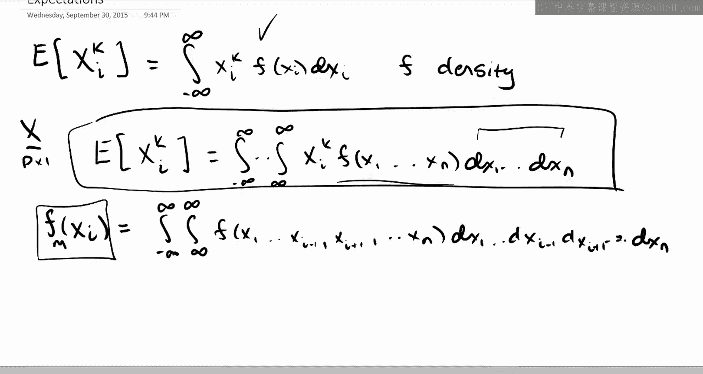

# 数据科学的高级统计：1：多元期望值基础 📊

在本节课中，我们将要学习多元随机变量期望值的基本概念。我们将从回顾一元随机变量的期望值定义开始，然后将其扩展到多元（向量）情形，并讨论这种扩展定义的一致性。

## 一元期望值回顾

上一节我们介绍了课程背景，本节中我们来看看期望值的定义。对于一元随机变量 \(X\)，其 \(k\) 阶矩的期望值定义为：

\[
E[X^k] = \int_{-\infty}^{+\infty} x^k f(x) \, dx
\]

其中 \(f(x)\) 是 \(X\) 的概率密度函数。如果 \(X\) 是离散型随机变量，则该积分应替换为求和。

## 扩展到多元情形

现在，假设 \(X\) 不再是一个标量，而是一个 \(p\) 维向量，即 \(X = (X_1, X_2, ..., X_p)^T\)。那么，向量 \(X\) 中第 \(i\) 个分量 \(X_i\) 的 \(k\) 阶矩定义为：

\[
E[X_i^k] = \int_{-\infty}^{+\infty} ... \int_{-\infty}^{+\infty} x_i^k f(x_1, ..., x_p) \, dx_1 ... dx_p
\]

这里 \(f(x_1, ..., x_p)\) 是 \(X\) 的联合概率密度函数。

## 定义的一致性

一个自然的问题是，这个基于联合分布的定义，是否与我们仅知道 \(X_i\) 的边缘分布时计算出的期望值一致。

假设我们已知 \(X_i\) 的边缘分布 \(f_{m}(x_i)\)。从联合分布得到该边缘分布的方法是：

\[
f_{m}(x_i) = \int ... \int f(x_1, ..., x_p) \, dx_1 ... dx_{i-1} dx_{i+1} ... dx_p
\]

即对除 \(X_i\) 外的所有变量进行积分。

现在观察多元期望值的定义。由于多重积分的顺序可以交换，我们可以先对除 \(X_i\) 外的所有变量积分。这个过程恰好就是在计算边缘密度 \(f_m(x_i)\)。完成这一步后，剩下的积分就变成了：

\[
E[X_i^k] = \int_{-\infty}^{+\infty} x_i^k f_m(x_i) \, dx_i
\]

这与直接使用边缘分布计算期望值的公式完全相同。

因此，无论我们是使用完整的联合分布，还是仅使用该变量的边缘分布，计算出的 \(X_i\) 的期望值都是一致的。这个结论可以推广：如果我们有一个包含 \(X_i\) 的子向量（例如五个分量），基于这个子向量的联合分布计算出的 \(X_i\) 的期望值，与基于完整联合分布或单独边缘分布计算出的结果仍然相同。

## 随机向量期望值的含义

基于以上讨论，对于一个随机向量 \(X\)，其期望值向量可以简单地定义为各分量期望值组成的向量：

\[
E[X] = (E[X_1], E[X_2], ..., E[X_p])^T
\]

以下是关于多元期望值的核心要点总结：
*   多元期望值的计算本质上是将一元定义按分量进行扩展。
*   基于联合分布计算某个分量的期望值，与基于其边缘分布计算的结果一致。
*   随机向量的期望值就是其各分量期望值构成的向量。

## 本课程的重点分布

在后续课程中，我们将主要针对一种特定的多元分布来计算期望值及其他统计量，那就是**多元正态分布**。它是多元统计分析中最核心和常用的分布。

本节课中我们一起学习了多元随机变量期望值的基础。我们回顾了一元期望值的定义，并将其成功扩展到了多元情形，同时验证了基于联合分布和边缘分布计算期望值的一致性。最后，我们明确了随机向量期望值就是其分量期望值组成的向量，并指出了多元正态分布将是本课程后续重点研究的对象。