# 约翰霍普金斯大学《数据科学的高级统计｜Advanced Statistics for Data Science》中英字幕（deepseek p113 2_期望值的矩阵运算.zh_en -BV1htPjeYEFH_p113-

In the last lecture we talked about what a multivariate expected value is， particularly if。

 for example， we have expected value。

OfX， where x is a random vector or a matrix， this was just the associated random vector or a matrix。

 Maybe we might write it this way， the expected value of the components， let's say X I。

Over I so the expected value of the individual components and last time we talked about the distinction between multivariate and unitvariate calculated expected values。

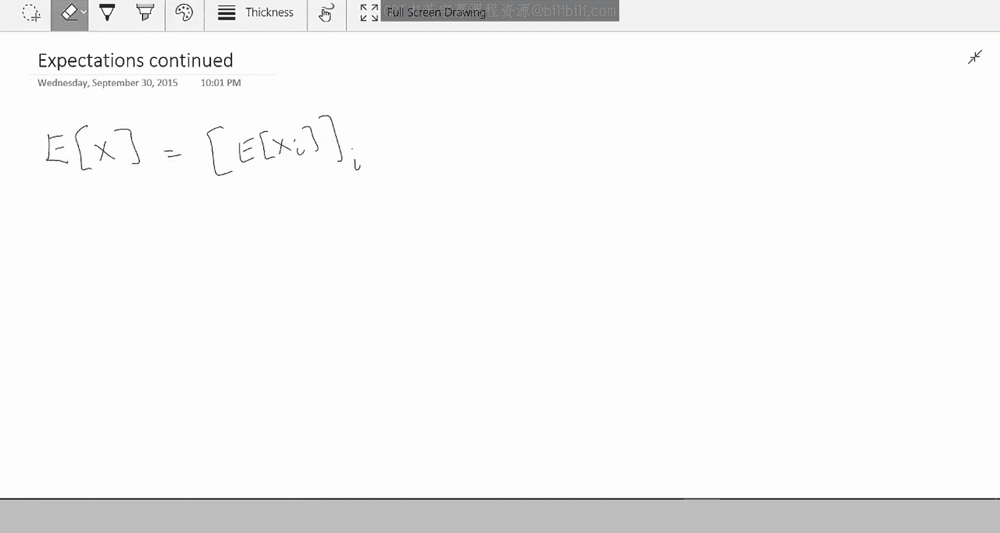

Okay。So。

Let's now just talk about some of the properties of expected values。

In this setting。So I going make that pencil a little bit thicker。

So if。We have a random vector， or matrix。And。We want to calculate， for example， a。

 which is a matrix or vector of constants times my random vector or matrix a times x。

 Well the expected value is linear in the sense that we can pull the random vector or matrix out。

 a times the expected value of x。 and if we have two random vector， say x。

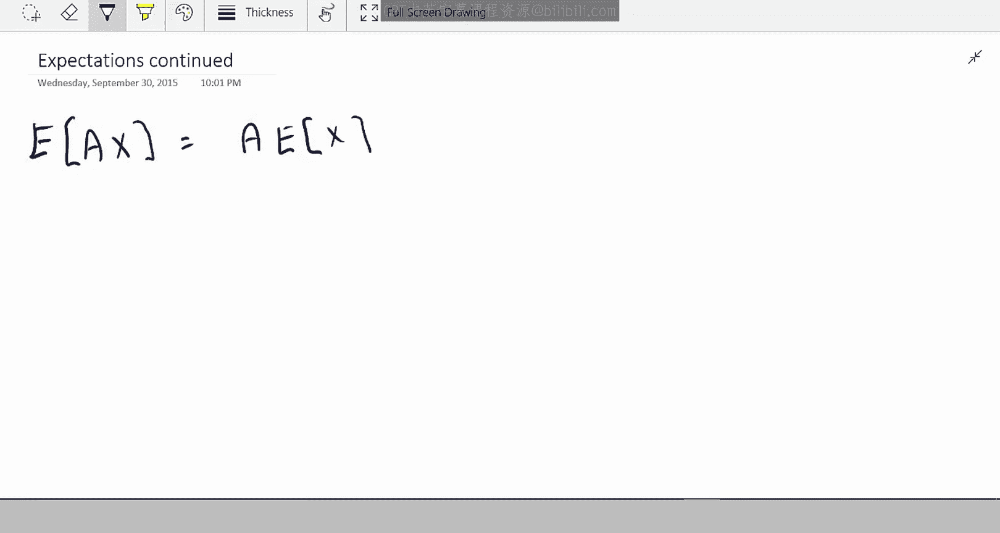

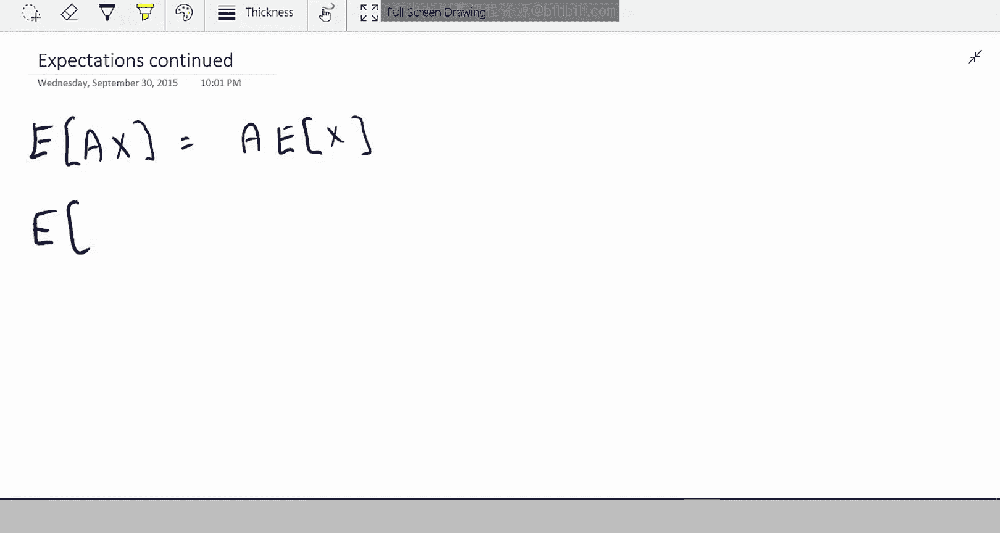

And why。Then their sum is the sum of the expected values。

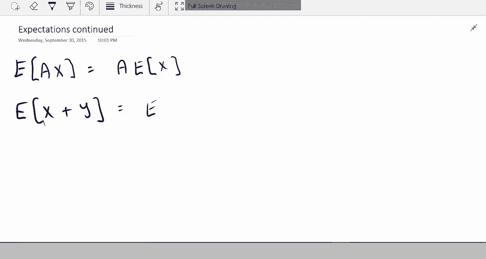

Which is great。

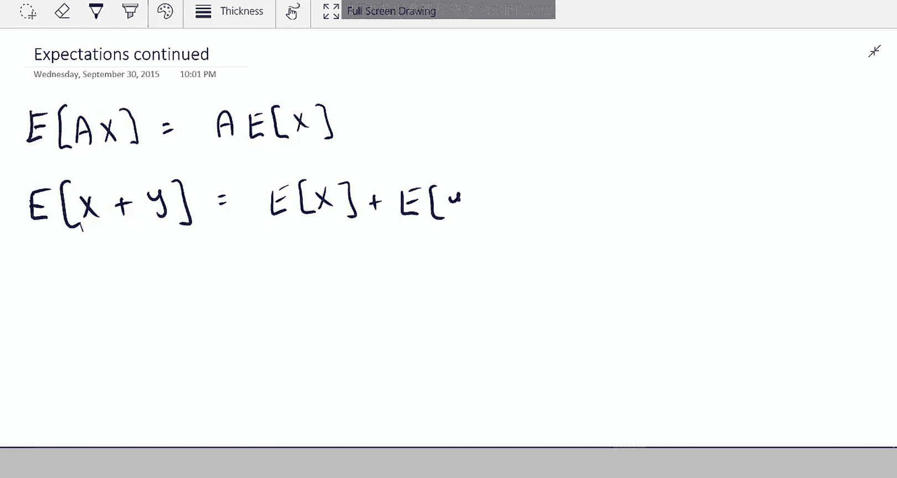

And another useful property that comes up in matrices and vectors is the expected value of the transpose。

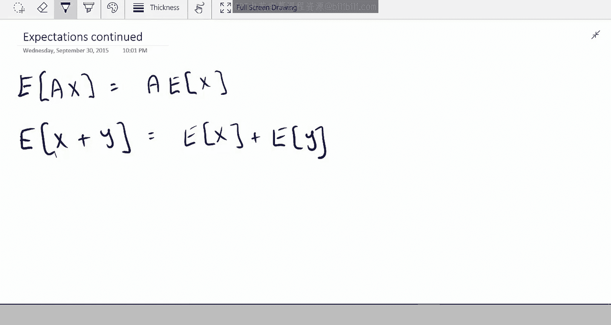

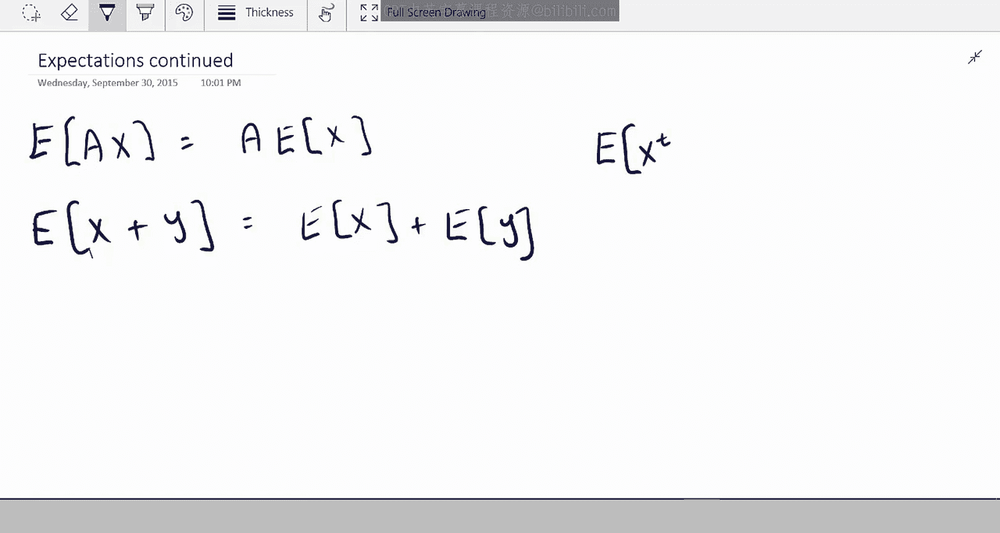

Of a vector matrix is the expected value of their vector matrix then transposed outside of the expected value。

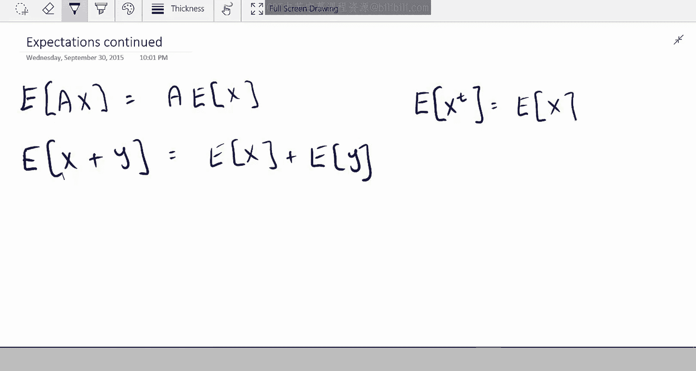

And the final thing I would say is that the trace。

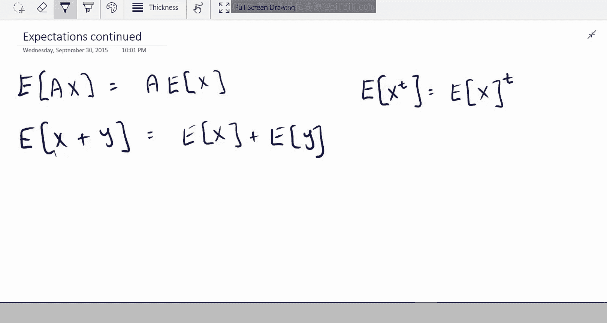

Because the trace is a linear operator， the trace of the expected value of a random vector matrix is the expected value。

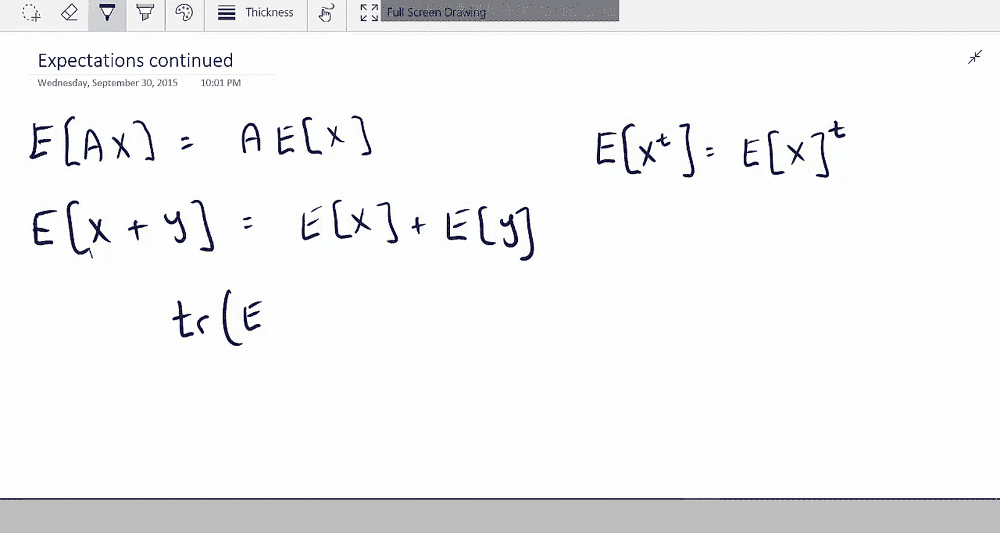

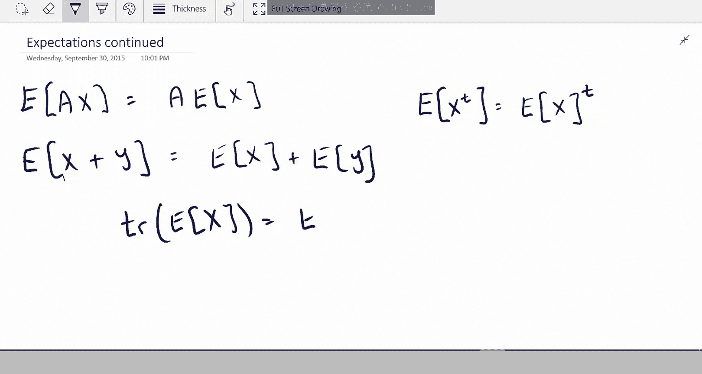

Of the trace。Okay， so all of these just go to show that the expected value。

 which we know from our unitvariate case is a linear operator。

 all of these linear operator properties then transfer over to the multivariate case and we're not going to go through the proofs because the point of this class isn't to recreate multivariate massst。

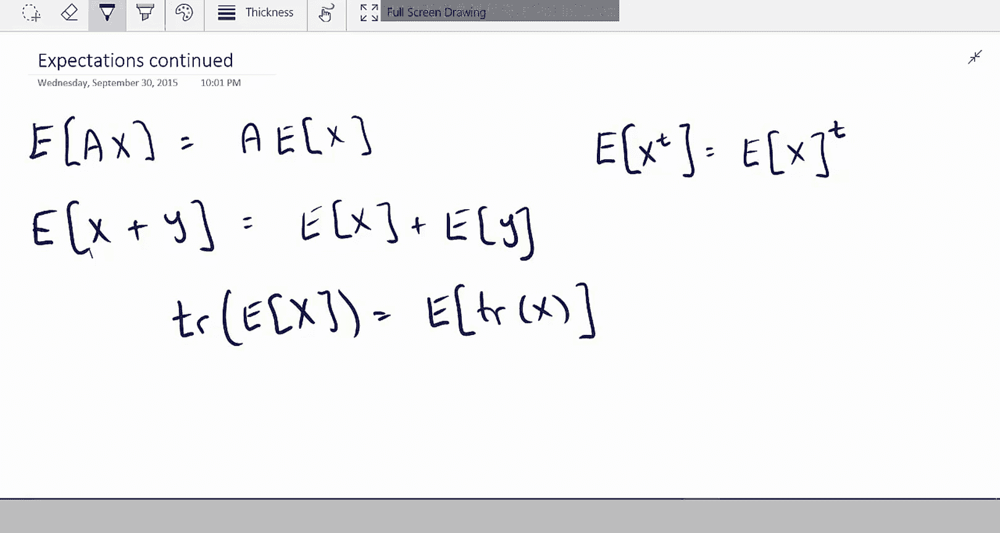

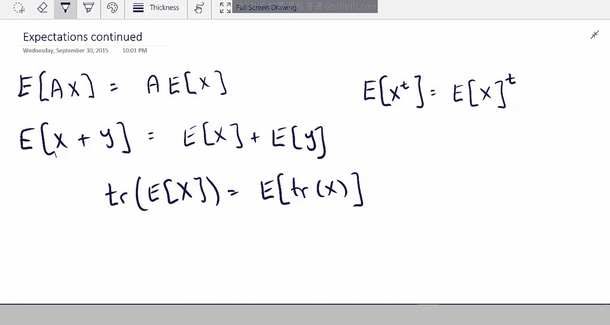

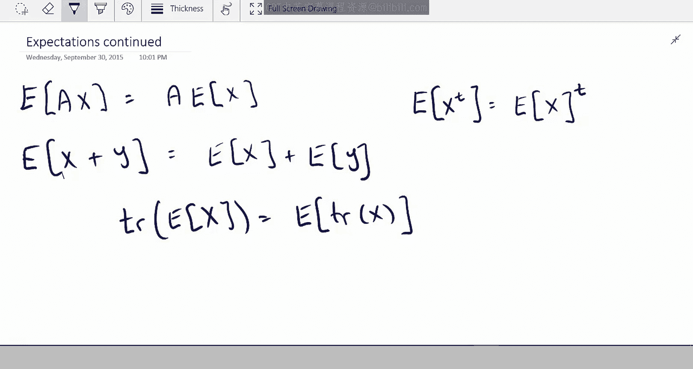

So these are just pretty much all that you really need to know about multivariate expected values for this class。

 and then in the next lecture we're going to talk about the variance。

 multivariate variances and covariances。

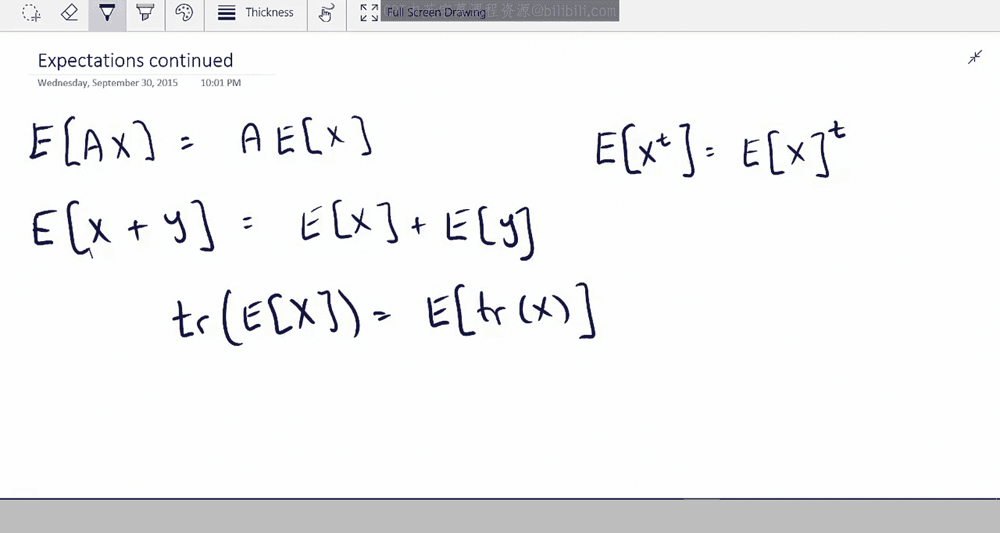

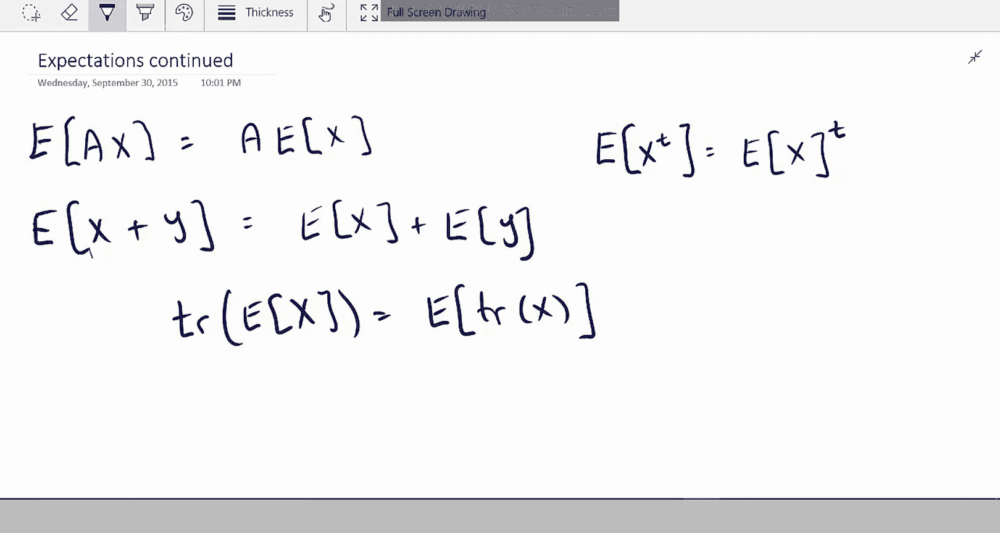