# 数据科学的高级统计：2：期望值的矩阵运算 🧮

在本节课中，我们将要学习多元随机变量期望值的矩阵运算性质。我们将探讨期望值作为线性算子的特性，并了解其在向量和矩阵运算中的具体表现。

上一节我们介绍了多元期望值的定义，特别是对于一个随机向量或矩阵 **X**，其期望值 **E[X]** 定义为各个分量期望值组成的向量或矩阵，即 **E[X] = (E[X₁], E[X₂], ..., E[Xₙ])ᵀ**。本节中我们来看看期望值运算的一些重要性质。

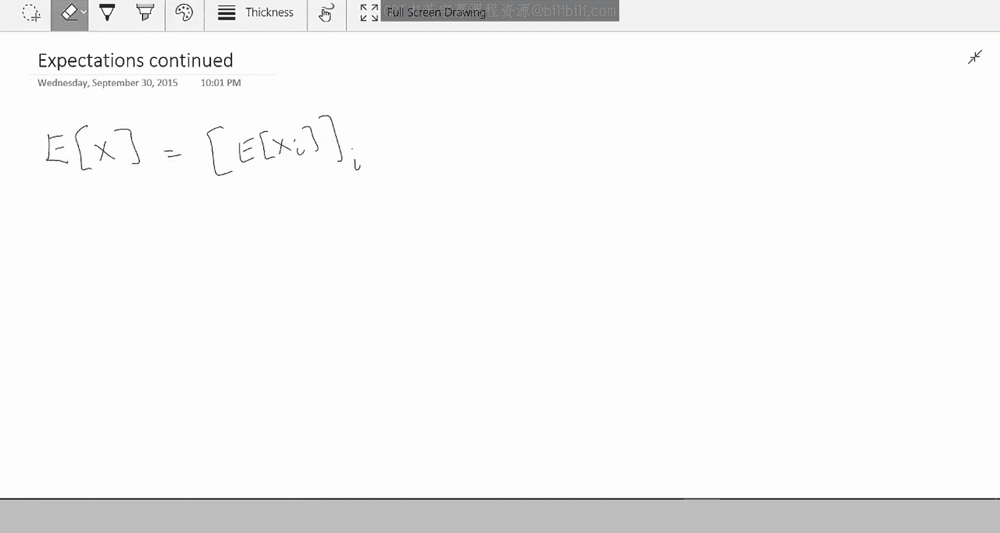

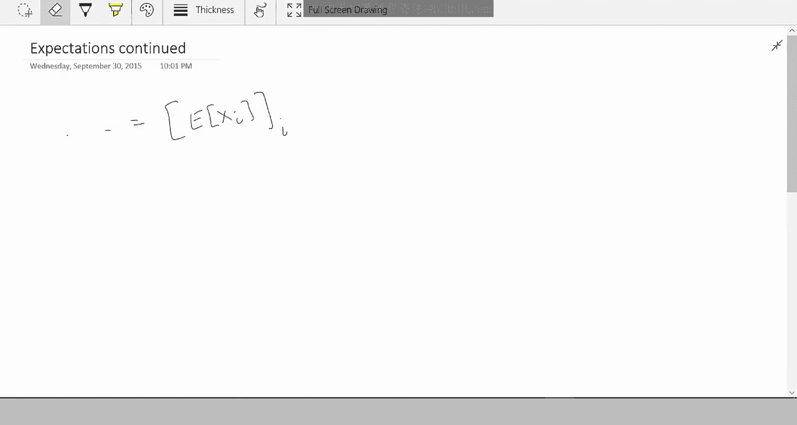

## 期望值的线性性质 ✨

期望值是一个线性算子，这意味着它满足加法和数乘的线性规则。以下是期望值线性性质的具体表现。

以下是期望值线性性质的核心规则：

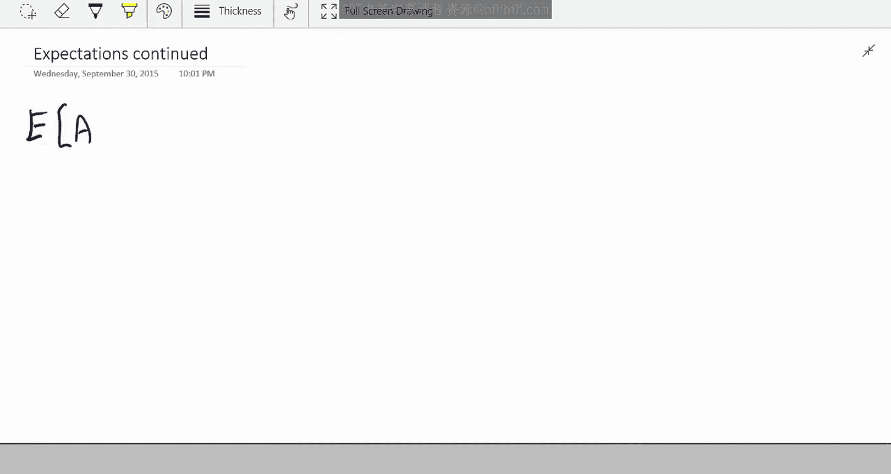

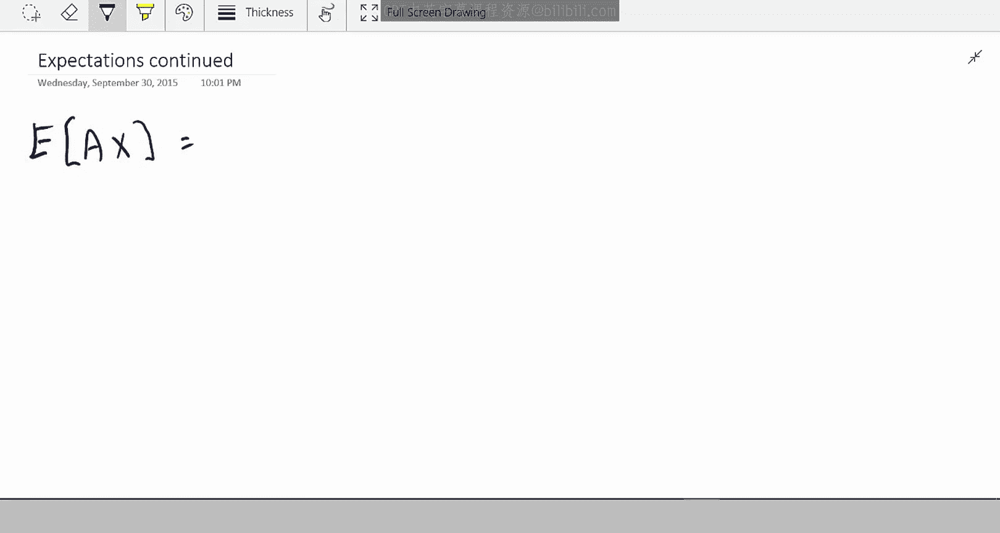

1.  **常数矩阵与随机向量的乘积**：若 **A** 是一个常数矩阵（或向量），**X** 是一个随机向量（或矩阵），则有：
    **E[A X] = A E[X]**
    这意味着常数矩阵可以提到期望值运算之外。

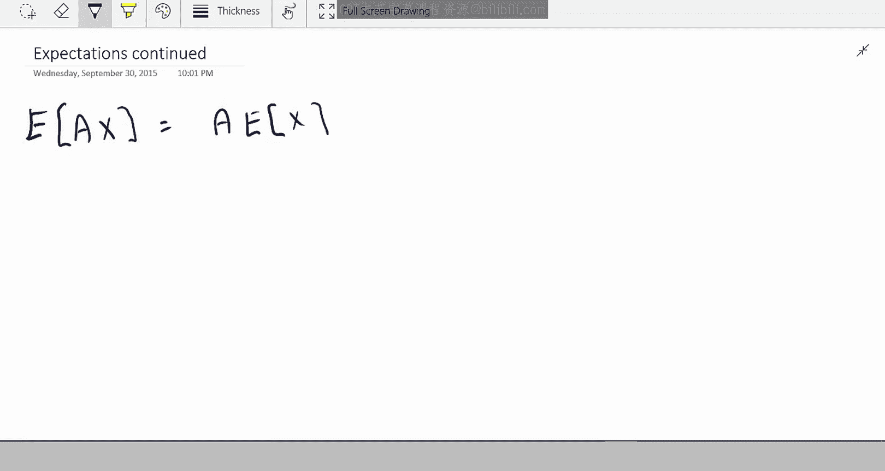

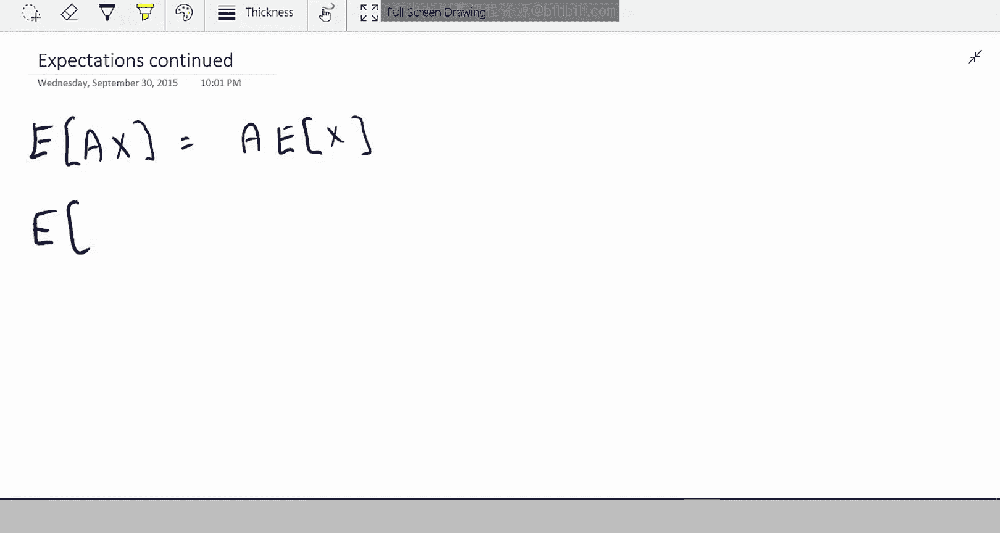

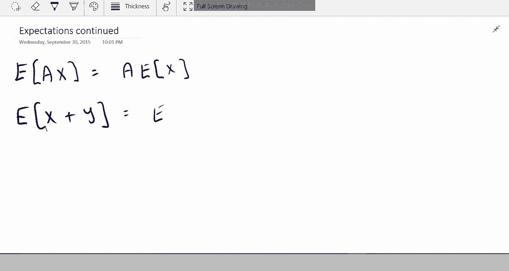

2.  **随机向量之和的期望值**：若 **X** 和 **Y** 是两个随机向量，则有：
    **E[X + Y] = E[X] + E[Y]**
    和的期望值等于期望值的和。

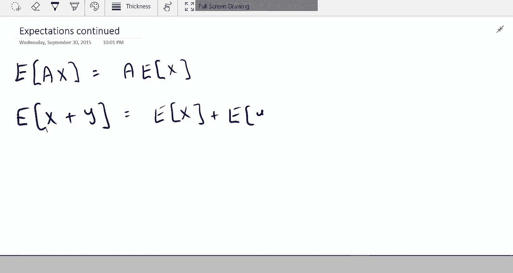

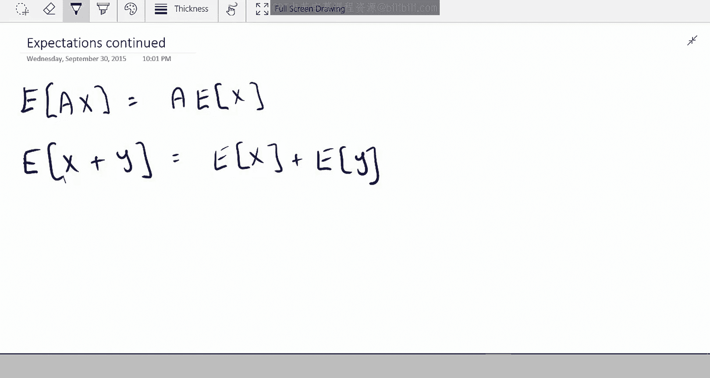

## 转置与迹的运算 🔄

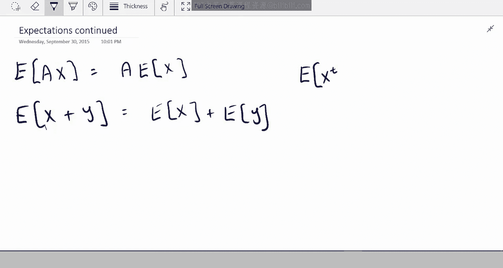

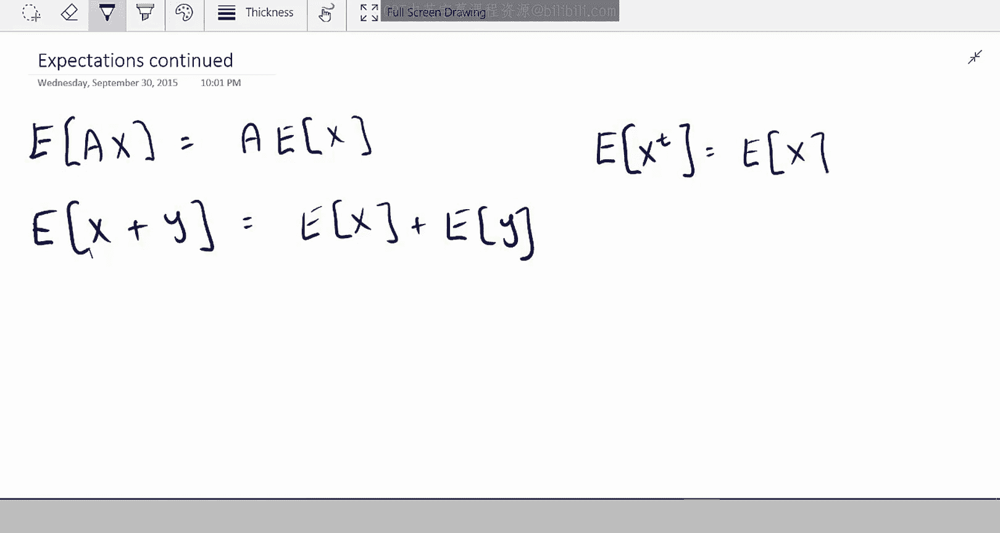

在处理矩阵时，转置和迹是常见的运算。幸运的是，期望值与这些运算可以交换顺序。

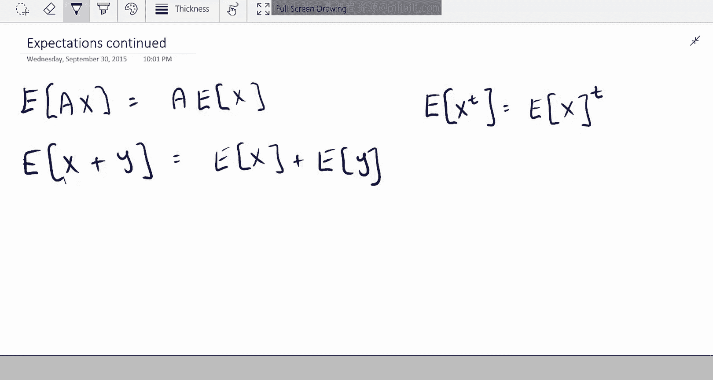

以下是期望值与转置、迹运算的关系：

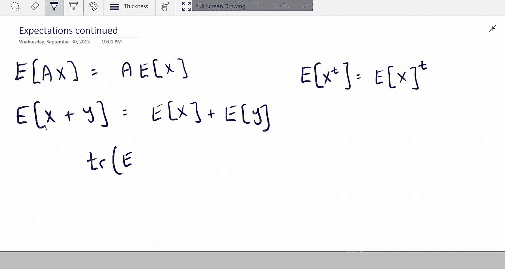

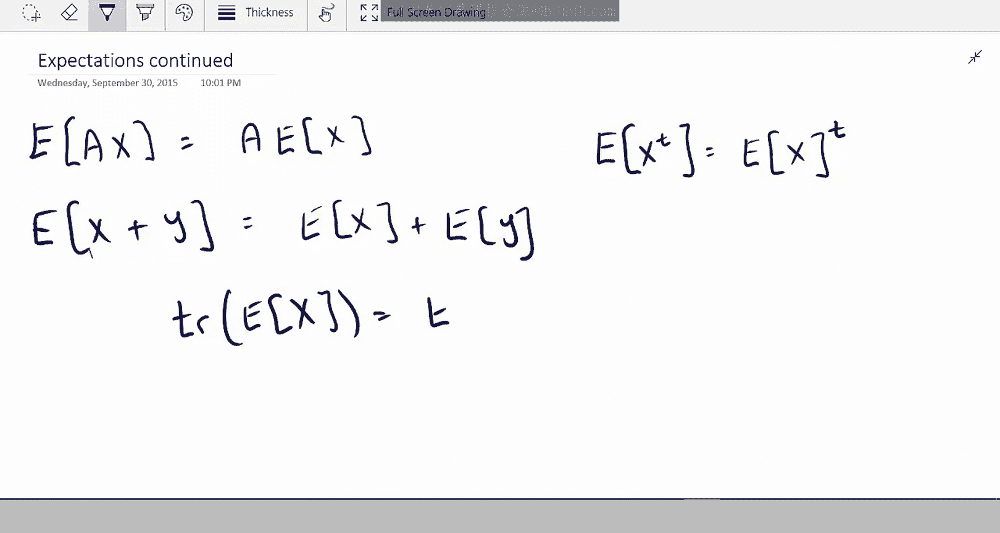

*   **转置运算**：随机向量或矩阵的期望值的转置，等于其转置的期望值。即：
    **E[Xᵀ] = (E[X])ᵀ**

*   **迹运算**：由于迹（trace）本身也是一个线性算子，因此期望值与迹运算也可以交换顺序。即：
    **E[tr(X)] = tr(E[X])**
    其中 `tr()` 表示矩阵的迹，即主对角线元素之和。

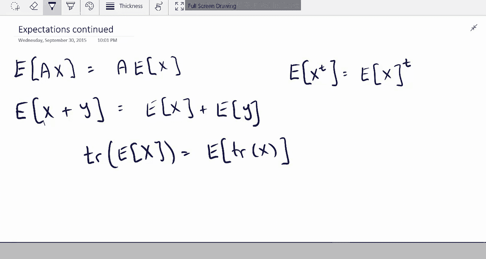

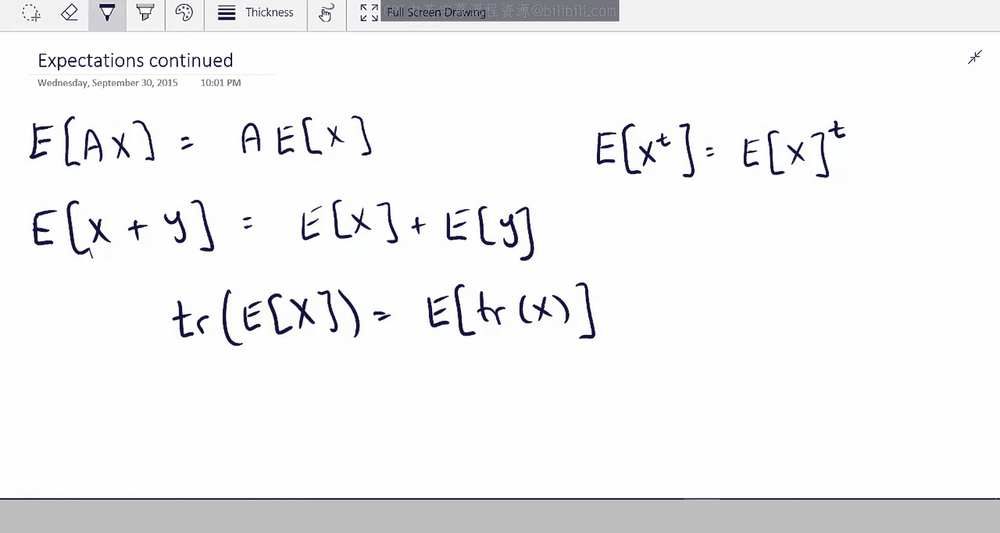

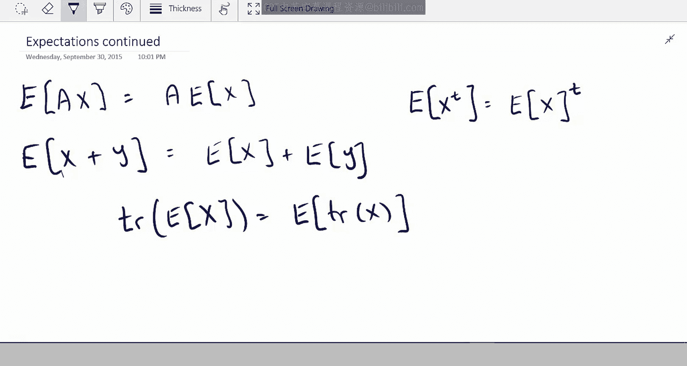

所有这些性质都表明，期望值在多元情形下依然保持了我们在单变量情形中所熟知的线性特性。我们在此不深入证明过程，因为本课程的重点并非复现多元微积分。

本节课中我们一起学习了多元期望值的核心运算性质，包括其线性性质、与矩阵乘法、加法、转置以及迹运算的交互规则。这些性质是后续进行更复杂统计分析的基础。

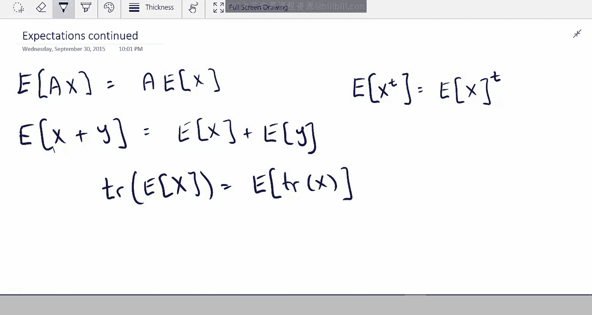

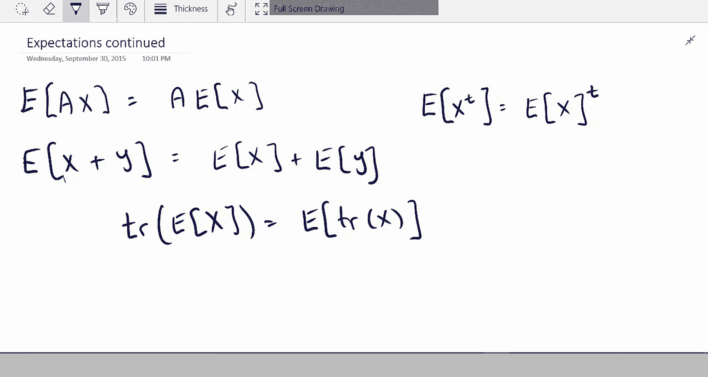

在下一讲中，我们将讨论多元情形下的方差与协方差。