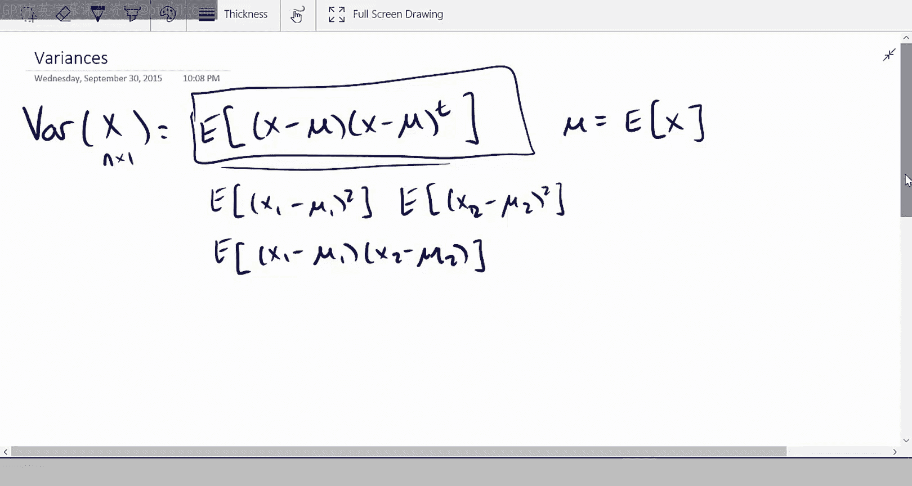
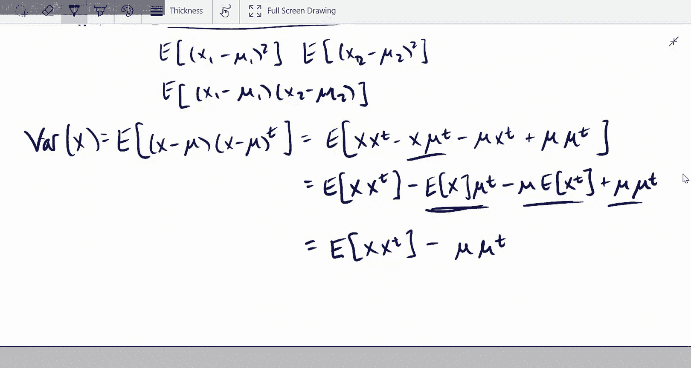
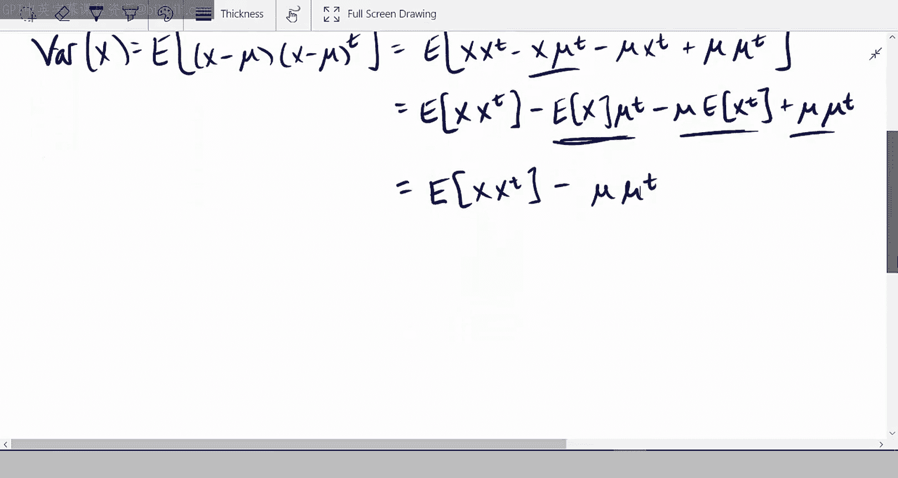
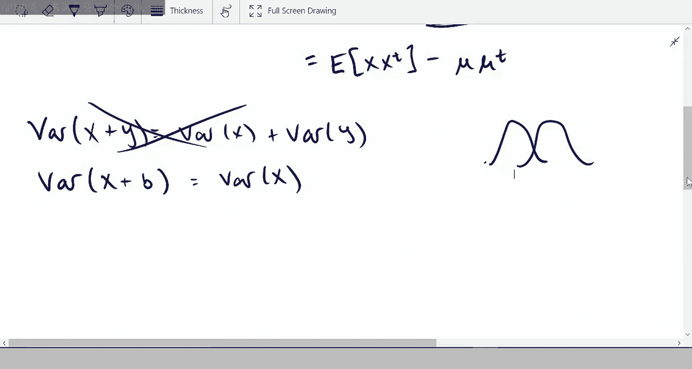
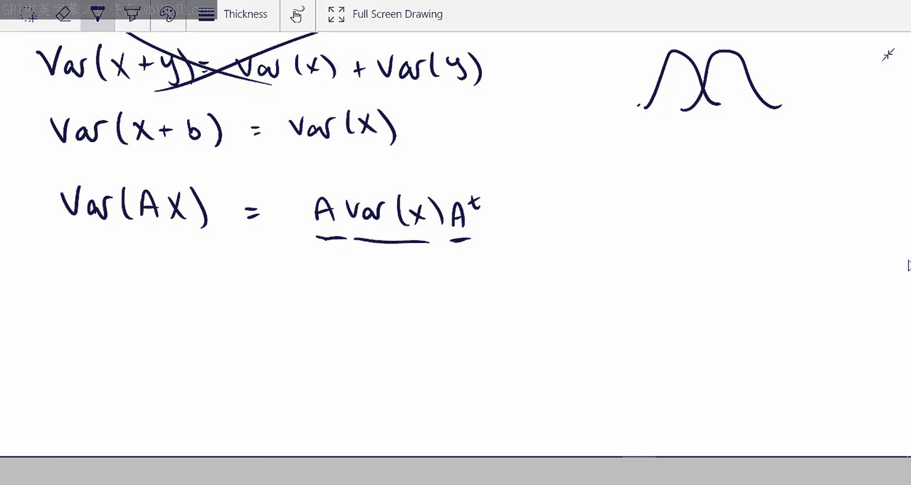
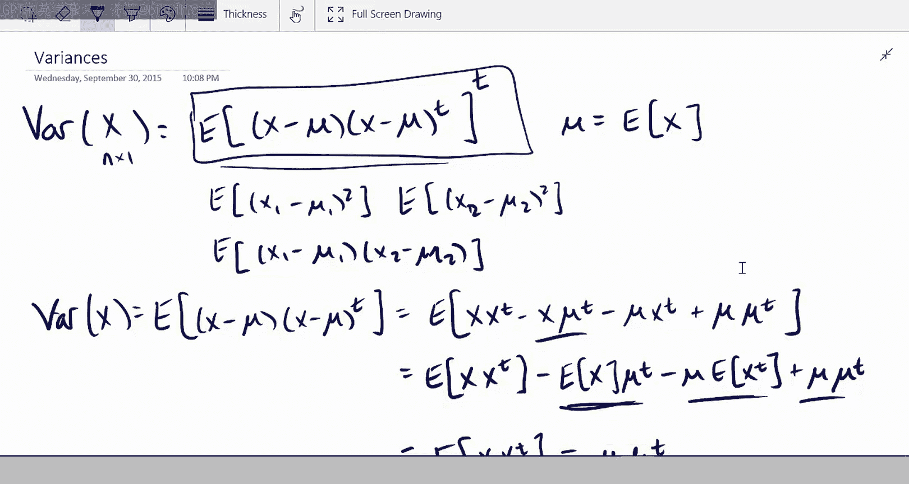
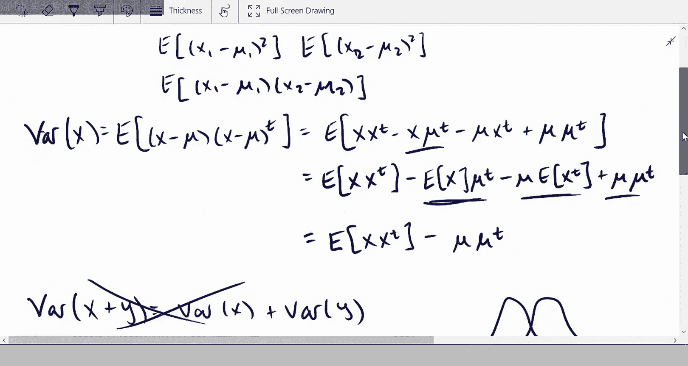
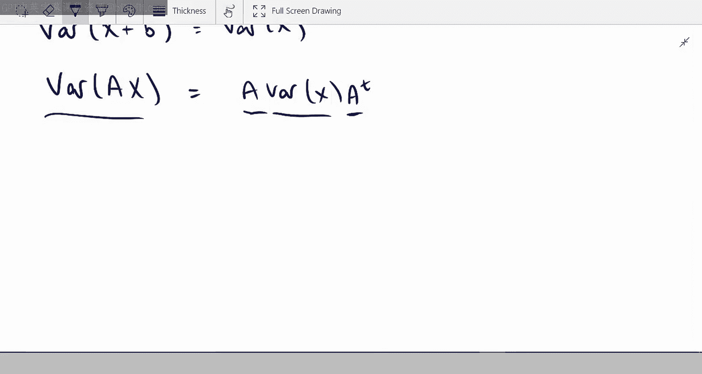

# 约翰霍普金斯大学《数据科学的高级统计｜Advanced Statistics for Data Science》中英字幕（deepseek p114 3_多元方差与协方差.zh_en -BV1htPjeYEFH_p114-

Let's talk a little bit about multivariate variances and covariances。

So we're going to define for a random vector x， the variance of the random vector x。

 which says n by one。Is going to be the expected value of the outer product of x minus mu。

With itself。So where here mu is equal to the expected value， the it's the vector expected value of x。

So this quantity here has the property that， for example。

 the diagonal element or the first diagonal element is expect a value of。X1 minus mu 1 squared。Okay。

 so it's just the ordinary variance of the first element of the vector， the second entry。

 second diagonal entry of this matrix is just the expected value of x2 minus mu2 squared。First。

 off diagonal element of this matrix。In either above the diagonal or below the diagonal is's just the expected of have x1 minus mu 1。

Times the expected of value of x2 minus mu2。And that is exactly the covariance between x1 and x2。

 so the IJth element of this matrix is the covariance between the I element of the vector X and the J element of the vector x。

 so this quantity is called the variance covariance matrix。

And just like the variance calculation for。

Uivariate random variables has a shortcut formula， the variance calculation for multivariate random variables also has a correlation shortcut calculation。

 so the variance of x is expected value。Of x minus mu。X minus mu transpose。 let's use our rules。

 So that's the expected value of x x transpose minus x mu transpose minus mu x transpose。Plus， mu。

 mu transpose。So that's equal to the expected value of x x transpose。

Then this quantity mu is not random。So we can pull it out of the expected value and the expected value is a linear operator so it moves across these sums so we can write this as the expected value of x times mu transpose minus mu times the expected value of x transpose and the mu mu transpose has nothing random in it so that's mu mu transpose but this is just mu mu transpose because remember mu is defined as expected value of x and this is just mu mu transpose again so we get minus mu mu transpose minus mu mu transpose plus mu mu transpose so we get that the shortcut formula is the expected value of the outer product of the x's minus the outer product of the expected value of the x's。

Okay， so that's a simple shortcut formula。

The variance has nice properties， not unlike the mean。

 it would be nice if the variance was a linear operator， but it's not so take， so we cannot say。

 for example， that variance of x plus y is equal to the variance of x。

Plus， the variance of y。So we cannot say that unless the vectors x and Y are mutually independent。

Or uncorrelated at least So what we can say is that first of all that the shifts in the variance shifts have no effect on the variance。

 so if we take the variance the variance x and shift it by a constant vector v B。

 that's just the variance of x again， just like in Uniivariate cases， of course。

 the distribution of a random variable， if it looks like this。

 it's going to have the same variance if we shift it over by a little bit。

So the variance doesn't change if we shift and then another important property is the variance of a times x if we have a variable that we'd like to pull out of a variance that is equal to a variance of x。

A transpose。 So when we pull a matrix or vector out of a variance， it sandwiches the variance。

 And so you get sort of a is the bread。 And then the variance of X part is the meat。

 So it sort of sandwiches the variance。 And when you pull it out。

 it has to go in both directions with a and a transpose。 Look back at the definition one more time。

 I also want to point out that。

Li。Varance covariance matrix is clearly symmetric if you were to take。

 for example the transpose of this matrix， remember that transposes move into expected values。

 you'll find that you get the expected value of the same exact thing， so it is symmetric。

 which is a good thing because we know that， for example， the IJ。

Off diagonal covariance， XI and Xj is equal to the covariance of Xj and XI。

 the bivari covariance operator is exchangeable with this argument so it has to be symmetric。

 so it's nice that we can see that property very directly。

So those are some of the key things to know about multivariate variances or variances of vectors and we'll use these facts a lot throughout the class。

 so it would be nice to commit， especially this formula here about pulling a。

A matrix out of a variance calculation that's quite useful。

