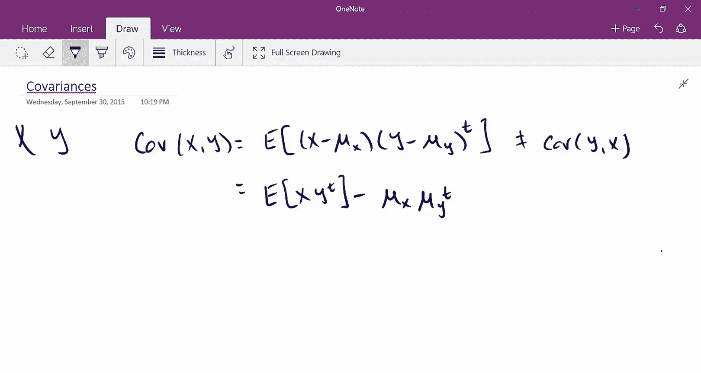
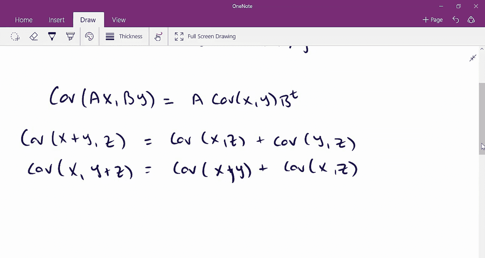
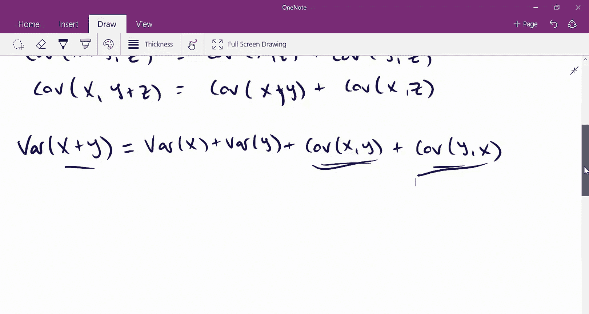
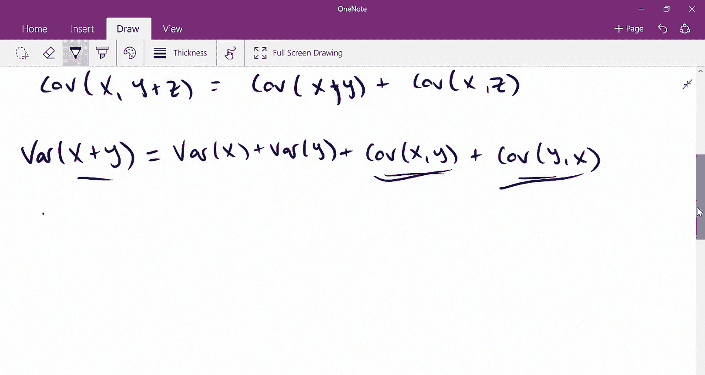
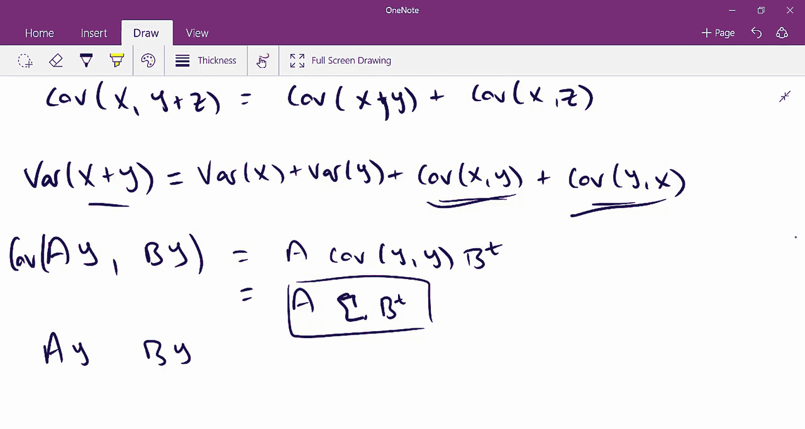

# 约翰霍普金斯大学《数据科学的高级统计｜Advanced Statistics for Data Science》中英字幕（deepseek p115 4_多元协方差与方差矩阵运算.zh_en -BV1htPjeYEFH_p115-

Let's talk about multivariate covariances。So。And these are a little less。

 these are often less described the multivariate variances， but I find them very useful。

 so I'm going to just go over their properties really quick if I have a vector X and another vector Y。

Then the covariance。Between x and y is going to be defined as the expected value of x minus its mean。

 let's call that mu of x out of product with y minus its mean， let's say mu of y。Transpose。

So notice first off， the multivariate covariance is not symmetric。

 so covariance Xy is not necessarily equal to covariance。Y comma X。

We also note that if we plug in y equal to x， we get the variance。

 so covariance x comma x is going to be equal to the variance of x。

It also has a shortcut formula just like Uniivariate covariance calculations have a shortcut formula。

 and that's going to be the expected value of the outer product of x and Y。

mininus the outer product of the expected value of x and the expected value of y。

 and I think given the way in which we derive the shortcut formula for the variance。

 you should be able to now at this point， derive this shortcut formula for the covariance。

So the covariance has some nice properties。And perhaps the most useful one。Is that。

If we take the covariance of a times x and B times y。Where A and B are constant matrices。

Then that's going to be a times the covariance of x and Y。Be transposed。

 so the left hand arguments gets pulled out to the left side and the right hand one gets pulled out to the right side。

 but then gets transposed。The second thing is that covariance。Of x plus y。And Z。

 let's say suppose we have three random variables， covariance of x plus y。

 and z is equal to the covariance of x and z。Plus， the covariance。Of why。And Z。And similarly。

 the covariance of x and y plus z is going to be equal to the covariance。Of x plus y。

ACovariance of x and y plus the covariance。Of X and Z。

So we can also look at formulas that are useful， such as the variance of a sum now we can write it out correctly if we have we want to know what the variance of x plus y is。

 and I you know I suggest that you prove this yourself just using the collection of rules that we've given you so far。

 the variance of x plus y is equal to the variance of x。

Plus， the variance of y。Plus plus the covariance， not twice。

 but plus the covariance of x comma y plus the covariance。Of y comma x and notice in this case。

 the dimensions work out。Because we're assuming that x and y are both n by one so that addition is meaningful so that covariance x comma Y and covariance y comma x have the same dimension。

 it's not guaranteed。In general， it'll often be the case that the covariance is not a square matrix。

 if y， for example has a different dimension than x。But in this case。

 we're assuming it does because we're assuming that x plus y is meaningful。

 certainly you get this nice covariance formula， so if x and y are uncorrelated。

hen these two terms would be zero are mutually uncorrelated。

 the vectors x are mutually uncorrelated with vector y， then those two terms would be zero。

 and then the variance will distribute across sums。Just like in the Univariate case。

 if we have uncorrelated random variables， then the variance will distribute across sums okay。

 so I think that's pretty much all you need to know oh one one more extremely useful fact。

Often this may seem strange， but it's often the case that a times y。

And B times y。Two random vectors that are functions of the same kind of originating vector y。

RightThe covariance of those can be zero so this is a times the covariance of y in itself。

B transpose， and let's just assume that the covariance of y in itself is this multivarivariance covariance matrix sigma。

So what we can see is that AY is going to be uncorrelated with BY。If and only if this quantity。

Is exactly zero。Okay， and that's a tremendously useful fact that we'll use quite often。

So in the next couple parts of this section， we're going to talk about quadratic forms and how we can calculate now we can calculate moments in those cases。

 and we'll talk about a way in which we can prove an optimality result now that we have multivariate expected values if we make some assumptions about our response and our predictors we could start to add statistical properties to our least squares estimate which up to this point we've only discussed their mathematical properties。

