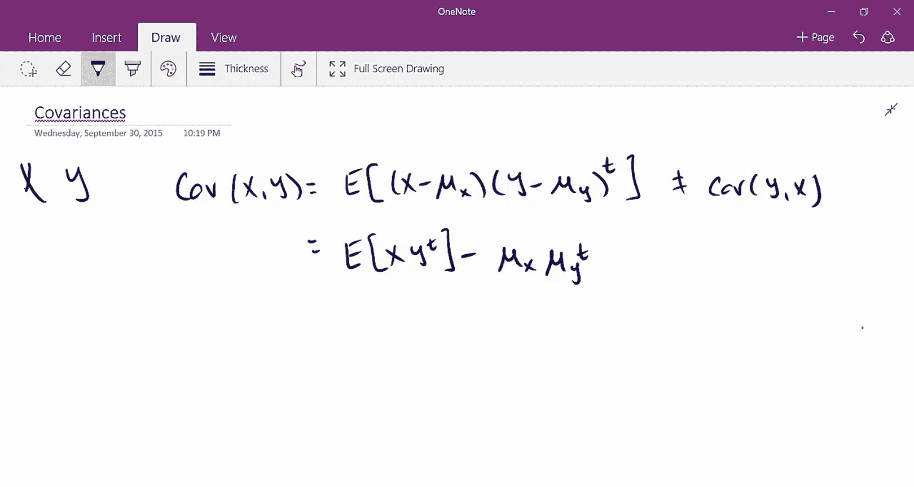
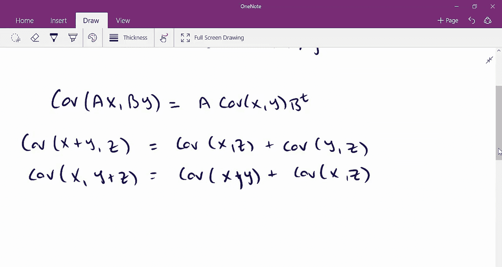
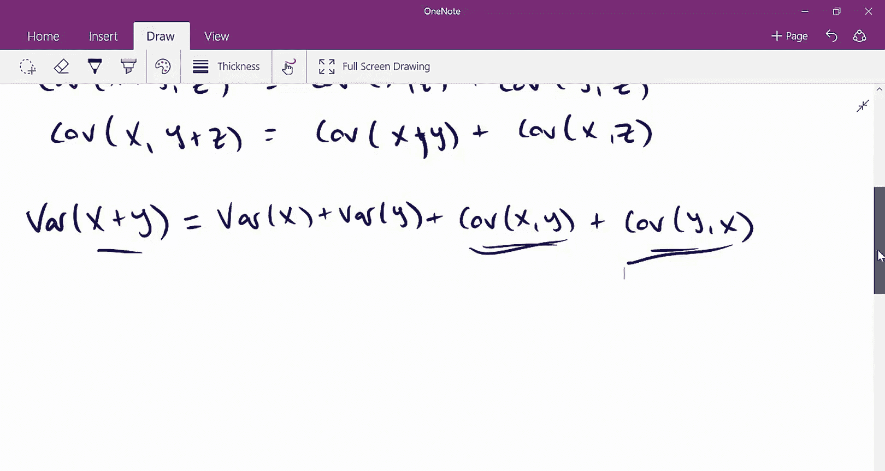
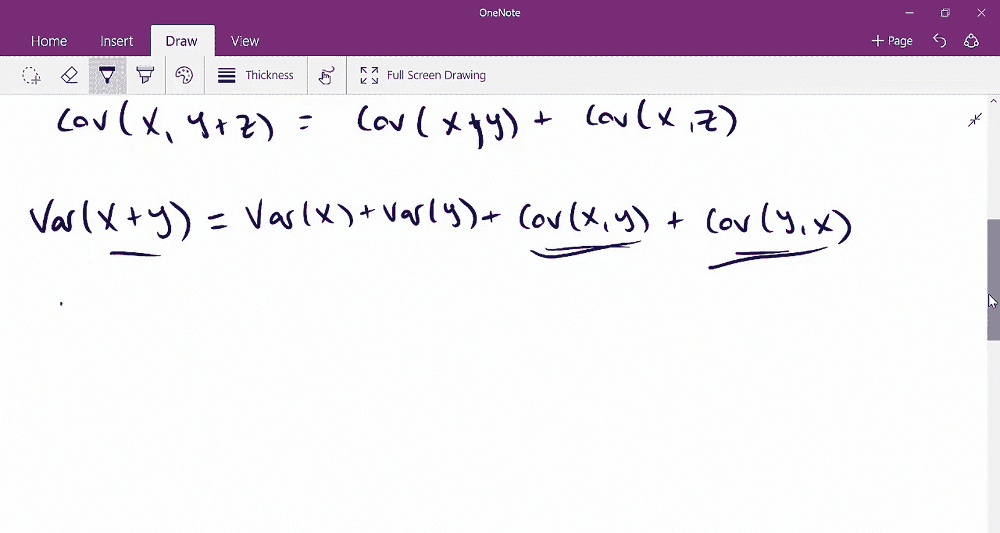
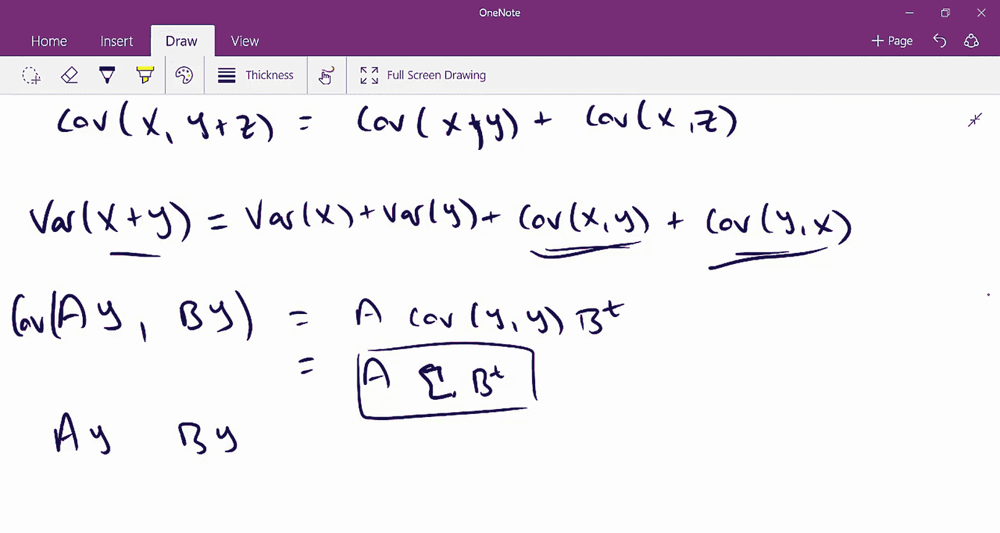

# 高级统计学：4：多元协方差与方差矩阵运算

在本节课中，我们将要学习多元协方差的概念及其运算规则。我们将从定义开始，逐步介绍其性质、计算公式以及一些在实际应用中非常有用的特性。

## 多元协方差的定义

上一节我们介绍了方差矩阵，本节中我们来看看两个随机向量之间的协方差。假设我们有一个随机向量 **X** 和另一个随机向量 **Y**，它们之间的协方差定义为：

**公式**：`Cov(X, Y) = E[(X - μ_X)(Y - μ_Y)^T]`

其中，`μ_X` 和 `μ_Y` 分别是 **X** 和 **Y** 的均值向量。请注意，这个定义是向量形式的推广。

首先需要注意，多元协方差**不是对称的**。也就是说，`Cov(X, Y)` 不一定等于 `Cov(Y, X)`。

此外，如果我们令 **Y = X**，那么协方差就变成了方差矩阵：`Cov(X, X) = Var(X)`。

## 协方差的计算公式

与一元协方差类似，多元协方差也有一个简化计算公式。

以下是协方差的简化计算公式：

**公式**：`Cov(X, Y) = E[XY^T] - E[X]E[Y]^T`

这个公式的推导方式与一元方差的简化公式类似，掌握了前面的知识后，你应该能够自行推导这个公式。

## 协方差的性质

了解了定义和计算公式后，我们来看看协方差的一些重要性质。这些性质在简化复杂表达式时非常有用。

以下是协方差的一些关键性质：

1.  **线性变换**：如果 **A** 和 **B** 是常数矩阵，那么 `Cov(AX, BY) = A * Cov(X, Y) * B^T`。这意味着左边的参数（**A**）被提取到左边，右边的参数（**B**）被提取到右边并转置。
2.  **分配律**：对于三个随机向量 **X**, **Y**, **Z**，有：
    *   `Cov(X + Y, Z) = Cov(X, Z) + Cov(Y, Z)`
    *   `Cov(X, Y + Z) = Cov(X, Y) + Cov(X, Z)`

## 和的方差公式

利用上述性质，我们现在可以正确地写出两个随机向量之和的方差公式。

以下是两个随机向量之和的方差公式：

**公式**：`Var(X + Y) = Var(X) + Var(Y) + Cov(X, Y) + Cov(Y, X)`

请注意，这里不是两倍的协方差，而是分别加上 `Cov(X, Y)` 和 `Cov(Y, X)`。在这个公式中，我们假设 **X** 和 **Y** 维度相同，因此加法运算和协方差矩阵的维度都是有意义的。

如果 **X** 和 **Y** 是**互不相关的**，那么这两个协方差项都为零，方差就可以像一元情况那样直接分配：`Var(X + Y) = Var(X) + Var(Y)`。

## 一个非常有用的性质

最后，我们介绍一个在统计推断中极其有用的性质。这个性质涉及由同一个随机向量变换而来的两个新向量。

假设我们有一个随机向量 **Y**，其协方差矩阵为 **Σ**，即 `Var(Y) = Σ`。现在考虑它的两个线性变换：**AY** 和 **BY**，其中 **A** 和 **B** 是常数矩阵。

**公式**：`Cov(AY, BY) = A * Σ * B^T`

这个公式表明，**AY** 和 **BY** 是**不相关的**，当且仅当 `A * Σ * B^T = 0`（零矩阵）。这个结论在证明估计量的最优性时非常关键。

## 总结与展望

本节课中我们一起学习了多元协方差的定义、计算公式和核心性质。我们看到了协方差矩阵如何在线性变换下变化，以及如何计算随机向量之和的方差。最重要的是，我们掌握了判断两个由同一向量线性变换而来的新向量是否相关的条件。

在接下来的章节中，我们将讨论**二次型**，并学习如何计算其矩。更重要的是，基于我们现在掌握的多元期望和协方差知识，我们可以为之前只讨论过数学性质的最小二乘估计添加**统计性质**。在做出一些关于响应变量和预测变量的假设后，我们将能够证明最小二乘估计的某些最优性结果。