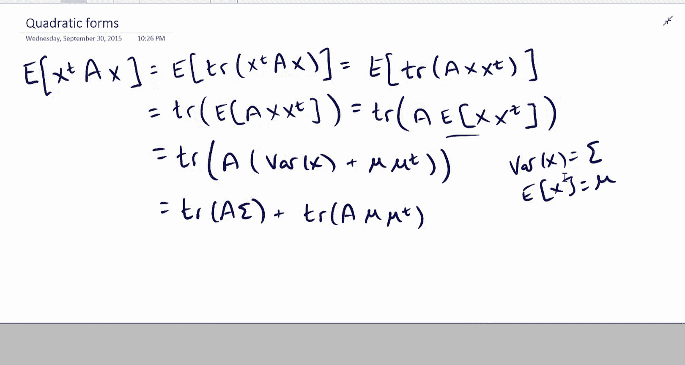
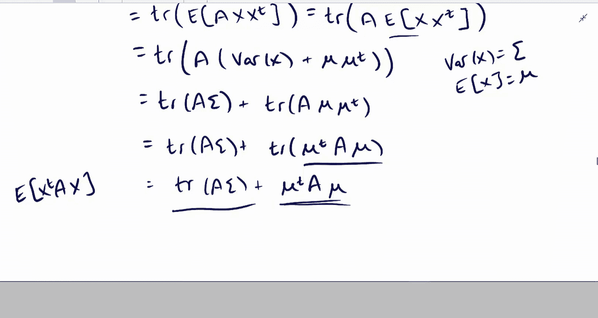

# 约翰霍普金斯大学《数据科学的高级统计｜Advanced Statistics for Data Science》中英字幕（deepseek p116 5_二次型的期望值.zh_en -BV1htPjeYEFH_p116-

Let's talk about a useful result where we can calculate the expected value of a scalar quantity but has vector building blocks。

 so consider quadratic forms where I have x transpose Ax。

Where x is in let's say an n by one vector and so x transpose ax is a scalar where a is maybe a symmetric matrix。

 and there's a pretty clever trick to figuring out this expected value。

 So I just want to show you and it comes in handy quite a bit in this class。

 So the way we calculate this expected value is because it's a scalar the expected value of this quantity is equal to the trace of the expected value。

Because the trace of a scalar is just the scalar。And then because the trace A B is trace B A。

Right we can take the trace and they say this is the trace of x。X transpose。

And then because the trace is a linear operator and the expected value is a linear operator。

 we can pull the trace out of the expected value。So that's the trace of the expected value of a xx transpose。

Now。Because A。Isn't random， We can pull it out of our expected value。

 So this is the trace of the expected value of x x transpose now。 And remember。

 by the definition of the shortcut definition of variance， this quantity here。

 expected value of x x transpose is nothing other than the variance of x。Plus。

 the expected value of x， expected value of x transpose， so this is trace。Of a。

Times the variance of x。Plus， and let's just say the expected value of x is mu plus mu mu transpose。

Okay。So let's just call the variance of x， let's call that sigma。

 so just over here we're going to say that the variance of x we're just going to define is capital sigma and the expected value of x we've typically defined as mu。

Okay， so now we can write this as the trace of a sigma。Okay， plus the trace。Of a mu mu transpose。

But again。

The trace A B is trace BA。So we can write this as the trace of a sigma。Plus。

The trace of mu transpose a mu。Which is equal to the trace v sigma。

Plus now trace of mu transpose a mu is just mu transpose a mu because that's this is a scalar。

 So the trace of a scalar is just that scalar itself。Okay。

 so let's remind ourselves where we're calculating the expected value。

 This is the expected value of x transpose a x。 And what you'd really like is for the expected value to really move through and operate on both sides。

 So you'd really like this to be just the answer by itself。

 The expected value of x transpose ax is expected value of x transpose a expected value of x transpose。

 That would be great。 And it does work out that that's a component of the expected value。

 But you have this other term here， trace a sigma as well。

 And I like this proof because it involves a lot of little nifty tricks like moving the trace in and out of the expected value。

 But it works out to be pretty simple。 So quadratic forms。

Which we're going to run into a lot of quadratic forms in this class。

 have very simple expectation calculations。

