# 约翰霍普金斯大学《数据科学的高级统计｜Advanced Statistics for Data Science》中英字幕（deepseek p117 6_最小二乘估计的期望性质.zh_en -BV1htPjeYEFH_p117-

Now let's consider a setting where we can use some of our results。So imagine if we have a vector y。

And we're going to assume outcome Y。And that's going're going to n by one。

 and we have a vector acts of predictors that's n by P。And we're going to assume that expect a value。

Of y is equal to x beta。And let's say that the variance of y。Is equal to sigma squared。

Times an identity matrix， So the components of y are uncorrelated with a constant variance。And。D。

Expect a value of y is this linear combination of the columns of x given by beta and we don't know and like to estimate beta。

 Well， if we use beta hat as our least squares estimator x transpose x。Inverse x transpose y。

 The first thing we can note is that the expected value of beta hat。Is the expected value。Of。

X transpose x inverse， x transpose y。Which is equal to the expected。

Which is equal to x transpose x inverse， x transpose expected value of y。

 since we're assuming we're conditioning on x， so we're assuming x is not random。

And then expect a value of y is just x beta。Well this quantity right here。

 x transpose x and this quantity right here are just inverses。

 we have x transpose x and x transpose x inverse， so this works out to just be beta so beta hat is unbiased。

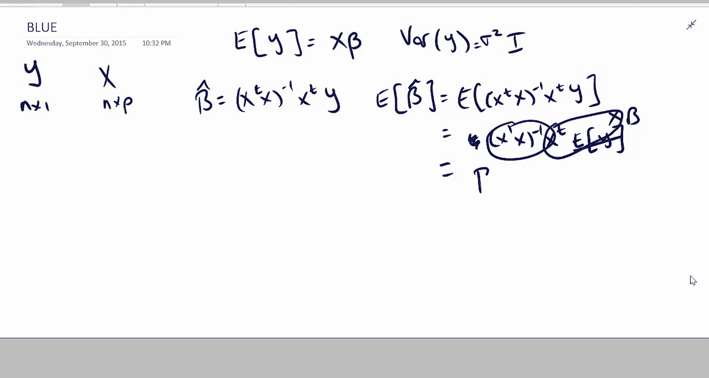

Its expected value is what it's like to estimate， what we'd like to estimate。

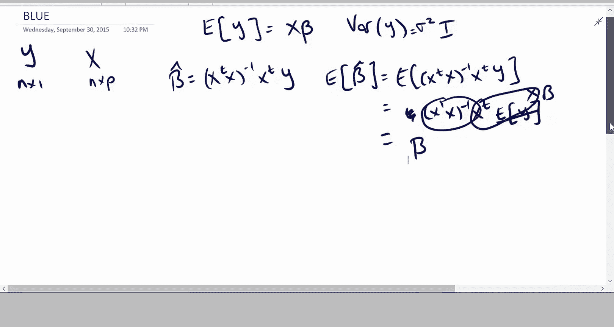

And then also we can calculate the variance of beta hat。Under this these assumptions。

 so the variance of beta hat。Is equal to the variance。Of。X transpose X inverse。X transpose y。

Which is equal to x transpose x inverse x。Variarianance of y。

 and then times the matrix transposed again x transpose， and then x transpose x inverse symmetric。

 so that's just x transpose x inverse again。And then I get， I'm just going to write it out again。

And the variance of y is sigma squared times I。 So I'm just not going to write it Sigma squared times I。

I'm not going to write that because I'm just going to pull it out because the I doesn't change anything in the sigma squared is scalar。

 so then we get x transpose。X transpose x inverse。 And then we can put our sigma squared out here。

 Okay， so we have x transpose X inverse， X transpose X and X transpose X inverse。

 So this works out to be x transpose X inverse sigma squared。 So a lot of like。A lot like our。

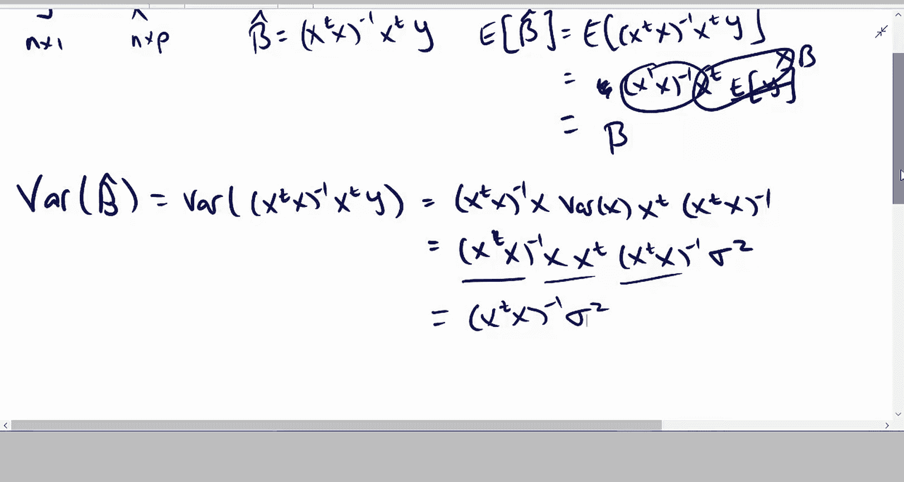

Linear regression estimate， the variability of the regressor winds up being， in a sense。

 you know in a matrix sense in the denominator。And this tells us that just like in linear regression。

 in order to have our variance estimate of our coefficient be smaller。

 we want the variances of our x's to be larger， and that makes a lot of sense if you think back in linear regression。

 if you want to estimate a line really well， if you collect x's in a very tight little ball。

 you're not going to be able to estimate that line very well， But if you collect x's。

All along the line， In other words， the variance of x is very large。

 Then you're going to be able to estimate that line with greater precision。 So， so we want。

 it's interesting that we。Don't want variability in our Y's。 We want sigma squared to be small。

 but we do want variable in our x's。 We want the variability in our x's to be large， and in fact。

 in linear regression， the most variable you can make things is if you get half of your x observations at the lowest possible value and half of your X observations at the highest possible value。

 that'll give you the maximum variance for the denominator。Of course。

 you're banking a lot about the relationship not doing anything funky in between this big gap where you didn't collect any data。

 but that is if you're really quite certain about the linearity，Then that would minimize。

That would minimize the the variance of the。Of the estimated of the estimated coefficient。Okay。

 the last thing is we can estimate the variance of Q transpose beta。Where Q is a linear contrast。

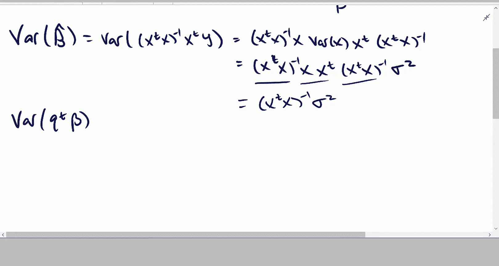

So that works out to Q transpose beta hat， so that just works out to be Q transpose。

Times the variance of beta hat。Times Q， which is then just Q transpose x transpose x inverse Q times sigma squared。

 and it's interesting to note。That。As an estimate， Q transpose beta hat is an estimate of Q transpose beta。

 and we can show that this estimator Q transpose beta hat is so called blue。

Not blue because it's sad， in fact， blue because it's happy because it's best。Linear。

A biased estimator。So。First of all， let's check off these things to make sure clearly it's an estimator。

And it's unbiased。 you know that Q transpose beta hat is unbiased because we know that beta hat is unbiased and  Q is just another scalar or just another constant multiplier。

 So it would just pull out of the expectation。 So it's unbiased。 beta hat is linear and y。

 So Q transpose beta hat is linear and y。 So when we mean linear， we mean linear and y。

 So it's linear and y。 And so best。 Well， what do we mean by best。

 And what we mean is that it has minimum variance。And we can show this very quickly and it has quite a clever proof。

 and it involves all of our techniques that we've used in these last couple of lectures。

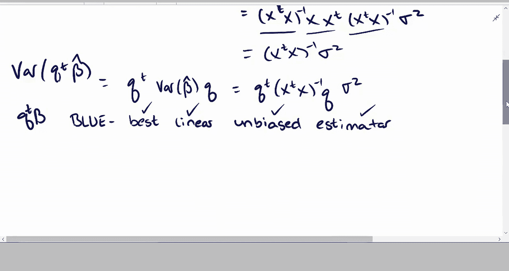

So take as an example to try to find another estimator that is also linear。

 so let's say k transpose times y is another linear estimator of Q transpose beta for some value of k and then because this estimator is linear and unbiased。

That expect a value of k transpose y。Is equal to k transpose expect value of y， which is x beta。

And we want that to be unbiased， so we want it to be equal to Q transpose beta。

 so we know that k transpose x has to equal Q transpose because this statement has to be true for all possible betas right we cant even though we don't know beta。

 we need this unbiasedist property to exist across all possible betas。

 so that means K transpose x has to equal Q transpose。

 so that's the first fact that you have to keep in your back pocket here。Okay。

 the second thing we're going to talk about。

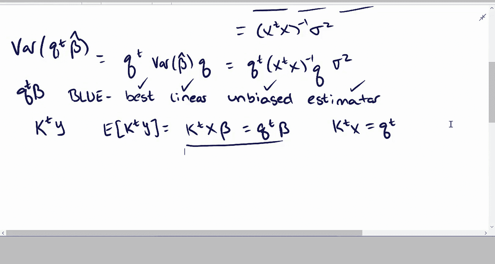

Is let's look at the covariance。Of the two estimators， covariance of Q transpose beta hat。And。

K transpose y。And that's equal to Q transposse， we pulled that out of the covariance on that side。

Covariance of beta hat。Times K transfer。And when I pull the K out of it。

 I get y and I'm pulling out a K transpose， so I get K transpose transpose， which is k on that side。

Now。Covariance。Beta hat is。X transpose x inverse， x transpose y， and we have with y there times k。

 So now we can pull out the x transpose x inverse part。

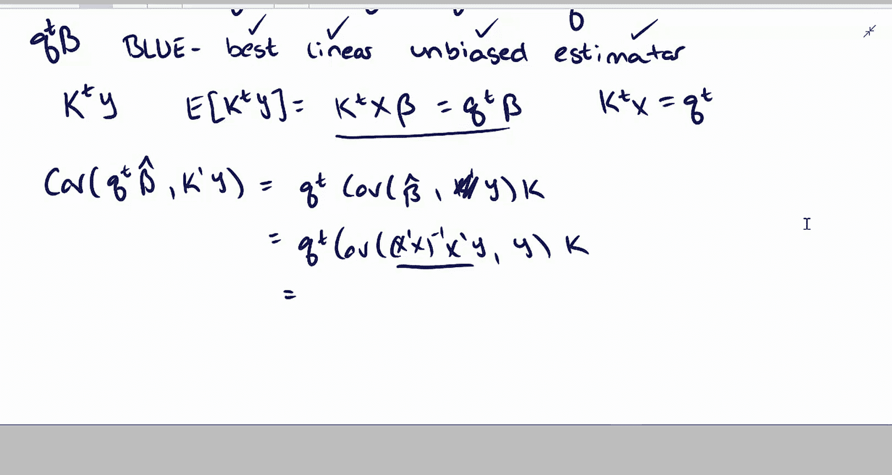

X transpose part。 So this is。Q transpose times x transpose x inverse x transpose。

 then covariance of y with itself times K， which is equal to the Q transpose x transpose x inverse x transpose covariance of y with itself is just the variance of y。

 we're assuming that's I sigma squared。 So I'm just going to put that as K times sigma squared。

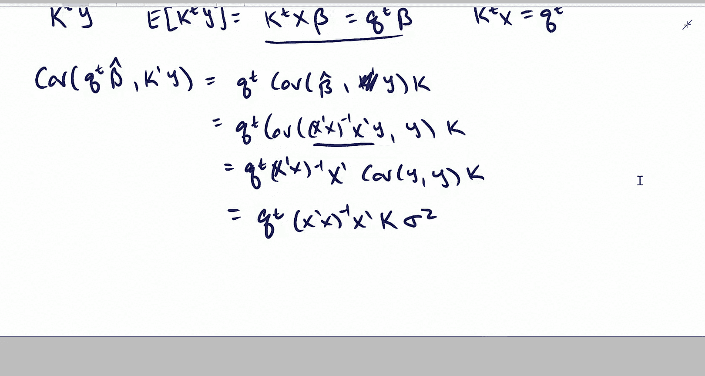

Okay， now from this point above right here。We can replace。X transpose K with Q。

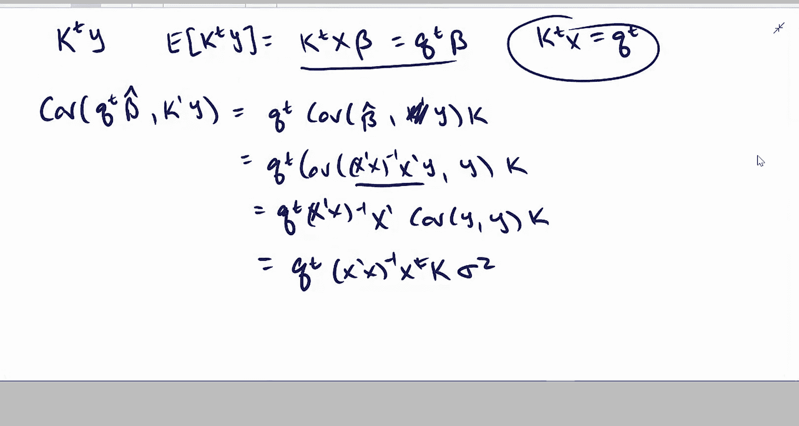

Which is equal to Q transpose x transpose x inverse。Q。Time sigma squared。 And if you look back。

 we can look back。

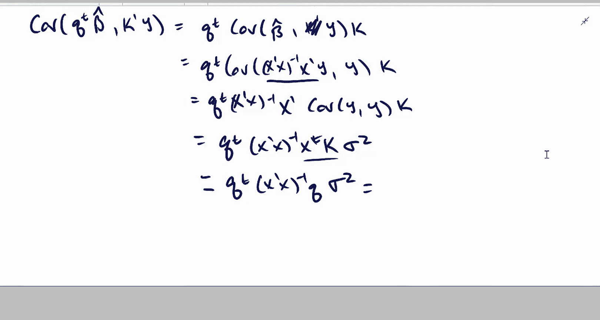

That's exactly equal。

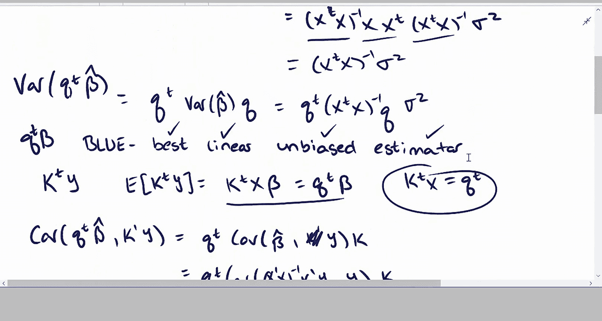

To the variance of Q trans was beta hat， so that's a clever little thing。

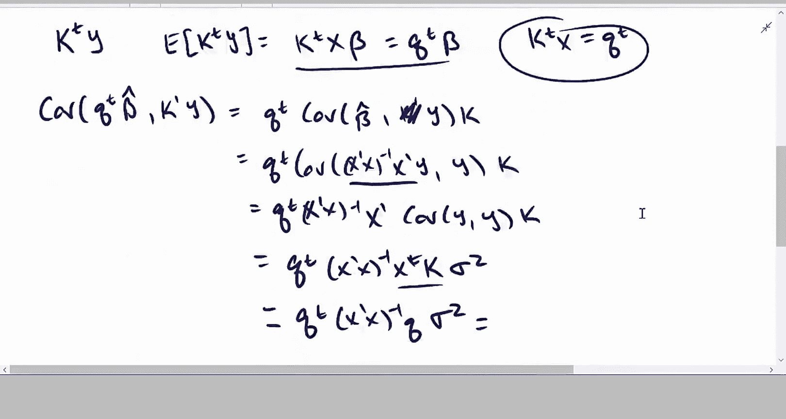

Okay， now let's get to the proof。Now that we have that's another fact that you need to keep in your back pocket so we have two facts you need to keep in your back pocket well first we're done with this one that K transpose x has to equal  Q transpose。

 but the second fact that you have to keep in your back pocket now the only one you have to remember now is that this covariance between the two estimators works out to be equal to the variance of Qant transpose beta hat。

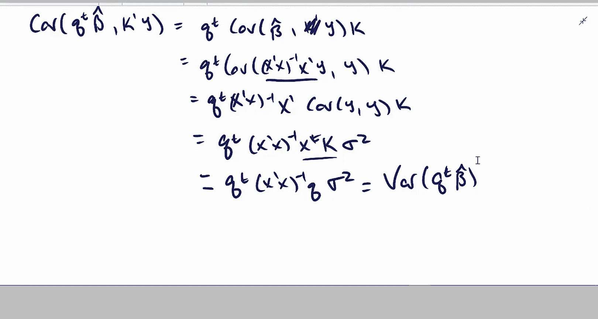

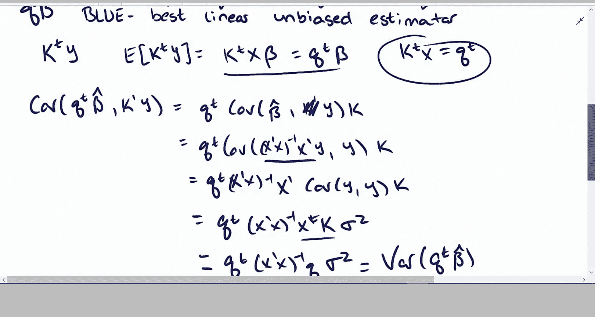

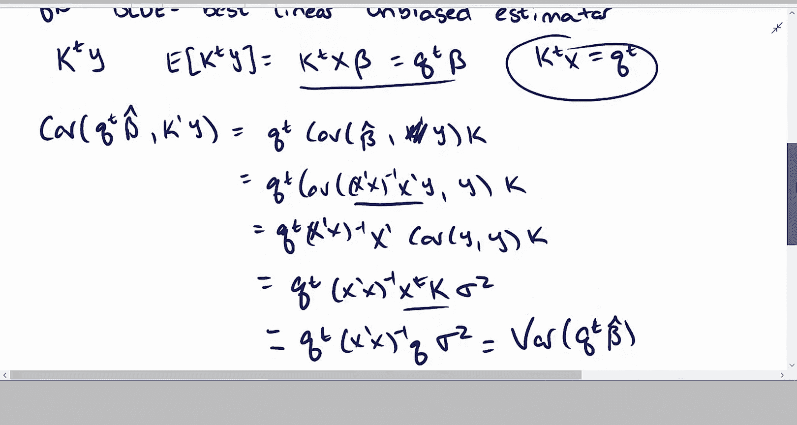

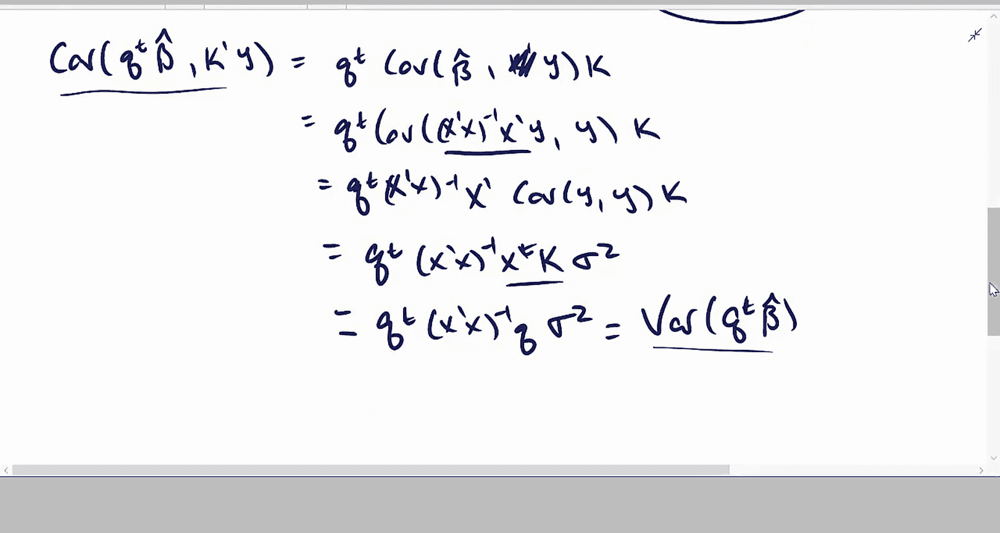

Now。I'm going to take the variance。Of。Q transpose beta hat。And subtract off。K transpo y。

Well by our definition of variances， that's the variance of Q transpose beta hat。Plus。

 the variance of K transpose y。Minus。Two times the covariance。Of Q transpose。Beta hat。

And K transpose y。 Now we know that the covariance just factors out as twice the covariance because in these cases。

 there's scals， Q transfer is beta hat as a scalar。

 K transpose y is a scalar so that the covariance of AB is the covariance of B in this case because that is true when the quantities are scalars now remember the covariance between the two is equal to。

We just proved that the covariance between the two estimators is exactly equal to the variance。

Of Q transpose。Beta hat。So we have this works out to be the variance。Of K transpose y minus。

The variance。Of Q transpose。Beta hat， the last point I'd like to point out。

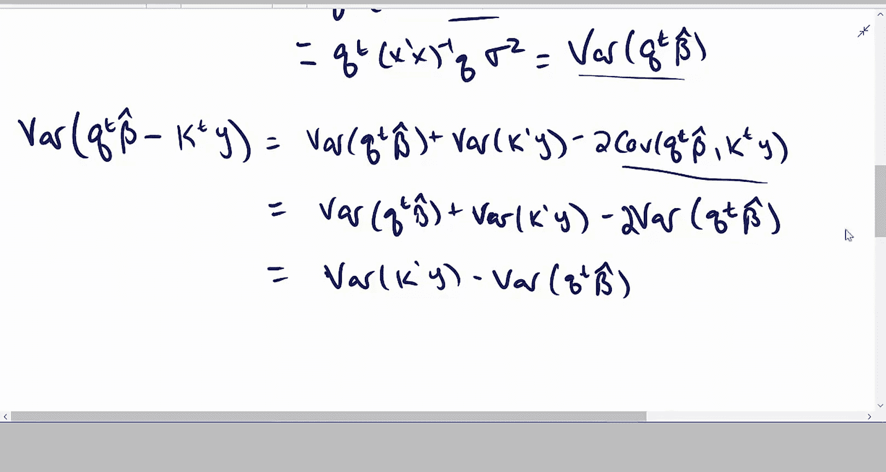

Is that this variance by virtue of being a variance has to be greater than or equal to 0。

 So if we take this statement and argue that it has to be greater than or equal to 0 because it's equal to a variance。

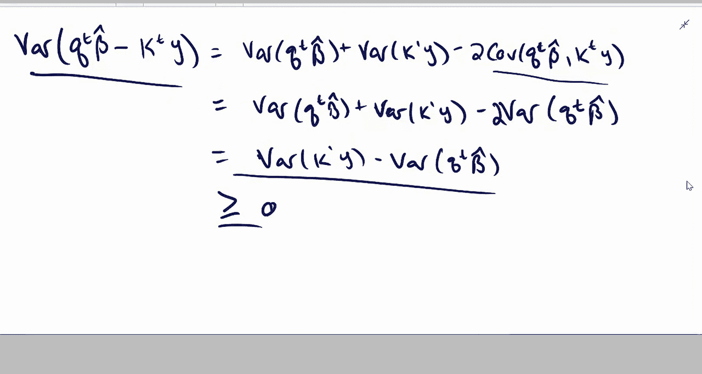

Then what we get is that the variance。Of K transpose y。Has to be greater than equal to the variance。

Of Q transpose beta hat。So there you have it。That if you take any。

Other linear combination of Y' that results in a unbiased estimator。

Their variance has to be greater than or equal to the obvious linear combination of beta hat。

 So beta hat is the best linear unbiased estimator。 I also want to make one last point is that。

Taking the best in terms of minimum variance is only really meaningful if you restrict yourself to the class of unbiased estimators。

Take if we didn't have the class of unbiased estimators as a restriction。

 then we can always get minimum variance by just estimating things with a constant if I just estimate everything with the number five。

 the number five has zero variance， but it's quite biased unless you happen to be estimating five。

Okay， so。Based estimators， particularly constants can have zero variances。

 but they're not good estimators， so you can only do this trick where you compare minimum variance。

 where you compare variances if you restrict yourself to a meaningful class of estimators in terms of bias so in this case we restricted ourselves to unbiased estimators and then the linear combination of beta hat。

 the appropriate linear combination of beta hat， we see is the best among all linear unbiased estimators。

Okay， so that's a nifty little result。 And it used all of our tools where we built up tools for expected values。

 variances and covariances。 And then in the next lecture， we're going to start working with。

The multivariate normal distribution， so we can not only just talk about moments。

 but the full complete set of characteristics from the distribution。

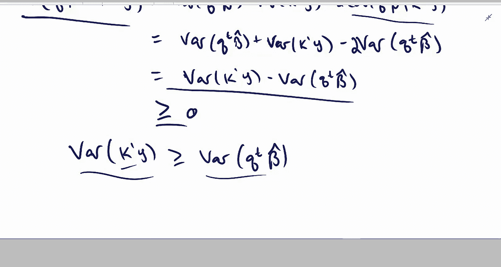