# 高级统计：6：最小二乘估计的期望性质

在本节课中，我们将学习最小二乘估计量在特定模型假设下的期望性质。我们将推导其无偏性，计算其方差，并证明一个重要的结论：最小二乘估计量是“最佳线性无偏估计量”（BLUE）。

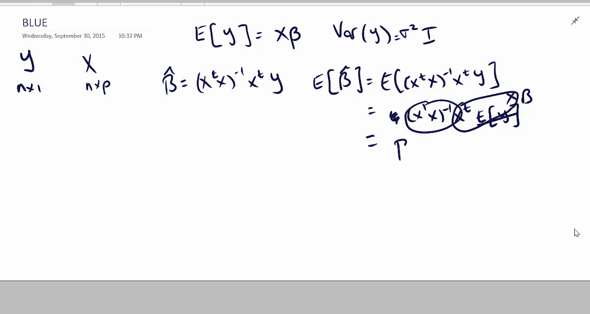

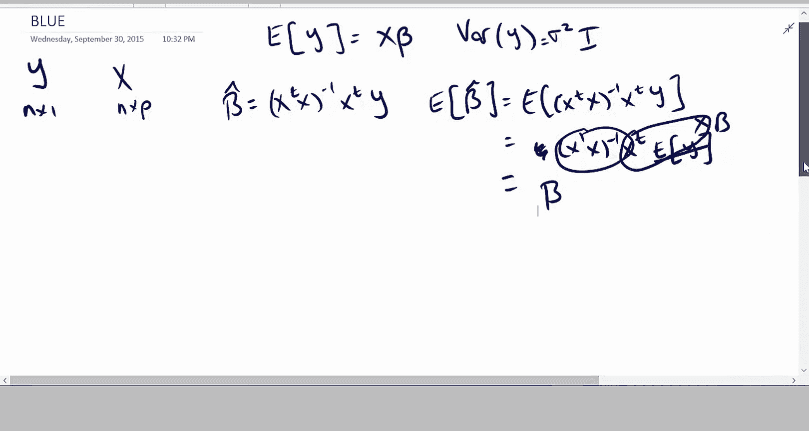

## 模型设定

首先，我们设定一个线性模型。假设我们有一个 **n × 1** 的响应变量向量 **y**，以及一个 **n × p** 的预测变量矩阵 **X**。我们假设 **y** 的期望值等于 **X** 与参数向量 **β** 的线性组合，即：
\[
E(y) = X\beta
\]
同时，假设 **y** 的方差-协方差矩阵为常数方差 **σ²** 乘以单位矩阵 **I**，这意味着 **y** 的各分量不相关且具有相同的方差：
\[
Var(y) = \sigma^2 I
\]
我们的目标是估计未知的参数 **β**。

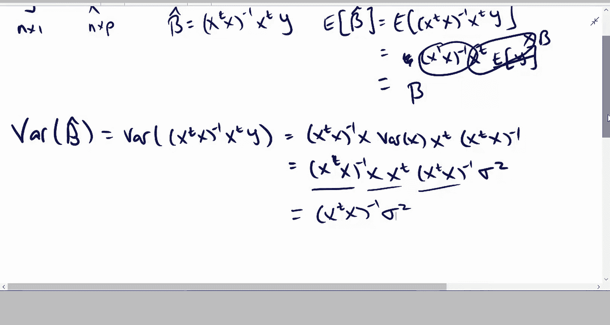

## 最小二乘估计量的无偏性

我们使用最小二乘估计量 **β̂** 来估计 **β**，其公式为：
\[
\hat{\beta} = (X^T X)^{-1} X^T y
\]
接下来，我们计算 **β̂** 的期望值。在假设 **X** 是固定的（非随机）条件下，我们有：
\[
E(\hat{\beta}) = E[(X^T X)^{-1} X^T y] = (X^T X)^{-1} X^T E(y)
\]
由于 \( E(y) = X\beta \)，代入上式得：
\[
E(\hat{\beta}) = (X^T X)^{-1} X^T X\beta = \beta
\]
因此，**β̂** 是 **β** 的一个**无偏估计量**，其期望值恰好等于我们想要估计的真实参数。

## 最小二乘估计量的方差

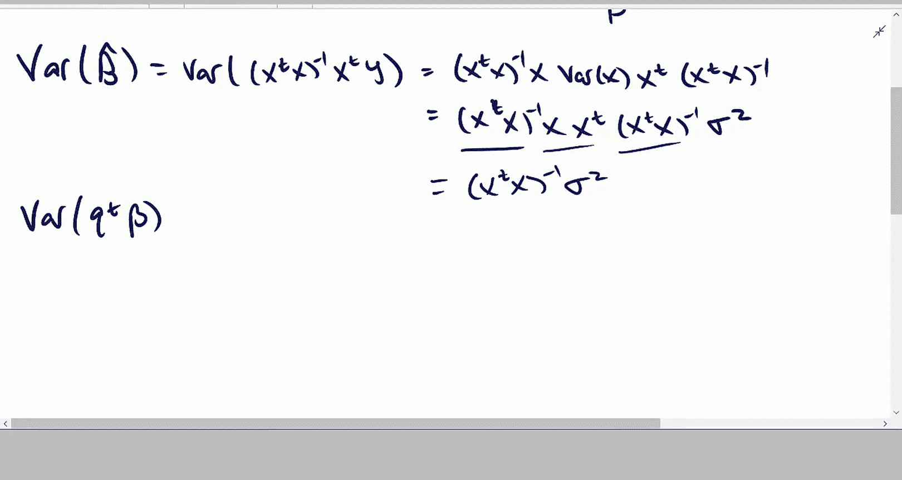

上一节我们证明了 **β̂** 是无偏的，本节我们来计算它的方差。方差衡量了估计量的波动性。

根据方差的定义和模型假设，**β̂** 的方差计算如下：
\[
Var(\hat{\beta}) = Var[(X^T X)^{-1} X^T y]
\]
由于 **X** 是固定的，我们可以将其视为常数矩阵提出：
\[
Var(\hat{\beta}) = (X^T X)^{-1} X^T \cdot Var(y) \cdot [(X^T X)^{-1} X^T]^T
\]
因为 \( (X^T X)^{-1} \) 是对称矩阵，其转置等于自身，且 \( Var(y) = \sigma^2 I \)，所以：
\[
Var(\hat{\beta}) = (X^T X)^{-1} X^T (\sigma^2 I) X (X^T X)^{-1} = \sigma^2 (X^T X)^{-1}
\]
这个结果与线性回归中的结论一致。方差公式中的 \( (X^T X)^{-1} \) 起到了关键作用。它告诉我们，为了降低系数估计的方差（即提高估计精度），我们希望预测变量 **X** 的变异性更大。直观上理解，如果我们收集的 **X** 值分布在一个很窄的范围内，就很难精确地估计回归线；反之，如果 **X** 的取值分布广泛（方差大），我们就能更准确地估计这条线。

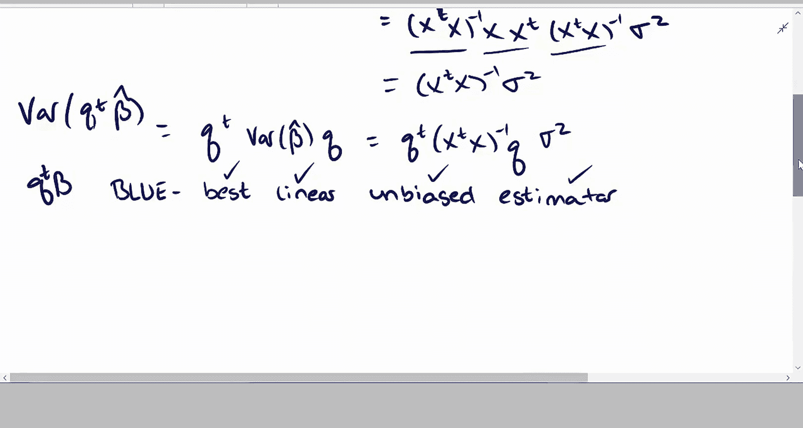

## 线性对比的估计与BLUE性质

现在，我们考虑对参数 **β** 的线性组合进行估计。设 **Q** 是一个 **p × 1** 的常数向量，我们感兴趣的是估计量 **Q^T β**。

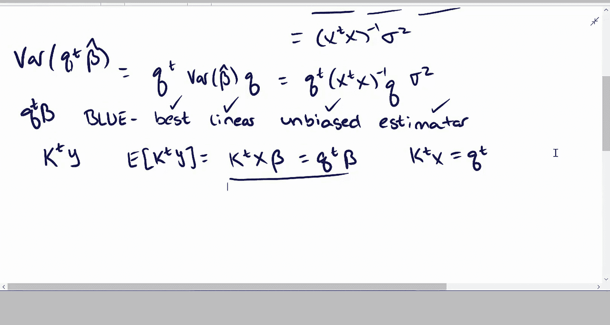

一个自然的估计量是 **Q^T β̂**。根据之前的推导，这个估计量也是无偏的。它的方差为：
\[
Var(Q^T \hat{\beta}) = Q^T Var(\hat{\beta}) Q = \sigma^2 Q^T (X^T X)^{-1} Q
\]

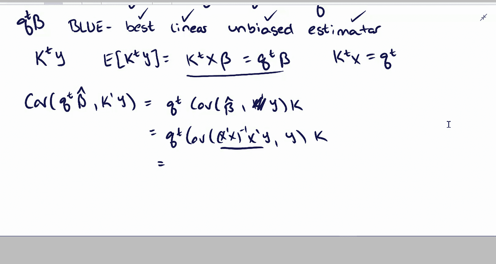

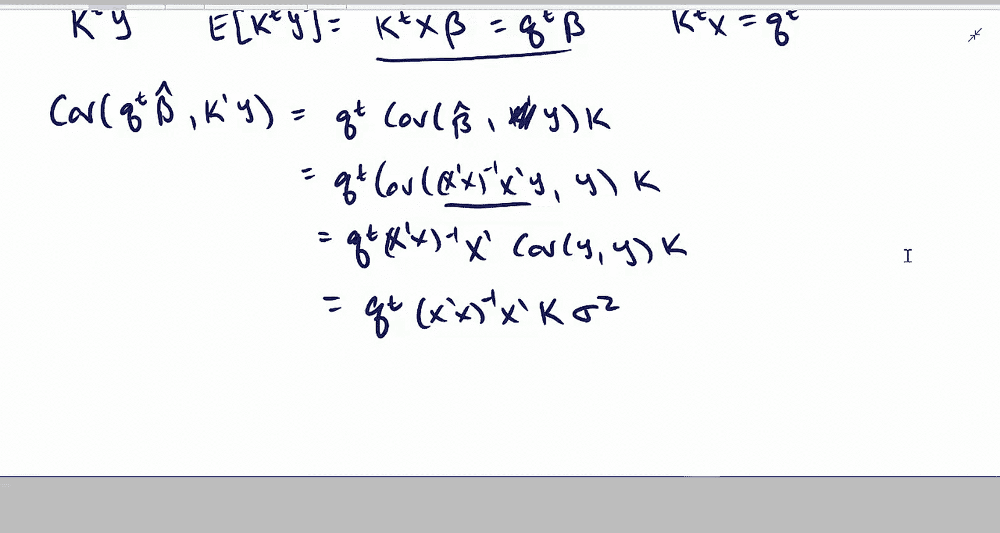

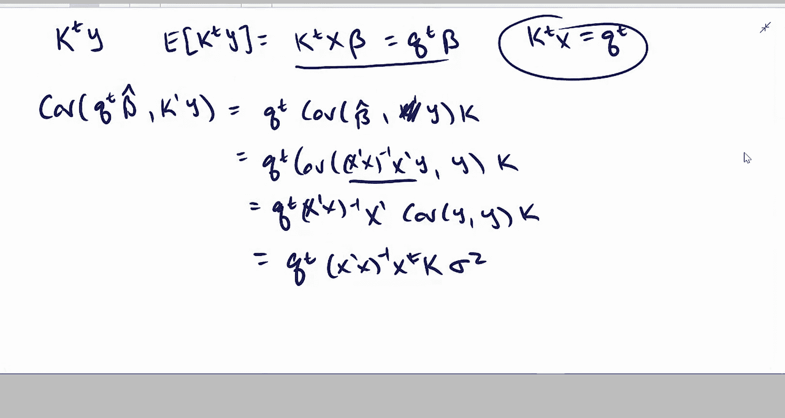

一个重要的结论是：**Q^T β̂** 是 **Q^T β** 的**最佳线性无偏估计量**（BLUE）。这里的“最佳”是指在所有线性无偏估计量中，它具有最小的方差。

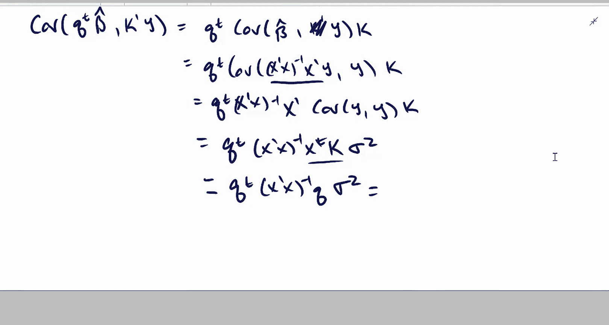

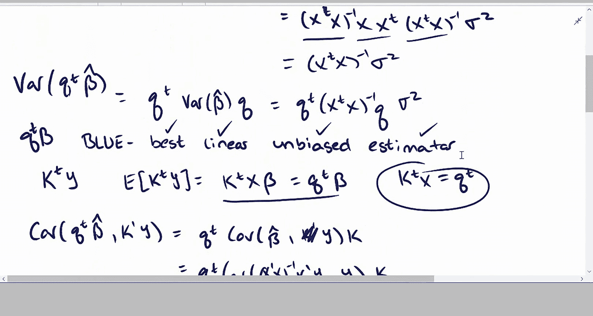

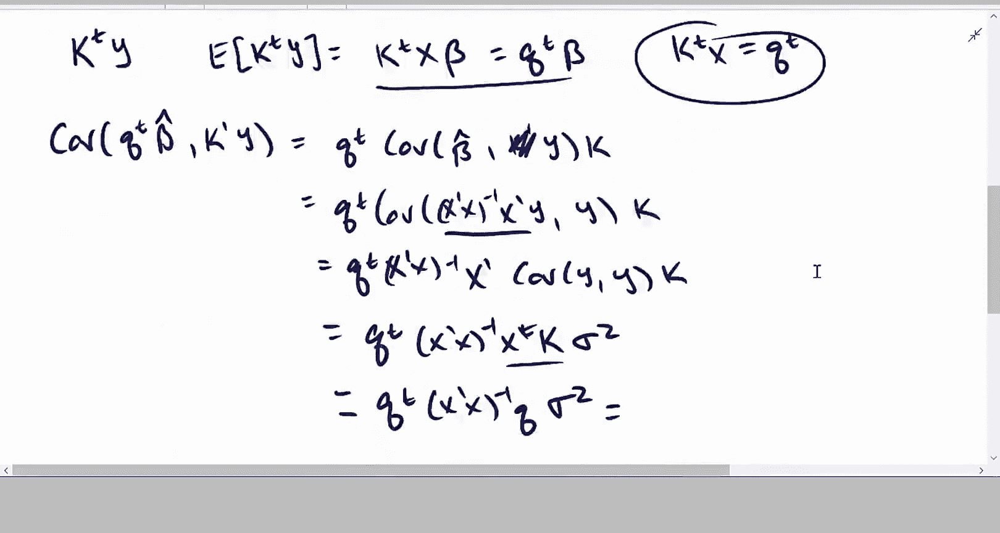

以下是这个结论的证明思路：

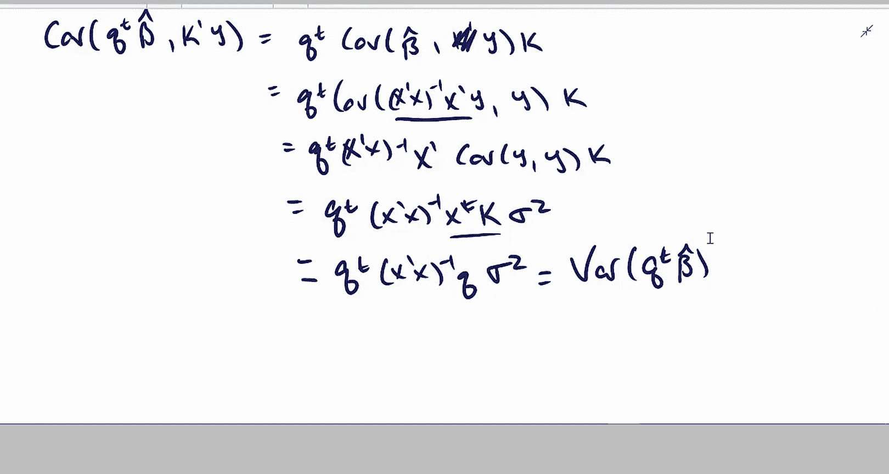

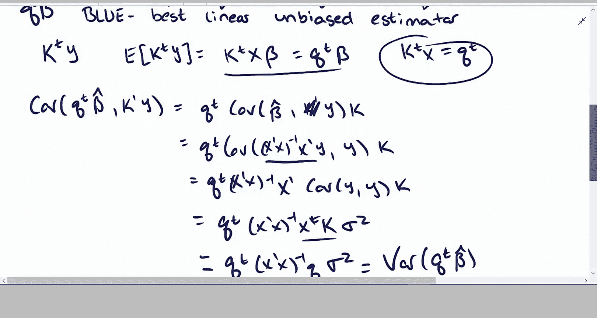

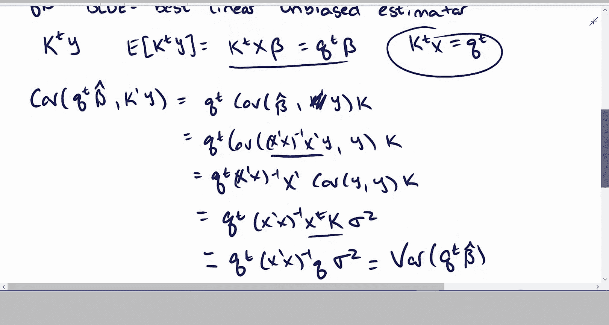

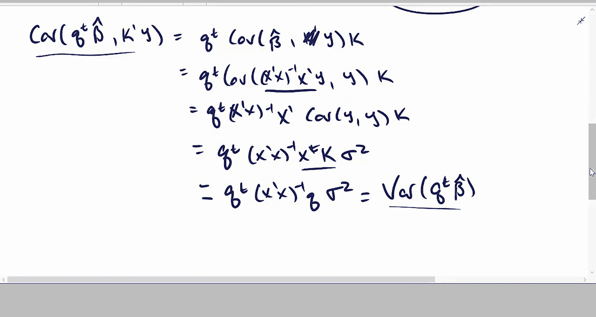

1.  **设定**：假设存在另一个线性无偏估计量 **K^T y**，其中 **K** 是某个常数向量。
2.  **无偏性条件**：由于 **K^T y** 是无偏的，即 \( E(K^T y) = K^T X\beta = Q^T \beta \) 对所有 **β** 成立，这要求：
    \[
    K^T X = Q^T
    \]
3.  **计算协方差**：计算两个估计量 **Q^T β̂** 和 **K^T y** 的协方差。利用方差和协方差的运算规则，可以证明：
    \[
    Cov(Q^T \hat{\beta}, K^T y) = Var(Q^T \hat{\beta})
    \]
4.  **比较方差**：考虑差值 \( Q^T \hat{\beta} - K^T y \) 的方差。由于方差非负，我们有：
    \[
    Var(Q^T \hat{\beta} - K^T y) = Var(K^T y) - Var(Q^T \hat{\beta}) \ge 0
    \]
    这直接推出：
    \[
    Var(K^T y) \ge Var(Q^T \hat{\beta})
    \]

因此，对于任意其他线性无偏估计量 **K^T y**，其方差都不会小于 **Q^T β̂** 的方差。这就证明了 **Q^T β̂** 的BLUE性质。需要强调的是，“最佳”是在**无偏**的线性估计量这个类别中比较方差才有意义。如果不限制无偏性，一个常数估计量（如总是估计为5）方差为0，但显然不是好的估计量。

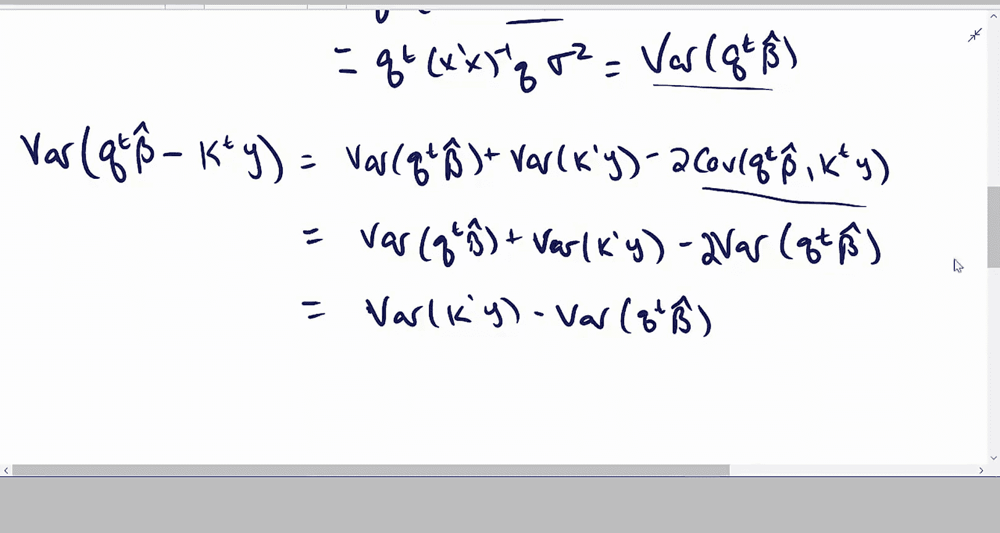

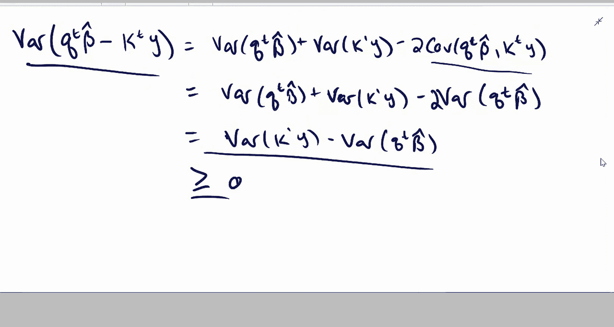

## 总结

本节课中，我们一起学习了最小二乘估计量 **β̂** 的核心期望性质。

*   我们首先在 \( E(y)=X\beta \) 和 \( Var(y)=\sigma^2 I \) 的模型假设下，证明了 **β̂** 是 **β** 的**无偏估计量**。
*   接着，我们推导了 **β̂** 的**方差公式** \( Var(\hat{\beta}) = \sigma^2 (X^T X)^{-1} \)，并解释了预测变量 **X** 的变异性对估计精度的重要性。
*   最后，我们证明了对于参数的任何线性组合 **Q^T β**，其估计量 **Q^T β̂** 是**最佳线性无偏估计量**，即在所有线性无偏估计量中具有最小方差。

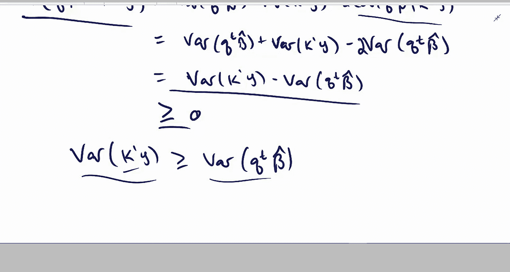

这些结论综合运用了期望、方差和协方差的运算工具，是理解最小二乘估计优越性的基础。在接下来的课程中，我们将引入多元正态分布，从而能够讨论估计量的完整分布特性，而不仅仅是矩（如期望和方差）。