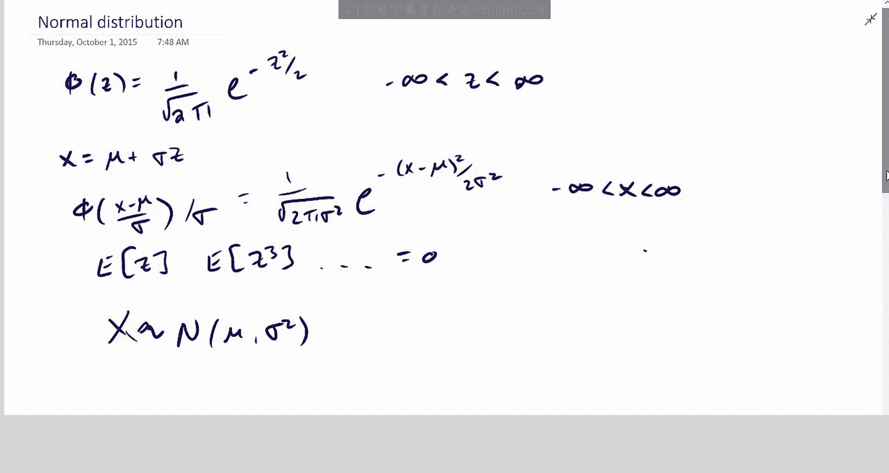
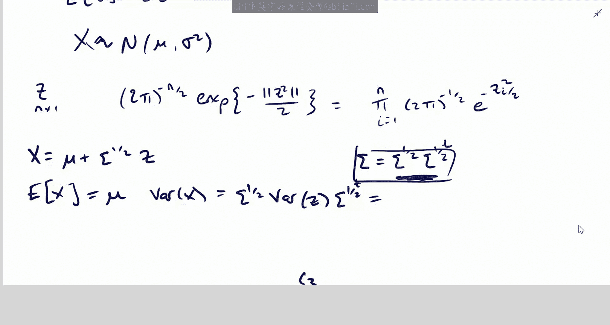
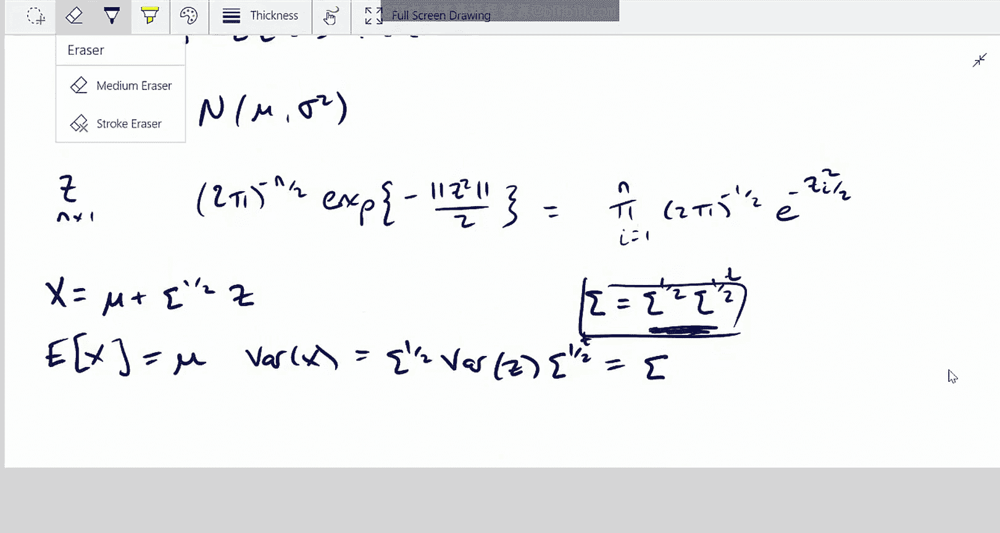
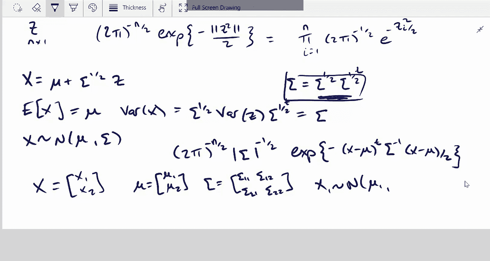
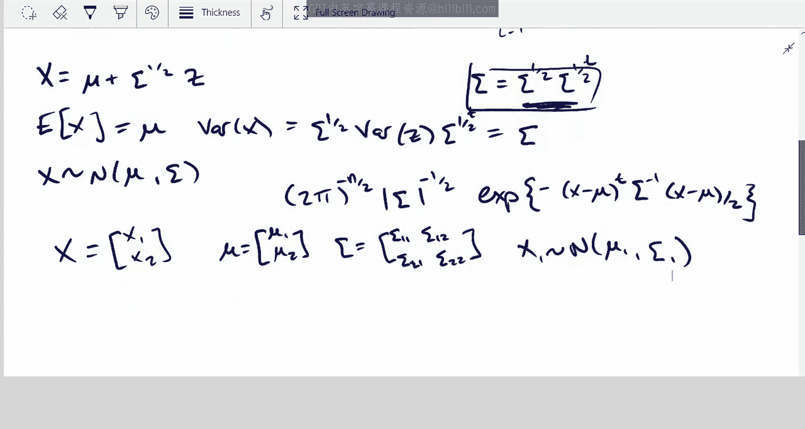
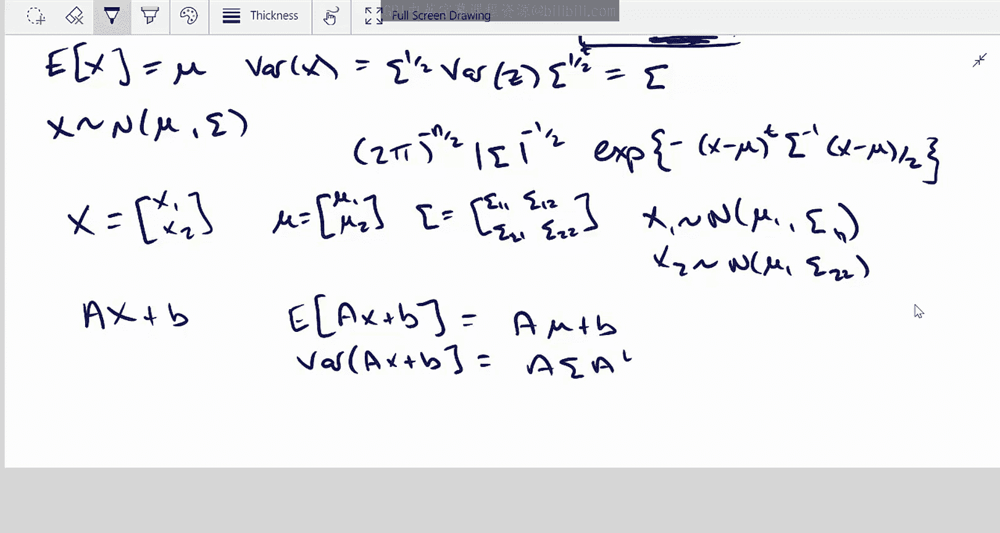
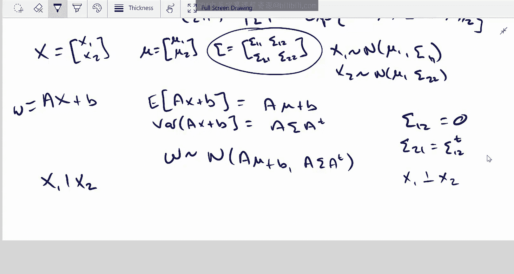

# 约翰霍普金斯大学《数据科学的高级统计｜Advanced Statistics for Data Science》中英字幕（deepseek p118 7_正态与多元正态分布.zh_en -BV1htPjeYEFH_p118-

Let's talk a little bit about the normal distribution。So the standard normal density。

 random variable follows a standard normal if it associated population density is one over a square root。

Tup pi。And then E to the negative z squared over 2。For。Z between。Minus infinity and plus infinity。

And then the non standard normal distribution is any random variable X that has the distribution。

Of mu plus sigma Z。Where Z is a standard normal， and the density of that random variable works out to be phi of x minus mu。

Over Sigma。Divided by sigma。 So we can write out the non standard normal density as a simple function of the standard normal density。

 and it looks the non standard normal density looks to be like one over square root2 pi sigma squared。

E to the negative x minus mu squared over2 sigma squared。Again， from minus inphony。Less than x。

 less than plusfinity。For the standard normal distribution。All of the odd moments are zero。

 so expect a value。H司。Expect the value of Z cubed。And so on are all zero。The normal distribution。

 the non standard normal distribution is characterized by the。Mean in the variance。

 So we might write if something is non standard normal distribution， just。A normal distribution。

 we might write that x is normal mu sigma square。 Okay。

 so hopefully all this is reviewed for you and we can use this to build up the multivariate normal distribution。

So we're going to say that a vector Z。Let's say is a standard multivariate normal。

If its density satisfies。T pi。To the minus n over 2。

The multivariate density E to the negative norm of z squared。Over2。So this is just， by the way。

 equal to the product。I go one to N。Of two pi。Minus1 half。E to the negative Z I squared over2。 Okay。

 so we get the multivariate normal distribution just as a。As the product of a collection。

 the multivariate standard normal distribution， just as the product of a collection of IID standard normals。

 So that's for an n by one vector Z。 And then we might define。A multivariate non standard normal。

 say x。So it would not necessarily mean zero in variance and variance covariance matrix is I。

We might define that as mu plus sigma to the one half。Times Z where。Sigma。

Is a variance covariance matrix sigmma to the1/ half matrix。

 that decomposition is called the Culeski decomposition。So notice if we write x this way。

 the expected value of x。Is equal to mu because the expected of I of z is0 and the variance of x。

Is equal to the sigma of the one half。Variance of。Varance of Z。Pance of Z。

Sigma of the one half transpose， which variance of z is I。

 So we just use this fact and it equals sigma。 Okay， so using that。

 we can define the non standard normal。

D呃。Multivariate normal distribution。Which people would just call then the normal distribution。

Or the multivarit normal distribution， maybe， and we would write that x is normal。Miao。西ig瓜。

Now it's the density associated with it。 We could use the transformation to figure out the density associated with it。

 and it is2 pi。The minus n over 2。Determinate of Sigma。To the。inus1 half。Yi。To negative。X minus mu。

Transpose， sigmaverse。X minus mu divided by 2。Okay， so that's with the non standard normal。

Or what we would just call the normal distribution works out to be the normal distribution。

 the multivari normal distribution has many convenient properties， first of all。

Any sub vectorctor of x。Any sub vector of x also follows a multivariate normal distribution with。

 of course， the。The relevant mean invari。 So， for example。

 if I take x and break it into two column vectors， x1 and x2。

And my mu is has the same corresponding column vectors。 mu on mu2， and my sigma is now a matrix with。

That I decomposed with the same dimensions， then for example。

 x1 is going to be now multivariate normal with mean mu1 and variant sigma 1。

And similarly， x2 is going to be normal would mean mu。Invariance of Sigma， Sigma 2，2。

It should have been signal one more。Okay， so any sub vector of a multivariate normal vector is multivariate normal。

 The second thing that is true about the multivariate normal is any full rank linear combination of multivariate normals is multivariate normal。

 So let's suppose I take Ax plus B。Then we know what the expected value of that is expected value of Ax plus B。

Has to be equal to a mu plus B， and we know what the variance of ax plus b has to be。

That has to be a variance of x， which is sigma a transpose。

However， we also know when x is multivariant normal that then a the variable Ax plus B。

 let's call that。Let's call that W。 Then we know that W has to be normally distributed also with mean a mu plus B and variance a sigma。

A transpo。 So the normal distribution has this property that all linear the multivarit normal distribution has all this property that all full rank linear combinations of multivarit normals are also multivarit normal。

 In addition， all conditional distribution。 So if I take， for example。

 x1 given x 2 where X1 x2 are defined as above that will also be normally distributed。 So all。

Linear combinations， all marginals。And all conditional distributions of the multivariate normal distribution are also multivariate normal。

Another property of the multivariant normal。Is that absence of covariance implies independence。

 So take， for example， my x1 and x2 up here and I look at its covariance matrix。

 I have it written out right here if sigma 12。And which is and sigma， I wrote sigma 21 there。

 but that's just sigma 1，2 transpose because the matrix has to be symmetric。 If if that's0。

 So in other words， if the block off diagonal of the sigma matrix， Sigma matrix is 0。

 then that would imply that x1 is not just uncorrelated with x2， but it's actually independent of x2。

 Okay， so the normal distribution is one of the strange distributions where this is true。

 where not only does independence imply absence of covariance， which is true for all distributions。

 but the reverse direction also applies， Ab of covariance implies independent。 So in many ways。

 the multivariate normal distribution is probably the most convenient distribution to work with。

