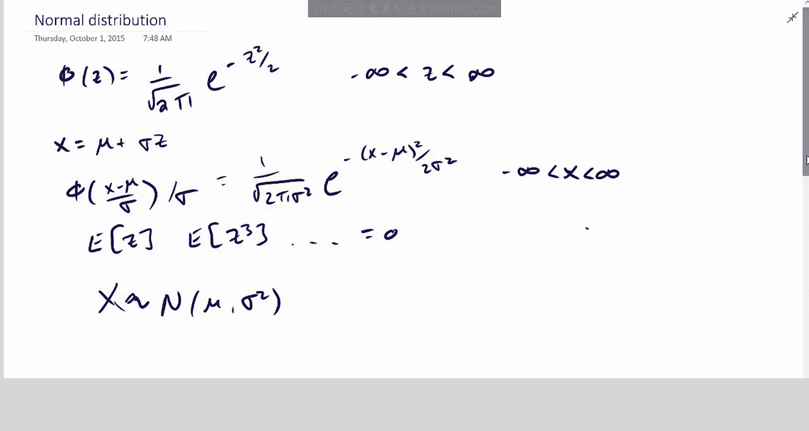
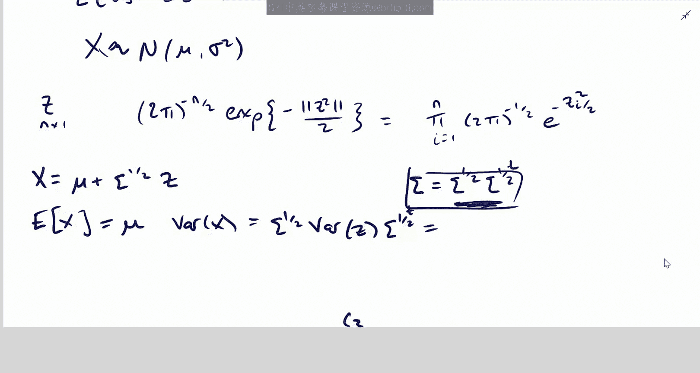
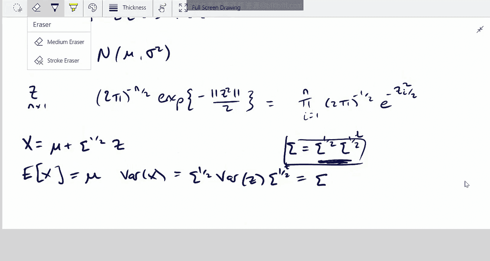
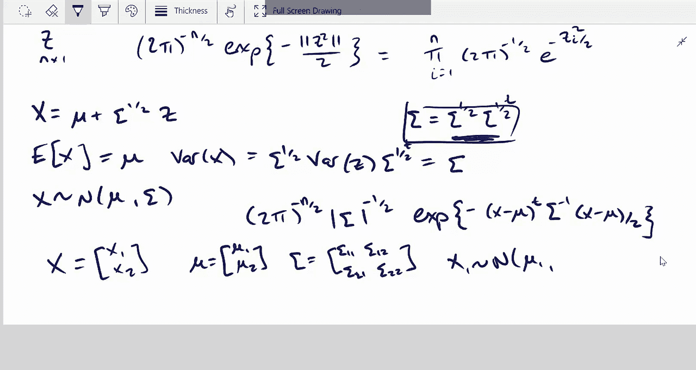
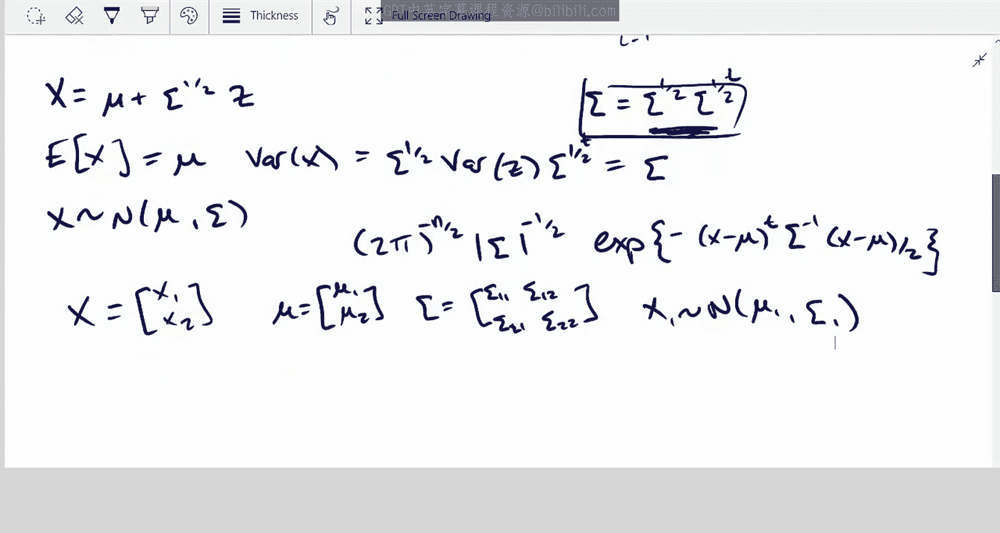
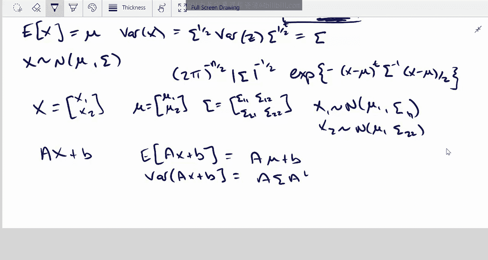
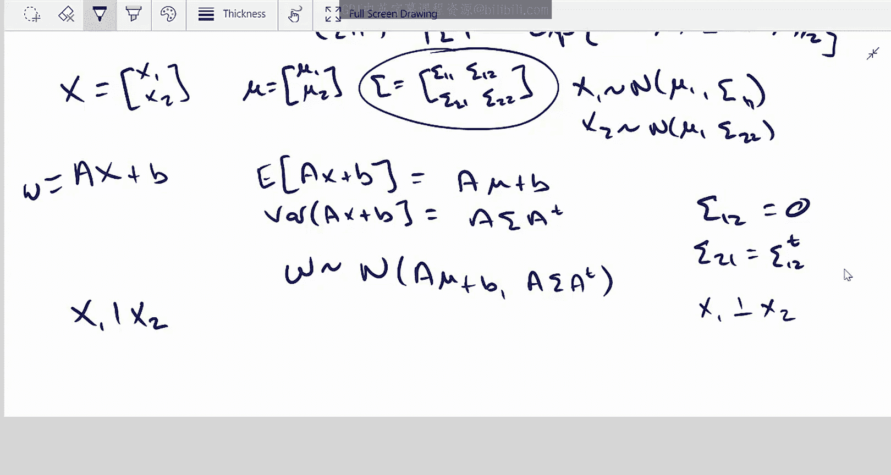

# 高级统计：第7章：正态与多元正态分布 📊

在本节课中，我们将要学习正态分布与多元正态分布的核心概念。正态分布是统计学中最基础且最重要的分布之一，而多元正态分布则是其在多维空间中的自然延伸。我们将从标准正态分布开始，逐步构建到非标准正态分布，最后探讨多元正态分布的定义、性质及其便利性。

## 标准正态分布

标准正态分布是正态分布的一个特例，其均值为0，方差为1。一个随机变量Z服从标准正态分布，如果其概率密度函数为：

$$
\phi(z) = \frac{1}{\sqrt{2\pi}} e^{-\frac{z^2}{2}}, \quad -\infty < z < \infty
$$

对于标准正态分布，其所有奇数阶矩（如期望值、Z的三次方期望值等）均为零。

## 非标准正态分布

上一节我们介绍了标准正态分布，本节中我们来看看更一般的情况。一个随机变量X服从非标准正态分布，如果它可以表示为：

$$
X = \mu + \sigma Z
$$

其中，Z是标准正态随机变量。此时，X的概率密度函数可以通过标准正态密度函数变换得到：

$$
f(x) = \frac{1}{\sigma} \phi\left(\frac{x - \mu}{\sigma}\right) = \frac{1}{\sqrt{2\pi\sigma^2}} e^{-\frac{(x - \mu)^2}{2\sigma^2}}, \quad -\infty < x < \infty
$$

非标准正态分布完全由其均值μ和方差σ²所刻画，我们通常记作：

$$
X \sim N(\mu, \sigma^2)
$$

## 多元标准正态分布

理解了单变量正态分布后，我们现在将其扩展到多维情况。一个n维向量Z服从多元标准正态分布，如果其联合概率密度函数满足：

$$
f(\mathbf{z}) = (2\pi)^{-n/2} e^{-\frac{\|\mathbf{z}\|^2}{2}}
$$

值得注意的是，这个密度函数等价于n个独立同分布的标准正态随机变量的乘积：

$$
f(\mathbf{z}) = \prod_{i=1}^{n} \left[ (2\pi)^{-1/2} e^{-\frac{z_i^2}{2}} \right]
$$

## 多元（非标准）正态分布

现在，我们来定义更一般的多元正态分布。一个随机向量X服从多元正态分布，如果它可以表示为：

$$
\mathbf{X} = \boldsymbol{\mu} + \boldsymbol{\Sigma}^{1/2} \mathbf{Z}
$$

其中，Z是多元标准正态向量，μ是均值向量，Σ是协方差矩阵，Σ^(1/2)是Σ的Cholesky分解矩阵。

根据这个定义，我们可以推导出X的期望和方差：
*   期望：`E[X] = μ`
*   方差：`Var(X) = Σ`

其概率密度函数为：

$$
f(\mathbf{x}) = (2\pi)^{-n/2} |\boldsymbol{\Sigma}|^{-1/2} e^{-\frac{1}{2} (\mathbf{x} - \boldsymbol{\mu})^T \boldsymbol{\Sigma}^{-1} (\mathbf{x} - \boldsymbol{\mu})}
$$

我们通常记作：

$$
\mathbf{X} \sim N(\boldsymbol{\mu}, \boldsymbol{\Sigma})
$$

## 多元正态分布的性质

多元正态分布之所以在统计学中应用广泛，是因为它拥有一系列非常便利的性质。

以下是其主要性质：

1.  **边际分布的正态性**：任何子向量也服从多元正态分布。例如，将X分割为X₁和X₂，对应的μ和Σ也进行相应分割，那么X₁ ~ N(μ₁, Σ₁₁)， X₂ ~ N(μ₂, Σ₂₂)。

2.  **线性变换的正态性**：任何满秩的线性组合仍然是多元正态分布。设W = A X + B，则 W ~ N(Aμ + B, AΣAᵀ)。

3.  **条件分布的正态性**：任何条件分布也是多元正态分布。例如，X₁在给定X₂条件下的分布仍然是正态分布。

4.  **协方差为零意味着独立**：这是正态分布特有的重要性质。对于大多数分布，独立意味着不相关，但反之不成立。然而对于多元正态分布，如果两个子向量X₁和X₂的协方差矩阵块Σ₁₂为零，则它们不仅不相关，而且相互独立。

## 总结

本节课中我们一起学习了正态分布家族。我们从单变量的标准正态分布出发，扩展到非标准正态分布，并学习了其密度函数和记法。接着，我们进入多维空间，定义了多元标准正态分布和一般的多元正态分布，并推导了其密度函数。最后，我们详细探讨了多元正态分布的四个核心性质：边际分布、线性变换、条件分布的正态性，以及协方差为零与独立性之间的等价关系。正是这些优良的数学性质，使得多元正态分布成为数据科学和高级统计建模中不可或缺的工具。