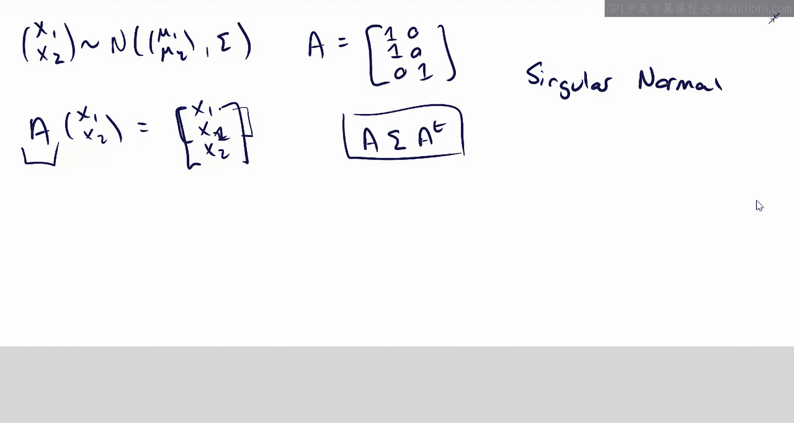
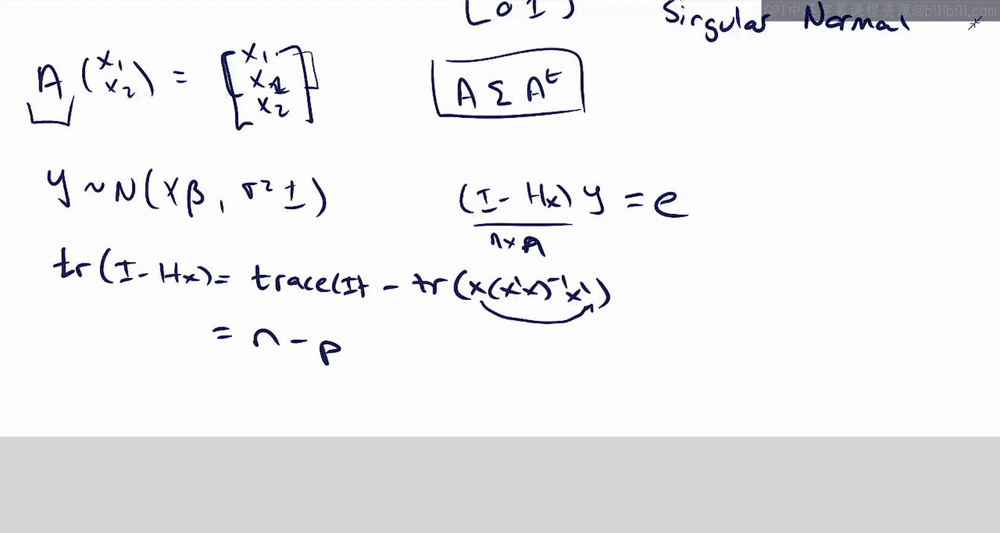
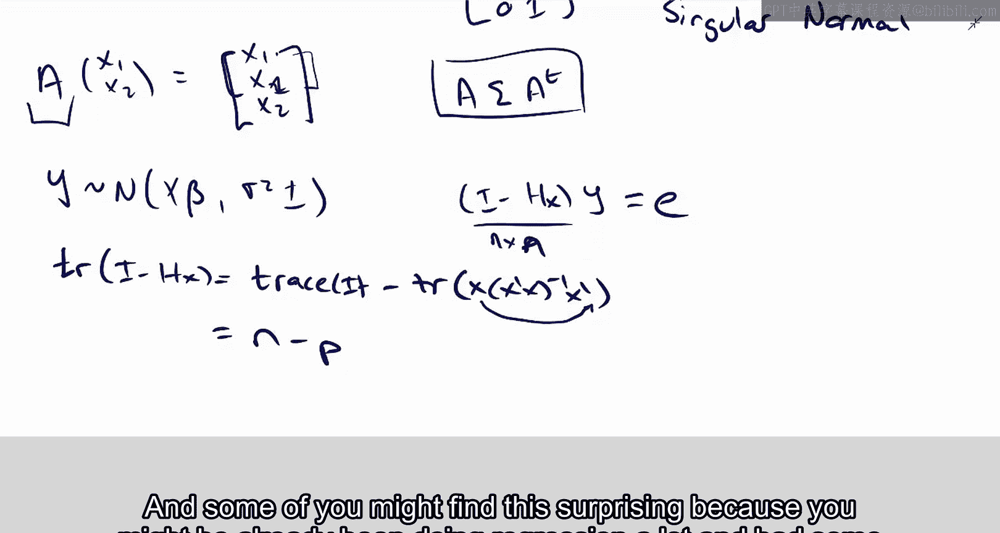
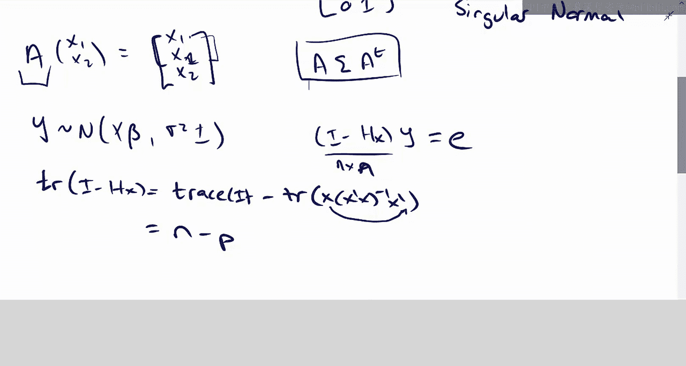
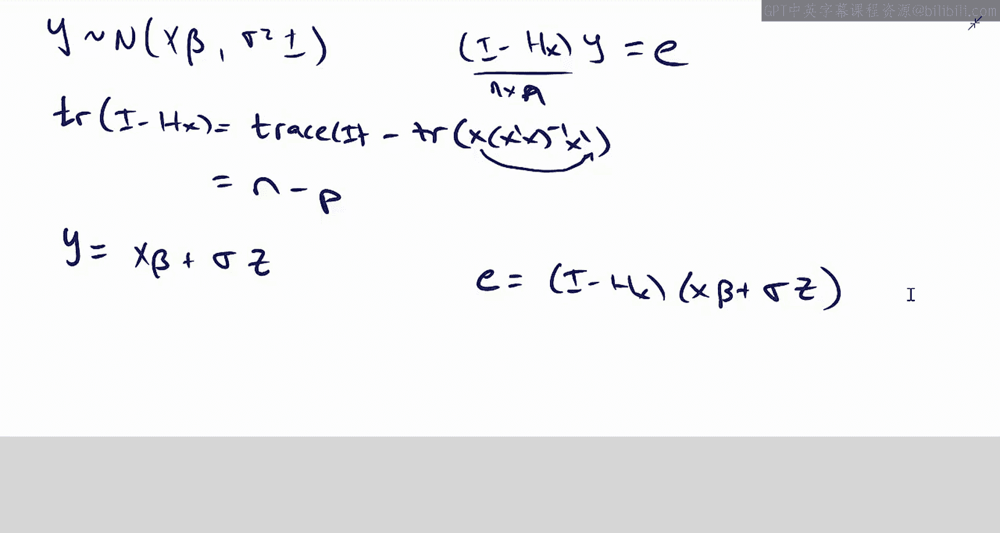

# 约翰霍普金斯大学《数据科学的高级统计｜Advanced Statistics for Data Science》中英字幕（deepseek p119 8_奇异正态分布.zh_en -BV1htPjeYEFH_p119-

So the multivariate normal distribution， in fact， just isn't rich enough for the collection of distributions that we need。

 even if we're going to assume that our underlying outcome variables are normally distributed。

Let me give you a simple example of what I mean by this， so take as an example， I have a vector x1。

X2。Which is both of those are scalrs。 is multivariate normal with mean mu 1， mu 2。

And variance matrix sigma。So let me define a to be equal to 110，001。Then the matrix a。Times x1， x2。

Works out to be。X1。X1。Next  two。Ah，X1， X1。X 2。So this can't be multivari normal because the first two entries are just the same one repeated twice。

And so。And the reason for that another reason it can't be normal is the variance matrix。

 which is a sigma， a transpose， is not full rank， so it's actually not invertible。

So you couldn't even write out the normal distribution。

 which remember requires the inverse of the variance in that exponent there， so what's going on here？

The real problem here is that the matrix that I'm multiplying my multivari normal vector by is not full row rank。

So you when you multiply by a matrix that's not full row rank。

 then you wind up with not a normally distributed random variable。

 you wind up with what we're calling a singularly normal a singular normal distribution The reason for calling it singular is so singular。

Singular normal。The reason for calling it the singular normal is because the variance matrix is singular。

 it's non invertible。

And this is an important distribution for us， and I'll give you an example of when it's important。

 so the standard assumption that we're going to make in regression is that our y is normally distributed with mean equal to x beta and variance equal to sigma squared I。

So take the residuals， which are I minus h of x。Times y。Look at this matrix right here。

 I minus h of x， it's actually not full rank， and the reason I know that is because it's symmetric and item potentent and for symmetric item potentent matrices the tray equals the rank。

So if I take the trace of i minus h of x。That's the trace。Of I。Minus the trace of ups。Of X。

X transpose x inverse x transpose。Wwhich is n for the trace of I。

 and then I can move this x over here， and then I get x transpose x inverse times x transpose。

 so I get the trace of a p by P identity matrix n which is the trace of a P by P identity matrix is p。

So this matrix is M by N。But is of rank n minus p， so we're going to wind up with the same problem。

Where we have a variance covariance matrix that's not a full rank， so the residuals。

Another way to see this with the residual so the residuals。

 even if my y is multivariate normally distributed。

 my residuals are actually not multivariate normally distributed。

 even though they are a linear combination of my vector Ys。

 and some of you might find this surprising because you might be have already been doing regression a lot。

And had some practice of checking normality of your data by checking of the apparent normality of your residuals。

And it's not like this is a bad practice because when n is much larger than P。

 your residual should be approximately normally distributed。So it's not like this is a bad practice。

 but as a matter of theoretical fact， your residuals are guaranteed to not be normally distributed。

Another way to see that the residuals can't be normally distributed is consider the instance where we include an intercept。

 if we include an intercept then the sum of our residuals is zero， however， for a normal vector。

 the sum of a normal vector has to be a normal scalar and a normal scalar can't take a particular value with probability1 so it it can't possibly be normal if it has that kind of linear redundancy built into it。

And in fact， there's P linear redundancies built into the residuals and so there's many different ways you can create。

 there's many different ways that you could create a vector。

 a linear combination the residuals that is a constant a full rank linear combination of the residuals that is a constant。

 and so you can see that that can't possibly be multivariant normal。

So the singular normal distribution was given its name， because of situations like this。

 we needed something that included the normal as a special case。

 the multivariate normal is a special case， but then also encompassed all these other settings I'd like that we' like that we need。

So we define a singular normal as any linear transformation of a multivariate。Standard normal。

And so in this case， in that that means any linear transformation of a non standard normal because we know that a。

A multivariate normal is a simple transformation。Of a standard normal。 So take， for example。

 our case here， we know that y is equal to x beta。Plus sigma times z where z is a multivariant。

Standard normal。So our residuals。Our residuals E is equal to i minus h of x。

Times x beta plus sigma Z where Z is a standard。Of collection of IID standard normals。

 so it satisfies the definition of being singular normal and the singular normal distribution carries over a lot of the properties of the normal distribution that we would like。

 for example， linear first of all， any linear combination。Of singular normals is singular normal。

 so it doesn't full rank or not full rank， it's singular normal。

Second thing is absence of covariance implies independence， just like in the multivarient normal。

And all of the marginal。And conditional。And groups of subgroups of random variables from the singular normal distribution。

 they're all also singular normal okay so it carries over a lot of the properties that you like from the normal distribution but then takes away this property that you have to have full row rank linear transformations in order to maintain the distribution it takes that property away at the expense of then we have random variables that have linear redundancies in non-inverttable covariance matrices okay so the singular normal distribution is an important distribution and well use it kind of frequently。

