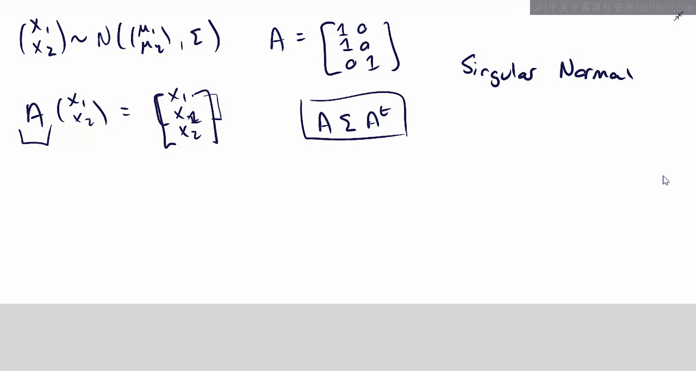
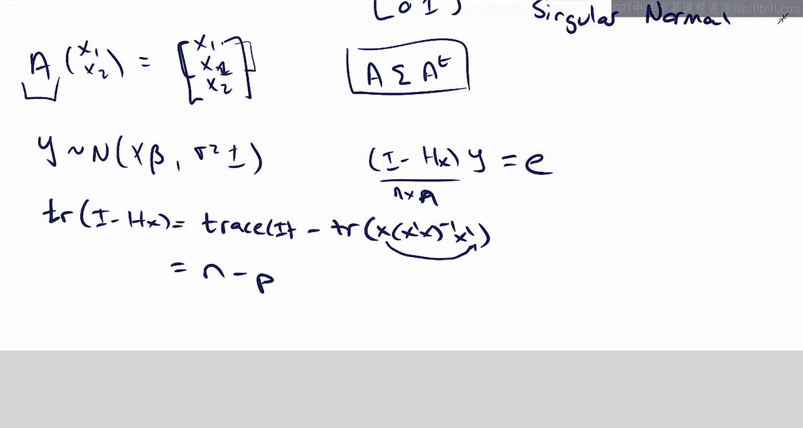
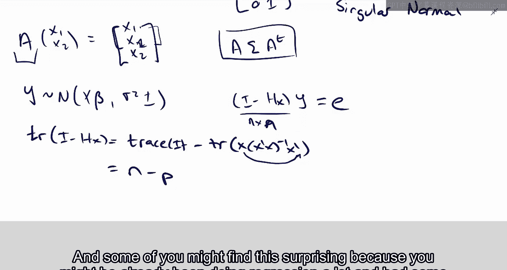
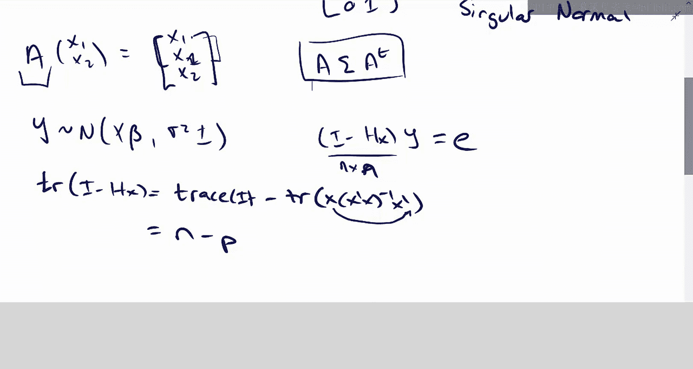
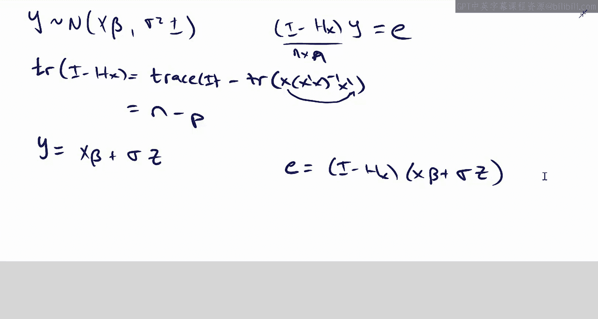

# 高级统计：第8章：奇异正态分布 🧮

在本节课中，我们将要学习多元正态分布的一个扩展——奇异正态分布。我们将探讨为何在某些情况下，标准的多元正态分布不足以描述数据，并介绍奇异正态分布的定义、性质及其在回归分析中的应用。

## 概述

多元正态分布在实际应用中有时显得不够丰富，即使我们假设基础的结果变量是正态分布的。本节将通过具体例子，解释为何需要引入奇异正态分布，并阐述其核心概念和重要性。

## 多元正态分布的局限性

上一节我们介绍了多元正态分布的基本性质。本节中我们来看看它的一个主要局限性。

考虑一个向量 `(X1, X2)`，它服从均值为 `(μ1, μ2)`、协方差矩阵为 `Σ` 的多元正态分布。

定义矩阵 `A` 为：
```
A = [[1, 0],
     [1, 0],
     [0, 1]]
```



那么，变换后的向量 `A * (X1, X2)^T` 结果为 `(X1, X1, X2)^T`。这个新向量不可能是多元正态的，因为它的前两个元素完全相同。

另一个原因是，新向量的协方差矩阵 `AΣA^T` 不是满秩的，因此不可逆。而多元正态分布的概率密度函数需要用到协方差矩阵的逆，所以在这种情况下无法写出其表达式。

问题的根源在于，用于变换的矩阵 `A` 不是行满秩的。当我们用一个非行满秩的矩阵去变换一个多元正态向量时，得到的结果就不再是多元正态分布，而是我们称之为**奇异正态分布**的随机变量。

之所以称其为“奇异”，是因为其协方差矩阵是奇异的（即不可逆）。

## 奇异正态分布的重要性

以下是奇异正态分布在统计学中至关重要的一个例子。

在回归分析中，一个标准的假设是响应变量 `Y` 服从正态分布：
```
Y ~ N(Xβ, σ²I)
```



现在考虑残差向量 `e`：
```
e = (I - H)Y
```
其中，`H = X(X^TX)^{-1}X^T` 是投影矩阵（或称帽子矩阵）。



矩阵 `(I - H)` 不是满秩的。我们知道它是对称且幂等的，对于对称幂等矩阵，其迹等于其秩。

计算 `(I - H)` 的迹：
```
tr(I - H) = tr(I) - tr(H) = n - p
```
因此，这个 `n × n` 的矩阵的秩是 `n - p`，不是满秩的。这导致了与之前相同的问题：残差的协方差矩阵不是满秩的。

所以，即使 `Y` 是多元正态的，其残差 `e` 也**不**是多元正态分布，尽管它是 `Y` 的一个线性组合。这一点可能让一些经常做回归分析的人感到惊讶，因为他们可能习惯于通过检查残差的正态性来检验模型假设。

当样本量 `n` 远大于参数个数 `p` 时，残差会近似服从正态分布，因此这种做法在实践中通常可行。但从理论事实出发，残差**保证**不是正态分布的。

另一种理解方式是：如果模型中包含截距项，那么残差的和恒等于零。对于一个正态随机向量，其和是一个正态标量，而一个正态标量不可能以概率1取某个特定值（如零）。因此，存在这种线性约束的向量不可能是正态的。

实际上，残差中内置了 `p` 个线性冗余。奇异正态分布正是为了涵盖这类情况而命名的。我们需要一个既包含多元正态作为特例，又能容纳这些必要场景的分布。

## 奇异正态分布的定义与性质

上一节我们看到了奇异正态分布出现的场景。本节中我们来正式定义它并了解其关键性质。



我们定义**奇异正态分布**为：任何一个多元标准正态分布的线性变换。

更一般地，由于任何多元正态分布都可以看作标准正态的线性变换，因此，奇异正态分布也包含非标准正态的线性变换。

以回归为例：
```
Y = Xβ + σZ， 其中 Z ~ N(0, I)
```
那么残差 `e` 为：
```
e = (I - H)Y = (I - H)(Xβ + σZ)
```
这满足奇异正态分布的定义，因为它是标准正态向量 `Z` 的一个线性变换。

奇异正态分布继承了许多我们期望从正态分布中得到的优良性质：

1.  **线性组合的性质**：奇异正态随机向量的任何线性组合仍然是奇异正态的（无论变换矩阵是否满秩）。
2.  **协方差与独立性**：与多元正态类似，在奇异正态分布中，协方差为零仍然意味着独立性。
3.  **边缘分布与条件分布**：从奇异正态分布中取出的任何子集，其边缘分布和条件分布也都是奇异正态的。

因此，奇异正态分布保留了正态分布的大部分优良性质，同时去掉了“线性变换必须行满秩才能保持分布类型”这一限制。其代价是允许随机变量中存在线性冗余，并接受非满秩的协方差矩阵。

奇异正态分布是一个重要的分布，在后续学习中我们会经常用到它。

## 总结



本节课中我们一起学习了奇异正态分布。我们首先通过一个例子指出了标准多元正态分布的局限性，即对非满秩线性变换不封闭。接着，我们以回归分析中的残差为例，说明了奇异正态分布出现的必然性和实际意义。然后，我们给出了奇异正态分布的正式定义：多元标准正态分布的任意线性变换。最后，我们总结了奇异正态分布所继承的关键性质，包括线性组合不变性、协方差与独立性的关系，以及边缘分布和条件分布的形式。理解奇异正态分布对于处理具有线性约束的统计模型至关重要。