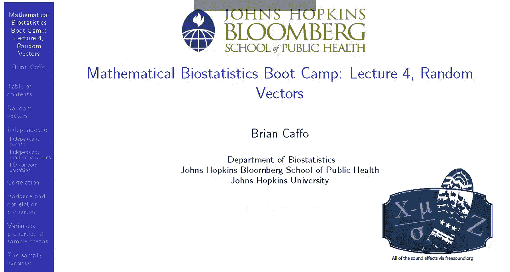
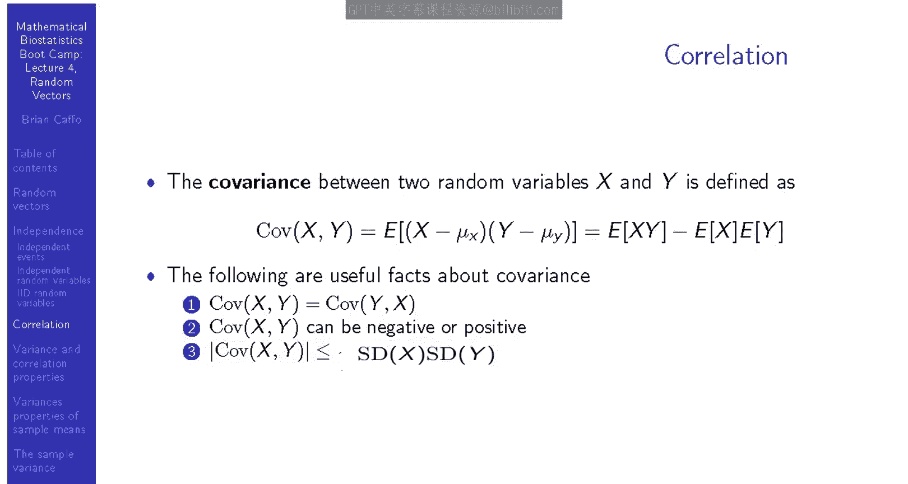
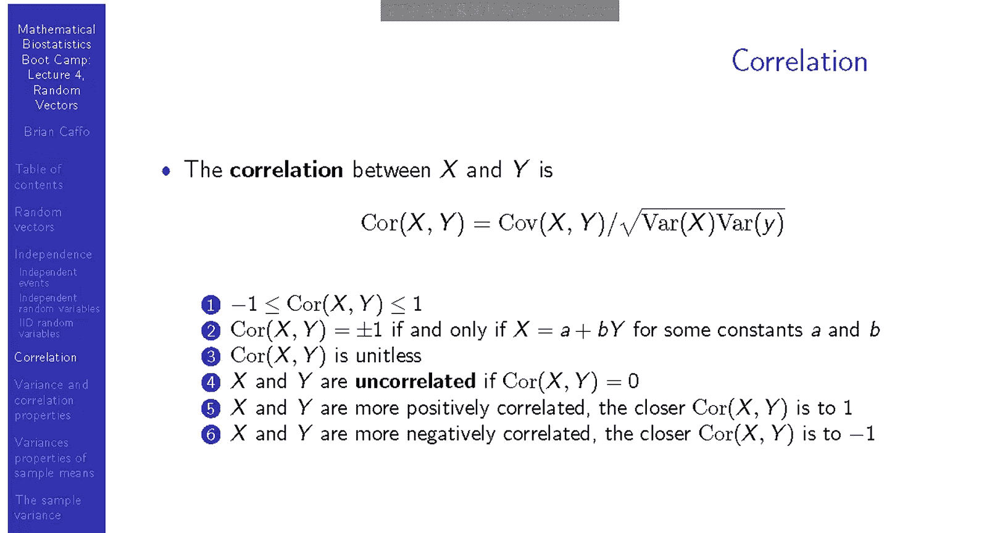
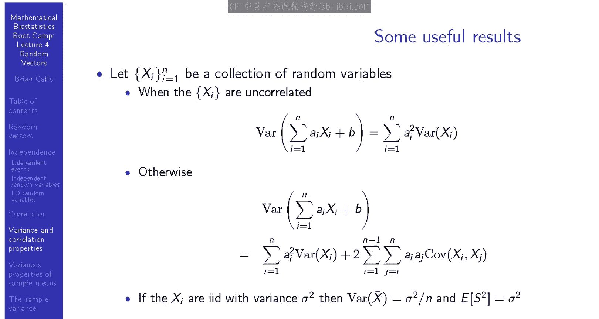
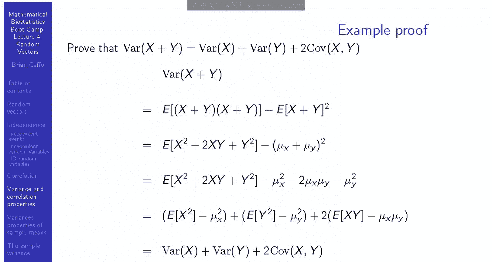
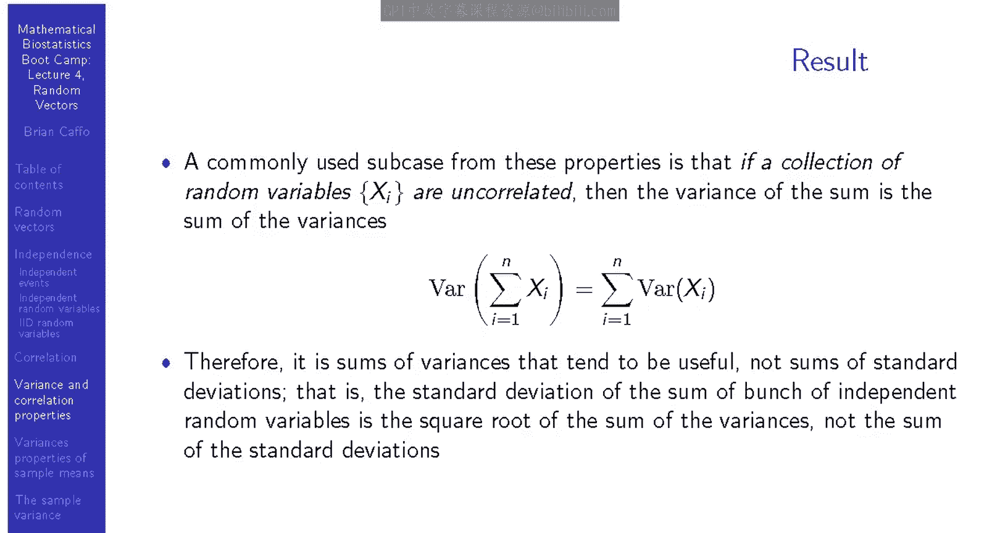

# 约翰霍普金斯大学《数据科学的高级统计｜Advanced Statistics for Data Science》中英字幕（deepseek p12 11_相关性.zh_en -BV1htPjeYEFH_p12-

Okay， so welcome back troops， we're going to talk about covariance and correlation now and what happens when random variables are independent。

So if we have two random variables x and y， then their covariance is defined as here cove x comma y。

 the expected value of x minus its mean times y minus its mean whole quantity and just like the variance there's a shortcut formula for covariances and it works out to be expected value of x times y minus the expected value of x times the expected value of y So there's some very useful facts about covariance first of all。

 the covariance you can interchange the variables and you get the same number so covariance of x comma y is covariance of y comma x。

The covariance can be negative or positive。But in an application of so-called Jensen's inequality will tell you that the absolute value of the covariance of x comma y is less than or equal to the square root of the variance of x times the variance of y so we could just write this right hand side as the standard deviation of x times the standard deviation of y this final property。

Is very useful because as we go on to the next slide， we use it to divine the correlation。

The correlation of x and Y is nothing other than the covariance。

Divided by the product of the standard deviations。So there's a couple reasons why we might want to do this from the previous slide。

 notice that this then normalizes the covariance so that it's between minus1 and plus one。

And that's a very useful thing to do so that maybe we can somehow utilize the idea of covariance across different kinds of random variables。

Now， another rationale for doing this is if we look back at our covariance formula， right。

 it's expected value of x minus the mean of x times y minus the mean of y well that has units of x times units of y。

Right， so the top part。Of the calculation has units x times units y。

 the standard deviation of x has units of x and standard deviation of y has units y。

 so the bottom part has units x times units y， so the correlation is a unit free。

Measurement that's a useful property to have。So if x is in inches and y is in pounds。

 then the covariance is in inches times pounds， but then the correlation is then unit free。

 which is useful。Correlations have some nice properties。

 one is that the correlation is only plus or minus1。

 if and only if the random variables are linear related x equals a plus B Y for some constants A and B correlation is unitless as we discussed already。

And then we say x and y are uncorrelated if correlation x and y are0。

And sort of the more positively correlated they are the closer correlation。

 the core x comma y gets to 1 and they're more negatively correlated as core x y gets goes to minus1 and this is again a description of a population quantity not a sample quantity right so this is a description of you're using a joint probability mass function or joint probability density function to model the population behavior of x and Y then we want ways to summarize that joint mass function or joint density function and the correlation is a summary of how related joint random variables are from this distribution so it's a summary of a population quantity and of course if something's a population quantity we want sample quantities that are able to estimate them so probably what you've heard of if you've never had a mathematical statistics。

Class before is the sample correlation and again， the goal of the sample correlation is to estimate the population correlation if you're using a probability model so the sample correlation estimates the population correlation so if you've ever had a sample correlation and you've had a probability model。

What you are trying to estimate is the population correlation。

 the estimate is the population correlation， so it follows the same rule we have so far for everything the sample variance estimates the population variance。

 the sample standard deviation estimates the population standard deviation。

 the sample media estimates the population media so all these sample quantities have analogous population quantities。

So if two random variables， x and Y are independent， then their correlation is zero。

The reverse is not true， things can be uncorrelated， but not be independent。

 so if they're independent then they are uncorrelated， but if they're uncorrelated。

 they're not necessarily independent in the case of Gaussian random variables， by the way。

 the two things agree always， but in general that's not always the case。

So let's talk about some useful results that rely on correlation and covariances and probably the most useful one we'll talk about is this variance idea。

 so if we have a collection of random variables x1 to XN，When the aes are uncorrelated。

And here I wrote out a very general form。 The sum of the x's maybe times some constant AI plus a constant B works out to be the sum of AI squared times the variance of the individual X's。

 And let's think about the specific case when b is 0 and the A's are all one。

 That just means that the variance of the sum is the sum of the variances。

 And here we just wrote out a slightly more general term。

 we know in general that constants pull out of variances and get squared。

 That's why you have the AI squared。 and we also know that if you have a random variable and you shift it by a constant B。

 it doesn't change its variance it just moves the density to the left or right。

So it doesn't change the variance， so the A's and the B's are kind of fluff on top of this equation。

 the core of this equation is just think about the instance when b is 0 and a is1。

 that when the x's are uncorrelated， they don't have to be independent。

 they just have to be uncorrelated for this result to hold。

 then the variance of the sum is the sum of the variances。If they're not uncorrelated。

 then you can actually calculate what their variance is in a way that it depends on the covariance。

 it works out to be the sum of the variances with the AI squares out front。

 plus twice the sort of sum of all the pairs of covariances。

So this is a very useful formula we won't use it in this class。

 but I thought I'd give it to you and so notice if they're all uncorrelated。

 all these terms here are0 and then we get the top formula。

 the top formula is what we're really going to use in this class and it basically says that the variance of the sum is the sum of the variance is if you have independent events the other important thing that this kind of says is that。

You know， you shouldn't be adding standard deviations。

 you should probably be adding variances is another way to kind of think about it in general。

So this leads to an interesting proof of a useful property that the variance of x bar。

 the sample mean is sigma squared over n， and it also leads to the fact that the expected value。

Of the sample variance is sigma squared。

These are two very important properties that will'll go on and on about。Okay。

 so I don't want to prove the general facts from the previous slide。

 let's just go through the heuristic because it's pretty easy to do。

So let's prove that the variance of x plus y is the variance of x plus the variance of y plus twice the covariance of x and y。

So at the top line， let's start with variance of x plus y。Well， just by the definition of variance。

 right that's the expected value of x plus y squared minus expect a value of x plus y quantity squared right。

 so if you're confused by that just replace x plus y with a random variable z and its expected value of z squared minus expected value of z quantity squared directly plugging into the shortcut variance calculation formula。

Well， the right hand element here is expected values always commute across sum。

 so we have mu of x plus mu of y quantity squared。And the left hand side。

 let's just expand out this x plus y squared to get x squared plus 2 xy plus y squared。

And then let's just move the expected value across the three elements of this expression。

Well then let's just organize terms and we get expect value of x squared minus mu of x squared plus expect a value of y squared minus mu of y squared。

 and then two expect a value of x y minus mu x mu y。

 Well this first one expect value of x squared minus mu x squared that's variance of x。

 the second one expect value of y squared minus mu y squared， that's variance of y。

And this latter part to expect a value of x y minus mu x mu y， right。

 expect a value of x times expect a value y for this right hand part。

 well that's just covariance of x comma y completing the proof。

So you can see that it only requires the basic rules for expected values to perform this calculation and the definition of covariance to perform this calculation。

So just to reiterate some things we discussed earlier。

If a collection of random variables are uncorrelated。

 then the sum of the variances is the variances of the sum。

 so what it basically means is that sums of variances tend to be useful。

 not sums of standard deviations， and this is just the issue I'm trying to raise is don't sum standard deviations。

So in other words， the standard deviation of the sum of a bunch of independent random variables is the square root of the sum of the variances。

 not the sum of the standard deviation， so it's just a common little problem so maybe trying to avoid it from the start。

