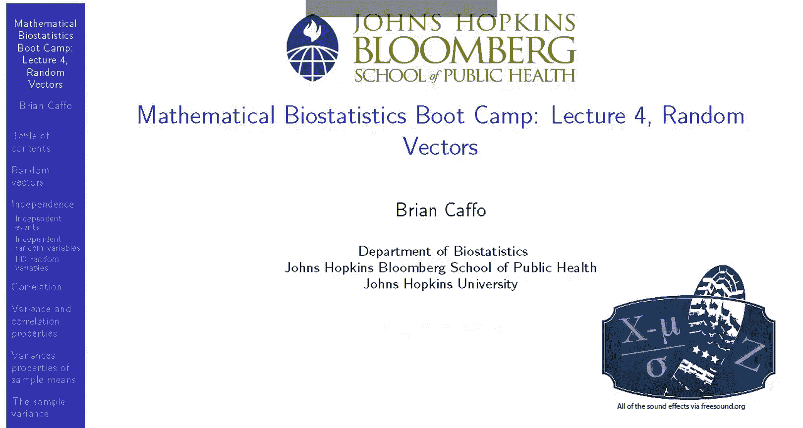
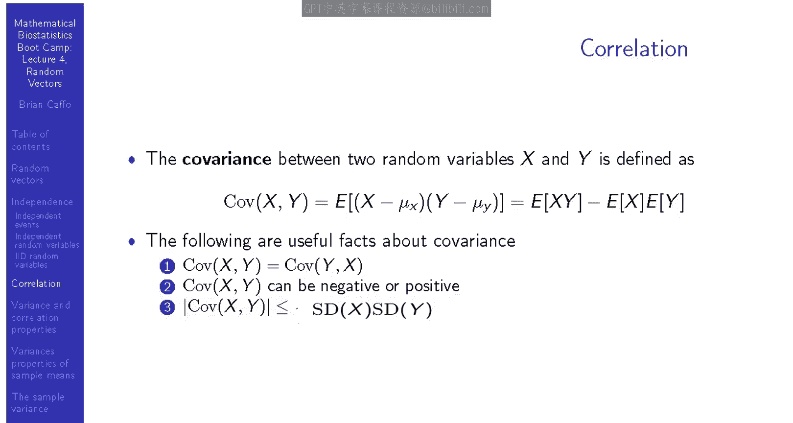
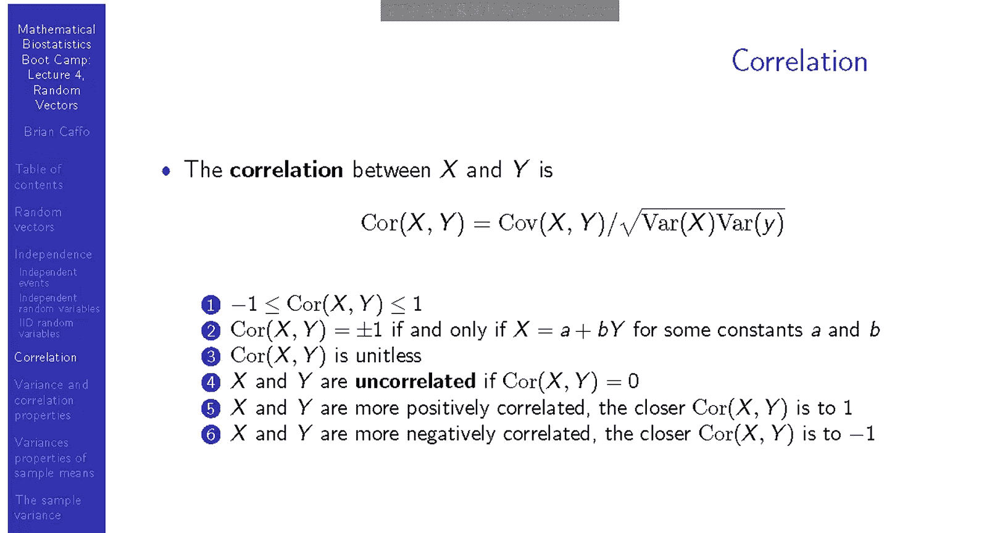
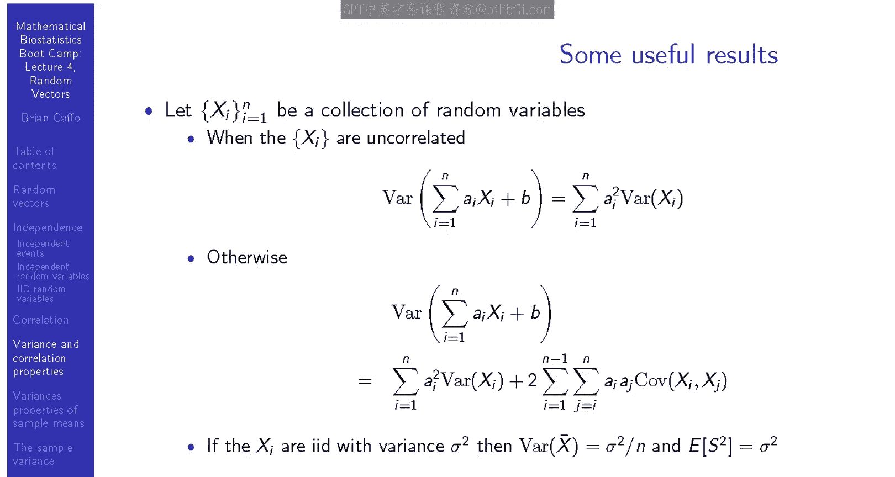
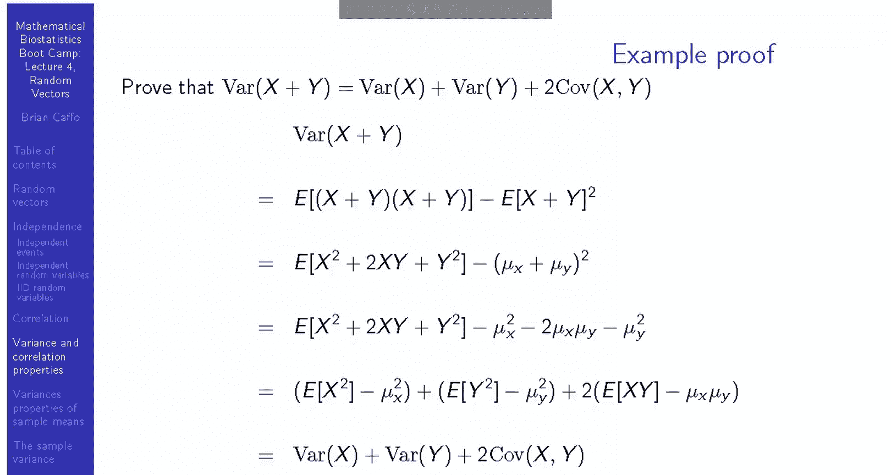
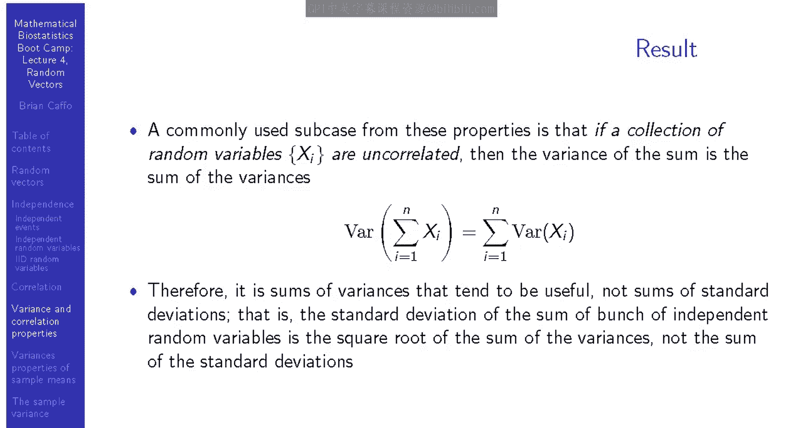

# 高级统计学：第11章：协方差与相关性 📊

在本节课中，我们将要学习协方差与相关性的概念，以及当随机变量独立时会发生什么。我们将探讨这些统计量如何量化两个随机变量之间的关系，并学习一些重要的数学性质。

---

## 协方差的定义与性质

协方差用于衡量两个随机变量共同变化的程度。对于随机变量 **X** 和 **Y**，其协方差定义为：

**公式：** `Cov(X, Y) = E[(X - μ_X)(Y - μ_Y)]`

与方差类似，协方差也有一个便捷的计算公式：

**公式：** `Cov(X, Y) = E[XY] - E[X]E[Y]`

以下是关于协方差的一些重要性质：

*   **对称性：** `Cov(X, Y) = Cov(Y, X)`
*   **可正可负：** 协方差的值可以是正数、负数或零。
*   **柯西-施瓦茨不等式：** `|Cov(X, Y)| ≤ √[Var(X) * Var(Y)] = σ_X * σ_Y`

上一节我们介绍了协方差的基本定义，本节中我们来看看如何通过标准化协方差来得到一个更通用的度量指标。

---

## 相关系数

为了消除量纲的影响，并获得一个介于 -1 和 1 之间的标准化度量，我们定义了相关系数：

**公式：** `ρ(X, Y) = Cor(X, Y) = Cov(X, Y) / (σ_X * σ_Y)`

相关系数具有以下关键特性：

*   **取值范围：** 相关系数的值始终在 -1 到 1 之间。
*   **线性关系：** 当且仅当 **X** 和 **Y** 存在严格的线性关系（即 `X = a + bY`）时，相关系数的绝对值等于 1。
*   **无单位：** 相关系数是一个无量纲的纯数字，便于在不同数据集间进行比较。
*   **不相关：** 如果 `Cor(X, Y) = 0`，我们称 **X** 和 **Y** 不相关。

需要强调的是，相关系数描述的是**总体**特征。在实际应用中，我们通常使用样本数据来估计它。

---

## 独立性与相关性

理解独立性与相关性之间的关系至关重要。

*   如果两个随机变量 **X** 和 **Y** 相互独立，那么它们的相关系数为零（即不相关）。
*   然而，反之则不成立。两个随机变量可以不相关，但却不是相互独立的。

**一个重要的例外是：** 对于服从**联合正态分布**的随机变量，不相关性与独立性是等价的。但在一般情况下，这并非总是成立。

---

## 方差的可加性

协方差和相关性在计算随机变量线性组合的方差时扮演着核心角色。以下是核心结论：

对于一组随机变量 **X₁, X₂, ..., Xₙ** 和常数 **a₁, a₂, ..., aₙ** 以及 **b**，其线性组合的方差为：

**公式：** `Var(∑ aᵢXᵢ + b) = ∑ aᵢ² Var(Xᵢ) + 2∑∑_{i<j} aᵢaⱼ Cov(Xᵢ, Xⱼ)`

当这些随机变量**互不相关**时，所有协方差项为零，公式简化为：

**公式：** `Var(∑ aᵢXᵢ + b) = ∑ aᵢ² Var(Xᵢ)`

一个最常见且重要的特例是：当所有 **aᵢ = 1** 且 **b = 0** 时，如果 **Xᵢ** 互不相关，则**和的方差等于方差的和**。

**重要启示：** 我们应当对**方差**进行加法运算，而不是对**标准差**进行加法运算。独立随机变量之和的标准差，等于各方差之和的平方根。

---

## 重要结论的推导

让我们通过一个简单的推导来理解两个随机变量之和的方差公式。

我们要证明：`Var(X + Y) = Var(X) + Var(Y) + 2Cov(X, Y)`

**推导过程：**
1.  根据方差的计算公式：`Var(X + Y) = E[(X+Y)²] - [E(X+Y)]²`
2.  展开平方项：`= E[X² + 2XY + Y²] - (μ_X + μ_Y)²`
3.  利用期望的线性性质：`= E(X²) + 2E(XY) + E(Y²) - (μ_X² + 2μ_Xμ_Y + μ_Y²)`
4.  重新组合项：`= [E(X²) - μ_X²] + [E(Y²) - μ_Y²] + 2[E(XY) - μ_Xμ_Y]`
5.  根据定义，`E(X²) - μ_X² = Var(X)`，`E(Y²) - μ_Y² = Var(Y)`，`E(XY) - μ_Xμ_Y = Cov(X, Y)`
6.  因此，`Var(X + Y) = Var(X) + Var(Y) + 2Cov(X, Y)`。证明完毕。

这个推导清晰地展示了协方差如何作为额外项出现在方差公式中。

---

## 样本均值和样本方差的方差

基于方差的可加性原理，我们可以得到两个在统计学中极其重要的结论：

1.  **样本均值的方差：** 若 **X₁, ..., Xₙ** 是独立同分布的随机变量，方差为 **σ²**，则样本均值 **X̄** 的方差为 **σ²/n**。
    *   **推导思路：** `Var(X̄) = Var( (1/n)∑Xᵢ ) = (1/n²) ∑Var(Xᵢ) = (1/n²) * nσ² = σ²/n`

2.  **样本方差的期望：** 样本方差 **S²** 是总体方差 **σ²** 的一个无偏估计量，即 `E(S²) = σ²`。

这两个性质是统计推断（如假设检验和置信区间构建）的理论基石。

---

本节课中我们一起学习了协方差与相关性的核心概念。我们了解到协方差衡量了两个变量的共同变化，而相关性是其标准化版本。我们探讨了独立性与不相关性的关系，并掌握了方差可加性这一关键原理，它解释了为何我们应对方差而非标准差进行求和。最后，我们推导出了样本均值方差和样本方差期望这两个在后续数据分析中至关重要的结论。