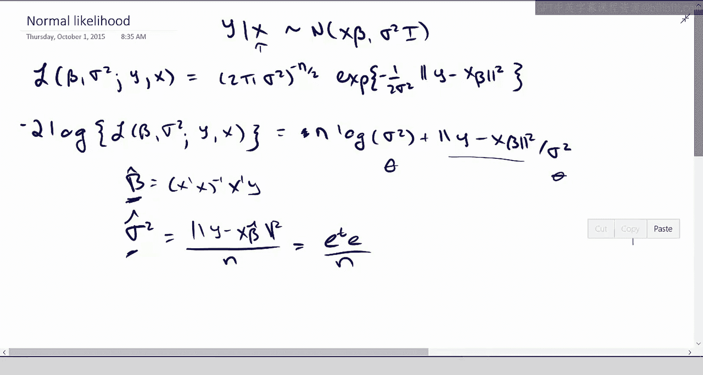
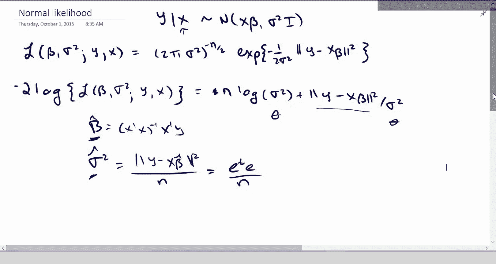
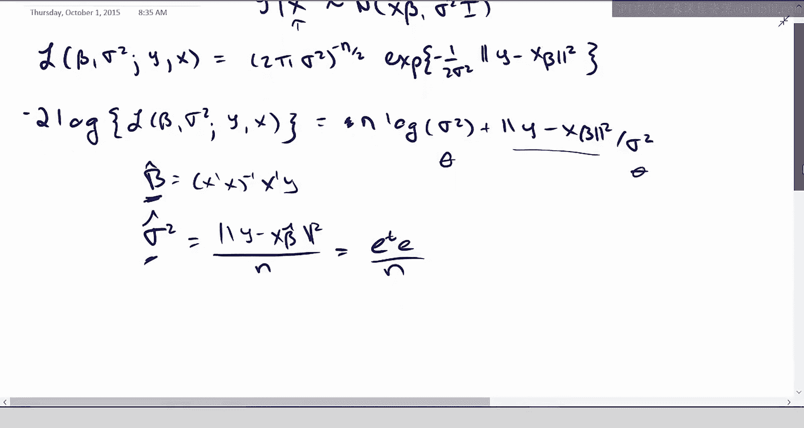
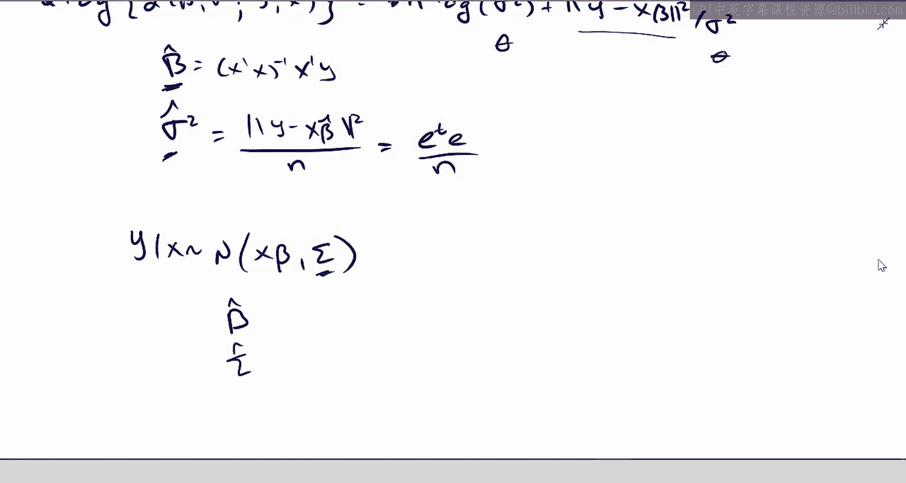

# 约翰霍普金斯大学《数据科学的高级统计｜Advanced Statistics for Data Science》中英字幕（deepseek p120 9_正态似然.zh_en -BV1htPjeYEFH_p120-

Let's talk about normal likelihoodlis now， so we have that y given x。

 let's assume that it's normal x beta and variance sigma squared I。

And I just want to emphasize here that we're conditioning on x。

 we're not considering the variability in x for the most part， when we talk about linear models。

So the likelihood of beta。And sigma squared。Given y and x is then2 pi。Sigma squared。

To the negative n over 2。Ex。Of 1 over two sigma squared。Norm y minus x beta。Squared。

And so if we wanted to obtain maximum likelihood estimates。

 we would maximize this likelihood with respect to beta in sigma squared。

But I often find and in many cases you can see since everyone's sort of product and expentiateated。

 it's probably easier to maximize the log of the likelihood than it is to maximize the likelihood and because the log is an increasing monotonic continuous function。

 the argument maximum is going to be the same。So， but you know， in this case。

 I think it's rather than maximize the log of the likelihood。

 I'm going to maximize minimize minus twice。The log of the likelihood。

So instead of maximizing the log， I'm going to minimize。know minus twice the negative of the log。

And minus twice the。The minus twice the log of the likelihood is called the deviance。

 and then I don't have to worry about any constants。That don't depend on sigma or beta。

 So I'm going to get rid of the two pi part。 Okay， so negative n log sigma squared and then times。

Plus。Y minus x beta。Square divided by sigma squared。 So that's the logable likelihood。 Now， notice。

Oops， and I don't have a negative there because I。I am multiplied by that。

 it's minus twice the likelihood， so I want to minimize this quantity to obtain the maximum likelihood estimates。

So if I minimize this quantity with respect to beta。Notice that if I minimize that。

 I'm going to minimize this expression overall， and that's just the least squares criteria so I get beta hat is equal to x transpose x inverse x transpose y and another way to think about that is if I were to fix sigma squared and find the optimum for beta hat。

Then this equation is clearly maximized at the least squares estimate。

 and then since the least squares estimate doesn't depend on sigma。

 then it must be the optimal estimate overall。Now I'm going to ask you for homework to then maximize this with respect to sigma squared。

 but know be careful to maximize it with respect to sigma squared so maybe replace sigma squared by theta or something so you know that you're not taking derivatives with respect to sigma。

 you're taking derivatives with respect to sigma squared。 but when you do that。

 you get to that estimate。Of sigma squared is just the norm y minus x beta hats。Squared over n。

 which is， of course， the。E transpose E。Over N。And so we get the biased version of the variance。

Which is which is fine。 maximum likely estimates are not guaranteed to be unbiased。

 It does work out to be unbiased in the beta case， but it works out to be the biased version in the sigma square case。

 So hopefully what you can see is that there's this pretty deep connection。In。

Normal theory linear models between the。Maximum likelihood estimates and the least squares estimates。

And this is very useful and it gets， you kind of gets blurred。

 the lines get sort of blurred between the two so that you know people often just you know。

 kind of interchangeably talk about at least squares of maximum likelihood for the slope coefficients in this case without being too precise。

Now there are instances where it matters in linear regression。

 we don't have to extend it by very much。

To get instances where things can change。So。At any rate。

 what I want you to be able to do is do some simple maximum likelihood calculations in the book。

I have an instance where I say that y given x is normal。X beta。

 but with a general variance matrix sigma， and so what I'd like you to try to do for homework。

Is to figure out the maximum likelihood estimate for beta with a fixed sigma here。

And so find beta hat， and if you can't figure it out， then the solution is worked out in the notes。

But try it on your own first and you get a very famous equation as an answer to sort of the weighted least squares estimate。

 and then also if you can try to figure out the estimate for Sigma hat that's a little bit harder but still I think doable。

 so that's a good exercise to build on what we learned today。

