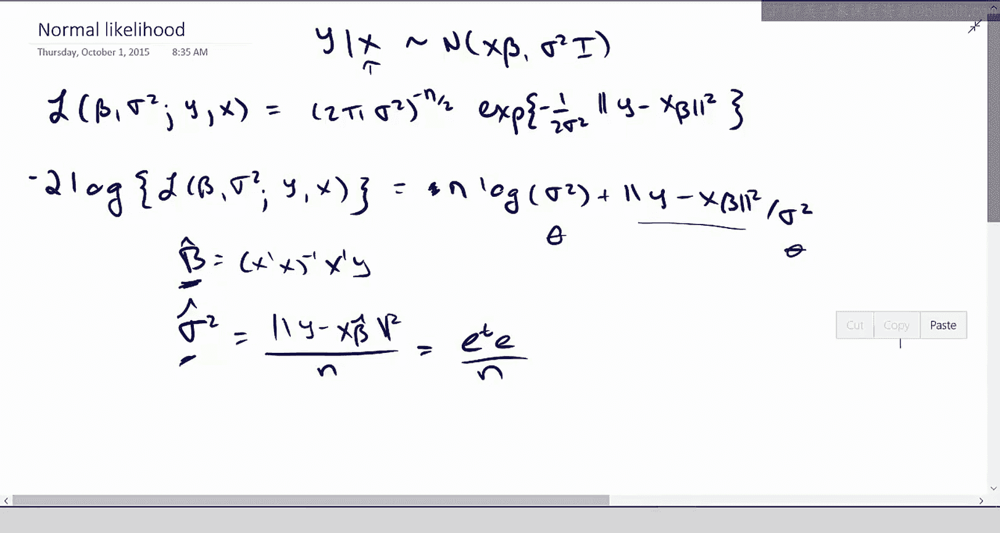
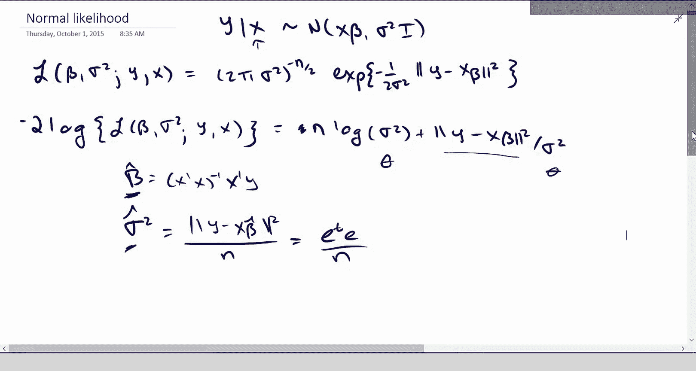
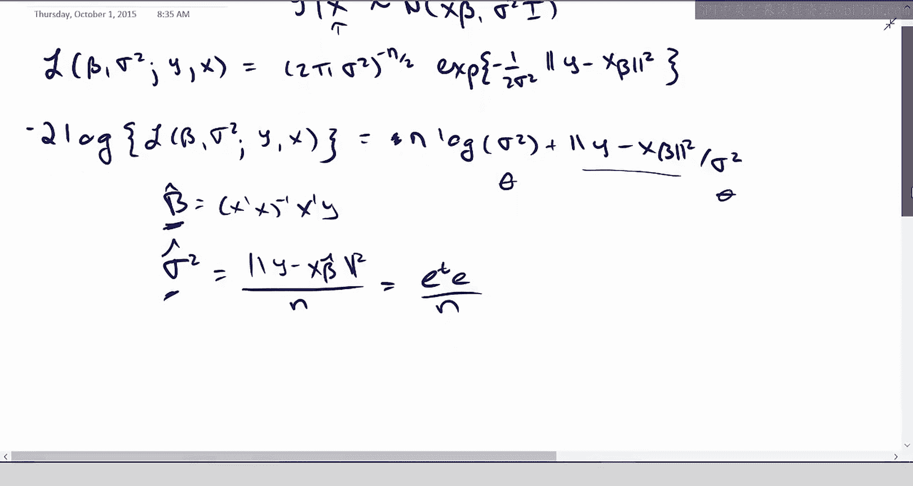
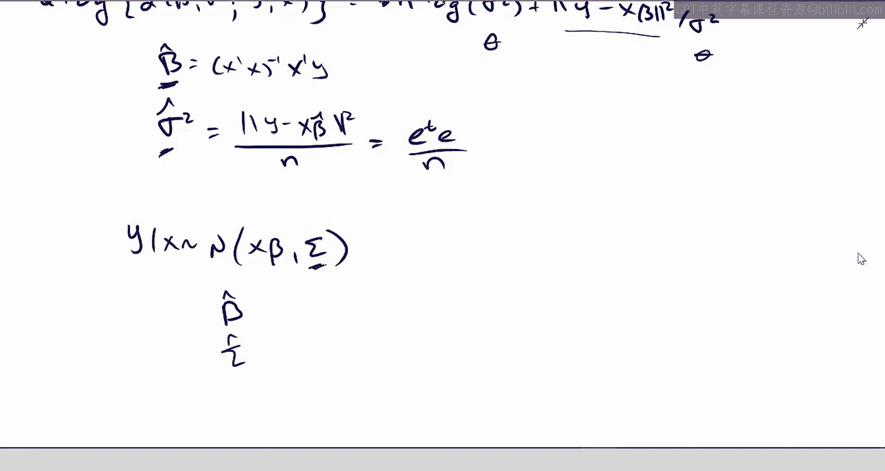

# 数据科学的高级统计：9：正态似然 📊

在本节课中，我们将要学习正态分布下的似然函数，并探讨其在线性模型中的应用。我们将看到最大似然估计与最小二乘法之间的深刻联系。

---

## 正态似然函数

我们假设响应变量 **y** 在给定预测变量 **x** 的条件下服从正态分布：
`y | x ~ N(xβ, σ²I)`

这里需要强调，我们是在**条件于 x** 的前提下讨论模型，在线性模型中通常不考虑 x 本身的变异性。

给定数据 **y** 和 **x**，参数 **β** 和 **σ²** 的似然函数为：
`L(β, σ² | y, x) = (2πσ²)^(-n/2) * exp{ -1/(2σ²) * ||y - xβ||² }`

为了获得最大似然估计，我们需要关于 **β** 和 **σ²** 最大化这个似然函数。

---

## 对数似然与偏差

由于似然函数是乘积和指数形式，最大化对数似然函数通常更为简便。因为对数函数是单调递增的连续函数，最大化对数似然与最大化似然本身会得到相同的参数估计值。

在实践中，我们通常最小化**负二倍对数似然**，这个量被称为**偏差**。这样做可以忽略掉不依赖于 **β** 或 **σ²** 的常数项（例如 `2π` 部分）。

因此，我们的目标函数（偏差）为：
`D(β, σ²) = n * log(σ²) + (||y - xβ||²) / σ²`

我们的目标是找到使 `D(β, σ²)` 最小化的 **β** 和 **σ²**，从而得到最大似然估计。

---

## 求解 β 的最大似然估计

上一节我们定义了要最小化的偏差函数。本节中我们来看看如何求解参数 **β**。

如果我们固定 **σ²**，最小化偏差函数 `D(β, σ²)` 就等价于最小化 `||y - xβ||²`。这正是**最小二乘准则**。

因此，**β** 的最大似然估计 **β̂** 就是最小二乘估计：
`β̂ = (xᵀx)⁻¹ xᵀy`

由于这个估计值不依赖于 **σ²**，所以它也是整体优化问题的最优解。

---

## 求解 σ² 的最大似然估计

在得到 **β̂** 之后，我们需要求解方差 **σ²** 的最大似然估计。这需要我们对偏差函数关于 **σ²** 进行优化（注意是对 **σ²** 求导，而不是 **σ**）。

以下是求解步骤：
1.  将偏差函数 `D(β̂, σ²)` 视为 **σ²** 的函数。
2.  对其求导并令导数为零。
3.  解方程得到 **σ²** 的估计值。

求解后，我们得到：
`σ̂² = ||y - xβ̂||² / n = (eᵀe) / n`
其中 **e = y - xβ̂** 是残差向量。

值得注意的是，这个估计是**有偏的**。最大似然估计并不保证无偏性。对于 **β**，估计是无偏的；但对于 **σ²**，我们得到的是有偏版本（分母是 n 而不是 n-p）。

---

## 核心联系与总结

通过以上推导，我们可以看到正态线性模型中最大似然估计与最小二乘估计之间存在深刻的联系。对于斜率系数 **β**，两者完全等价。这种联系使得人们在讨论线性回归的斜率时，常常不加区分地使用“最小二乘估计”和“最大似然估计”这两个术语。

然而，这种等价性并非永远成立。只需对模型稍作扩展，情况就可能发生变化。

---

## 课后练习

为了巩固今天所学的内容，请尝试完成以下练习：

**练习 1：广义最小二乘**
考虑一个更一般的模型：`y | x ~ N(xβ, Σ)`，其中 **Σ** 是一个已知的、一般的协方差矩阵（不再是 `σ²I`）。
*   请推导在 **Σ** 固定时，**β** 的最大似然估计。
*   你会得到一个非常著名的方程，即**加权最小二乘估计**。

**练习 2：估计协方差矩阵**
在同一个一般模型 `y | x ~ N(xβ, Σ)` 下，尝试推导 **Σ** 的最大似然估计。这比第一个练习稍难，但仍然是可行的。

如果你无法独立完成，课程笔记中提供了详细的解答。但建议你先自己尝试。

---

本节课中，我们一起学习了正态分布下的似然函数推导，明确了最大似然估计与最小二乘法在线性模型中的等价关系，并指出了方差估计的有偏性。理解这些基础是学习更复杂统计模型的关键。