# 约翰霍普金斯大学《数据科学的高级统计｜Advanced Statistics for Data Science》中英字幕（deepseek p121 10_正态条件分布.zh_en -BV1htPjeYEFH_p121-

Let's talk about the conditional distribution。Associated with the normal distribution。So。

Let let me let x， my vector x be equal to x1。X 2。And so without loss of generality。

 we're just going to assume that we want to know what the conditional distribution of x1 given x2 is。

So。Let me write out the answer first， first of all， I'm working under the assumption that x。

As we're talking about in almost all of the cases from this section of the class。

X is multivariate normal distributed。So I'm going to write out the variance covariance matrix this way。

 Sigma 11， sigma 12。Sigma 1，2 transpose and Sigma 2，2。

So what I'd like to know is what's the distribution of x1 given x2。

 and we know that it's normally distributed because we mentioned earlier that all the conditional distributions are normal。

 but what's the variance in covariance？So。Let me just write out the answers first。

 and then I'll show you a nifty derivation of this。 I'll do the derivation just because I like it。

 So the expected value of x1。Given x2 took the particular value， little x2。Is exactly equal to。Muwen。

Okay， it would be weird if that wasn't there。Plus sigma in2。Sigma 22 inverse。X2 minus mu 2。

And then the variance。Of X1。Given that x 2 equals little x 2。Is then equal to sigma 11。

 So what we would hope it would be because that would be easy。

 just the same as the marginal variance。 But of course， there's got to be other stuff minus， sorry。

 minus。Sigma 1，2。Sigma 2，2 inverse。Sigma， you could either write as sigma 21 or sigma 1，2 transpose。

 I like to write it as sigma 1，2 transpose。 Okay， let's come up with a derivation of this。

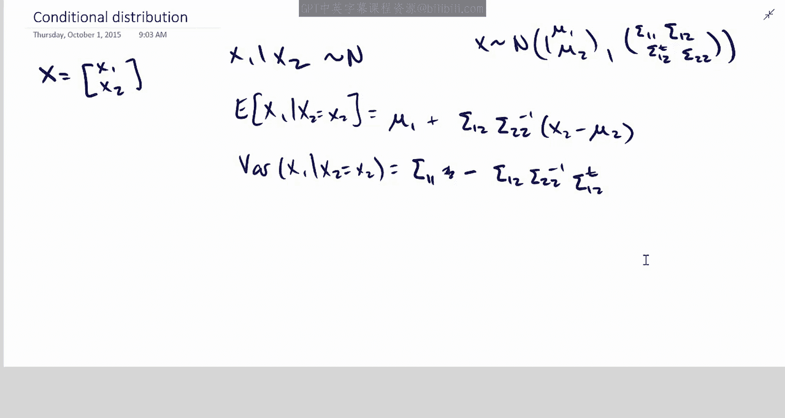

And。

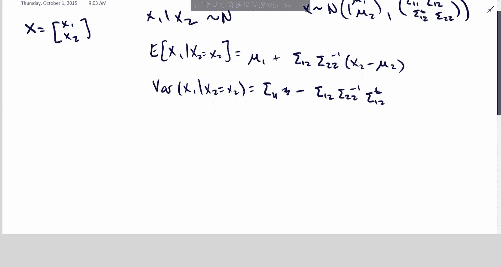

There's a really clever one。And。You know I'm not sure how someone figured this out， but it's really。

 I find it really nice。So and in fact， it was a student in my class who showed me this。

Because I was drivingring it using inverses of partition matrices。

 which is a lengthy bookkeeping procedure。Though not hard。 And they show me， oh。

 there's a much easier way to do it。 And what she said was define x Z equal to x1 plus。A x2。

Where a is equal to negative sigma 12。Sigma 22 inverse。

 And then what I would contend is that the covariance。Between x2 and z。Let's say Z and x 2。

Is equal to 0。 And let's， let's work that out real quick。 So the covariance。Of the。

And x2 is nothing other than the covariance。Of x1 plus A X 2 and x 2。

Which is equal to the covariance。OfX1。And x2。Plus， a covariance of x2 and x2。 Okay。

 so that's equal to covariance of x1 x2 is sigma 12 plus a， which I have defined as。

Negative sigma 12， sigma 22 inverse and covariance x2 and x2 with itself is sigma 22。 Okay。

 so I think you can pretty much see at this point that this equals 0。

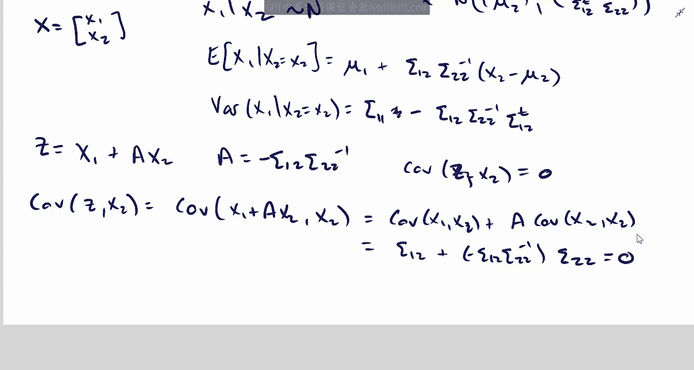

So。Z is independent of x2。

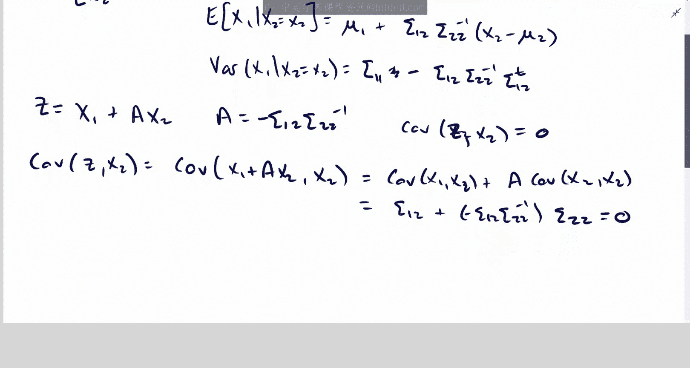

So the distribution of Z。Given x 2 is just the distribution of Z。

 disregarding x2 because Z is independent of x2。 So let's calculate。

 and we know that z is normal because it's a linear combination of normals。

 So let's calculate the expected value of z。Which is equal to。Mu1 plus。Bei。Mu2。Right。

And the variance of Z。Is equal to。A， the variance of x2 times a transpose with the variance of x2 is sigma 22。

Times a transpose。 Now， let's fill some of this in。 That's mu 1。mininus。Sigma 1，2， Sigma 2，2。

 inverse mu 2。And this is equal to。嗯。The negative sign will cancel out Sigma 12。

 and then I get a sigma 22 inverse sigma 22 Sigma 22 inverse。

 so it's just going to be sigma 22 inverse Sigma 12 transpose。

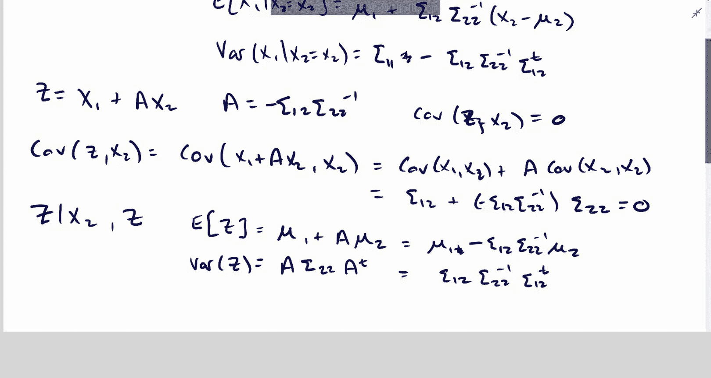

Okay。So let's think about this， so the expected value of z given x2 is equal to little x2。

Is equal to the expected value of z。But it's also equal to。嗯。Muwen。Minus sigma 12， Sigma 22 inverse。

M2 Okay， so we have that much so far， but we can also write out the expected value Z as the expected value。

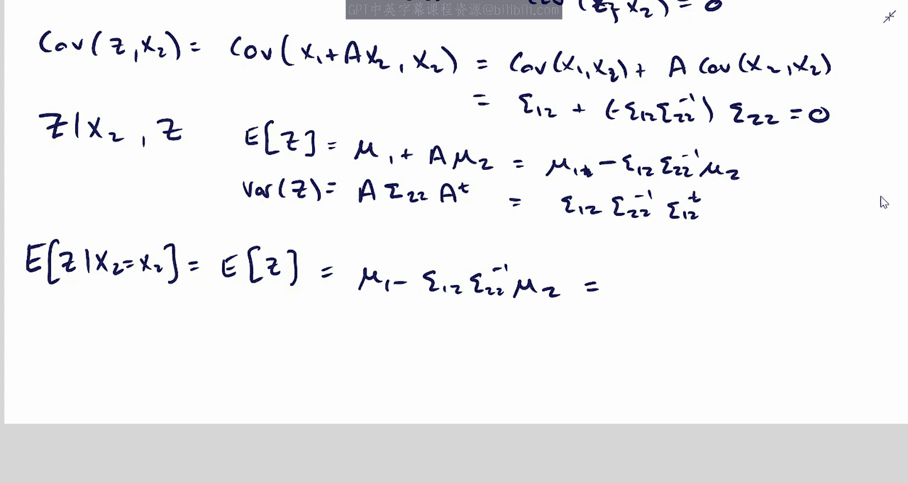

Remember the definition of Z， which we've written up here。

And that works out to be then that we can write this as the expected value of x1。Plus， A X2。

 given x2。Equals little x2。

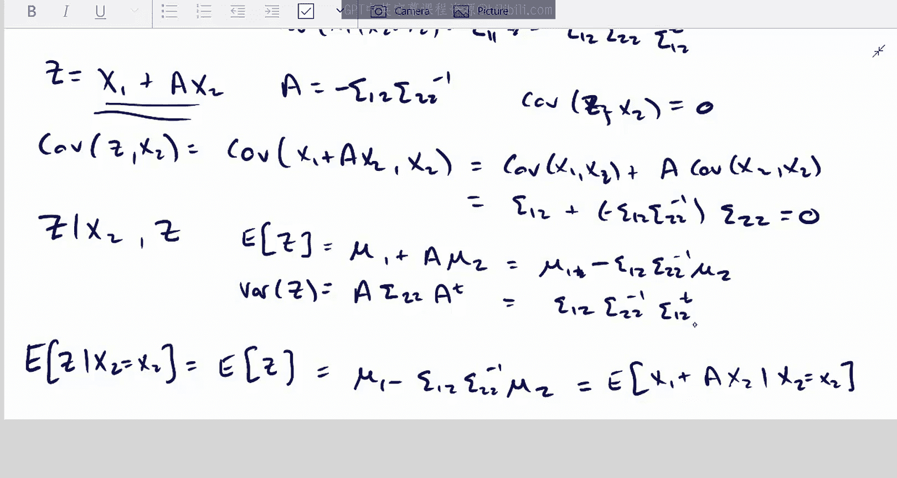

Okay。So we then can write expect a value of x1。哎。Given x2 plus a。Expect a value of x2 given x2。So。

This is the expected value of x1。X1。Given x2。Plus a expected value x2 given x2 is just x2。 Okay。

 so now take this equation。In this equation， and we can solve。For the expected value of x1 given x2。

Right。

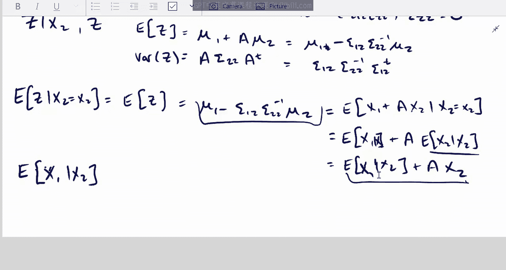

And it works out to be exactly the formula。That we had above。

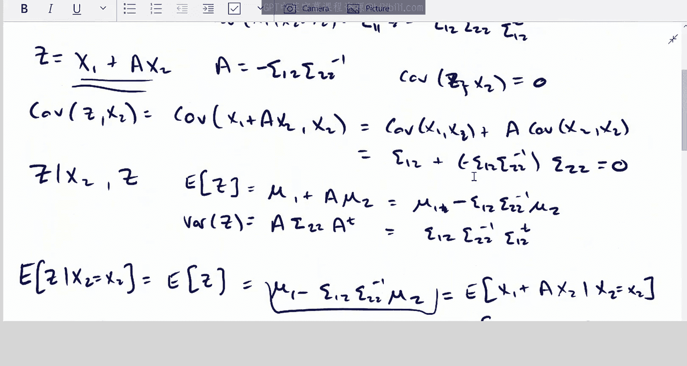

And then you can use the same technique to derive the variance so the variance。Of Z given x2。

Equals little x2。Well， that's just exactly equal to the variance of z。Since。

Z is independent of x2 since z is independent of x2。

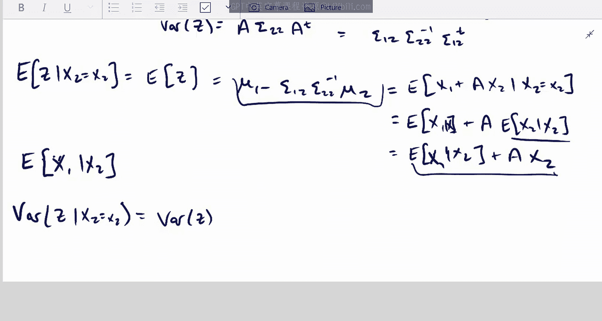

And。We can write we see right up here， the variance of z is。

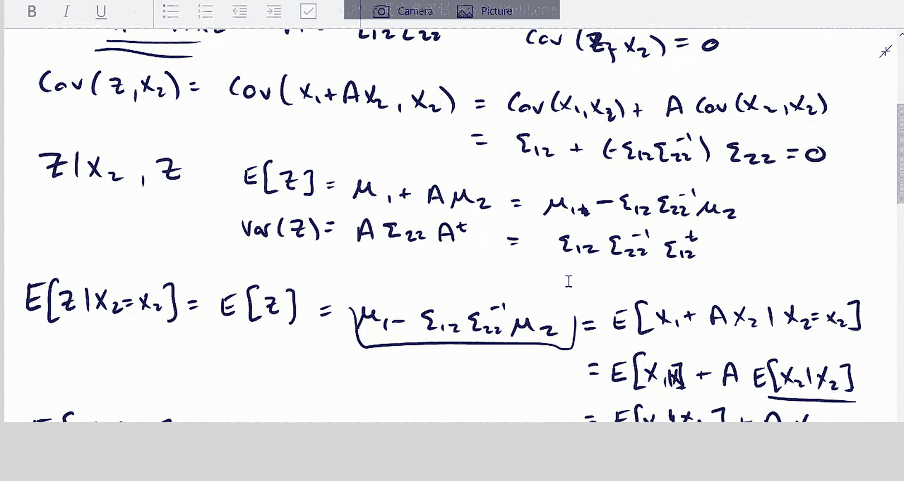

Sigma 12， sigma 2， inverse， Sigma 1，2， Sigma 1，2， Sigma 2，2 inverse， Sigma 12 transpose。

But then we also know that it's the variance。Of x1 plus A x2， given x2。

Because we're just simply rewriting that statement out with the definition of Z。

And by the rules of variances， we can then apply the variance formula and apply the rules of variance and solve again。

 and I'm going to ask you to complete the steps for homework。

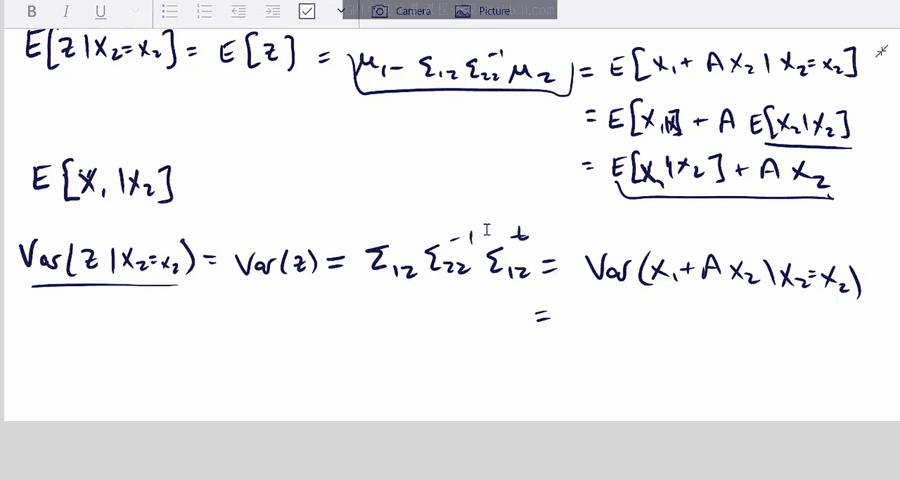