# 高级统计：10：正态分布的条件分布 📊

在本节课中，我们将要学习多元正态分布的条件分布。具体来说，我们将推导出在已知部分变量（例如 `x2`）的情况下，另一部分变量（例如 `x1`）的条件期望和条件方差的公式。这是一个非常实用且优雅的推导过程。

---

## 问题设定与公式

首先，我们设定一个多元正态随机向量 `x`，并将其划分为两部分：

`x = [x1, x2]^T`

我们假设 `x` 服从多元正态分布，其均值向量和协方差矩阵可以分块表示为：

均值： `μ = [μ1, μ2]^T`
协方差矩阵： `Σ = [[Σ11, Σ12], [Σ21, Σ22]]`

其中，`Σ12` 是 `x1` 和 `x2` 之间的协方差矩阵，`Σ21 = Σ12^T`。

我们的目标是：**求 `x1` 在给定 `x2 = x2` 时的条件分布**。我们知道这个条件分布也是正态的，关键在于求出其条件期望和条件方差。

以下是核心结论公式：

*   **条件期望**： `E[x1 | x2] = μ1 + Σ12 * Σ22^{-1} * (x2 - μ2)`
*   **条件方差**： `Var[x1 | x2] = Σ11 - Σ12 * Σ22^{-1} * Σ21`

上一节我们介绍了多元正态分布的基本形式，本节中我们来看看如何巧妙地推导出这些条件分布的公式。

---

## 一个巧妙的推导方法

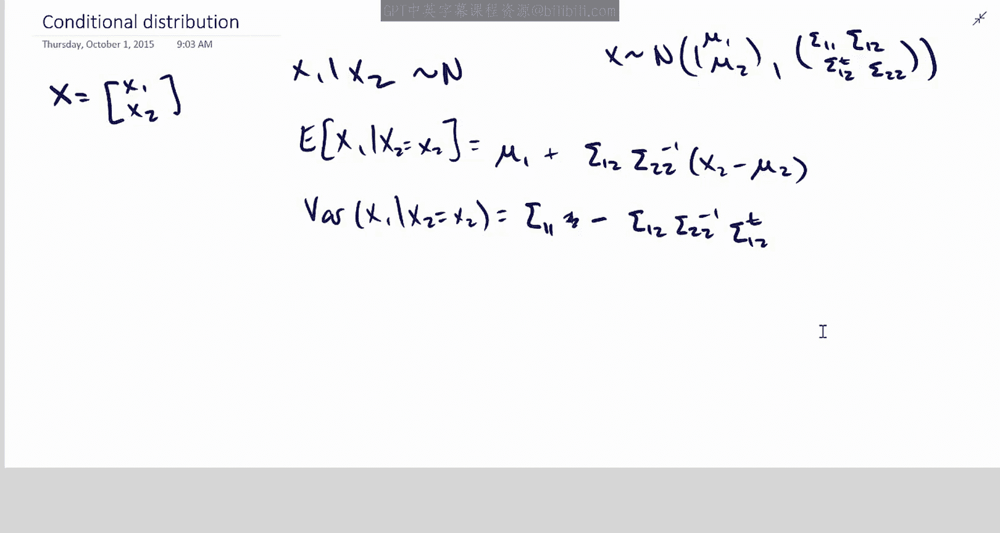

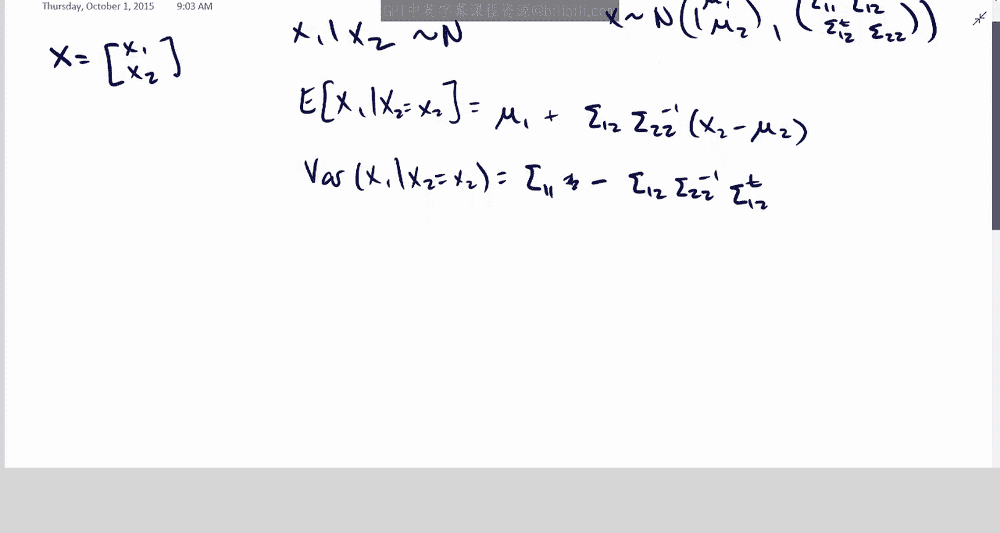

这个推导方法的核心思想是构造一个与 `x2` 独立的辅助变量 `Z`。

我们定义一个新的随机变量 `Z`：
`Z = x1 + A * x2`

其中，矩阵 `A` 被定义为：
`A = -Σ12 * Σ22^{-1}`

接下来，我们证明 `Z` 与 `x2` 是独立的。计算它们的协方差：

`Cov(Z, x2) = Cov(x1 + A*x2, x2) = Cov(x1, x2) + A * Cov(x2, x2) = Σ12 + A * Σ22`

将 `A` 的定义代入：
`Cov(Z, x2) = Σ12 + (-Σ12 * Σ22^{-1}) * Σ22 = Σ12 - Σ12 = 0`

由于对于联合正态的变量，协方差为零意味着独立，因此 **`Z` 独立于 `x2`**。

---

## 推导条件期望

因为 `Z` 独立于 `x2`，所以给定 `x2` 时 `Z` 的条件分布就是其边际分布。我们先计算 `Z` 的边际期望：

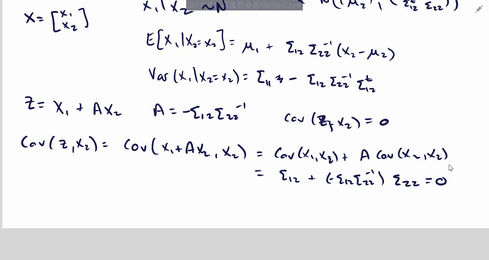

`E[Z] = E[x1] + A * E[x2] = μ1 + A * μ2`

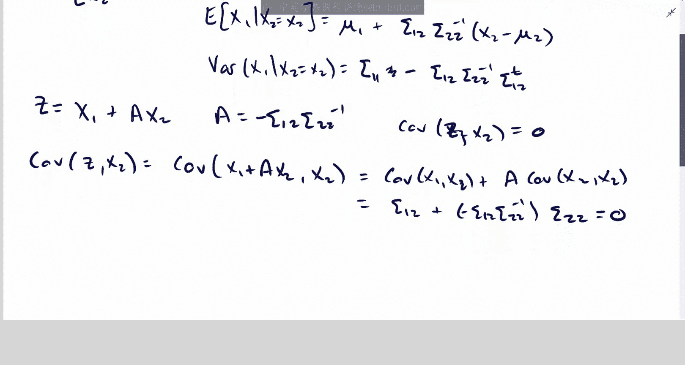

将 `A` 的定义代入：
`E[Z] = μ1 - Σ12 * Σ22^{-1} * μ2`  ... (1)

同时，根据条件期望的性质和 `Z` 的定义，我们也可以写出：

`E[Z | x2] = E[x1 + A*x2 | x2] = E[x1 | x2] + A * x2`  ... (2)

由于 `Z` 与 `x2` 独立，`E[Z | x2] = E[Z]`。因此，联立方程 (1) 和 (2)：

`E[x1 | x2] + A * x2 = μ1 - Σ12 * Σ22^{-1} * μ2`

解出 `E[x1 | x2]`：

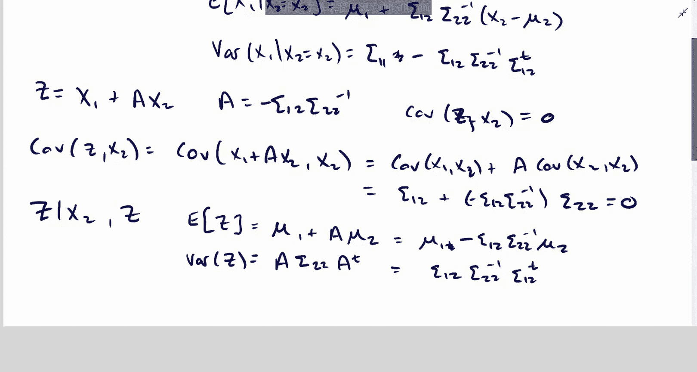

`E[x1 | x2] = μ1 - Σ12 * Σ22^{-1} * μ2 - A * x2`

再次代入 `A = -Σ12 * Σ22^{-1}`：

`E[x1 | x2] = μ1 - Σ12 * Σ22^{-1} * μ2 + Σ12 * Σ22^{-1} * x2 = μ1 + Σ12 * Σ22^{-1} * (x2 - μ2)`

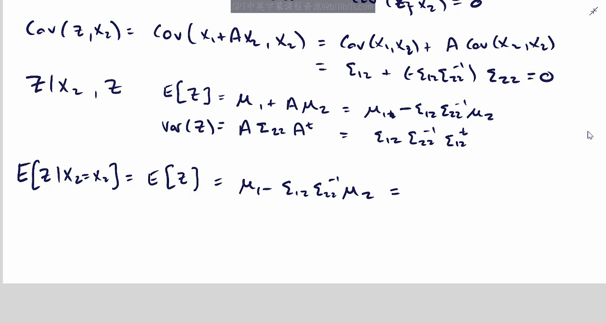

这正是我们之前给出的条件期望公式。

---

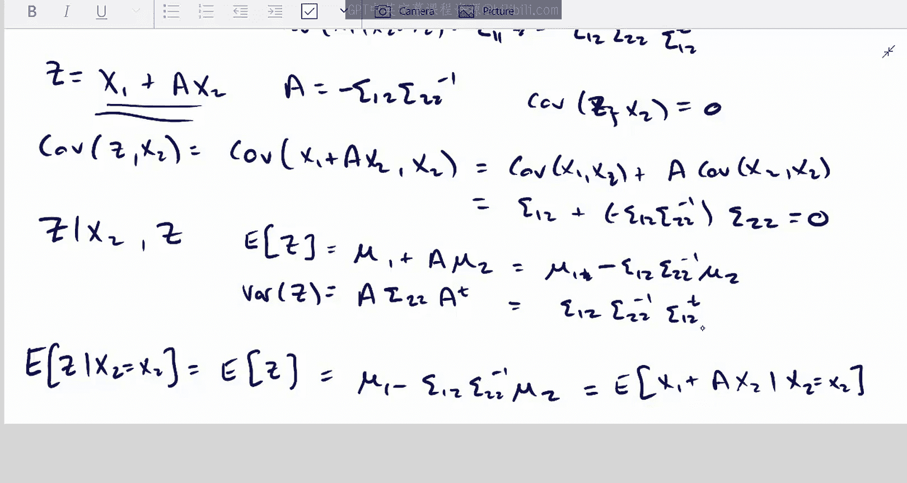

## 推导条件方差（思路）

我们可以用同样的思路推导条件方差。因为 `Z` 独立于 `x2`，所以：

`Var(Z | x2) = Var(Z)`

首先计算 `Z` 的边际方差：
`Var(Z) = Var(x1 + A*x2) = Σ11 + A * Σ22 * A^T + Σ12 * A^T + A * Σ21`

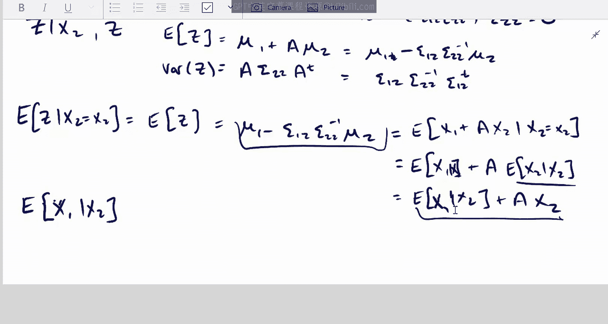

经过代入 `A` 并化简（此过程作为练习），可以得到：
`Var(Z) = Σ11 - Σ12 * Σ22^{-1} * Σ21`  ... (3)

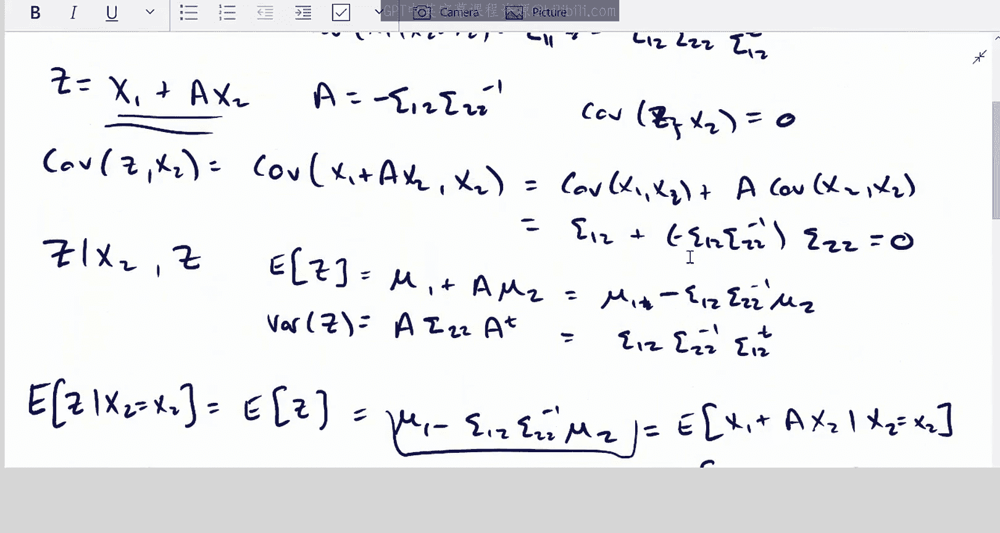

另一方面，根据 `Z` 的定义和条件方差的性质：
`Var(Z | x2) = Var(x1 + A*x2 | x2) = Var(x1 | x2)`  ... (4)
（因为给定 `x2` 后，`A*x2` 是常数，其方差为零）

联立 (3) 和 (4)，立即得到：
`Var(x1 | x2) = Σ11 - Σ12 * Σ22^{-1} * Σ21`

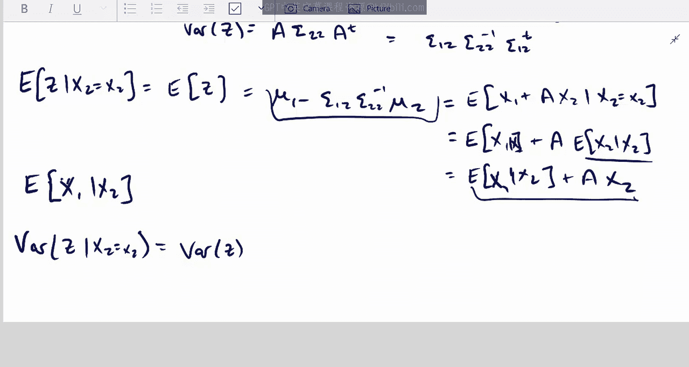

这正是我们之前给出的条件方差公式。

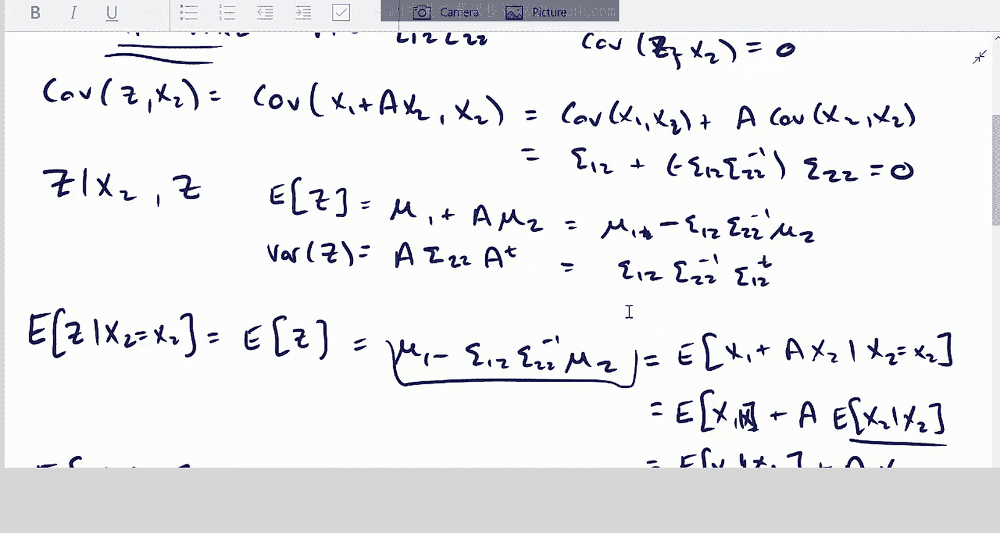

---

## 总结

本节课中我们一起学习了多元正态分布条件分布的推导。

*   我们首先给出了条件期望 `E[x1 | x2] = μ1 + Σ12 * Σ22^{-1} * (x2 - μ2)` 和条件方差 `Var(x1 | x2) = Σ11 - Σ12 * Σ22^{-1} * Σ21` 的公式。
*   然后，我们通过构造一个与条件变量 `x2` 独立的辅助变量 `Z`，巧妙地推导出了这些公式。这个方法的步骤是：
    1.  定义 `Z = x1 + A*x2`，其中 `A = -Σ12 * Σ22^{-1}`。
    2.  证明 `Cov(Z, x2)=0`，从而 `Z` 独立于 `x2`。
    3.  利用独立性，建立关于 `E[Z]` 和 `Var(Z)` 的方程。
    4.  将 `Z` 的定义代回方程，解出 `E[x1 | x2]` 和 `Var(x1 | x2)`。

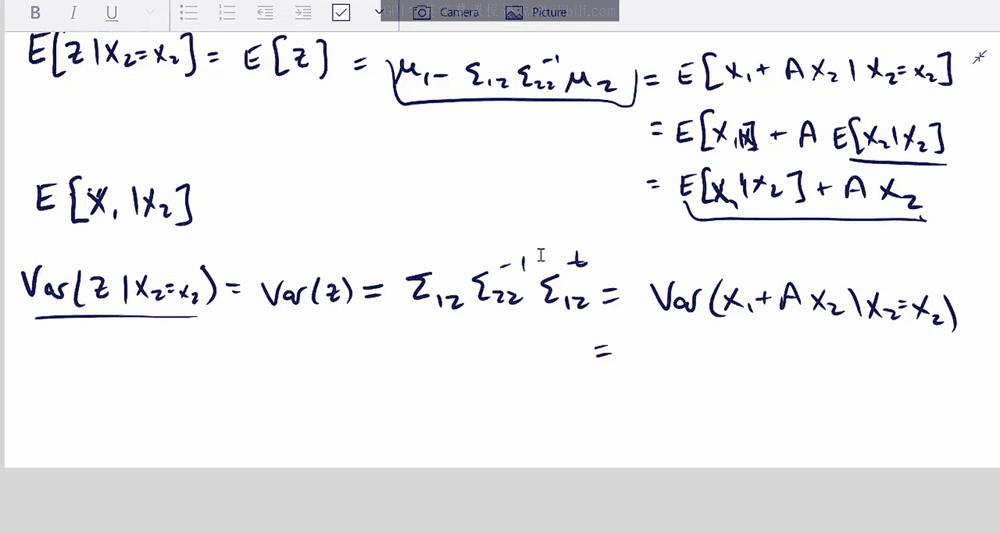

这个推导过程不仅简洁优美，也体现了处理联合正态分布问题时构造不相关变量的重要思想。