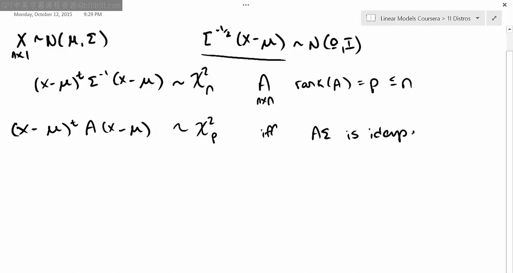
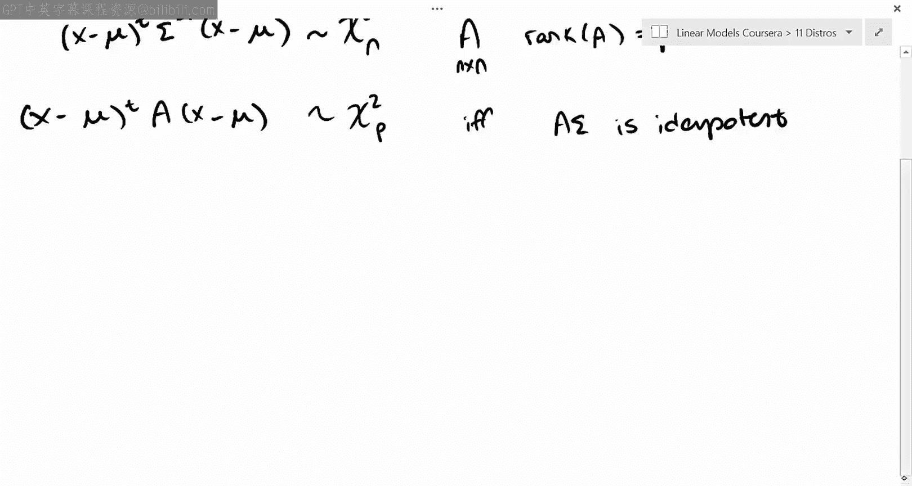
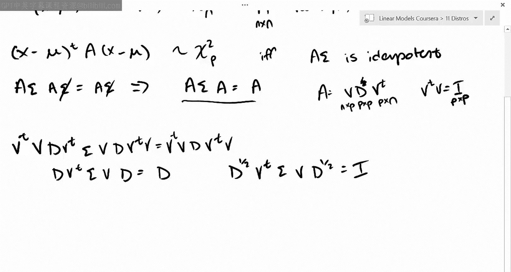
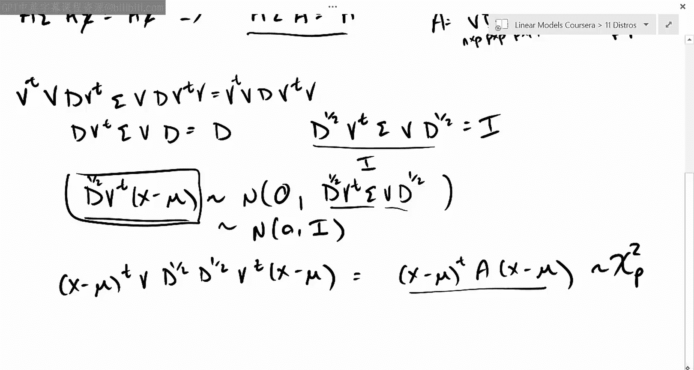
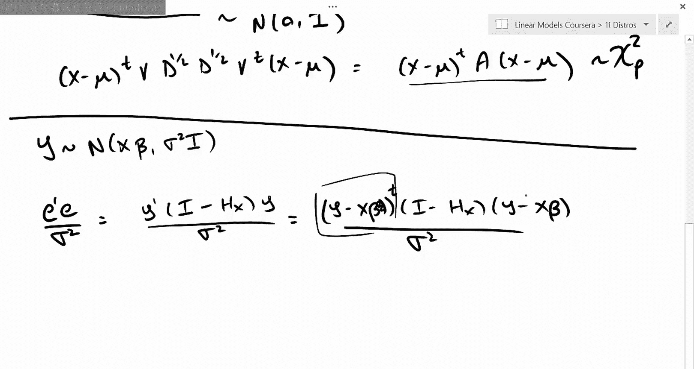
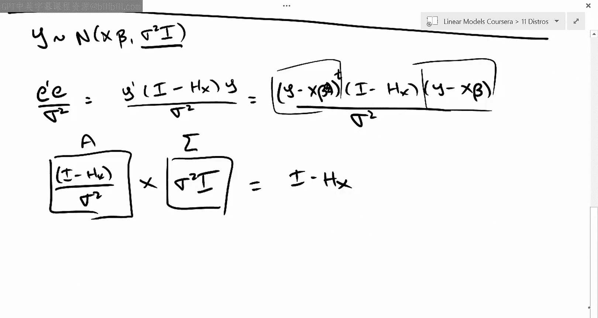
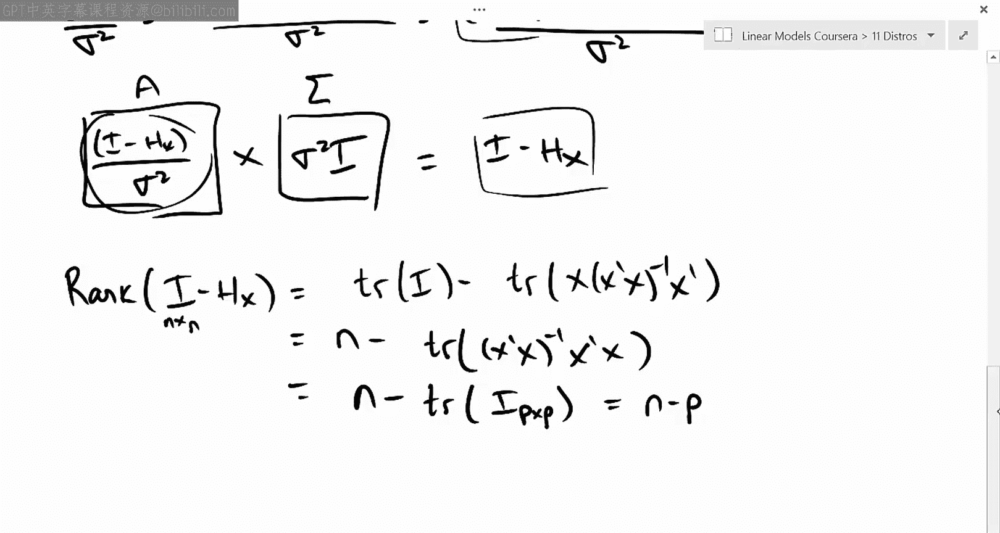
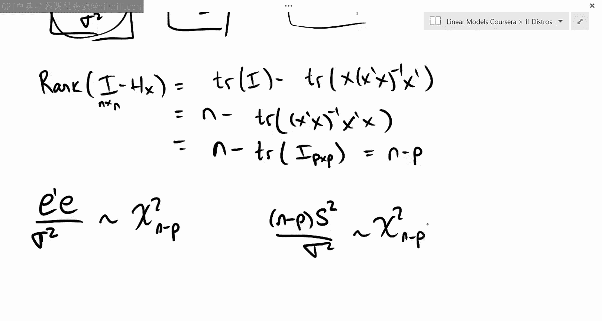

# 约翰霍普金斯大学《数据科学的高级统计｜Advanced Statistics for Data Science》中英字幕（deepseek p122 11_二次型的卡方结果.zh_en -BV1htPjeYEFH_p122-

In this lecture we're going to cover some basic distributional results and before I cover the instance where we're talking about a response and a predictor。

 let me just talk about some results where x is normal with a vector mean mu and a variance sigma。

 so X I'm going to assume is n by1。Now we all know that if we took sigma to the minus12。X minus mu。

That that's normal zero i。So if I were to take x minus mu transpose， sigma inverse x minus mu。

 well that's merely the inner product of that vector。

 so it's the sum of a bunch of squared II standard normals， which means it has to be chi squared n。

But we can actually make a stronger statement about quadratic forms。Let a be an n by N。

 not necessarily full rank。Sysymmetric matrix， so we're the rank of a。Is equal to P。

 which is not necessarily equal to n。Now， consider the。Qudratic form。

X minus mu transpose a x minus mu。 Well， that will in general， be chi squared。P where P is， again。

 the rank of a if。if and only if。A sigma。Is item potent。

So let's prove this result and it's surprisingly easy to prove well。

 we're going to prove one direction at least。

So the fact that a is item potent means that a sigma times a sigma is equal to a sigma。

But I'm going to rewrite this in a way that's going to be useful for me by multiplying getting rid of that sigma since remember Sigma is we're assuming that x is a normal vector。

 not a singular normal vector so that sigma is invertible。

 so that means that I can write that a sigma a。Is equal to a。

And then let me write the Cleski decomposition of A。As V D squared。

VAnd I'm just going to raise V D V transpose。Where D is a diagonal。Matrix of eigenvalues。

And V is n by p， so D is p by p and v transpose is p by n because it's the eigenvalue decomposition V transpose V is equal to I。

A P by P。Identity matrix。So take this statement and I'd like to write it out using the Kleski decomposition。

 so I get V DV transpose Sigma。V d， the transpose。Is equal to the D。The transpose。Okay。

 but now imagine if I were to then pre multiply this by v transpose and post multiply it by V。

 then I would have to do that same operation on this side and I would get。Then that D， V transpose。

Sigma。Vdi。Is equal to。Di。Now， I know I regret this decision I should have had it been de squared。

 but now I want to divide this。Divide both of these by a d to the minus12， and I get D to the1 half。

Which in this case， the square root is easy to think about because it's just the square root of the elements down the diagonal of D。

So I get D。V transpose sigma V。D to12 is equal to I Okay， so our item potency。

And our eigenvalue decomposition imply this relationship。

Okay。Now let's prove our result， at least one direction of our result。So consider the。Vectctor。D。

V transpose times x minus mu。Well， that's。For sure going to be a normal distribution because it's。

Whenever we have a normal vector and we just do linear operations So it it continues to be normal and its mean is going to be 0。

 I think that's pretty clearly easy to see。 And its variance is just going to be D。

 V transpose sigma V。D oh， and I should have。 I'm sorry I should have had that been a D to that one half。

Okay， so the variance of this vector is exactly the variance that we showed above is equal to I。

 a P by P I matrix。So this quantity right here。Is exactly normal。Zero I。Well。

 but now if I were to take x minus mu transpose or this quantity right here times itself transpose。

 so x minus mu。Times V D to the one half， D to the one half。V。Transpose。X minus mu。I get。

That's equal to x minus mu transpose a x minus mu。So。

What does this this implies that this quadratic form is the sum of a bunch of squared。

IID normals of P squared IID normals and is therefore chi squared P。Let's go through an example。

Where it's not a sigma matrix down the diagonal。 So I'm going to reuse some notation here。

 So I'm drawing this horizontal line to represent the fact that I am going to now。

Sort of start over on notation for this lecture， and I'm going to assume that why my Y outcome is normally distributed。

With mean x beta。Invariant sigma squared I。Now， consider the residuals。

To sum of the squared residuals。E transpose e。Divided by sigma squared。Okay， that's equal to。

 I hope this is old hat for everyone now， that's equal to why。Tranpose。

I minus the X hat matrix times y。Over sigma squared。

But I could just as easily write this as y minus x beta。啊。Transpose。Times I minus the hat matrix。

Times y minus x beta， and the reason I can do that is because the x times this I minus the hat matrix is0。

 so adding it in doesn't add anything and then over sigma squared。Well， what is this， Well。

 this is a normal vector minus its mean right here in and。

Quaddratic form with a matrix in the middle。 So according to my result， this will be chi squared。If。

And only if。I take the i minus H of x matrix。Over sigma squared。And I multiply it。

 so that's my a matrix from my notation before， and I multiply it。Times the。

Varance matrix from before， which was I labeled sigma。 So that's sigma squared I， Okay。

 sigma squared I。 Okay， so that is equal to I minus H of x over sigma squared times sigma squared I。

 That's equal to I minus H of x。 We've seen on many occasion that that's。I am potent。

And let's go through an argument about the rank the rank of this matrix。

The rank of。I minus H of x。So the rank of a symmetric item potent matrix is the trace。Okay。

 so this is equal， the rank equals the trace， so that's the trace of I。Minus the trace of h of x。

 which is x x transpose x inverse x transpose。Okay， so the trace of this I。

 remember this is an n by n matrix， so that's n， the trace of I is n。

 and then the trace of this I can do trace because trace A B is trace B。

 I can do trace of x transpose x inverse。X transpose x。

 So this is equal to n minus the trace of a P by P now。Identity matrix， which is equal to n minus P。

Now that's the rank of I minus H of x， so the rank of I minus H of x over sigma squared is the same thing because I've just multiplied at times the scalar。

 and so what we get。

According to this result is at our residuals E transpose E divided by sigma squared。

Is exactly chi squared n minus P。 And so another way to write this out is n minus P times S squared R。

The varianceance estimate divided by sigma squared is chi squared and minus p。

And notice as a special case of this， we get the instance of the ordinary chi squared result for normal data with just a mean and that's the case where we just have an intercept in our linear regression model and this just simply proves that that is chi squared。

And we get n minus1 degrees of freedom exactly like we show in an introductory statistics class。

 Okay， so this is a very handy handy result for proving very general chi square results for。

Cme for general quadratic forms and we'll find it very useful throughout the class。

