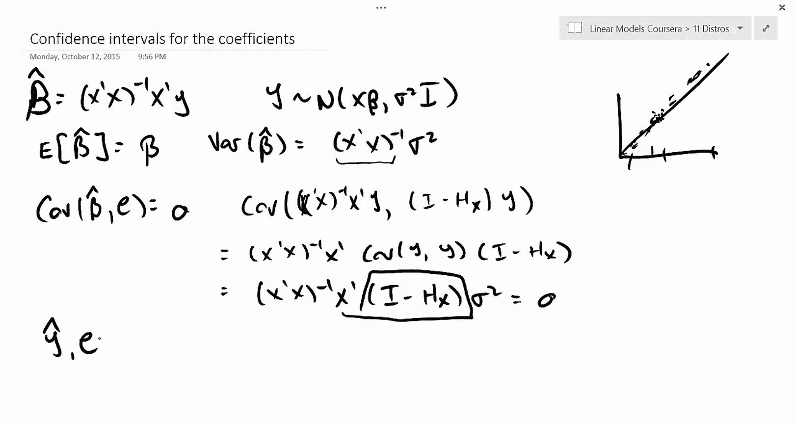
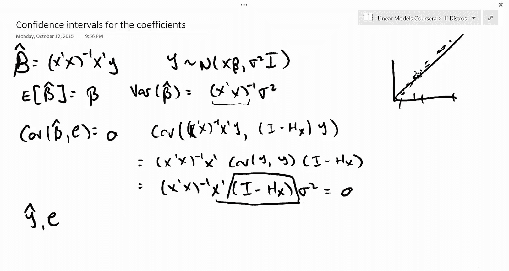
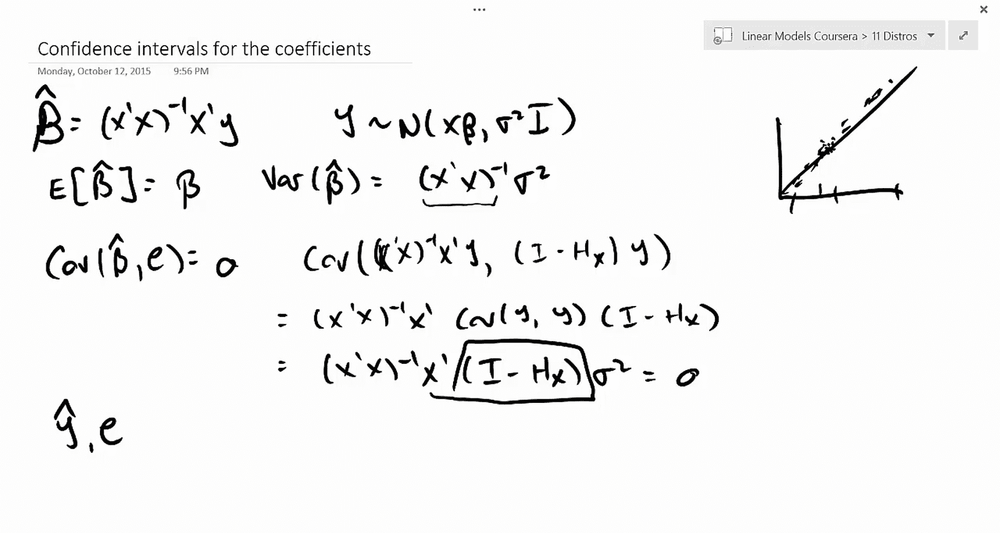
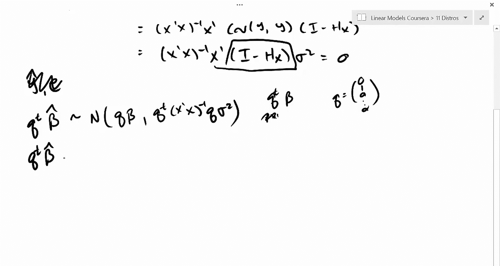
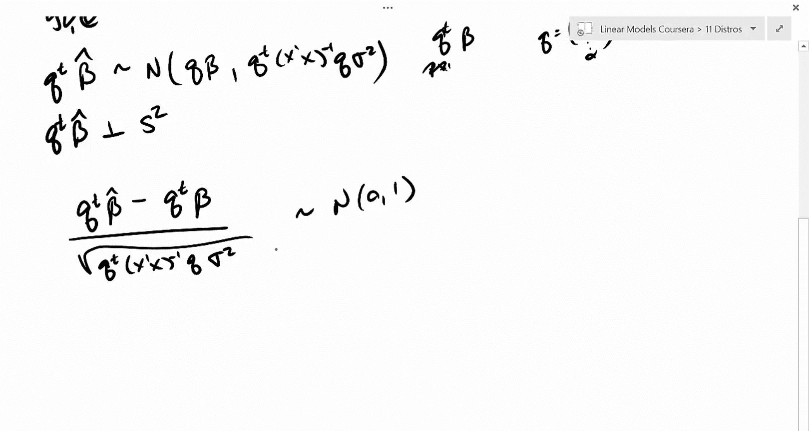
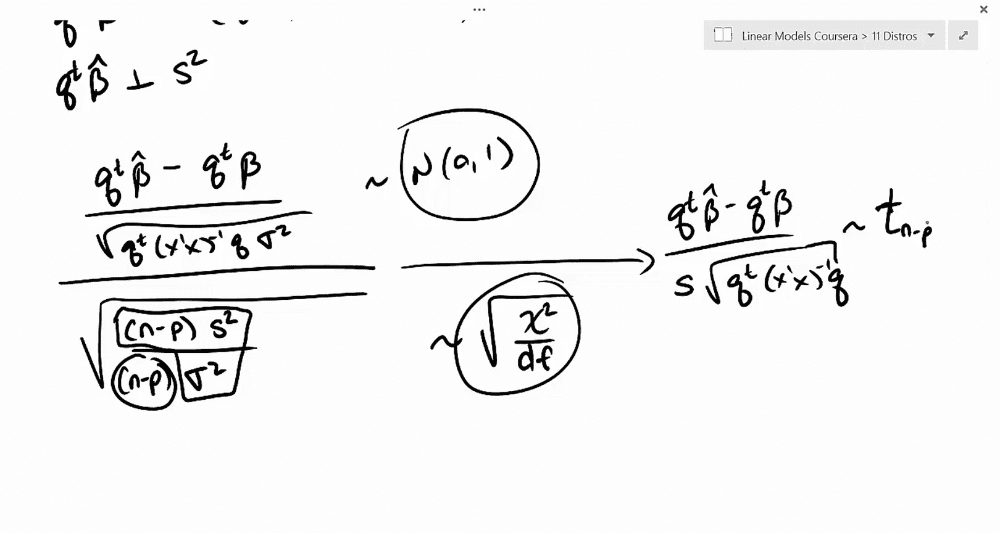

# 约翰霍普金斯大学《数据科学的高级统计｜Advanced Statistics for Data Science》中英字幕（deepseek p123 12_回归系数的置信区间.zh_en -BV1htPjeYEFH_p123-

Now that we have our chi squared result， we can start proving confidence interval results for our coefficients。

So。Beta hat。 And if you don't know this already， we haven't gone over this。

 It's x transpose x inverse x transpose y under the assumption that y is normal X beta。

Sigma squared I。Show that expect value of beta hat is beta。And that the variance。The beta hat。

Is equal to x transpose x inverse。Sigma squared。 and this should be old hat to you by now。

 I want to point out one comment， though， as is normal， what we saw in linear regression。

 that it's really variability in the x's make our variance in our coefficient smaller iss because of that inverse there。

So just like before you want to increase the variability in your regressors to decrease the variance the standard error of the coefficients。

 and that makes sense if we have a linear regression and our estimate of the line is going to be much more variable if we only measure the dots and a really tiny variance of x。

 but if we spread them out all along a very wide variance of the axises。

 then we'll get a less variable estimate of the line Okay， so small extra point going on there。

The other point I'd like to make is that。The covariance。Of beta hat。And E is0。

 And I can say this because the covariance of beta hat and E is the covariance。Of。X transpose X。

Inverse x transpose y。And the covariance of E is I minus h of x。And why， okay， so that's equal to。

X transpose x。Inverse x transpose covariance of y。With itself and I minus H of x when I pull it out on the other side。

Covariance of y with itself is sigma squared I。 So this works out to be x transpose x inverse x transpose。

Times I minus h of x times sigma squared。 And then we know that if we multiply this matrix times x transpose。

 we're going to get 0。So the covariance of beta hat and E。Our。

Is zero and then because of the normality， that means that beta hat and our residuals are unrelated and so similarly our Y hat and our residuals are unrelated。

We've seen that there。Pthgonal。

But now we actually see that they're statistically unrelated。

Here we go。Okay。Now， let's prove our T distribution result for our coefficients。

So take some linear contrast of the betas。Let's say Q transpose beta is a linear contrast where Q transpose is。

 is So Q is a。A P by one。Vectctor and Q transpose beta。

 then is some contrast of the betas that we're interested in。 So as a simple example。

 Q might be equal to say，0，1，0，0，0。And then Q trans was beta。

 would just pick off the second component of the beta vector or this contrast would pick off every component of the beta vector。

 but often we might be interested in the difference between two coefficients and so on。

So our natural estimate of Q transpose beta is Q transpose beta hat。

So Q transpose beta hat is clearly normally distributed。With mean Q beta。

And variance Q transpose x transpose x inverse Q sigma squared。Furthermore。beta had。

Is independent of the residuals， Q transpose beta hat will be independent of the residuals。

 hence they'll be independent of any function of the residuals。

 so they're going to be independent of S squared。

And any function of S squared。Okay， so Q transpose。Q transpose beta hat。Minus Q transpose beta。

Divided by。Square root。Q transpose X transpose X inverse Q。Times sigma squared。Is going to be。Normal。

0，1。Furthermore， we could divide this whole thing now。

We could divide this whole thing by the square root。Of n minus P。S squared。Over Sigma squared。

Which is the denominator is the square root of a chi squared divided by。

Its degrees of freedom I'm sorry。 And I want to divide by an extra n minus P there。

 which is the square root of a chi square root divided by its degrees of freedom， so。

This quantity right here。We've talked about is chi squared and there is its degrees of freedom。

So work all these together， and I'm just going to move over here。

 I get that Q transpose beta hat minus Q transpose beta。Divided by S。Square root。

Q transpose x transpose x inverse。Q。Is exactly a normal 01。

Divided by a chi square divided by its degrees of freedom where the top and the bottom are independent。

 so this is a t distribution with n minus P degrees of freedom。

So it is exactly using this result that we get to the individual coefficients from our linear model。

 follow a T distribution， and then this is exactly how we get。That the individual coefficients。

 we get the T table for the individual coefficients， for example， in R when you do summary。Okay。

 so let's go through a coding example of this， but this is exactly where the results in that T table come from。

