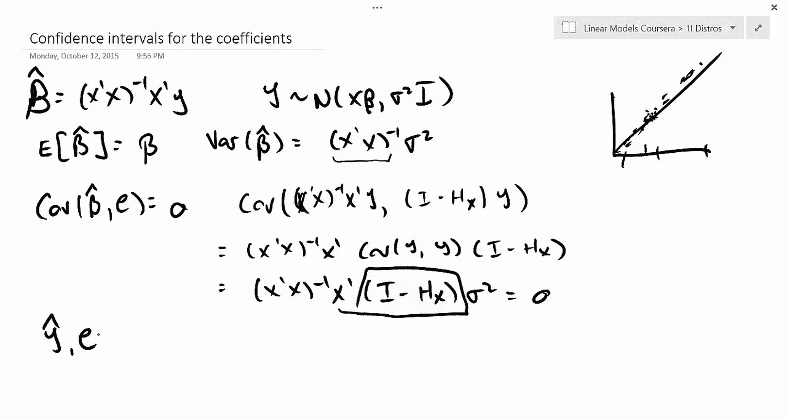
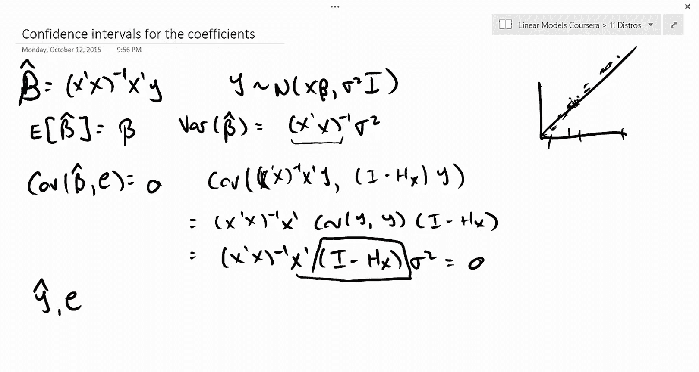
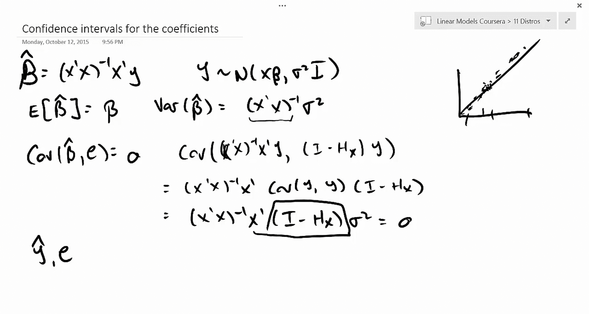
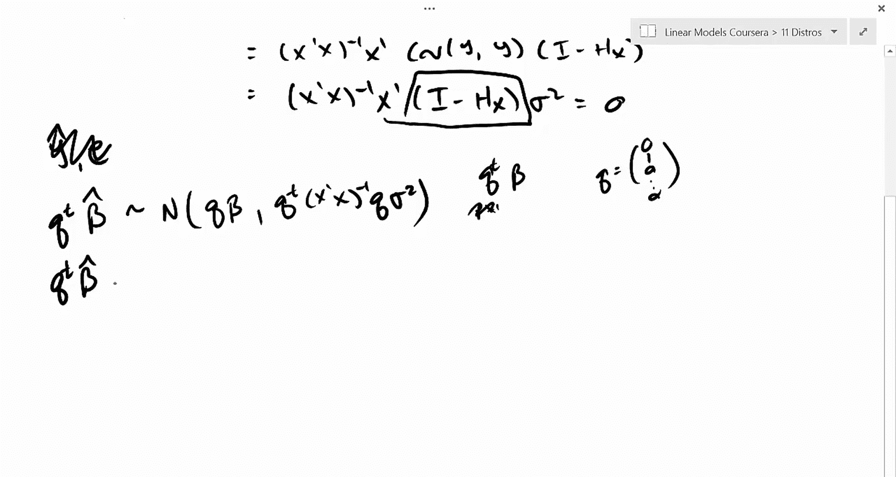
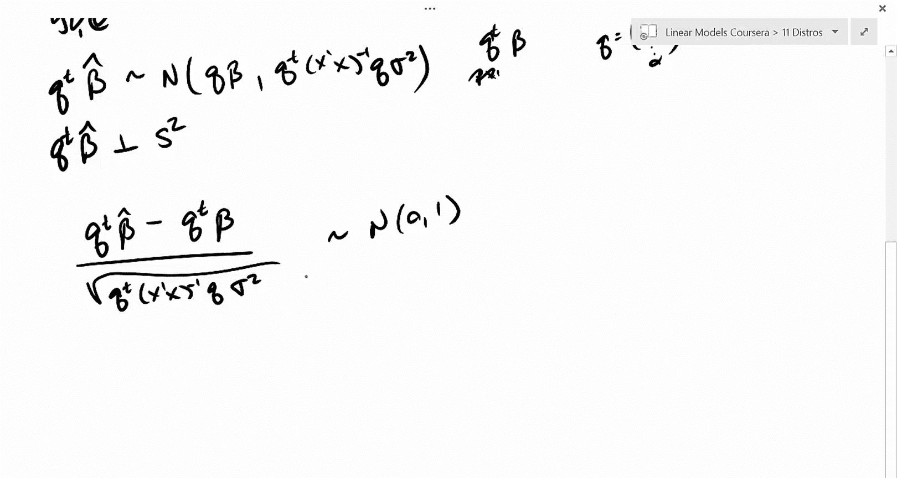
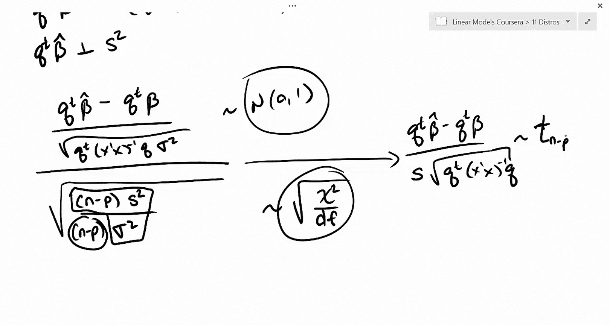

# 高级统计学：12：回归系数的置信区间 📊

在本节课中，我们将学习如何推导线性回归模型中回归系数的置信区间。我们将从回顾回归系数估计量的性质开始，然后证明其服从t分布，并最终利用这一结果构建置信区间。

---

## 回归系数估计量的性质

上一节我们讨论了残差平方和的卡方分布。本节中，我们来看看回归系数估计量 `β̂` 的性质。

`β̂` 的公式为：
```
β̂ = (XᵀX)⁻¹ XᵀY
```
其假设是 `Y ~ N(Xβ, σ²I)`。

可以证明：
*   `β̂` 的期望值是 `β`。
*   `β̂` 的方差是 `(XᵀX)⁻¹ σ²`。

这里需要指出一点：与线性回归中常见的情况一样，自变量 `X` 的变异性越大，系数估计的方差就越小，这是因为方差公式中存在逆矩阵 `(XᵀX)⁻¹`。这很直观：如果我们只在 `X` 的一个很小范围内测量数据点，那么对回归线的估计就会非常不稳定；反之，如果数据点在 `X` 的很大范围内分布，我们对回归线的估计就会更精确。

另一个重要的性质是，`β̂` 与残差向量 `e` 的协方差为0。因为：
```
Cov(β̂, e) = Cov((XᵀX)⁻¹ XᵀY, (I - H)Y) = 0
```
由于正态性假设，这意味着 `β̂` 与残差在统计上是无关的。同样，拟合值 `Ŷ` 与残差也是无关的。我们之前知道它们在几何上是正交的，现在则证明了它们在统计上是独立的。

---





## 系数线性组合的t分布



现在，让我们证明回归系数线性组合的t分布结果。

取 `β` 的一个线性对比，例如 `Qᵀβ`，其中 `Q` 是一个 `p x 1` 的向量。我们对这个对比的自然估计是 `Qᵀβ̂`。

以下是 `Qᵀβ̂` 的分布性质：
*   `Qᵀβ̂` 服从正态分布，其均值为 `Qᵀβ`，方差为 `Qᵀ (XᵀX)⁻¹ Q σ²`。
*   由于 `β̂` 独立于残差，`Qᵀβ̂` 也独立于残差，因此也独立于残差的任何函数，例如残差方差估计量 `S²`。

基于以上性质，我们可以构造以下统计量：
```
[ Qᵀβ̂ - Qᵀβ ] / [ √( Qᵀ (XᵀX)⁻¹ Q σ² ) ] ~ N(0, 1)
```

然后，我们用 `S`（`σ` 的估计值）替换分母中的 `σ`，并除以一个调整因子。具体来说，我们考虑以下表达式：
```
[ Qᵀβ̂ - Qᵀβ ] / [ S √( Qᵀ (XᵀX)⁻¹ Q ) ]
```
这个表达式可以重写为一个标准正态随机变量除以一个独立的卡方随机变量除以其自由度的平方根。这正是自由度为 `n-p` 的t分布的定义。



因此，我们得到：
```
[ Qᵀβ̂ - Qᵀβ ] / [ S √( Qᵀ (XᵀX)⁻¹ Q ) ] ~ t(n-p)
```

---



## 构建置信区间

利用上述t分布结果，我们可以为 `Qᵀβ` 构建一个 `100(1-α)%` 置信区间。

置信区间的公式如下：
```
Qᵀβ̂ ± t_{1-α/2, n-p} * S * √( Qᵀ (XᵀX)⁻¹ Q )
```
其中 `t_{1-α/2, n-p}` 是自由度为 `n-p` 的t分布的 `1-α/2` 分位数。

一个最常见的特例是当我们对单个系数 `β_j` 感兴趣时。此时，我们可以令 `Q` 为一个除了第 `j` 个元素为1、其余元素均为0的向量。这样，`Qᵀβ` 就是 `β_j`，`Qᵀ (XᵀX)⁻¹ Q` 就是 `(XᵀX)⁻¹` 矩阵的第 `j` 个对角元素。这正是R语言中 `summary()` 函数输出结果里每个系数对应的t检验和置信区间的基础。

---

## 总结



本节课中，我们一起学习了线性回归系数置信区间的推导过程。我们首先回顾了回归系数估计量 `β̂` 的期望、方差及其与残差的独立性。然后，我们证明了系数线性组合 `Qᵀβ` 的估计量服从t分布。最后，我们利用这个t分布结果，推导出了构建 `Qᵀβ` 置信区间的通用公式。这个理论框架是理解软件输出中回归系数推断结果（如p值和置信区间）的关键。