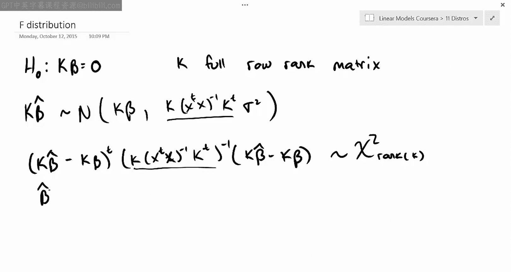
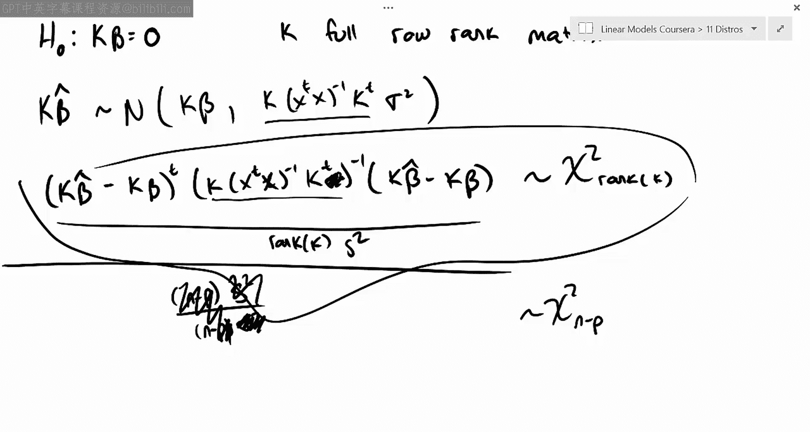

# 约翰霍普金斯大学《数据科学的高级统计｜Advanced Statistics for Data Science》中英字幕（deepseek p124 13_F分布.zh_en -BV1htPjeYEFH_p124-

Now I lied and I said we were going to go over a coding example， but I forgot。

 let's do the F distribution first。And then we'll go over a coding example because it's very related to what we just did with the deriving the T distribution so I'm going to take a simple example and I think you should be able to extend this to slightly more complex settings。

So consider testing the hypothesis that H not。K beta。Is equal is equal to 0。

So now we want a hypothesis test where K is a full rowing。 K is a full。B。Rannk。Matrix。Mattrix。

 so its it's some some degree some number of rows and then peak columns。

But it's at least a full row rank。And so because we want to test a vector。

 we can't use a T distribution or a unit T distribution。

 so we need to use something like an F distribution。Our natural。Our natural。

Etimator of k beta is K beta hat。Which under our standard assumptions from the section is going to be normally distributed with mean K beta。

Invariance equal to k x transpose x inverse。Cate transpose。Times sigma squared。

Now I can construct a chi squared out of K beta hat very easily。So let's take K beta hat。

Minus k beta minus its mean transposed， and then simply times the inverse of its variance matrix。

 K X transpose x inverse。X transpo x inverse。K transpose inverse。Times k beta hat minus k beta。

And that's clearly going to be chii squared。Rannk of K。

And the reason being that this by virtue of k being a full row rank matrix is going to be an invertible matrix。

And this is k by whatever the number rows of k is that by that square matrix and just by the results from the first section of this。

Chapter， we have that this is exactly chi squared。Furthermore。

 the only thing random in this chi squared is beta hat。And we know that this is independent。

Of S squared。

So what I could do。Is take this quantity， divide it by its degrees of freedom。 Let's just say， rank。

Okay。And then divide it。Byai。N minus P。S squared。Over n minus p。Sigma squared， and oh。

 I realized I made a mistake。I forgot my sigma squared right there。I forgot my sigma squared there。

 I just reminded myself of this。Okay and the reason I remembered it is because now when I divided these two things out。

 I have a chi squared rank of k in the numerator and I have a chi squared n minus p in the denominator and they're independent because in the numerator。

 the only random thing is beta hat and the denominator s squared is just a function of the residuals E。

 so the numerator is independent of the denominator and what I've done is taken a chi squared divided by its degrees of freedom and then divided by another chi squared。

 an independent chi squared divided by its degrees of freedom。The sigma squares， of course。

 will cancel out， and that's why I remember that I forgot my sigma squared from above。

So and then these n minus P's， of course， cancel out。So this statistic right here。

Which I can just move this S squared up right into the denominator That statistic right there is the F test for a general linear hypothesis。

 The most clear one would be a matrix K that grabs all of the coefficients except for the intercept。

 for example， and that is the standard F test from that our linear regression model puts out。

But I think I hope you can see that this is a pretty easy result to prove now that we have all this machinery under our belt。

