# 约翰霍普金斯大学《数据科学的高级统计｜Advanced Statistics for Data Science》中英字幕（deepseek p126 15_预测区间.zh_en -BV1htPjeYEFH_p126-

Okay， so let's talk about the subject of prediction。 Imagine that we have a y variable。

And an x variable。 And we have fit a linear model， either via least squares or more likely with some distributional assumptions to obtain beta hat。

 which is。X transpose x。Inverse x transpose y。T the same there。Okay。

What would be our obvious estimate for the expected value of y， let's say。

At at a particular value of x。 Okay， so the expected value of y。At a given value of x。

And so this is a vector Y。 Now， let's say expect the value of a particular value。

 why not of a scalar version of。Y at the particular value of x n。

 Well that expected the value is x not。X not transpose beta。Okay。

And so our estimate of that clearly is going to be。X not transpose beta hat。

So we can create a confidence interval for this prediction。

Very easily using the tools that we've developed so far because this is， again。

 just a linear contrast， Okay， and of the betas， which we've already even covered how to create a confidence interval for that。

 So we know that the variance of this。 So we'll call that Y hat not。 Okay。

 so the variance of why hat not is equal to。X not transpose variance of beta hat。X。

 which is equal to x transpose x transpose X inverse x sigma squared。Okay。And we know we can use。

 we can generate our T interval like we've done in some of the pre previous lectures and so that we can get our interval estimate。

 our interval。Is going to be Y hat not plus or minus a T 1 minus。

1 minus half over2 and n minus p degrees of freedom times S our residual variance estimate。

 which we're going to use for that。Times the square root of x transpose， x transpose x inverse x not。

Okay， so that is， say， if we have a linear regression。What that is is a confidence interval。

For the line。At a given value of x not。Okay。But that's not the entire story here about prediction intervals。

 because this。

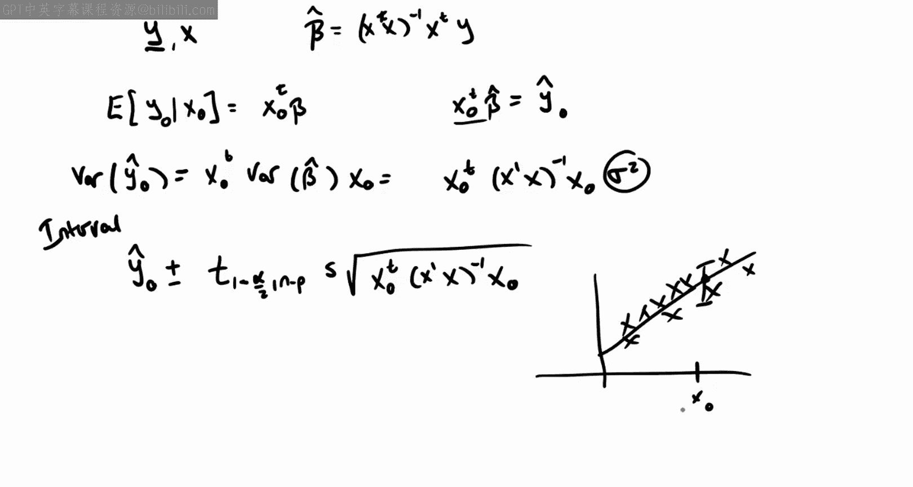

Talks about how well we've estimated the line。 Okay， so if we think about our diamond prices。

 for example， it talks about how well we've estimated the average cost of a diamond for that particular weight or that particular mass。

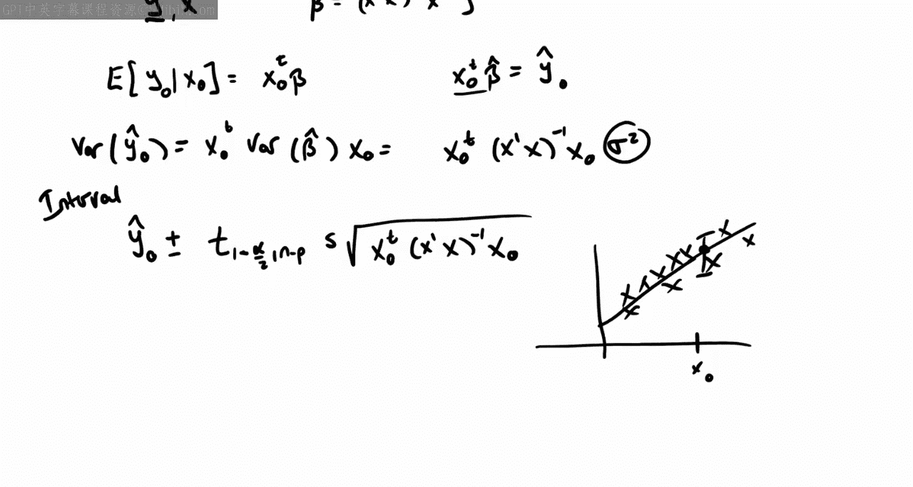

But if you're selling a diamond， you might be interested in knowing， okay。

 not not if I collected all the diamonds of this particular mass and took the average price that they were valued at。

 not that。 But if I were to sell this particular diamond。

 What's the a range of possible values that I that would be reasonable as a price for this diamond。

 And that's a different thing。 So there's a difference in this context between confidence interval for the mean value of in other words。

 the value of the line or the plane or whatever at that particular collection of X values， versus。

A prediction that incorporates the uncertainty that is included in the wise themselves。 Okay。

 so imagine we want to predict why not。

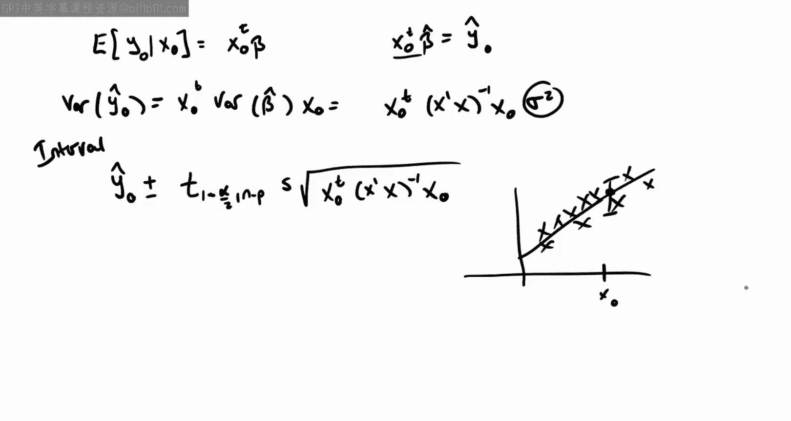

Which is the price of this diamond for this particular mass。

 where we haven't actually observed the y at this particular value of x。

 Think of it as a new value of y。Well， think about the。The quantity， why not。Minus。X。X not beta hat。

Okay， that's the difference between our actual y not at that particular value of x the new realized value of y。

And。What we would predict at this value of x n， We're not beta not， just beta。 where， again。

 our beta hat hasn't used this Y n in its calculation。 Okay， so now the variance。The variance of。

Of this。Is now the variance。Of why not？Plus， the variance。Of let's say why not hat。 Okay。

 and I can move that variance across that sum again， because this beta hat didn't involve that Y not。

 this potential new value of Y not in its calculation。 So they're independent。 Well。

 this variance of Y not is sigma squared plus the variance of y hat。 We just did that a second ago。

 That sigma squared。X not x transpose x inverse。X not。Let should be a transpose there。 Okay。

 so if I wanted to estimate this variance， it would be sigma squared times1 plus。X not transpose。

X transpose x inverse， x not。

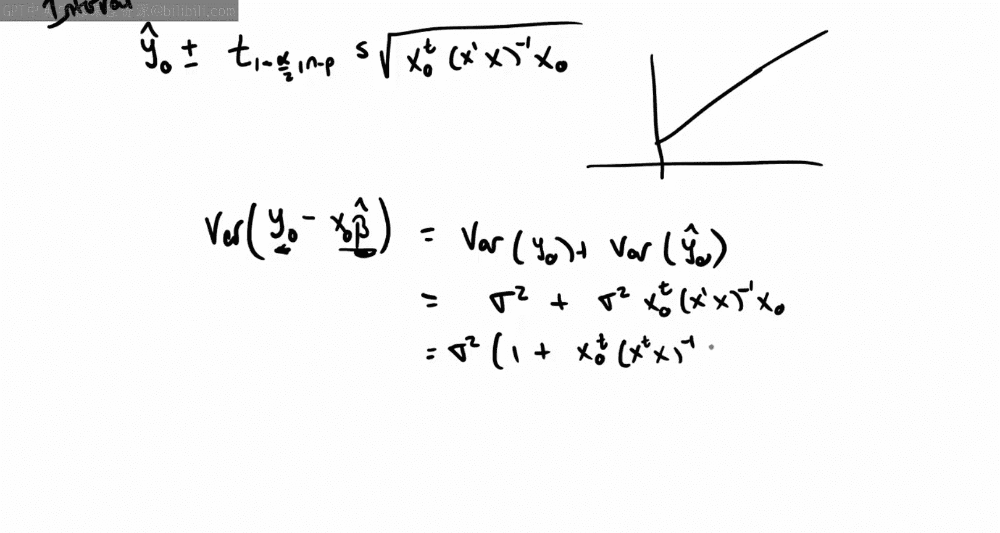

And then what I'm going to ask you to do for homework because it should be old hat for you now is to prove to yourself that why not minus。

X， beta hat。Over。S， square root。1 plus。X not transpose， x transpose x inverse x not。

Is follows a T distribution with n minus P degrees of freedom。And so， we can calculate。

The probability that say a t quantile， the alpha over2 t quantile with n minus t degrees of freedom。

 n minus p degrees of freedom is less than or equal to y not minus x。Not beta hat。Over。S。

Square root 1 plus。X， not transpose。X transpose x inverse。

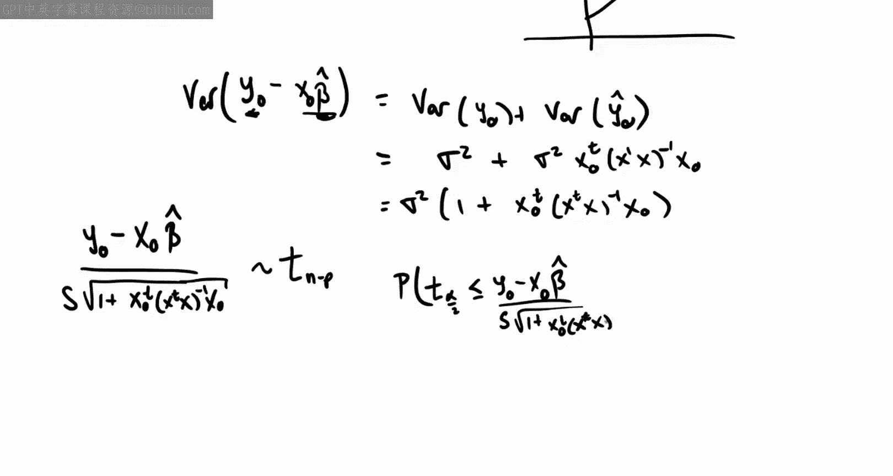

Ex not。Is less than or equal to the T the one minus alpha over to upper quantile。

 That should be equal to1 minus alpha。 In other words， we're looking at our T distribution。

 We're looking at the probability that it's。啊。It's。

If we put alpha over two there and alpha over to the mass there。

 probably that our statistic lies in between those two cutoffs should be equal to1 minus alpha。

And we can rearrange that to make the probability statement the probability that why not is in the interval。

嗯。X not beta hat。Plus， or minus。T1 minus alpha over 2。Square root S times square root 1 plus。

X not transpose x transpose X inverse x not。The probability that why not lies in there is1 minus alpha。

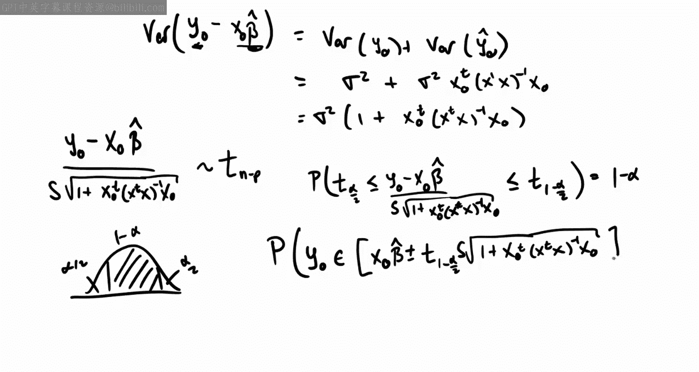

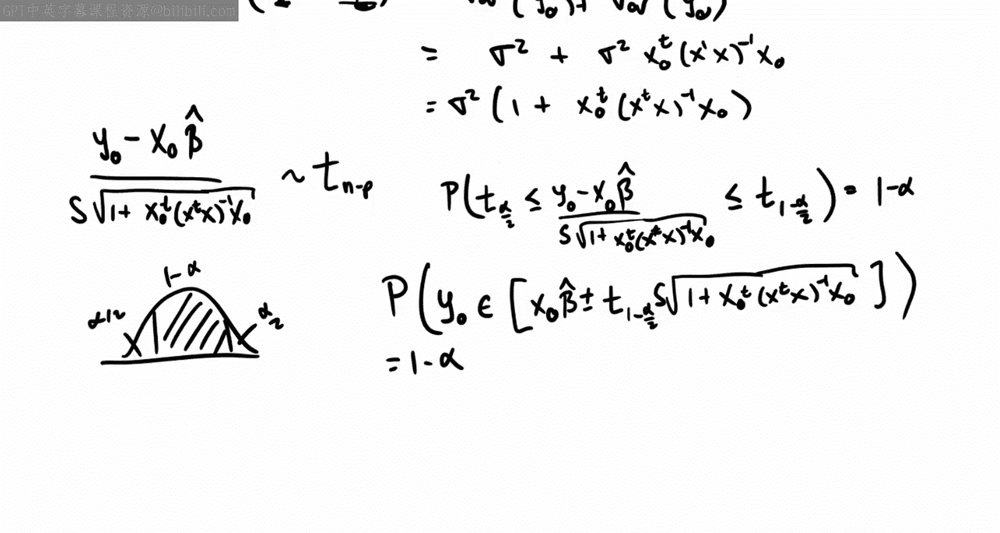

Okay， so this quantity。X not beta hat plus or minus the T quantile。

S times square root 1 plus is our prediction interval。Notice it's exactly the same。Plus or minus t。

Notice it's exactly the same as our confidence interval。For the mean。

Of the regression surface at that point。The only difference being。No， one plus。Okay。

 so what is that extra one well that extra one is from if we look back。

 it's from the variance of this why not term right here。

 and it makes total sense that we would have to have that extra one in there if we want for a prediction interval。

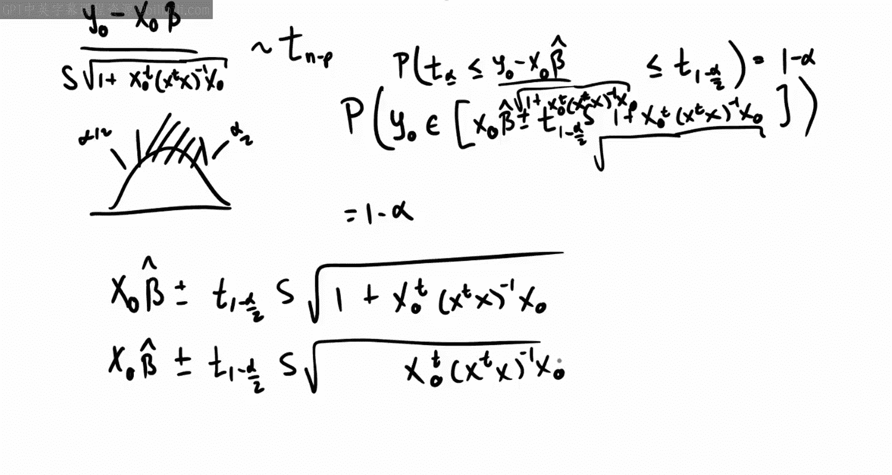

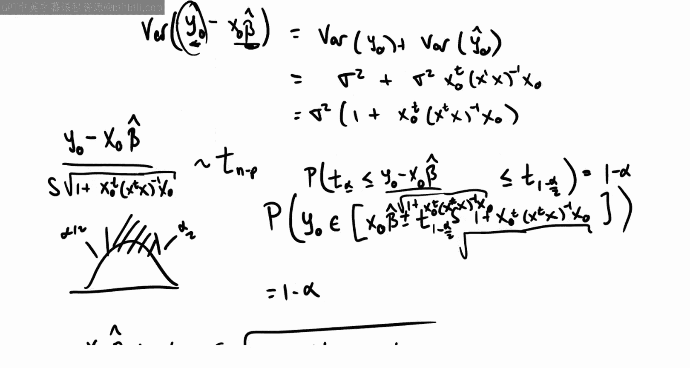

Versus a confidence interval for the mean。Okay， so if we want a confidence interval for the mean of the regression surface。

 if we collect an infinite amount of data， that confidence interval should get narrower and narrower。

 it should always you know， limit。To exactly the mean price。

 So if we collected all the diamonds in the world of that specific weight。

 we should have a very good estimate of what the line should be like at that particular point。

 On the other hand， if we want to know what are the potential set of prices we could get for this specific new diamond that we're trying to sell。

 Okay， there's some intrinsic variability that no matter how well we estimate the line would be surrounding the line。

 Okay， and that that's why this one part doesn't go away， no matter how much data。

 how much better we estimate the line， it still is there， It's sort of an intrinsic variability。

 So as we collect an infinite amount of data， this part converges to sigma。

And this part will converge to zero。And so that one part will just stay there and then just represent the natural variability around the line。

 Okay so that's the distinction between a prediction interval and a confidence interval。

 So a prediction interval， by the way， is not a confidence interval because if you look at the actual probability statement we use the quantity we're saying is in the interval is a random quantity。

 So it's not a confidence interval。 But we derive it in kind of the same way。

 And now at this point in the class， I think you should be able to derive the prediction interval in the confidence interval。

 that's why I'm going over this kind of glossing over it a little bit。

 but I just want to make sure that everyone understands the distinction between the two and why it is there's this fixed quantity in the prediction interval。

 it's because of this natural variability that exists around the regression line or ground the regression surface that doesn't go away if what you want to if what you want to estimate is what is the whatever the potential likely values。

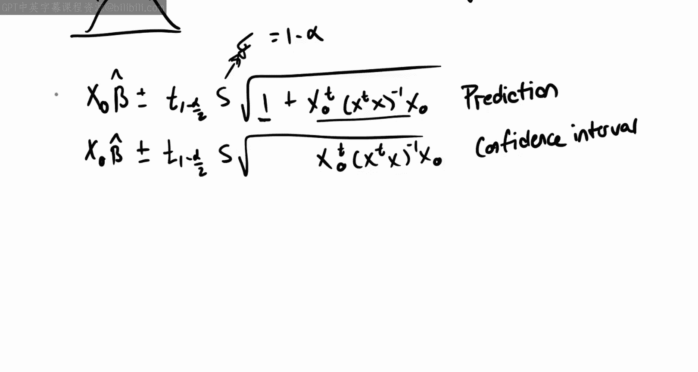

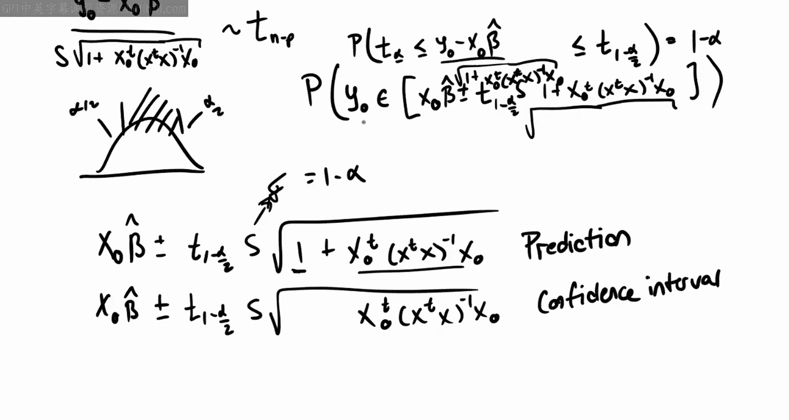

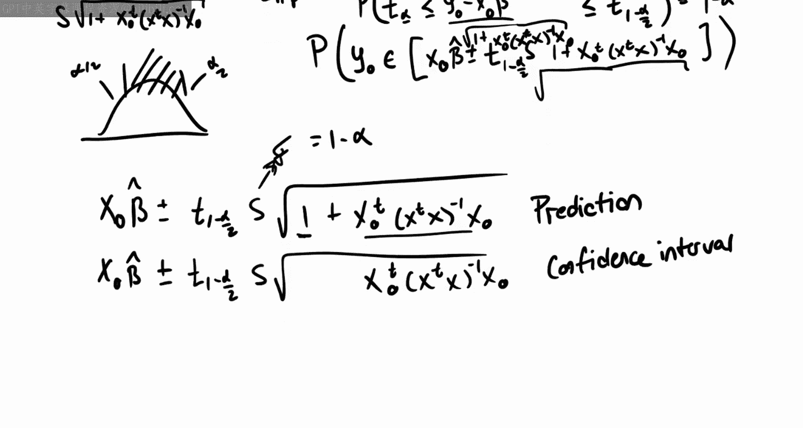

For a response at that given value of x or that given collection of values of x。

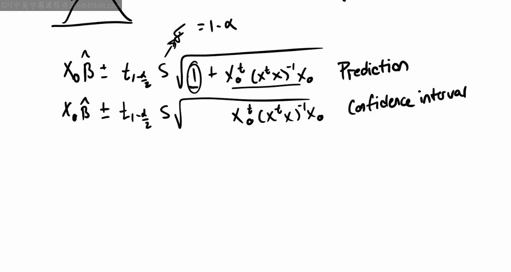