# 约翰霍普金斯大学《数据科学的高级统计｜Advanced Statistics for Data Science》中英字幕（deepseek p127 16_编程示例.zh_en -BV1htPjeYEFH_p127-

So let's go through an example of calculating a prediction interval in this case we're going to use the empty cars data set。

Okay， and so I'm going to fit a model that has miles per gallon as the outcome。

 horsepower and weight in an intercept as predictors。 Okay， so there's my fit。 If I do summary fit。

 you can see there it is。

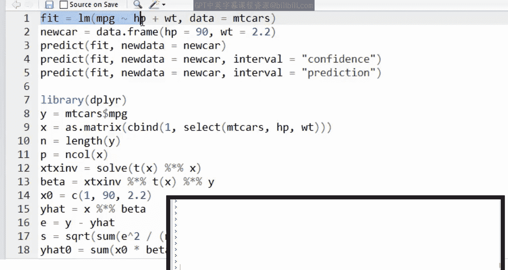

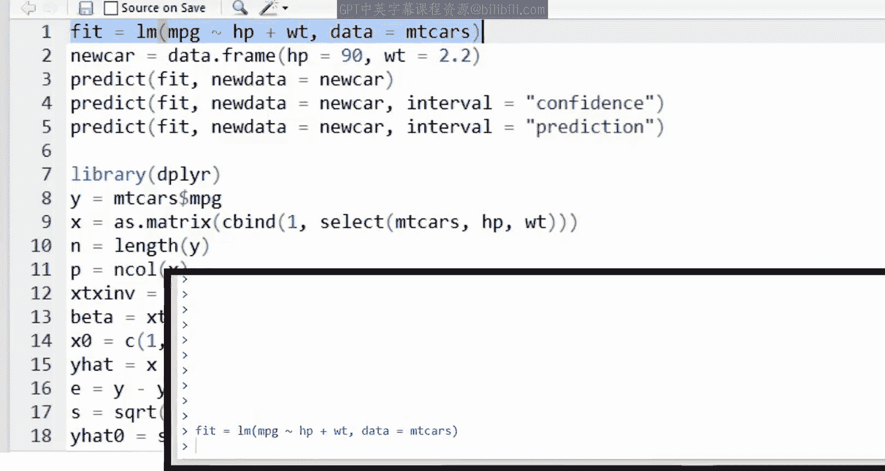

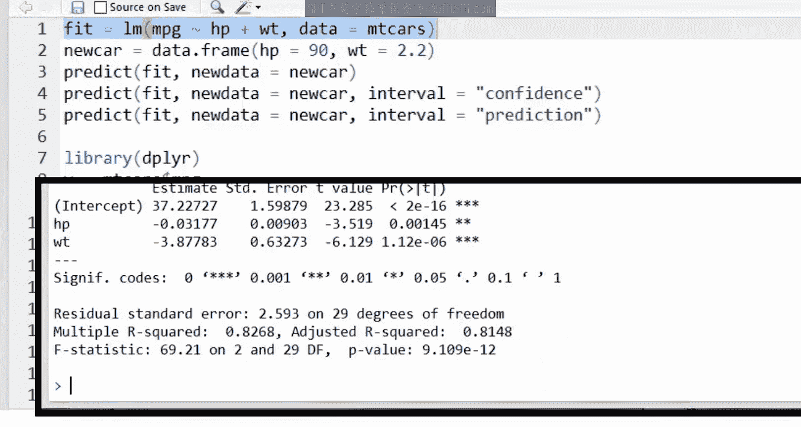

Okay。So if I want to predict that a new car， I'm going to create a new data frame。

 and I want to predict that a horsepower of 90 and a weight of 2。2。Okay。

 so then if I do predict fit and new date equals new car， Okay， it gives me my prediction 25。

8 miles per gallon。 note if I， if I do predict。

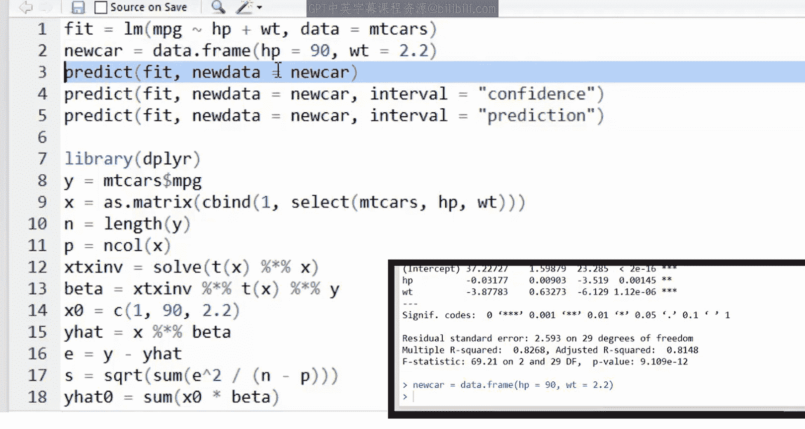

Of my fit of my linear model fit without any arguments。

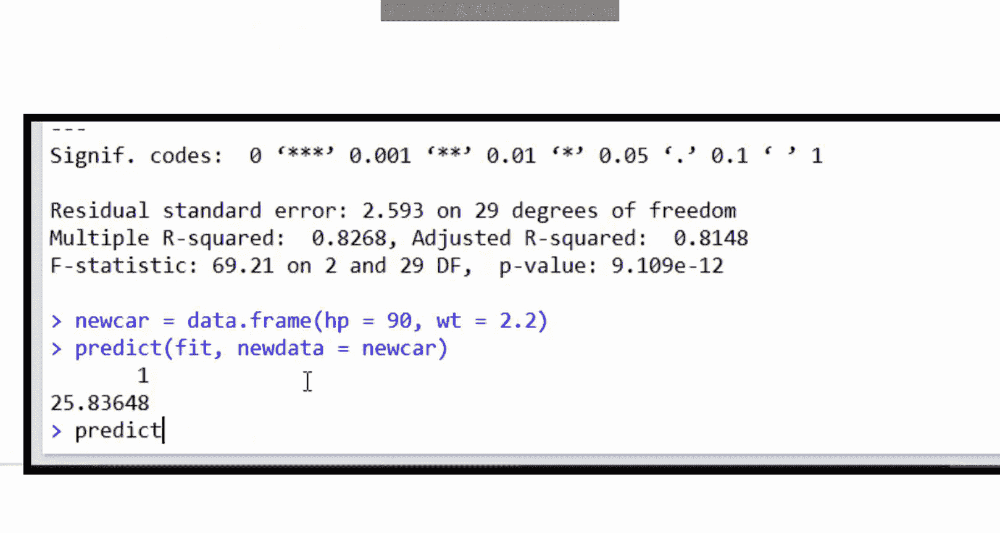

Okay，It predicts for all the existing x values。 It gives you x beta for all the it basically gives you x beta hat where x is the observed design matrix。

 Okay， so it gives you the it gives you the Y hat values from the。From all the observed DX values。

 okay now if I want to predict at this new data set。

 but I want a confidence interval for the prediction surface。

 the two dimensionional prediction surface， then I want to put confidence and it gives you the fit which is 25。

8， it gives you the lower and upper confidence limits for a 95% confidence interval。

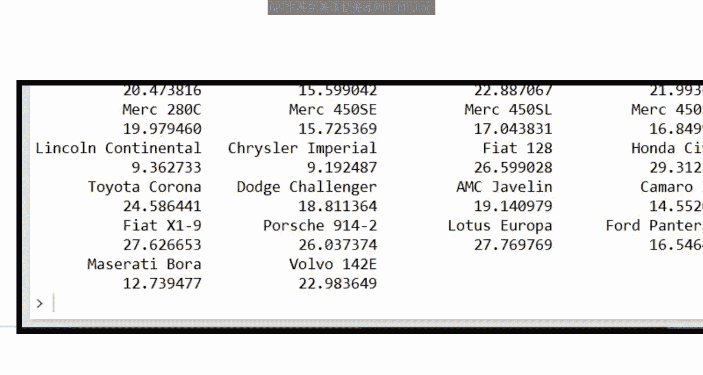

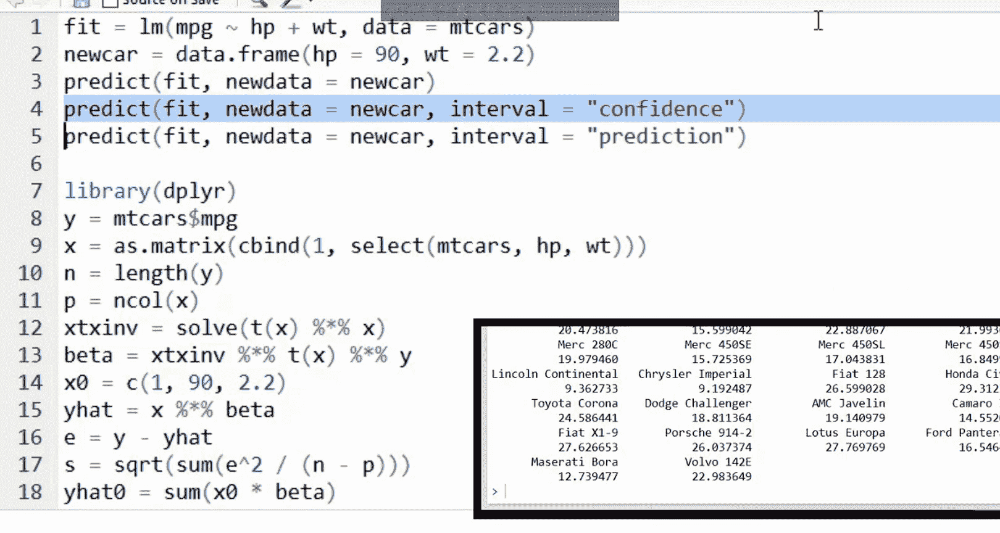

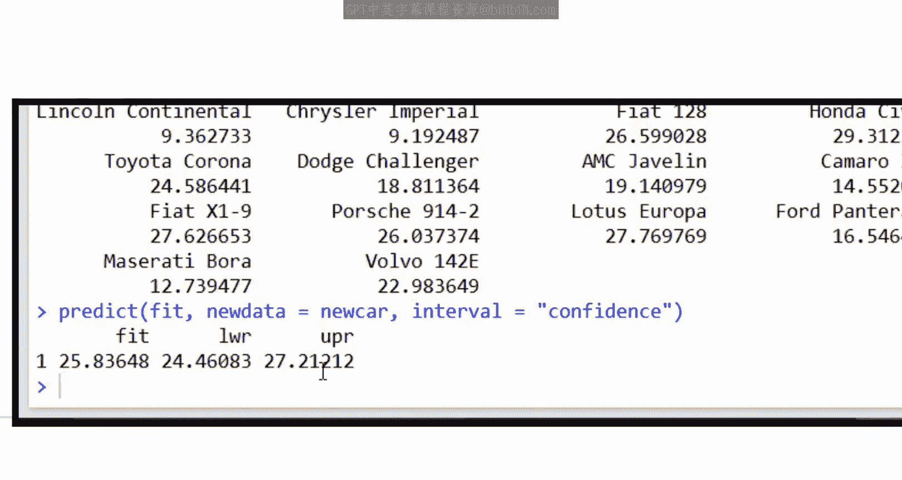

Okay， if I do interval equals prediction， then it does the same thing。

 however it's giving you a prediction interval So notice that the lower and upper confidence intervals are the lower one is lower and the upper one is higher representing that one plus that exists in there。

 Okay， so let's now do this manually because in this class we like to know exactly what's going on under the surface。

 Okay， so I'm going to grab a D per。

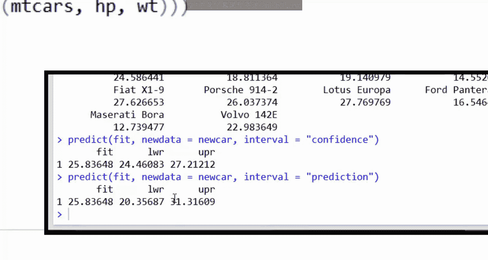

Okay， and then my y is my miles per gallon， and my X matrix is the intercept， which is a one。

 and I'm just going to grab from the empty cars data set， the horsepower and weight。

 and I like to do that with select。Which is I think in the Dliier package。Okay。

 my n is the number of observations I have， MIP is the number of columns of x。

 which in this case p should be 3。Okay， so one for the intercept。

 one for horsepower and one for weight。 Okay， so x transpose x inverse is just x transpose x inverse。

 and then my beta is going to be x transpose x inverse times x transpose y。

And then the new value I'd like to predict at is my intercept。Okay，90。And 2。2， okay。

90 for the horsepower and 2。2 for the weight。Okay。There we go。

 And then my Y hat at that new x value is going to be。呃。X not times beta。

 but let me get to that in a minute。 My y hat at my observed x values is x beta。

 and then my residuals are going to be y minus y hat。

 And then my residual variance is just my average squared residuals divided by n minus P rather than n。

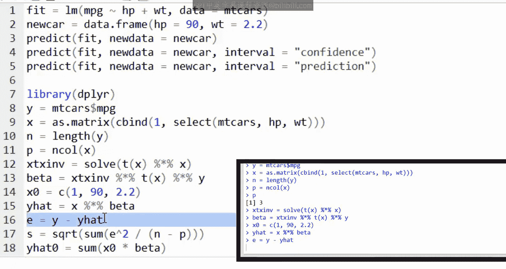

Okay， now my prediction， my Y hat 0 at this new value of x is just going to be x not times beta。

 And I just did sum just to avoid。Having to type out the matrix multiplication operator。

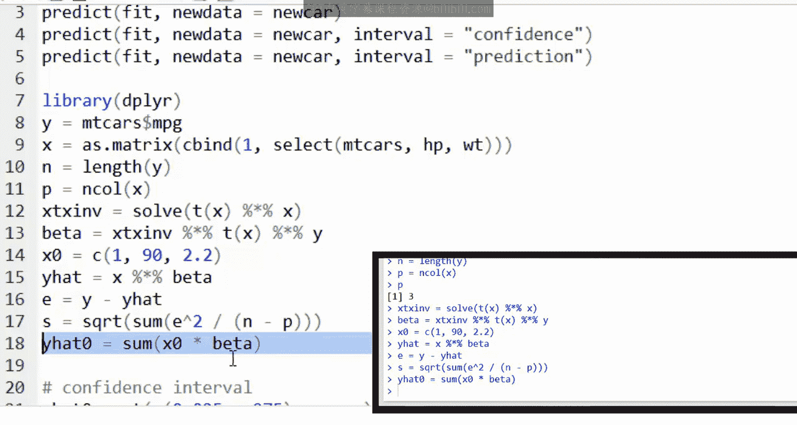

Okay， so what's my confidence interval， it's why hat。

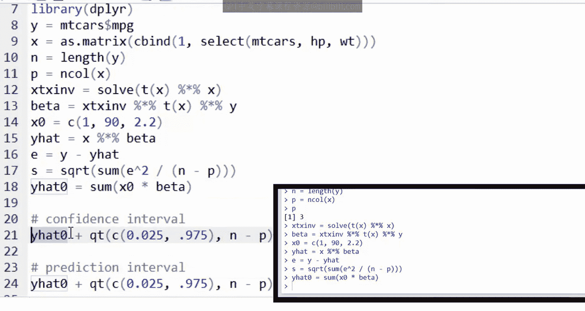

Then plus the plus or minus the 0。975 quantile。 So instead of plus or minus， I just say plus the 0。

25 and 0。975 quantile because notice if you do that。

 it's going to return the negative and the positive version。Then times S， then times square root。

 x not transpose， x transpose x inverse x not transpose， so there it is， and you get 24 to 27。

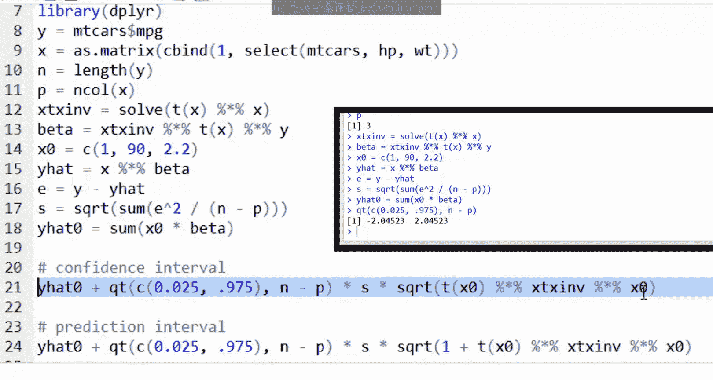

24 to 27。224。26。 So if you go up to our conference interval， it's 24 to 27。2。 okay。

 so it's the same thing Now it's to our prediction interval。

 it's the same thing only now there's this one plus right here。

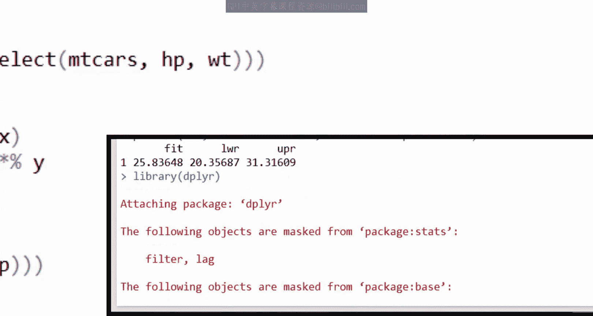

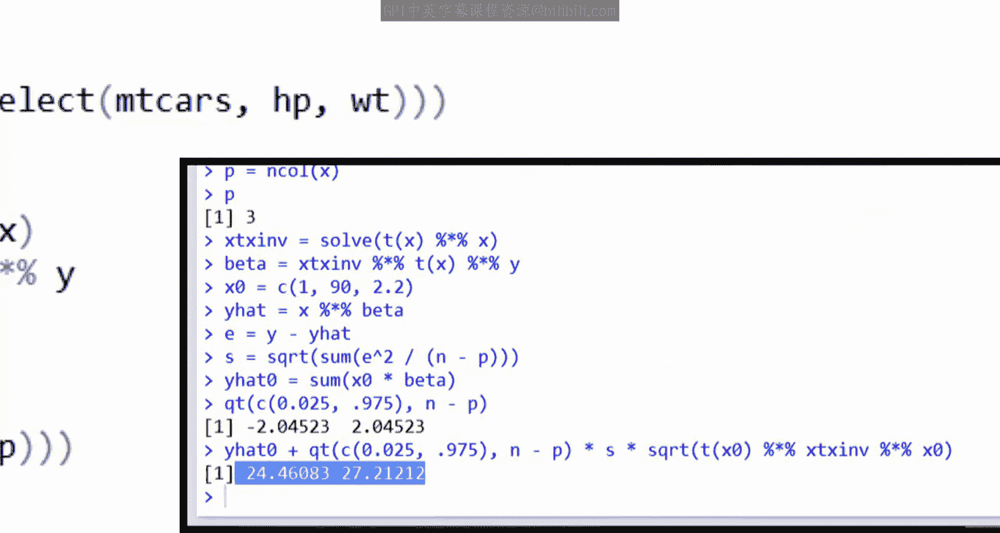

Okay， so let's do that again and we get 20。356- 31。31 okay， so 20。356 31。31 okay。

 so that's what's going on under the scenes， it's pretty straightforward logic on how it's doing this。

And， you know， just make， you know， take into account if you want to estimate the prediction surface at a particular point。

 you want a confidence interval。 And if you want to evaluate the prediction surface plus the variability。

 the natural variability exists that that exists around that prediction surface。

 Make sure you do a prediction interval rather than a confidence interval。

 And it's all pretty easy with the predictive function。 Okay。

 you should only do these kind of calculations just as part of something like this class where you're just verifying that you understand how it works。

 And then from then on， you would use the more the more natural function to do this。

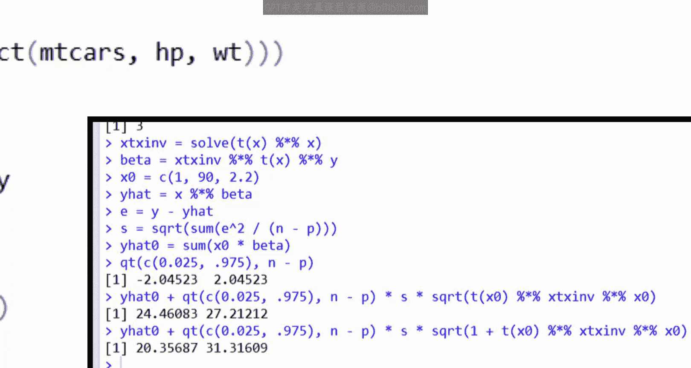