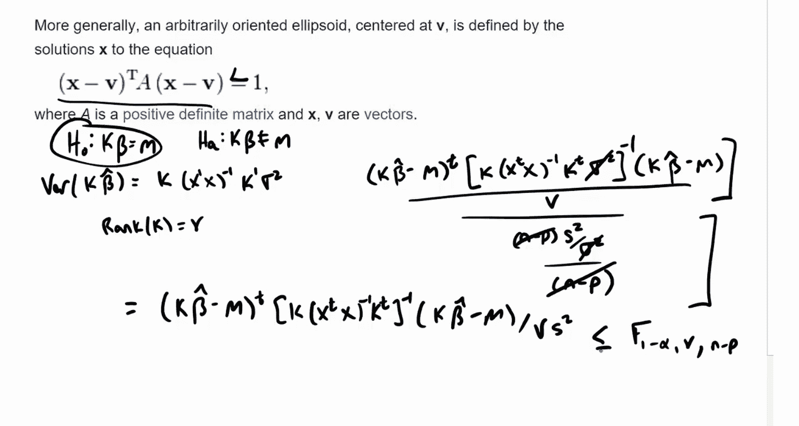
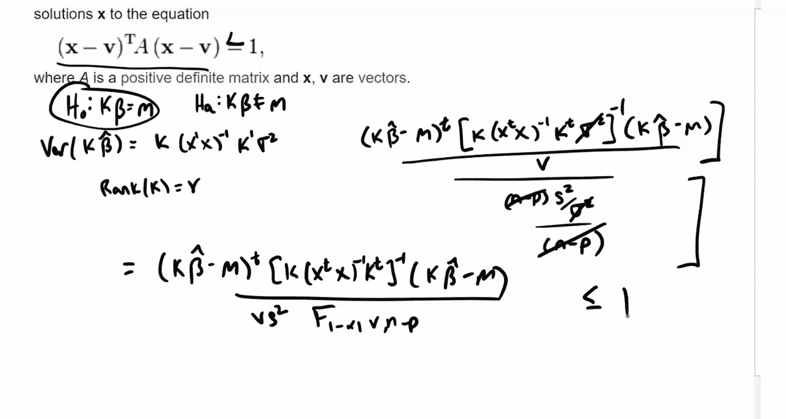
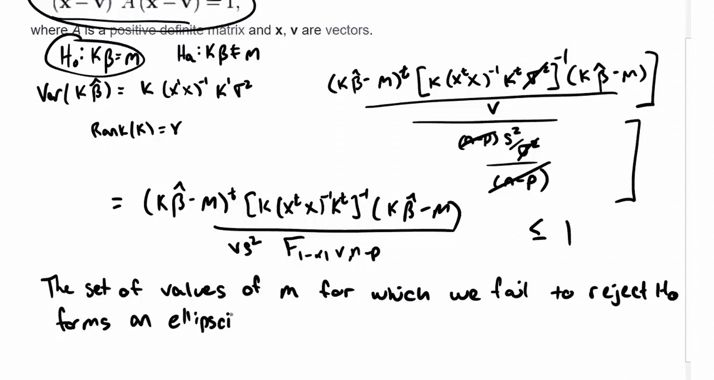
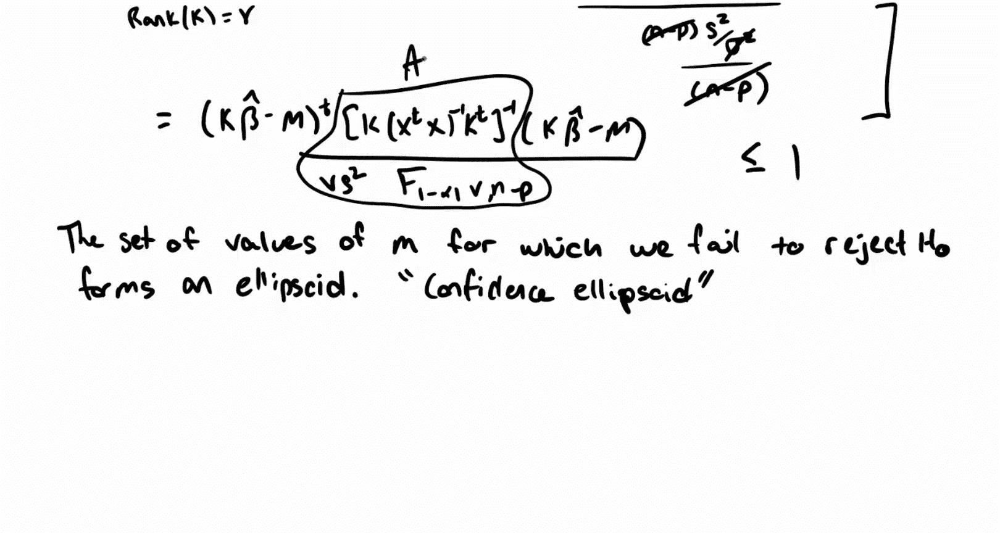
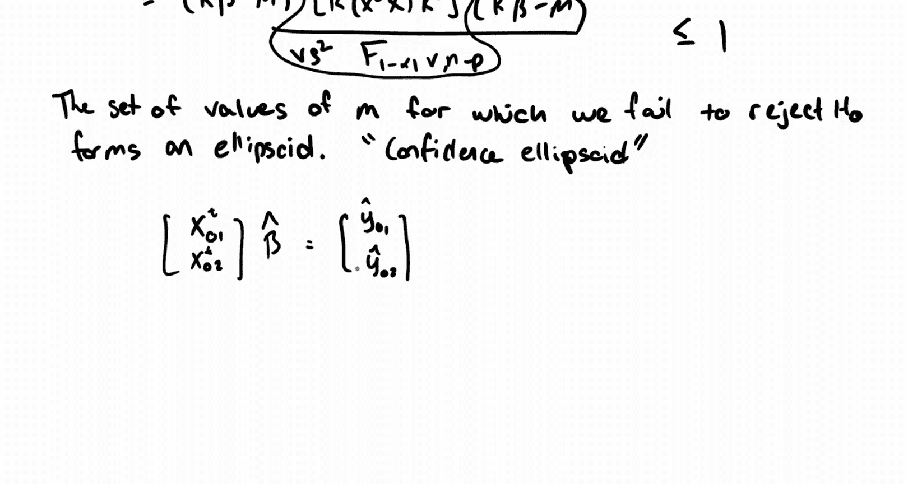

# 约翰霍普金斯大学《数据科学的高级统计｜Advanced Statistics for Data Science》中英字幕（deepseek p128 17_置信椭球.zh_en -BV1htPjeYEFH_p128-

So I took this little snippet of text here from the Wikipedia page on ellipses。

 so and they basically they say more generally from an arbitrary oriented ellipse center to V。

 it is defined by the solutions x minus v transpose a x minus v equal to 1 so。So you know。

 V is the center of the ellipse。And then the first eigenvalue。嗯。Of the matrix A is the length of the。

Major axis and the second eigenvalue is the length of the minor axis。M。

And and if we say the points that satisfy less than or equal to1。

 those are all the points on the interiorior of the ellipse。

 and I think at this point in the class you would notice this equation is the same equation as the Mahallenobus distance between x and V where a is a weight matrix and also it would look a lot like the F statistic。

 so take for example， if I were to take the hypothesis H。K beta equal to M versus H。K beta。嗯。

Not equal to M。Which we've discussed previously， remember our variance。Of K beta hat。

Is equal to K x transpose x。嗯。Inverse k transpose times sigma squared。

 And then what we saw was that so then。呃K。Beta hat， minus m。Transpose。Times。K， X transpose x。

Inverse x transpose， not x transpose。K transpose。K transpose times sigma squared。Times。

K beta hat minus M。 Well， that follows up inverse here。 That follows a chi squared distribution。

With the number of rows of k degrees of freedom。 And then if we divide that by。

Its degrees of freedom， which is， let's just say the， the the。The rank of K。Let's say。Fi。

So divide by its degrees of freedom， then divide divide it similarly by。N minus P。

S squared over sigma squared， which is also a chi squared。

 and then divided it by its degrees of freedom， which is n minus P。

 Then we have the ratio of two chi squares。 This part is a chi squared with V degrees of freedom。

 This part is an independent chi squared with n minus P degrees of freedom。

 And then let's organize terms。 And again， we've already done this， but it's good for review。

 I think if we organize terms， what we see。Is that that sigma squared cancels with that sigma squared that M minus P cancels with that M minus P。

 and then we get that k beta hat minus M。Transpose。K x transse。X inverse， K transpose， inverse。

K beta hat minus m。Over。Divided by V S squared。It follows an F distribution follows an F distribution。

With the numerator degrees of freedom and n minus P denominator degrees of freedom。

 so we would reject。This hypothesis。K beta equal to M。

 if this is greater than or equal to an f critical value of1 minus alphaator v numerator degrees of freedom and n minus P denominator degrees of freedom。

And so we would accept we would accept the no hypothesis。 We would accept this hypothesis if it was。

 let's say if it was less than or equal to。 sorry， it probably should have been greater than for that。

Other direction。 Okay， so I could divide this。By F 1 minus alpha。 you know， it's already。

Divided by V S。Squared and divide it by F1 minus alpha V N minus P。 And then we got。

Less than or equal to。1， okay， now we're just back up to this equation again。

 And so what we see is that。

The set of values。Of M。For which。We fail to reject the hypothesispo。Forms。Yan。Lpsoid。

They form the interior of an ellipide。Okay， and so that is given a term， it's called a confidence。

Philllip soid。And so a confidence ellipsoid is just a confidence interval。

 the generalization of a confidence interval to more than one dimension。

 and we see that the form is pretty easy here you know our k beta hat is observed。

Our M is the variable that's varying okay， and then this entire matrix right here。

Is the a matrix from before？From the Wikipedia definition， so if you had。

 say software that would for given take K beta hat and A。

And plot a hyper elllypsse say in two or three dimensions。

 then you could create hyper elllyipses for those settings and we'll show an a coding example next how to do that in three dimensions just because it's kind of neat。

 But there's a couple of times that you might want to do this a good example is when in say linear regression where you want a joint confidence interval for the intercept in the slope。

 but also notice if you have two x not values， let's say x not1 and x2 transpose。

If I take those times beta hat， then I get say why not one and why not2， so if I want to predict。My。

I want to predict my confidence surface at two points。Okay。

Then I might want to do that a joint confidence surface for that okay and then just to get a confidence eipsoid and this is just a special case of this formula and of course if you wanted to generalize a confidence a prediction ellipsoid I think you could all do this at this point given this knowledge so in the next lecture。

 why don't we go through and create a confidence ellipoid in this specific case and I think it'll be pretty neat because we can use RGL and show how the ellipoid looks in three dimensions。

