# 约翰霍普金斯大学《数据科学的高级统计｜Advanced Statistics for Data Science》中英字幕（deepseek p129 18_编程示例.zh_en -BV1htPjeYEFH_p129-

Okay， so let's create some confidence ellipsoids。For our miles per gallon example in the motor train cars data set Okay。

 so I'm going to fit。

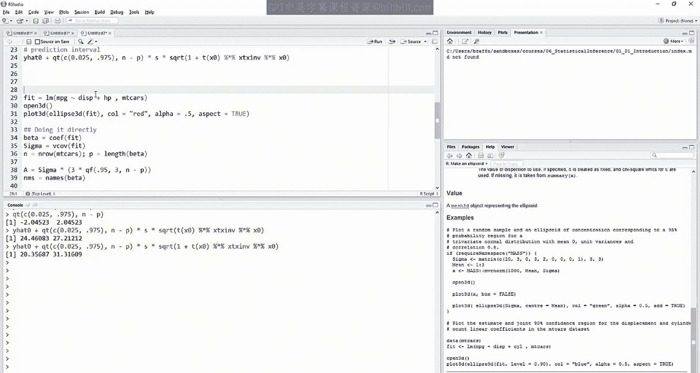

A linear model where miles per gallon is the outcome。Displacement， I guess。

 and horsepower are the predictors。Okay。

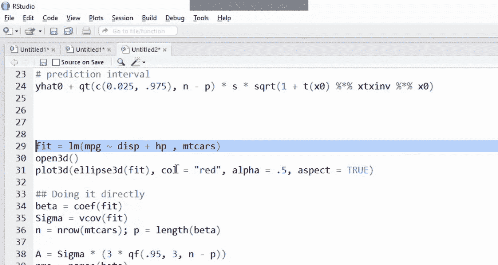

And I'm going to use RGL。 so I need to do library。 You need to have RGL installed。

 and then you have to do this locally。 You can't be using， for example。

 our studio on a web server to do this because you need RGL uses your graphics acceleration from your。

From your graphics card installed you know on your computer。

 so can't really do it in the browser so you need to be running a local version of R to do this sort of stuff。

Okay。Or if you're doing it externally， say on a server。

 you need to tunnel the X connection or something like that。Okay， so let's open up a 3D。Window in。

R GL， okay， there it is， oops。That big。Just resize it a little bit， there we go。Okay。

And then I want to plot an ellipsoid of the fit， and it turns out that the function ellipse 3D can just take in the。

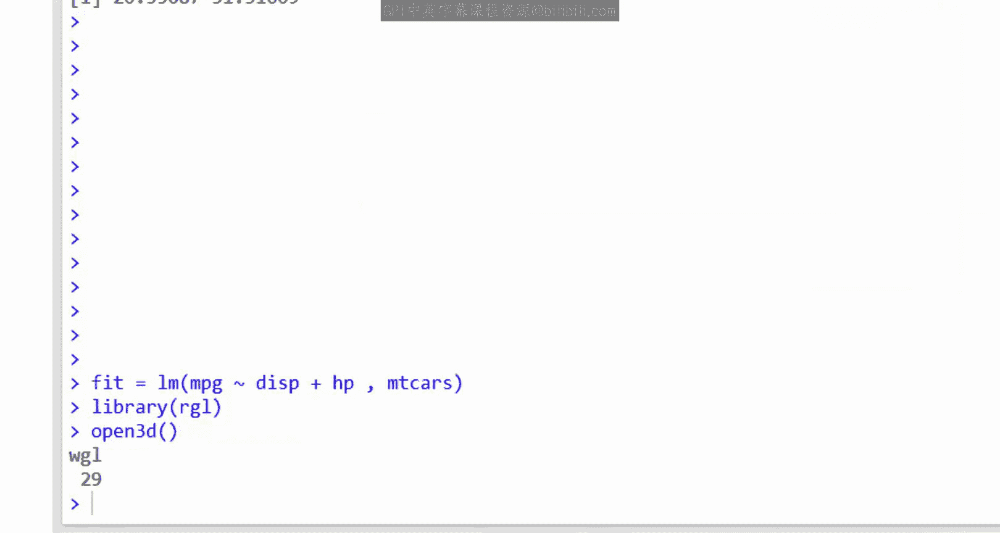

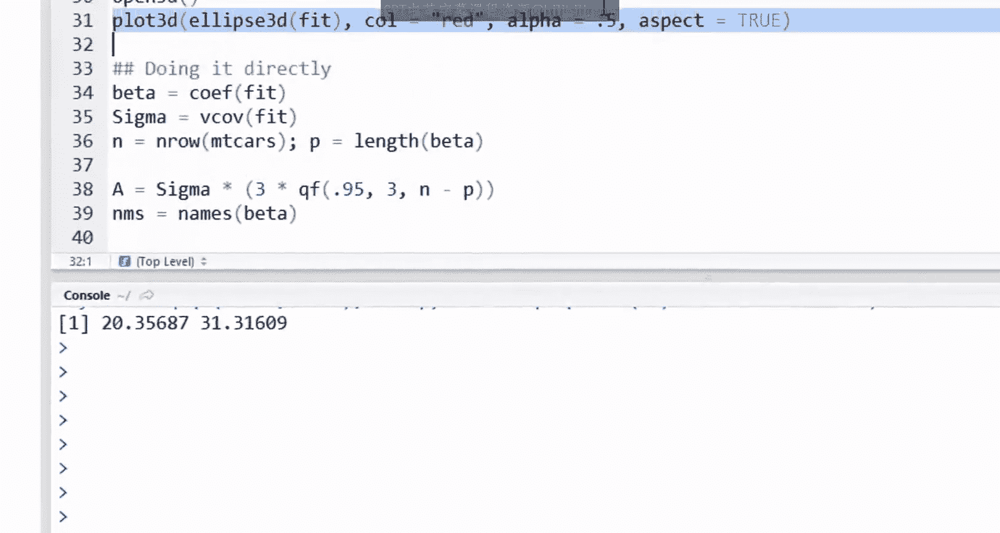

The fitted object by itself。 And it automatically just takes the first three coefficients and fits a simultaneous confidence ellipsoid for those three coefficients。

 In this case， we only have three coefficients。 So that's fine。 And I'm going to tell it。

 I want color to be read， the blending that this is not the type 1 error rate alpha。

 This is the alpha blending for how transparent。 You want the object to be in this case。

 I want it to be about 50% transparent。 And I want aspect to go true。

 that just means how it's going to rescale the axes。 So I put it in。 And there it is。 Okay。

 so this is now our confidencellipsoid where displacement is on one axis， the。

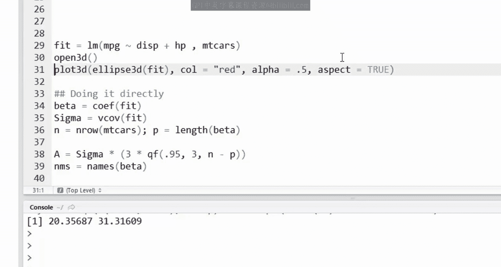

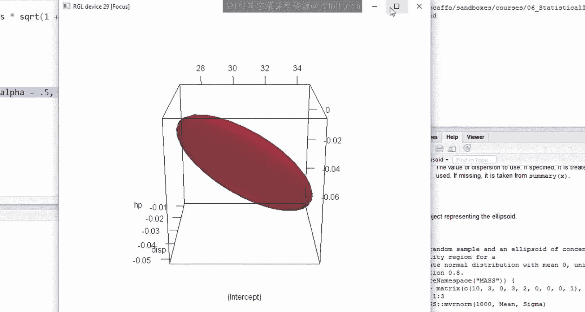

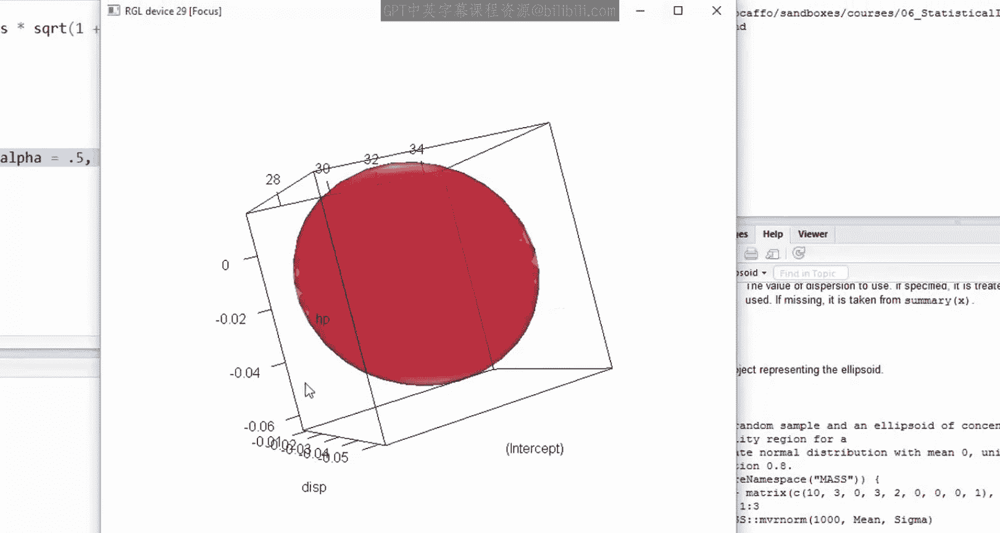

Intercept is on the other axis。And the horsepower is on the third axis， okay。

 so this is a three dimensional confidence ellipsoid for those three coefficients simultaneously。

 so the probability that the three dimensional point for beta1 beta not beta1 and beta 2 wise in this confidence region is 95%。

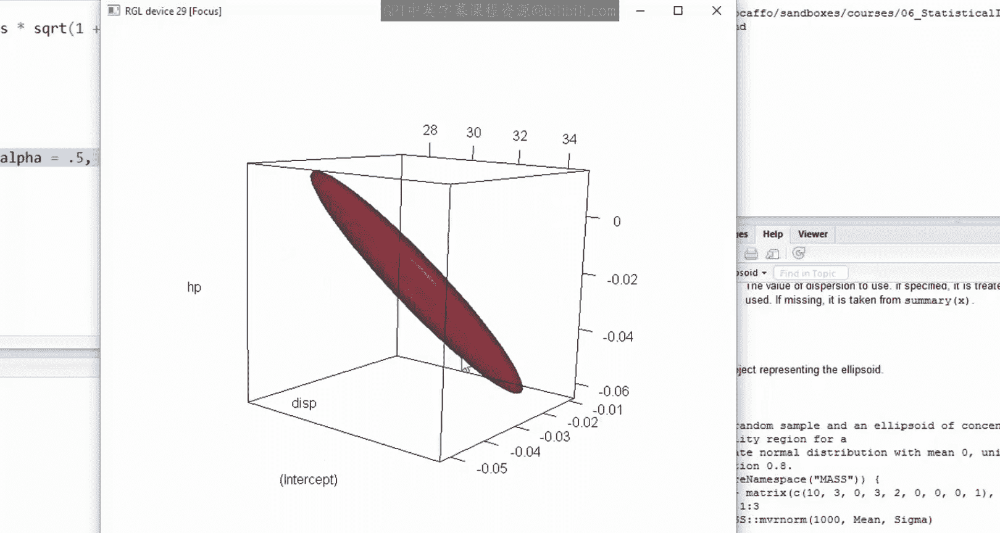

Under our assumptions。Okay， so now we can do this directly， I think we should， you know。

 given our discussion where we actually went through the definition of an ellipse。

 we should actually do it a little bit more directly。

 so beta is now just going to be the coefficients from the fit of values so let me just show you what the betas are。

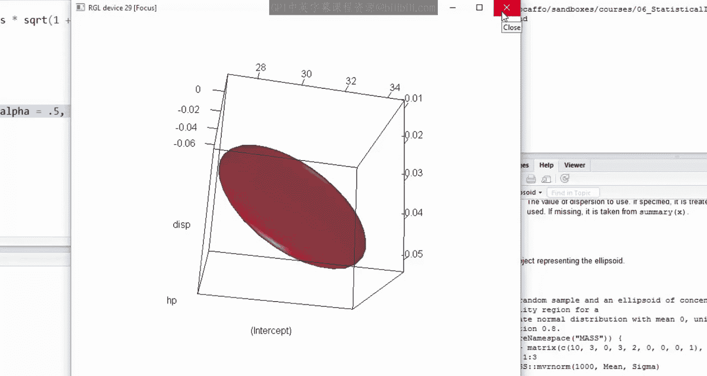

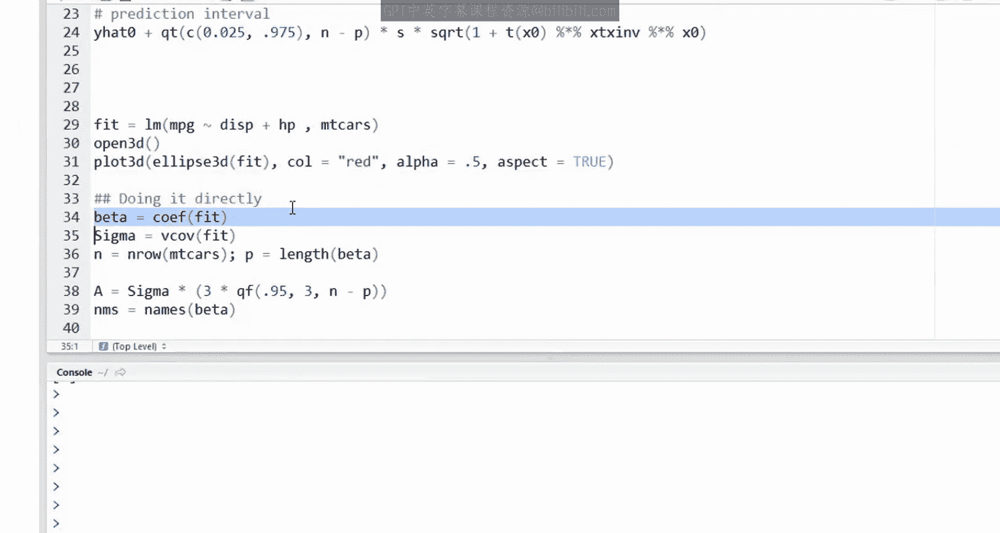

There's the bettas， 30 for the intercept minus 。03 for displacement and minus0。O24 for horsepower。

And then my sigma is just going to be the variance covariance of the fitted matrix。

 so sigma is the variance covariance matrix of the beta matrix， So there it is 1。77。 you can see it。

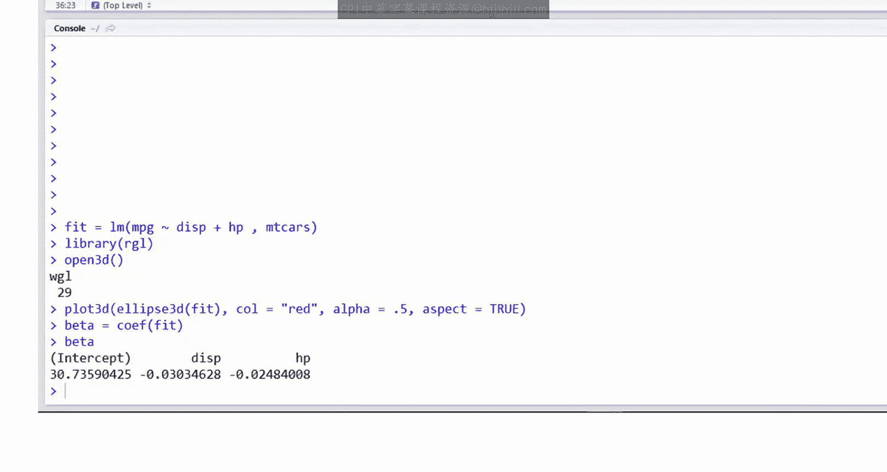

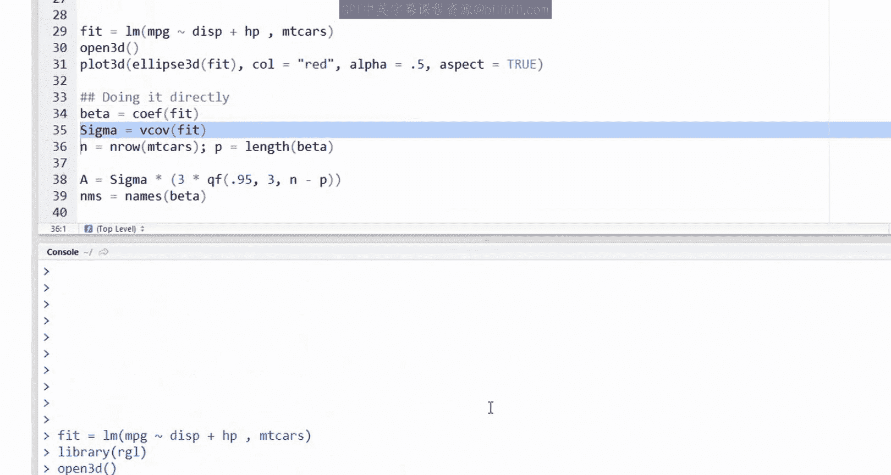

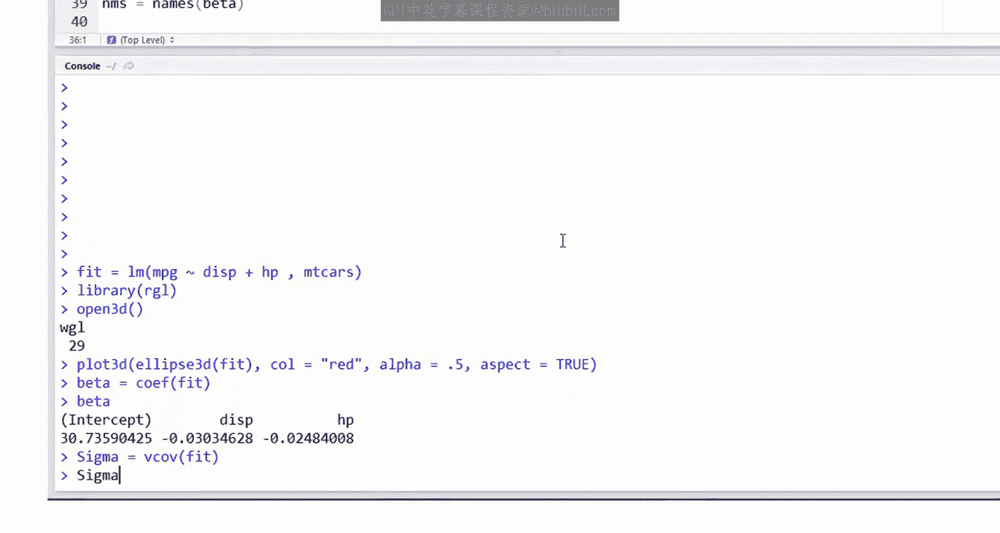

Okay， I then n is the number of rows and p is the number of columns。Of x。So in this case。

 it turns out that the specific way that ellipse 3D needs it because it needs the a matrix to be sigma times the relevant f quantile and then three here is from the three dimensions it's from the。

The rank of the test。 Okay， so， so that is there。 And it's gonna I really should。

 I'm really being a little bit inaccurate because this is really a inverse from the notation we were using in the last lecture。

 So keep that in mind。 It took me a little bit of nitpic to figure this out。 Okay。

 and then if you want the names to show up。 you need a vector of the names。 Okay。

 so let's open up the 3D connection。

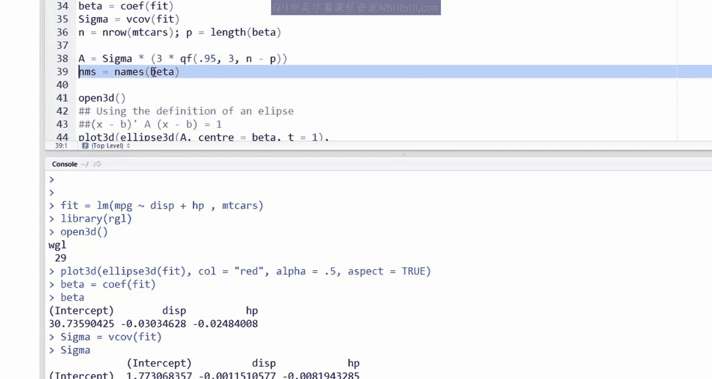

Okay。That is。And then here we're going to do plot 3D， so it takes ellipse 3D， and then it's taking A。

 but I think in our definition， this is really averse， it should be A inverse。

 and then you want it centered at my beta estimates。Okay and in this case。

 my K is the identity matrix okay and then TqL1 is just saying define the ellipse as the set of points where the ellipse is less than or equal to1 this time I want to be blue and then I want alpha blending to be 0。

5 so I want to be about 50% transparent I want the aspects so it's rescales the aes to look nice to be true and then this is just setting my label names and then when I do that。

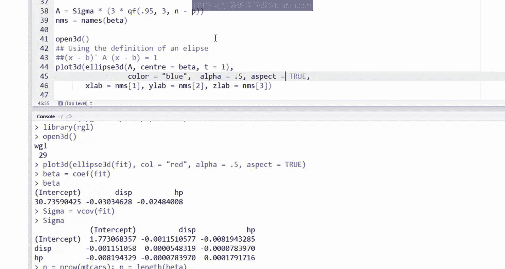

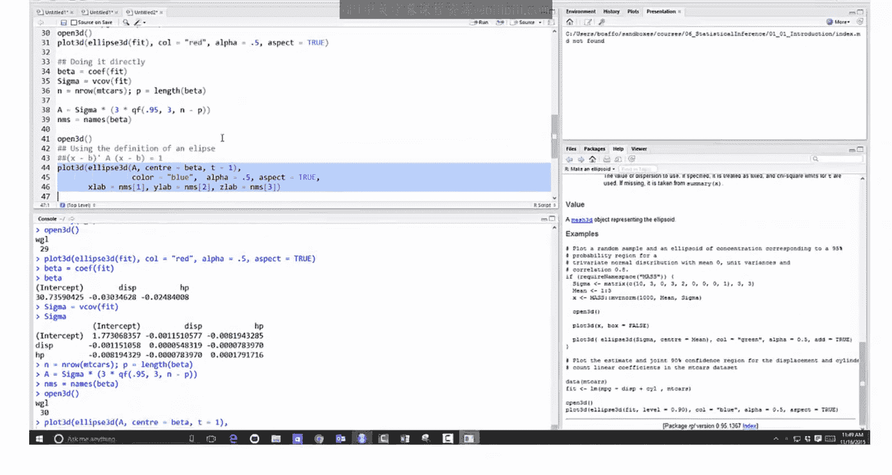

Get it up， okay， and there it is， you can see it's the same plot。

But now we've directly used the definition of an ellipse rather than relying on ellipse 3D to do it for us。

 So it's， that's all that it is。 And hopefully now you could use this to。

Do your own confidence ellipsoid， your own three dimensional confidence ellipsoid。

 and hopefully you could also do it， find another ellipse plotting program to do two dimensional ones if you wanted to。

But this is， I think， a pretty nice way to visualize a three dimensional fit。

 I think the way that I would most likely use a three dimensional hyperlyse。

In order to visualize a confidence set would be in the case where I wanted to predict three things and I wanted to see the simultaneous prediction。

 I think that would probably be the most likely instance where I would use some function like this。

Okay， but it's pretty neat， you can impress your friends now by using RGL to create confidence ellipsoids for collections of parameters from your linear model fits。

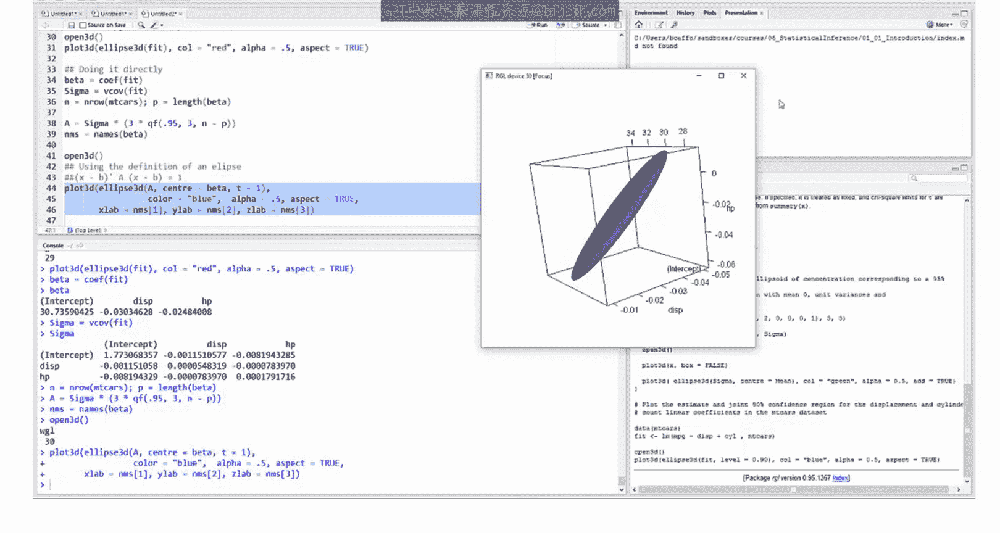