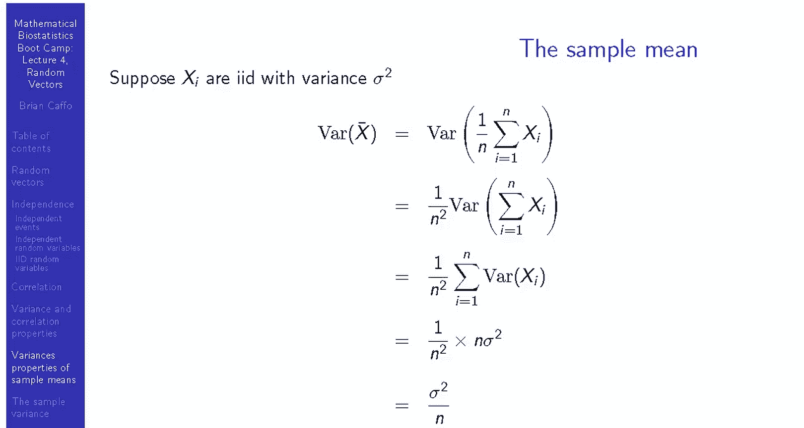
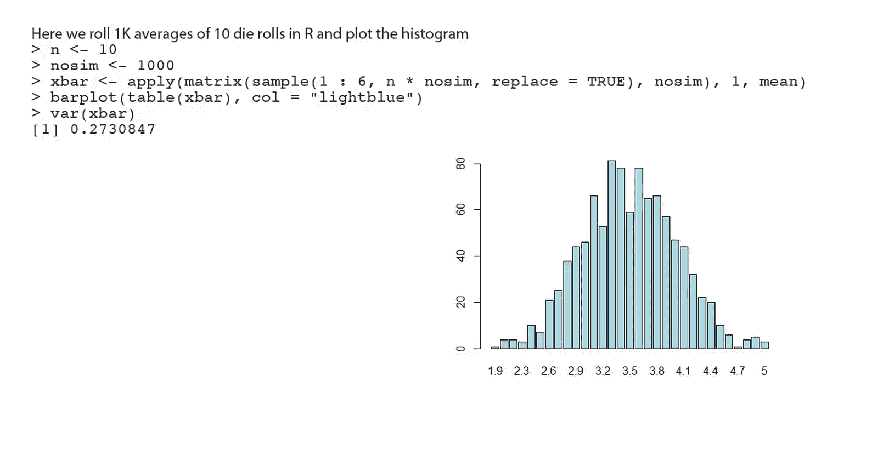
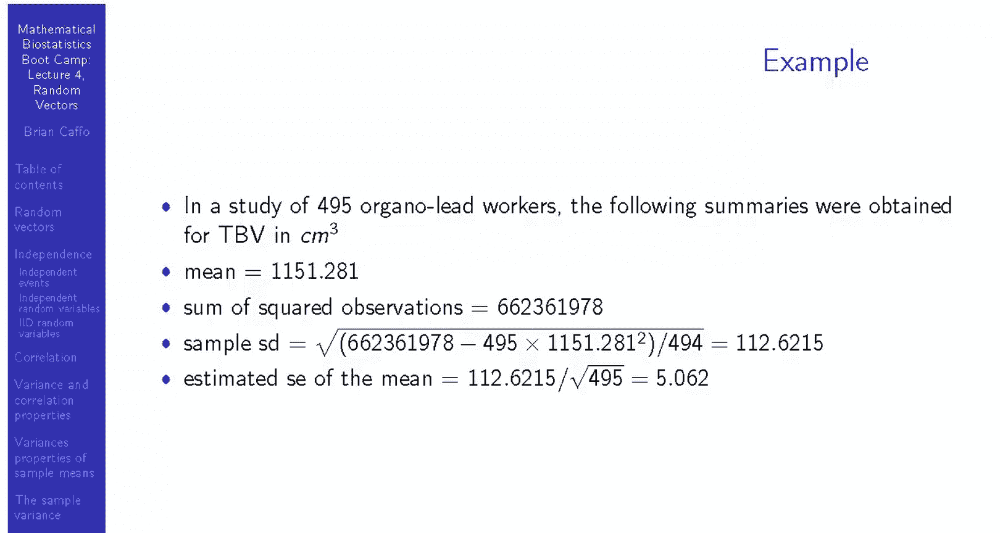

# 约翰霍普金斯大学《数据科学的高级统计｜Advanced Statistics for Data Science》中英字幕（deepseek p13 12_方差性质与样本方差.zh_en -BV1htPjeYEFH_p13-

There's an important result that arises out of these facts and the important result is that the variance of the sample mean of a collection of independent and identically distributed random variables is sigma squared over n so let's assume that we have a collection Xi equals1 to n that are independent and identically distributed IID and that the variances of the distribution that they're drawn from is sigma squared so let's calculate variance of x bar well that's just the variance of1 over n times the sum of the x's right that's just the sample mean formula。

 the sum of everything divided by the number of things you added up。

The1 over n is a constant so we can pull it out1 over n squared and we get the variance of the sum。

The variance of the sums， the sum of the variances because the x's are independent。啊。Hence。

 uncorrelated。And then because their IID， the variance of each Xi is the same， it's sigma squared。

 and we've added up n sigma squared， so we get n sigma squared。

 and so it works out to be sigma squared over n。For the final line here。So what does this mean。

 It's really quite an interesting fact。 what this says is if I want to know。What's the variance？

Of the distribution of averages， of 10 random variables， say， from a distribution。

 I don't actually have to know what that distribution of averages actually is。

So I don't have to do that， all I have to know is what the variance from the original distribution that the individual observations are drawn from。

And that gives it to me， I just have to divide that by n， right， So if I want the variance。

 I divide by n， if I want the standard deviation， take the original standard deviation and divide by square root n。

And why is this important， because remember， eventually we'd like to connect all of these ideas。

 these population model ideas to data？And if we have a bunch of things that we're willing to model as if they were IID。

Well， we get multiple draws from the distribution of individual observations。

 all the X's are separate draws from the original distribution。

So we can estimate things like sigma squared， but we only get one sample mean。

 let's say we have a sample of 100 observations， we only get one sample of 100。

 So if we calculate the sample mean of all those1 hundred0 observations， we have nothing。😊。

Empirically， to estimate the variance。Of sample means of 100 variables。

 We don't have repeated samples of 100 variables。 We only have the one。 Well。

 what this result says is you don't need that， right。

 because all you need is the variance of the original population and divide it by n。

 The variance of the original population is something we can estimate。

And so it's a very nifty result， let me give you an example of this property that you could do at home to just test this result to make sure it's true。

Recall in the last lecture， we said the variance of a di roll。

 which takes values 1 to 6 with equal likelihood， one，6 for each number。

The variance of a di roll was 2。92。So what that says is if you roll a die over and over and over and look at the distribution。

 you'll get about one6 of each number。And that the variance of that distribution。

 so if you were to roll it thousands and thousands of times and take the variance of the thousands of measurements you would get around 2。

92 so do that roll a die a lot of times and take the sample variance of the thousand die rolls for example and you'll get about 2。

92 Why is that that's saying because the sample variance of lots of die rolls estimates the distribution of the population of die rolls。

 which is this uniform distribution on 1 to6 and its variance is 2。92 so you'll get that。

Now here's the question that the calculation on the slide is answering。Suppose now。

 instead of rolling a die over and over again， you rolled 10 dice。

And took their average and repeated that process over and over again。

Right so now this would no longer be uniform on the numbers one to six。

 still the minimum would be one right if you got all 10 ones。

 the average of 10 ones is one and the maximum would still be six， the average of 10。

6 is still six and so the bounds are one and six but it would not look like a uniform distribution on the numbers between one and six because you can get all sorts of different numbers right you can get numbers between one and two。

 two and three and so on， so it has kind of a funny distribution。

 the distribution of averages of 10 di rolls。So imagine if you were to do that。

 roll your 10 dice and take the average and do that over and over again so that you got say 10。

000 averages of 10 di rolls right and you wanted to know what was the variance of that distribution Well it seems kind of like a hard calculation first you'd have to figure out what's the distribution of the average of 10 di rolls which seems kind of like a hard distribution and we'll actually later on discuss that that's maybe even a little bit easier to calculate than you might have thought。

But this calculation says you don't even have to worry about that。

 we know that the variance of the distribution of individual di rolls is 2。92。

 so the variance of the distribution of averages of 10 dis is 2。92 divided by 10 so it would be 0。

292 and so we could run this experiment in R。For example。

 where we rolled a digital die thousands of times and took the variance of 1000 die rolls and you'd find that it's about 2。

92， and then we could also do this experiment where we rolled 10 dice， took the average。

 and repeated that process over and over again and got 10，000 averages of 10 die rolls。

 and you would find that the variance of those averages， was about 0。292。

Very interesting and so it's a very simple formula and so let's belabor this point。On the next slide。

So when the x's are independent with a common variance。

 the variance of x bar is sigma squared over n。The quantity sigma over n。

 the square root of this is so important， we give it a name and we call it the standard error of the sample mean。

 basically a standard error is nothing other than the standard deviation of a statistic in this case the statistic is the sample mean。

 but you might have a standard error of another statistic， for example。

 the median than itself has a standard error， it's maybe a little hard to calculate。

 but nonetheless it has a standard error。So what is the standard error。

 the standard error of a sample mean is this standard。

Deviation of the distribution of the sample mean。 So sigma。

 the standard deviation talks about how variable the population is Sigma over square root n talks about how variable。

 the population of averages of size n from that population are。 It two different statements。

 and they estimate different things。 So for example， if the x's are IQ measurements。

 Sigma talks about how variable Iqs are。 Sigma over square root 10 say then talks about how variable averages of 10 IQs are。

 Okay， so they're different， they're obviously related， but they're different concepts。

 and it's easy to confuse the two。 and an easy way to remember this， by the way。

 is that the sample mean has to be less variable than a single observation。 therefore。

 it's standard deviation is divided by square root n。

 So that also gives you a sense of how the rate at which standard deviations。

Decline as you collect more data。So since we've talked about the sample variance a lot。

 why don't we actually define it？So the sample variance is that entity that we use data to estimate the population variance so recall the population variance was the expected value or the average the expected deviation of a random variable around its population mean right so what is the sample variance。

 well it's the average deviation of the sample values around the sample mean so it's quite convenient now notice it's not exactly the average we divide by n minus1 instead of n which is a little annoying but we do it？

So imagine for the time being that this is an n in the denominator， not an n minus1。

 then the sample variance is nothing other than the average squared deviation of the observations around the sample mean。

So the sample variance is an estimator of the population variance sigma squared。

And just like the population variance has a shortcut formula。

 the sample variance has a shortcut formula， summation X minus x bar squared。

 the top of the variance calculation is summation X squared minus Nx bar squared。

So if someone gives you the sum of the squared observations in the sample mean。

 then you can calculate the sample variance really quickly。

So why do we divide by n minus1 instead of n？And again， for large samples， it's irrelevant。

 right the factor n 1 over n is small， so you're going to get about the same answer either way。

 but for small samples， it can make a difference。 So why do we choose to divide by n -1。

So recall we have this property unbiasedness， and the property of unbiasedness meant that the statistic。

 its expected value equaled the quantity that it's estimating。Yeah。So。Just to remind you。

 the sample variance is a function of our observed data， it's a function of our random variables。

 right so itself is a statistic。So it is a random variable itself， so it has a distribution。

 and so that distribution has a variance and that distribution has a mean。 Okay。

 that's what we're going to talk about right now is that the mean of that distribution turns out to be sigma squared。

 if you happen to do the calculation where you divide by n -1。

 So I'm going to show it by showing that the expected a value of the numerator of this statistic is equal to n -1 times sigma squared。

 That's the same thing is showing that the sample variance is unbiased because then you just divide both sides of this equation by n -1 and you get the result。

 So let's do that。Just to say it again because it's important， what are we doing。

 remember the sample variance is itself a random variable， that random variable has a distribution。

 that distribution has a population mean， and we want to say that that population mean is in fact sigma squared okay。

So expect a value of the numerator part of the sample variance calculation。

 the sum of the squared deviations。Around the sample mean， if we use the shortcut formula。

 that's sum of the expected value of the X square of minus expected value of x bar squared。

And now let's use a really kind of nifty fact to recall for the variance。

The shortcut variance formula was defined as the expected value of a random variable squared。

 minus the expected value of the random variable quantity squared。Well， we can shift that。

Formula around to get it to say that the expected value of a random variable squared is the variance plus the mean squared。

 And that's what we do right here。 So the expected value of x i squared is variance X plus mu squared。

 Okay， and then the same thing is true， of course， for the mean because the mean itself is just another random variable。

 So the expected value of x bar squared is variance x bar plus mu squared。

 And then we have this n out front。 Okay， and so the variance of X i is sigma squared。

 So we wind up with some sigma squared plus mu squared， which is a constant。

 So we wind up with n of those。 And then variance of x bar。

 we just derived a little bit ago as being sigma squared over n。 So we get。😊。

N times sigma squared over n plus mu squared and just collect terms now and you get n minus1 sigma squared。

 So this is a really interesting fact。 So this says that the。Expect a value of the variance。

Is in fact， the quantity it's trying to estimate if in fact， you divide by n minus1 instead of n。

 and that's why we divide by n minus1 Another way to kind of think about this is that well。You know。

 we don't know the population mean mu， and if we knew it instead of plugging x bar into the sample variance formula。

 we would plug mu into the sample variance， we would calculate the deviations of the observed observations around the population mean rather than the deviations around the sample mean。

And so the idea is that we will sort of lose a degree of freedom by plugging X bar。

 its sample analog instead of plugging in that mu。So that's the kind of heuristic behind why you divide by n minus1 it's an interesting fact though it's not 100% clear that you do want to divide by n minus1 it's sort of every introductory statistics textbook divides by n minus1。

But there's this interesting phenomenon called the bias variance trade off。 and in this case。

 we've obtained an unbiased estimator by dividing by n 1 instead of n。

 but what if we had divided by n maybe as an exercise。

 I could ask you to calculate the expected value of the sample variance if it was calculated with n in the denominator instead of n minus1。

 so basically what's the expected value of n minus1 over n times S squared。

And you can calculate that very easily， it's not sigma squared， but it's quite close to it。

So it's a biased estimator， but the other thing I would ask is， well。

 which of the two estimators the estimator s squared calculated with n -1 in the denominator。

 or the calculation of the variance with an n in the denominator has a lower variance。

 And what do I mean by that。 Remember， the sample variance。 is a random variable。

 It has a distribution。 that distribution has a variance。

 And the question is which of the two calculations dividing by n or dividing by n -1 results in a smaller variance of that distribution And what does that mean。

 that would mean。How precise your estimate of the variance is。 I'll give you the punch line。

 The sample variance divided by n has a slightly lower variance than the sample variance divided by n-1。

 So it's another kind of classic bias variance trade off。 In this case。

 we divide by n -1 because we want unbiasedness， but then we wind up with slightly greater variance。

 If we divide by n， we wind up with a slightly lower variance of our sample variance。

 but it's slightly biased。 I know extremely well established statisticians that say they would prefer to have the lower variance but pretty much every introductory statistics textbook divides by n-1。

 It's kind of an interesting discussion。 You know， one of the confusions that always comes up seems quite simple。

 we divide by an n -1 when we calculate the sample variance。

People have a tendency to confuse that with the end that we divided by when we talked about the standard error of the mean。

 and so let's just try to avoid some of this confusion。

Suppose you have a bunch of observations that you're willing to model as IID with population mean mu and population variance sigma squared。

Then the sample variance S squared estimates the population variance sigma squared。

The calculation of s squared involves dividing by n minus1。

 and we just spent forever talking about the difference between dividing by n and dividing by n minus1。

Then the standard error of the mean is sigma over square root n。

 so s over square root n will estimate the standard error of the mean。

 so we've already divided s squared by n minus1， then we square root it and then we divide by an additional square root of n if we want the standard error of the mean okay and I'm just trying to avoid some confusion because people seem to get confused by that so I guess if you wanted to attach a label to the quantity S over square root n。

 it's the sample standard error of the mean。What does estimate。

 it estimates the population standard error of the mean sigma over square root n。

Let's tie this down with some actual numbers。So I was involved in a study where there was a lot of organ lead workers in this case I took a subset of 495 of them and the total brain volume for the lead workers。

 they were interested in studying how their exposure to lead in their job changed their brain volume。

 so TBV stands for total brain volume。this case is a measure of the brain volume on the inside of the skull。

So all the measures are in cubic centimeters。So the mean in this case is 1151。

 If we're willing to assume these organoled workers are say an Iid draw of organoled workers from a population that we're interested in。

 then the sample mean 1151 would be estimate of that population mean。

 The sum of the squared observations works out to be this number， So the standard deviation。

 the sample standard deviation works out to be that number。

 495 times the sample mean squared all divided by 494。

 that-1 in the denominator square root the whole thing you wind up with 112。

So what does 112 describe， 112 describes the variance？

Of the population of brain volumes of organoled workers okay so it's a direct estimate of my sample variation right and then it's an attempt to estimate if you view my data as a sample from a population of organo lead workers it attempts to then estimate or the population standard deviation of that distribution。

So we could， for example， use Chevy Chev's rule to interpret what the combination of the mean in the standard deviation say about brain volumes of lead workers in the population。

Now what does if I take this 112。6 and divide it by square root 495 gives me five as the numerical result。

 but what does that five actually estimate or do for us well the five is no longer talking about the variation in total brain volumes in the population。

 it's talking about the variation in averages of 495 organo lead workers so the idea is if we're willing to model are 495 organ lead workers as a draw from a population of organo lead workers then five estimates the distribution of averages of 495 draws of organal lead workers from that population it talks about how variable averages of 495 brain volumes are the 112 talks about how variable brain volumes are okay so let me just repeat that because it's very important。

The 112 talks about how variable brain volumes are。Of organa led workers in the population。

And it directly talks about it in the sample。But it's an estimate of our population variance and the five is an estimate of the population standard deviation of averages of 495 organ led workers。

 So I hope you're getting a sense of what these numbers are trying to calculate。

 So there's several concepts that are being used here。

 First we have our observed data right and these quantities。

 the sample means sample standard deviation in standard error tell us things about our observed data。

RightAnd then there's the assumptions， for example。

 that their IID that help to try and connect it to a population so that we can maybe generalize the results from this data to a population of organ led workers。

 say for example， if you wanted to use this data to inform policy。

And then these numbers would then be estimates of these population quantities and then dividing by the square root 495 is telling us things about how variable this mean is relative to the variability in the population Okay so that's the concepts we're trying to use and what formalize these much more when we actually do things like generate confidence intervals and perform hypothesis tests in these things。

🎼。🎼。🎼你你的意。

