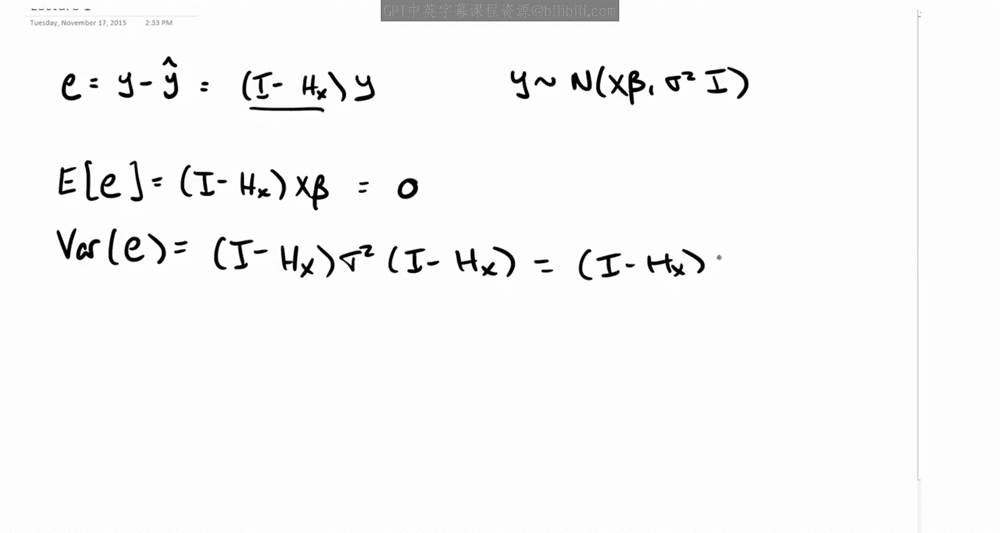
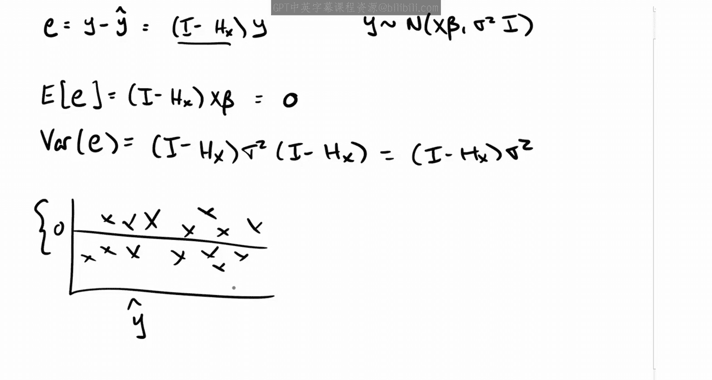
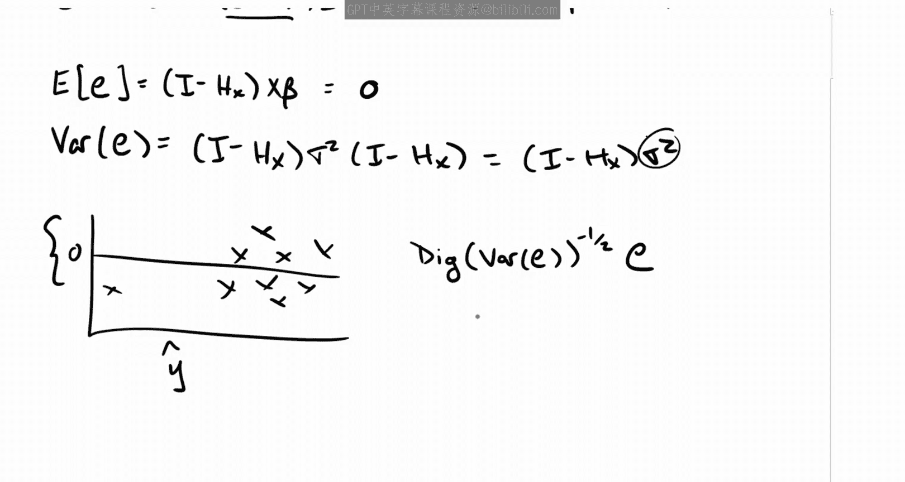
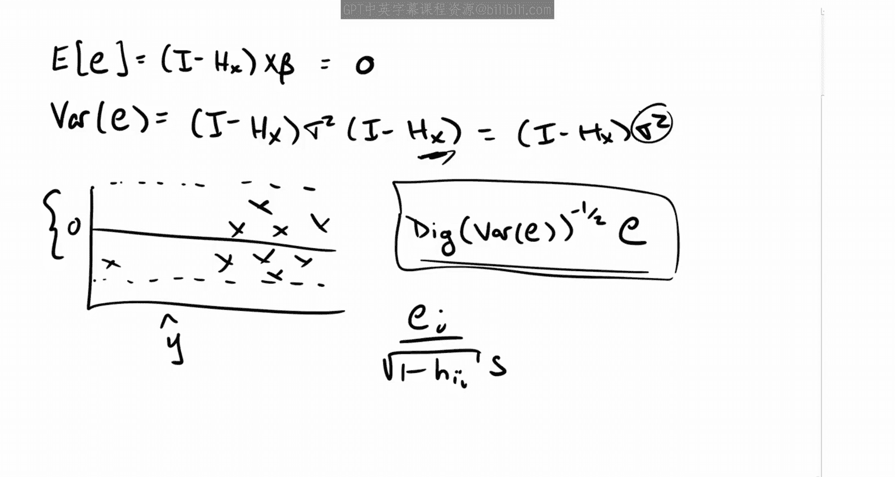
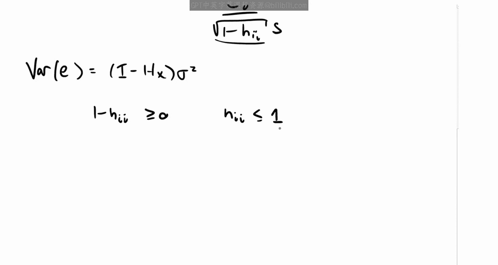

# 约翰霍普金斯大学《数据科学的高级统计｜Advanced Statistics for Data Science》中英字幕（deepseek p130 19_残差的分布结果.zh_en -BV1htPjeYEFH_p130-

So recall that our residuals were defined as e equal to y minus y hat。

 which we could write as I minus。The hat matrix times y。And again。

 now we're in the context where we're going to assume y is normally distributed with mean x beta and variance sigma squared times I。

So the residuals then are singularly normal distributed because this is not a full rank transformation。

 so the residuals are singularly normal distributed and they're mean expected value the residuals。Is。

I minus H of x。Times x beta， which is 0。U。Because for the reasons that we've discussed at length。

The variance of the residuals。Is then I and minus。H of x。Sigma squared I minus H of x。

And then which is just I minus H of x。Sigma squared since the matrix i minus h of x is item potent。

So。The residuals have this issue。or not issue， but they have this property that they are they inherit the units of Y。

 so of course that's a good thing， they're a linear transformation of Y。

 but that often means that if we do things like a plot of our residuals， which we often plot。

 say for example， our residuals versus our fit of values。It's terrible。嗯。The scale。

 the vertical scale， when we look at that， isn't comparable across。Experiments。

And so if you wanted to standardize your residuals。

 that's some of the things that we're going to talk about in this lecture。

 so what you could do is simply take the diagonal。

Of the variance。But E， that matrix to the。One half power， so what I mean by that。

Not writing this out perfectly， but the square root of the diagonal of the variances so let me。

You write it out here。To the 1 half power。 So I just mean the diagonal matrix。That has the。

Rate the inverse of the standard deviations， and if we were to multiply that times our E。

 then we would have now random variables。That have unit variance， though of course。

 we'd have to estimate。The sigma squared。So that is a nice way to do things so and of course it satisfies our criteria for creating a unitfr quantity。

 however these quantities， these so-called standardized residuals。

 have the problem that you can't establish you can't easily establish I guess I should say boundaries for calling standardized residuals outliers。

 just because the distribution of this quantity isn't terribly easy distribution to work with it's not it's not a t distribution because the numerator and the denominator are not independent in the same way that are typical statistics T statistics that we derive for say the coefficients are。

 so we're going to talk a little bit more about how to get T like more T like residual statistics here when we talk more about different ways in which we can standardize our residuals。

 but this is by no means a。

thing to do to take our residual say EI and then divide it by the let's say。

 square root 1 minus HI or HI。And then。嗯。Times s where HII is the I diagonal element of the hat matrix。

That that's often a quite useful thing to do。 Another little。

 just a little comment that we might need later on is because。

The variance of E。Is equal to I minus。H of x。Times sigma squared。

 We know that that has to be greater than equal to 0。So。For we know that any element。

 I should say any element of this， the diagonal of this matrix has to be greater than or equal to 0。

 So one minus H， this quantity the denominator of our statistic over there has to be greater than or equal to0 so that H has to be less than or equal to 1 so our。

Diaagonals of our hat matrix always have to be bounded from above by one。

 This is a fact that we're going to use later on when we use our hat diagonals as a diagnostic measure。

Okay， so let's just go through a coding exercise where we create standardized residuals and look at them。

