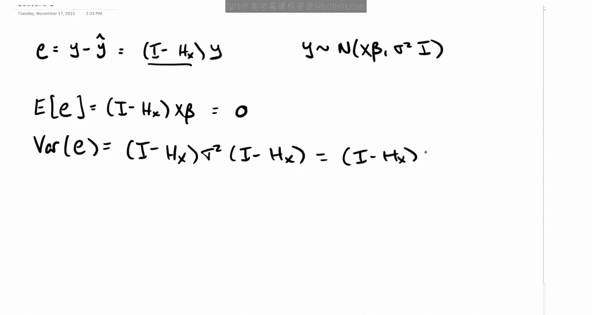
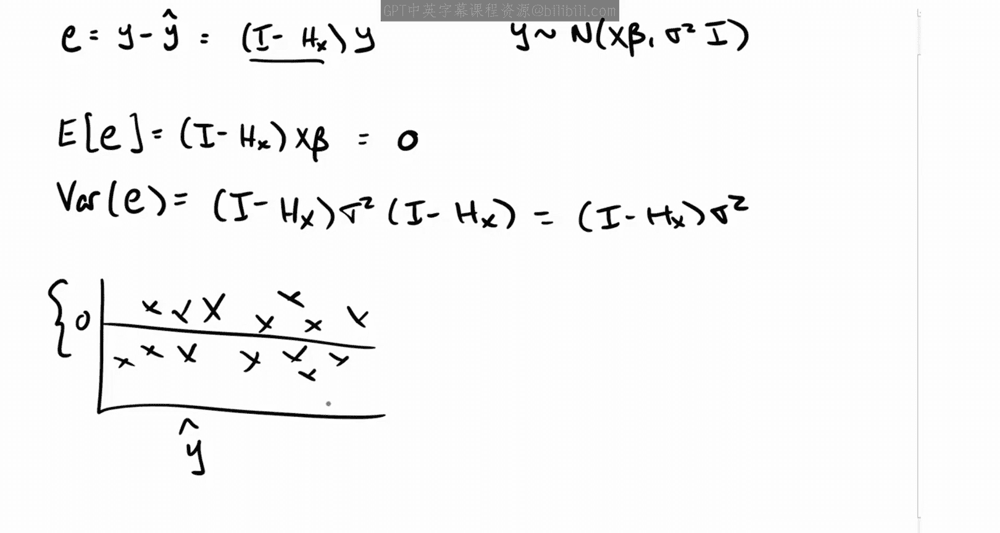
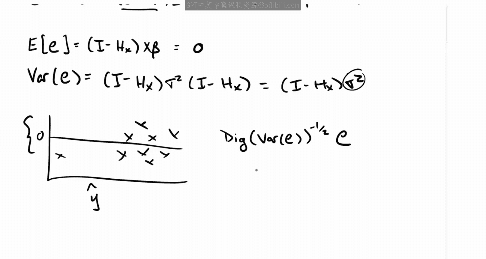
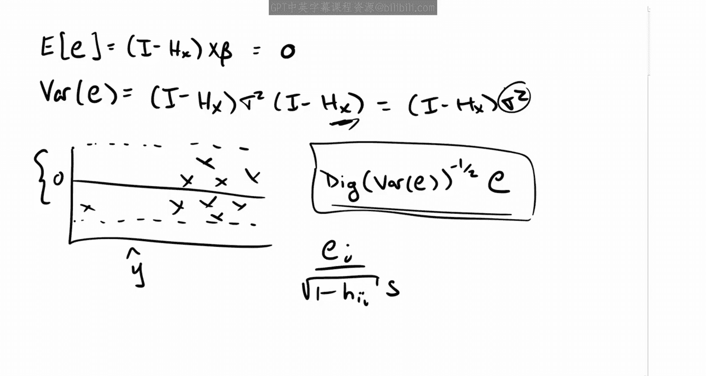
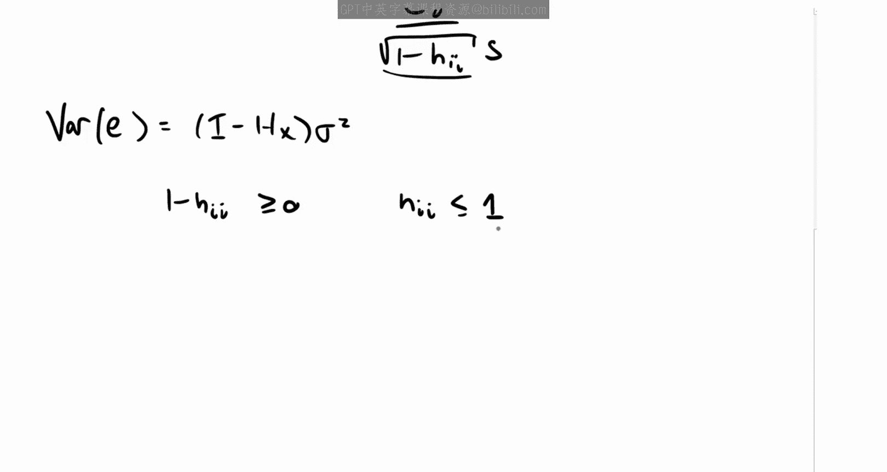

# 高级统计：19：残差的分布结果

在本节课中，我们将学习线性回归模型中残差的分布特性。我们将探讨残差的定义、其统计分布，以及如何对残差进行标准化处理，以便于诊断模型和比较不同实验的结果。

## 残差的定义与分布

上一节我们介绍了线性回归模型的基本概念。本节中我们来看看残差的数学定义及其分布。

残差被定义为观测值 `y` 与模型预测值 `y_hat` 之间的差值。其公式如下：

**公式：**
`e = y - y_hat`

我们可以将其写成矩阵形式：
`e = (I - H) * y`
其中，`I` 是单位矩阵，`H` 是帽子矩阵（Hat Matrix）。



在假设响应变量 `y` 服从正态分布的前提下，即 `y ~ N(Xβ, σ²I)`，我们可以推导残差的分布。由于 `(I - H)` 不是一个满秩变换，因此残差服从**奇异正态分布**。

残差的期望值为：
`E[e] = (I - H) * Xβ = 0`

残差的方差为：
`Var(e) = (I - H) * σ²`

由于矩阵 `(I - H)` 是幂等矩阵，方差公式可以简化为：
`Var(e) = (I - H) * σ²`

## 残差标准化

残差继承了响应变量 `Y` 的单位，这导致在不同实验或模型中，残差的尺度可能无法直接比较。为了解决这个问题，我们通常会对残差进行标准化处理。



一种直接的方法是使用残差方差的平方根来标准化。具体做法是计算残差方差矩阵的对角线元素，取其平方根的倒数，构成一个对角矩阵，然后用这个矩阵乘以原始残差向量。

**公式：**
`标准化残差 = D^(-1/2) * e`
其中，`D` 是 `Var(e)` 的对角线元素构成的对角矩阵。

这样处理后的随机变量将具有单位方差（当然，我们需要用估计值 `s²` 来代替未知的 `σ²`）。这种方法满足了创建无量纲量的标准。

然而，这种“标准化残差”存在一个问题：很难为其设定一个明确的阈值来判断哪些是异常值。因为这种统计量的分布并不像我们熟悉的 t 统计量那样易于处理，其分子和分母并不像系数估计的 t 统计量那样相互独立。

## 学生化残差

为了获得更接近 t 分布的残差统计量，我们通常使用“学生化残差”。一个常用的计算方法是：

**公式：**
`r_i = e_i / (s * sqrt(1 - h_ii))`
其中：
- `e_i` 是第 `i` 个观测的原始残差。
- `s` 是残差标准误的估计值。
- `h_ii` 是帽子矩阵 `H` 的第 `i` 个对角线元素。

这种方法在实践中非常有用。

## 帽子矩阵对角线的性质

关于帽子矩阵，有一个重要的性质我们后续会用到。由于残差的方差矩阵 `Var(e) = (I - H) * σ²` 必须是一个半正定矩阵，因此其对角线元素必须大于等于零。

这意味着对于方差公式中的项 `(1 - h_ii)`，必须有 `1 - h_ii >= 0`，从而推导出 `h_ii <= 1`。

**结论：** 帽子矩阵 `H` 的所有对角线元素 `h_ii` 的上界为 1。这个性质在我们后续使用帽子矩阵对角线作为模型诊断工具时非常重要。



## 代码实践

最后，我们将通过一个简单的编码练习来创建并观察标准化残差。以下是使用 R 语言的示例代码框架：

```r
# 假设我们已有线性模型对象 `model`
# 计算普通残差
raw_residuals <- residuals(model)



# 获取帽子矩阵
hat_matrix <- lm.influence(model)$hat

# 计算残差标准误的估计值
sigma_hat <- summary(model)$sigma

# 计算学生化残差
studentized_residuals <- raw_residuals / (sigma_hat * sqrt(1 - hat_matrix))

# 绘制学生化残差与拟合值的散点图
plot(fitted(model), studentized_residuals,
     xlab = "Fitted Values",
     ylab = "Studentized Residuals",
     main = "残差诊断图")
abline(h = 0, lty = 2)
abline(h = c(-2, 2), lty = 2, col = "red") # 常见的异常值参考线
```

通过这张图，我们可以直观地检查残差是否随机分布，以及是否存在明显的异常值。

## 总结



本节课中我们一起学习了线性回归模型中残差的分布特性。我们回顾了残差的定义，推导了其期望和方差，并指出了原始残差在跨模型比较时存在的问题。为了解决尺度问题，我们介绍了标准化残差和学生化残差的概念。最后，我们探讨了帽子矩阵对角线元素的重要性质（`h_ii <= 1`），并提供了一个简单的代码示例来实践学生化残差的计算与可视化。理解这些内容是进行有效的回归诊断的基础。