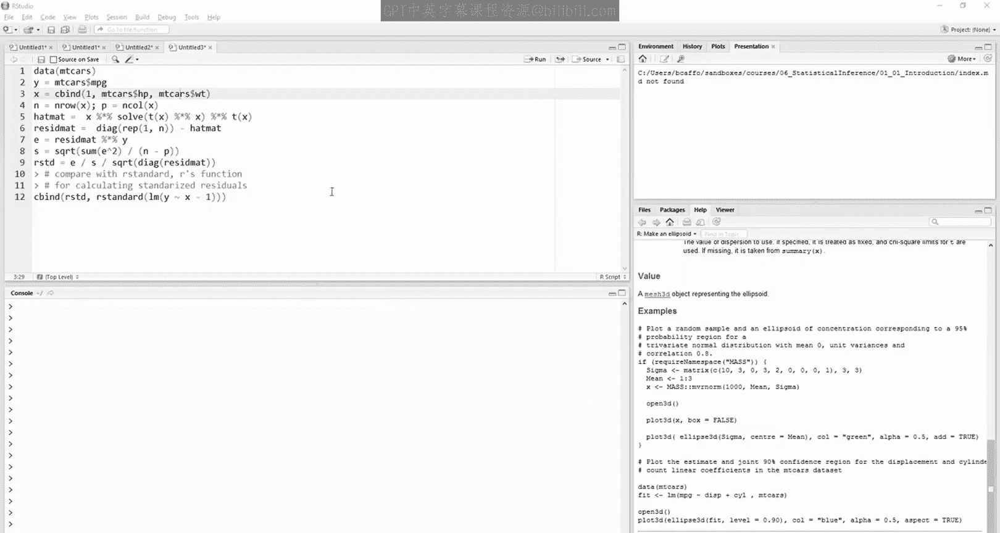
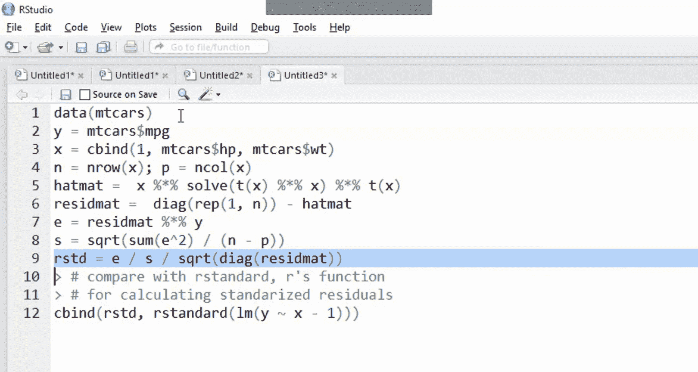
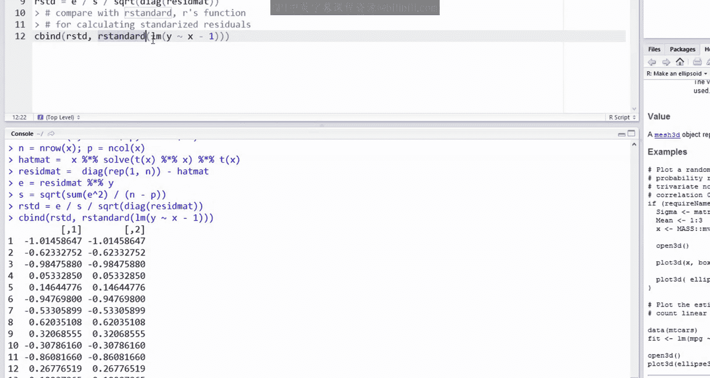
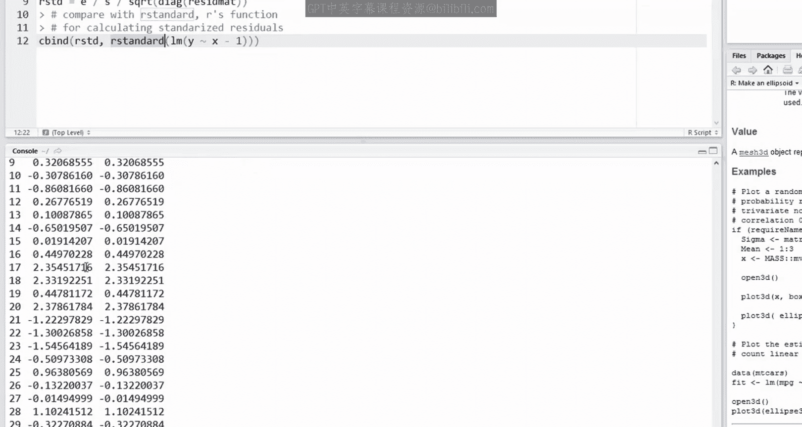
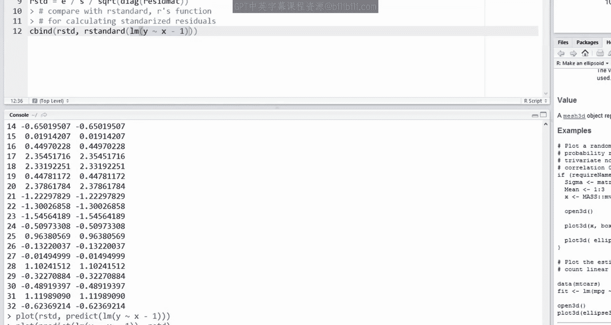
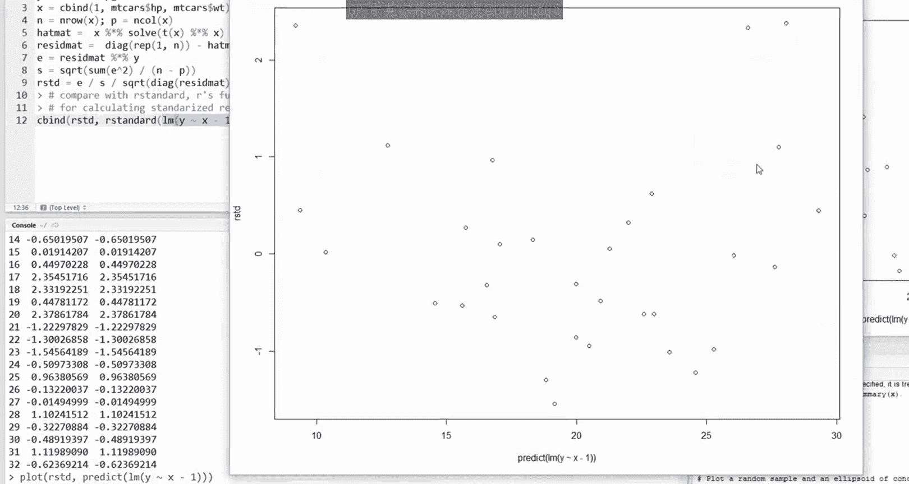
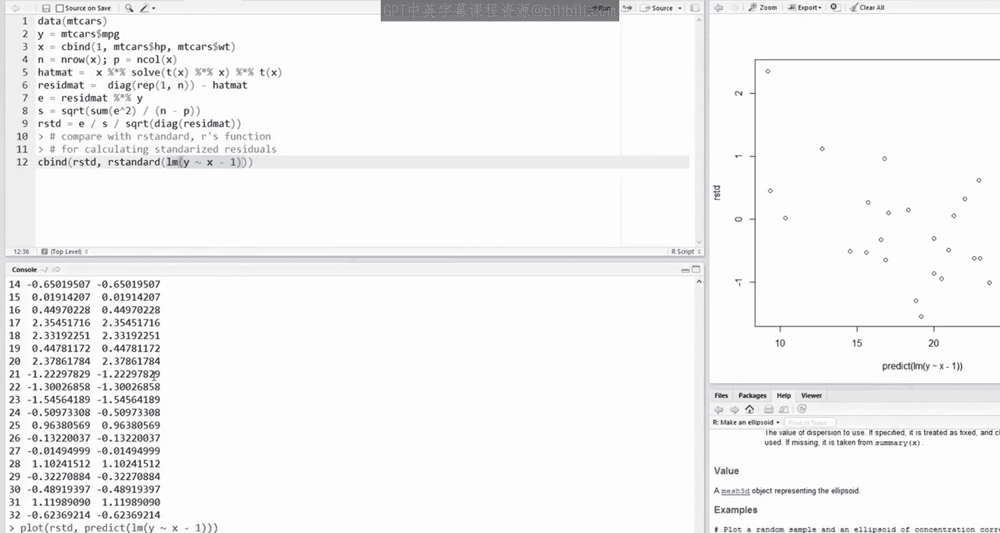
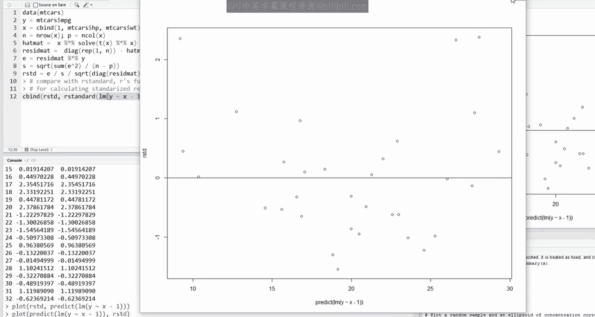

# 约翰霍普金斯大学《数据科学的高级统计｜Advanced Statistics for Data Science》中英字幕（deepseek p131 20_代码演示.zh_en -BV1htPjeYEFH_p131-

Okay， so let's start creating some standardized residuals just to show an example of doing it manually and then with ours default built in function。

 so if I do data empty cars for the motortren cars data set， my Y is miles per gallon， in this case。

 my x is an intercept， horsepower and weight。

O。I define my NM myP， I create my hat matrix。And then， my。

What I'm calling the residual matrix is just being I minus the hat matrix and then my B is my reid mat times y。

 so Reidd mat is the matrix that is orthogonal to the projection onto the space span by the columns of x。

Okay， and then my residual variance estimate is the sum of the residual squared divided by MISP。

 and then my standard standardized residuals are just my residuals divided by s divided by the square root of the diagonal of the residual matrix。

Okay， and then if I compare those。These are just exactly with what you get if you take the output of your fitted LM object。

Okay， and here I'm just putting in my design matrix， which includes an intercepts。

 I'm subtracting on ours default intercept， and then the function R standard for standardized residuals is what returns the standardized residuals as we just calculated and you can see here they're identical What you want to look for in standardized residuals So I would just want to do something like plot。

Are standard by predict。And then I should have assigned my。

My output of my fitted object to a variable， but I'm just going to refit it there。 and oh， usually。

Usually want the predictive values on the。Horontal access， and then you get。

Your residuals versus。There you go， then you get your residuals versus your fit of values plot and when you want and look for when you look at these plots。

 there's any obvious patterns or systematic systematic。

Relationships， for example， variances increasing with a predictive value or things like that often usually want。

You usually want to add a horizontal line at zero because since we've included an intercept。

 our residuals have to sum to zero so they at some level have to be distributed above and below zero。

And we're just doing our residual plot only now we know that the interpretation of this minus1 and two here are in terms of residuals being minus1 or one or two standard deviations above or below the mean of the residuals。

 the mean of the residuals again being zero in this case Okay， so that's a。

That's a pretty easy trick to get your residuals on a more interpretable scale now we're going to go through and talk about other kinds of standardized and special kinds of residuals that take on a particularly nice form in linear models。

