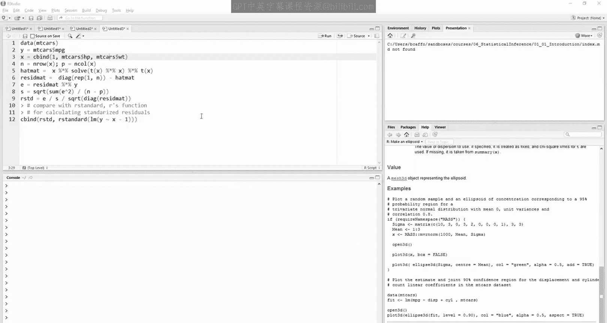
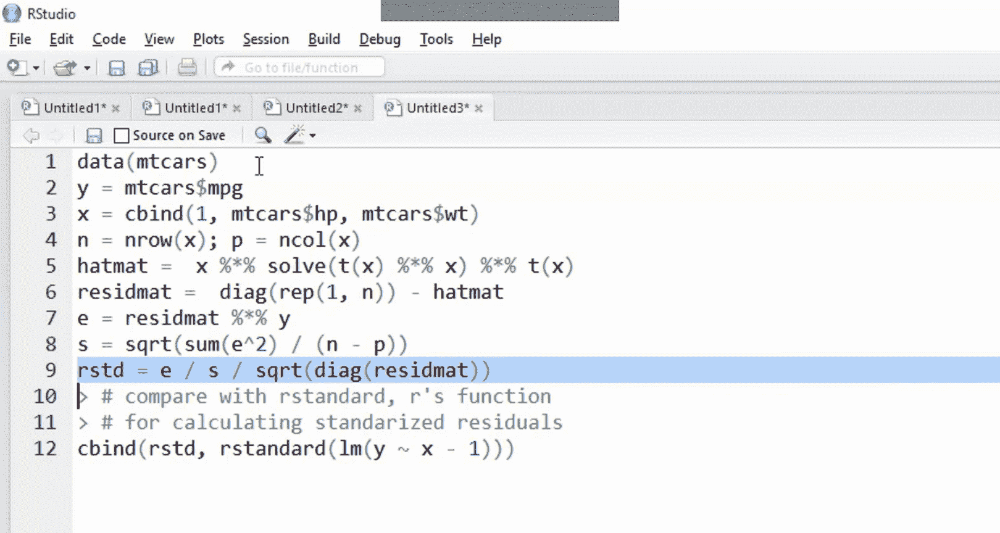
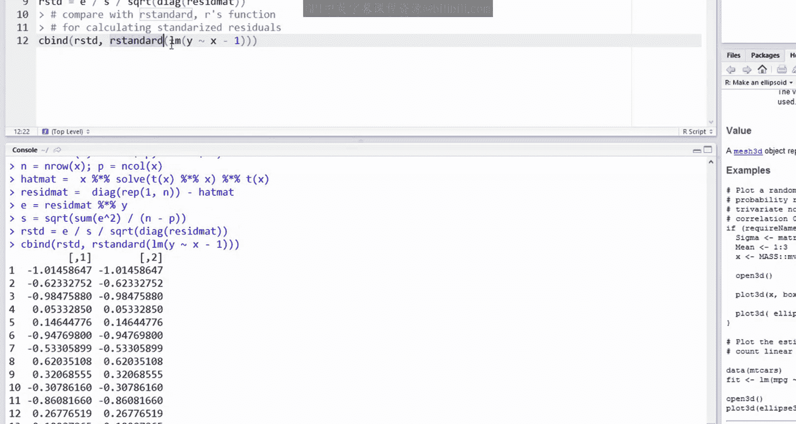
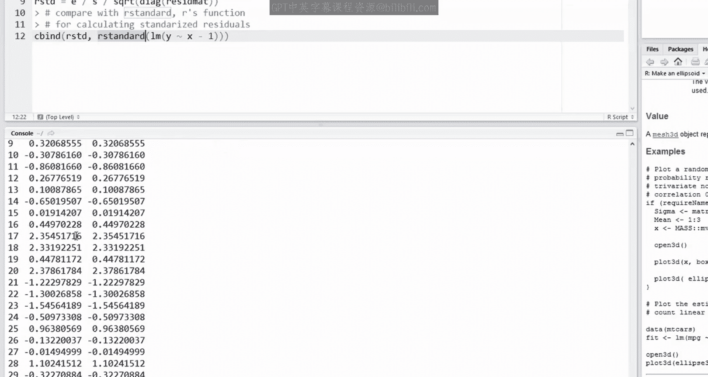
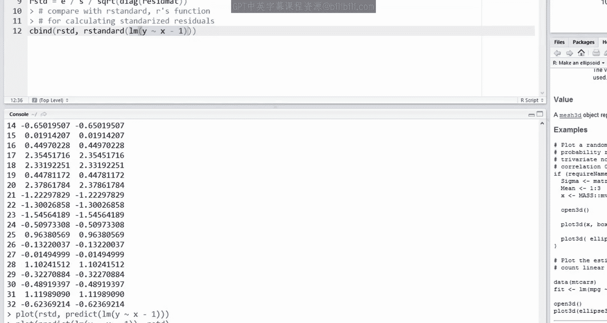
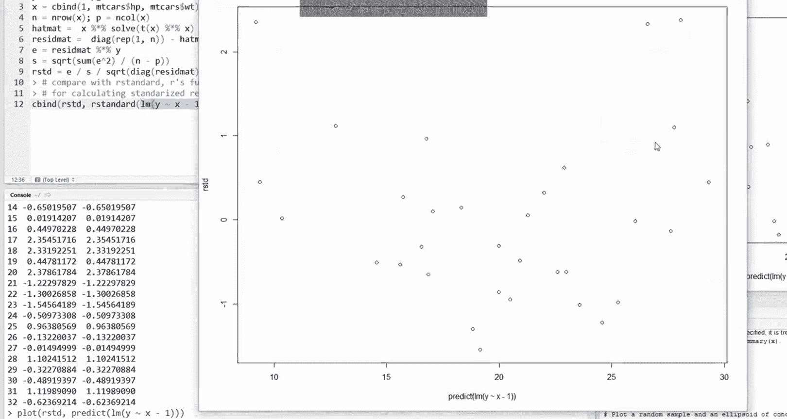
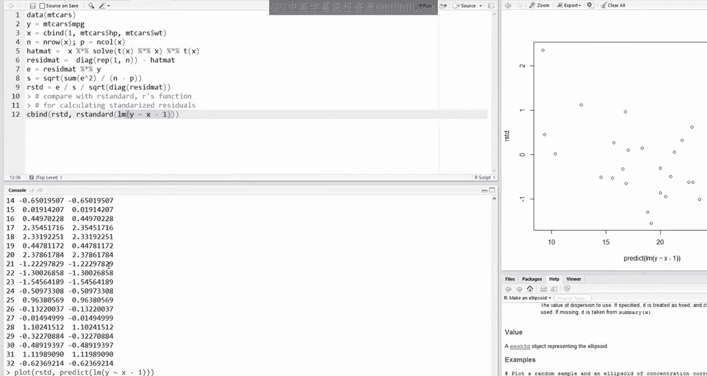
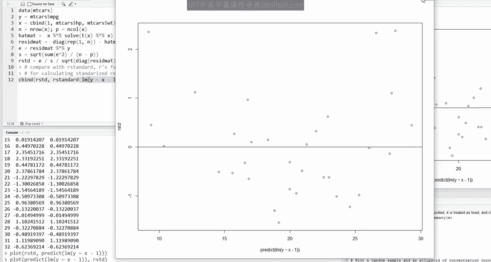

# 数据科学的高级统计：P131：标准化残差计算与可视化教程 🧮

在本节课中，我们将学习如何在线性回归模型中计算和可视化标准化残差。我们将从手动计算开始，然后演示如何使用R语言的内置函数实现相同功能，最后通过残差图进行模型诊断。



## 概述

标准化残差是回归诊断中的重要工具，它将普通残差转换为以标准差为单位的度量，便于识别异常值和检查模型假设。本节我们将通过`mtcars`数据集演示具体操作。

## 手动计算标准化残差

首先，我们手动计算标准化残差以理解其原理。我们使用`mtcars`数据集，以每加仑英里数（`mpg`）作为因变量，马力和重量作为自变量。



以下是手动计算步骤：

1.  **定义模型矩阵与参数**  
    设`Y`为`mpg`，`X`为包含截距项、马力（`hp`）和重量（`wt`）的设计矩阵。

    ```r
    y <- mtcars$mpg
    X <- cbind(1, mtcars$hp, mtcars$wt) # 设计矩阵，包含截距
    n <- nrow(X)
    p <- ncol(X)
    ```

2.  **计算帽子矩阵与残差**  
    帽子矩阵（Hat Matrix）`H`将观测值投影到由`X`的列张成的空间上。残差矩阵`I-H`则正交于该投影空间。

    ```r
    H <- X %*% solve(t(X) %*% X) %*% t(X) # 帽子矩阵公式: H = X(X'X)^{-1}X'
    I <- diag(n)
    resid_mat <- I - H # 残差矩阵
    residuals <- resid_mat %*% y # 计算残差
    ```



3.  **估计残差方差并标准化**  
    残差方差估计值`s^2`等于残差平方和除以自由度（`n-p`）。标准化残差是残差除以其估计的标准误。

    ```r
    s2 <- sum(residuals^2) / (n - p) # 残差方差估计
    s <- sqrt(s2) # 残差标准误
    std_residuals_manual <- residuals / (s * sqrt(diag(resid_mat))) # 标准化
    ```



## 使用内置函数计算



上一节我们手动完成了计算，本节我们来看看如何使用R语言`lm`函数和`rstandard`函数快速获得相同结果。

```r
# 拟合线性模型
fit <- lm(mpg ~ hp + wt, data = mtcars)
# 提取标准化残差
std_residuals_builtin <- rstandard(fit)
# 比较手动与自动计算结果是否一致
all.equal(as.numeric(std_residuals_manual), std_residuals_builtin)
```
运行上述代码，你会发现两种方法得到的标准化残差完全一致。



## 残差可视化与诊断



计算出标准化残差后，下一步是进行可视化诊断。残差图是检查模型线性、同方差性等假设的有效工具。

以下是创建和解读残差图的步骤：

1.  **绘制拟合值-残差图**  
    以模型拟合值为横轴，标准化残差为纵轴绘制散点图。

    ```r
    plot(fitted(fit), std_residuals_builtin,
         xlab = "Fitted Values",
         ylab = "Standardized Residuals",
         main = "Residuals vs Fitted Plot")
    abline(h = 0, col = "red", lty = 2) # 添加y=0参考线
    abline(h = c(-2, 2), col = "blue", lty = 3) # 添加±2倍标准差线
    ```

2.  **解读图形**  
    在分析残差图时，我们主要寻找以下模式：
    *   **随机分布**：理想情况下，点应随机分布在`y=0`红线上下，无明显规律。
    *   **同方差性**：点的垂直散布范围应大致均匀，不随拟合值增大而明显变宽或变窄。
    *   **异常值识别**：大多数标准化残差应落在`-2`到`2`的蓝色虚线区间内。落在此区间外的点可能是异常值，需要进一步检查。

    标准化残差的优势在于，其值可以直接解释为“距离残差均值（0）多少个标准差”。例如，一个值为2.5的标准化残差，意味着该观测的残差比期望值大了约2.5个标准差。

## 总结



本节课中我们一起学习了线性回归中标准化残差的计算与应用。我们首先手动推导并计算了标准化残差，理解了其背后的矩阵运算原理。接着，我们使用R语言的`lm()`和`rstandard()`函数高效地获得了相同结果。最后，我们通过绘制和解读拟合值-残差图，学习了如何利用标准化残差诊断模型的线性、同方差性假设并识别潜在的异常值。标准化残差将残差缩放至统一尺度，使得不同观测间的残差比较和模型诊断变得更加直观和可靠。