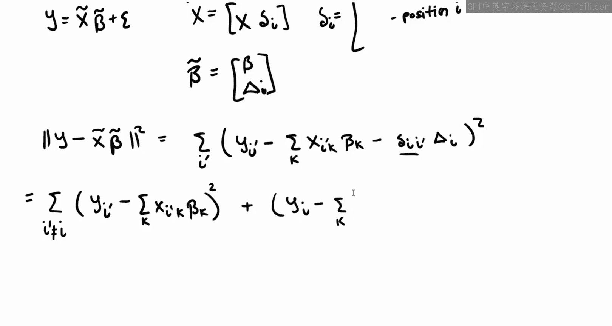
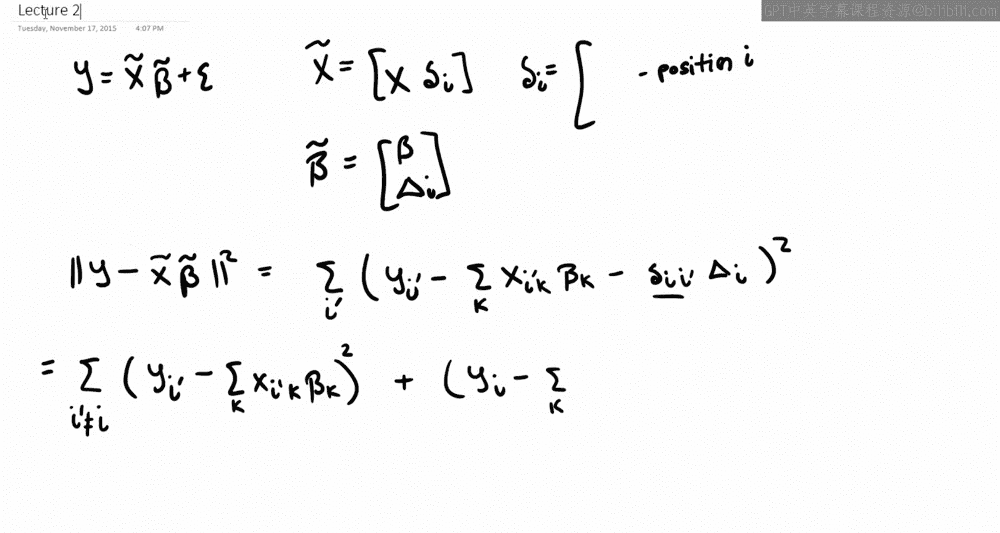
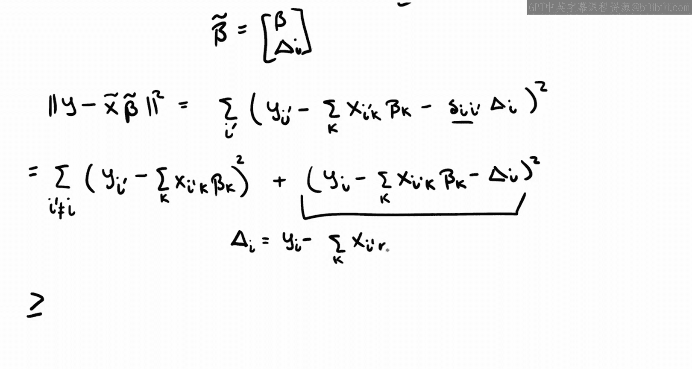
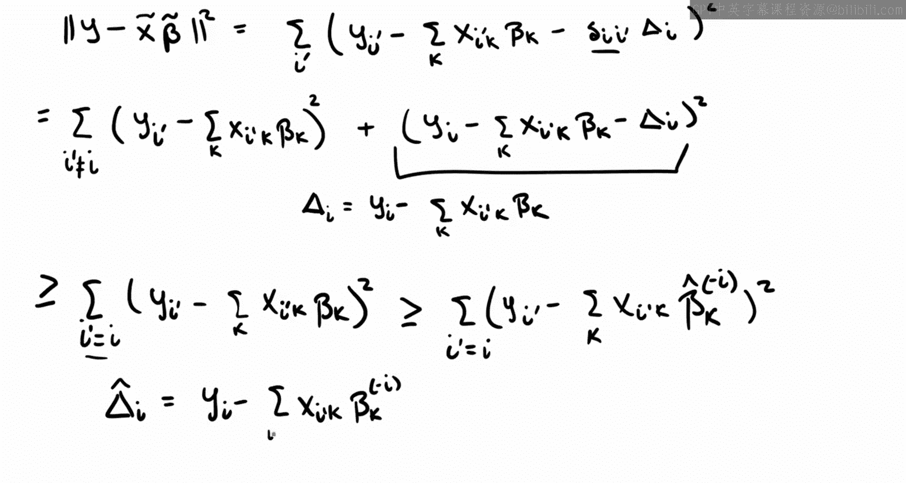
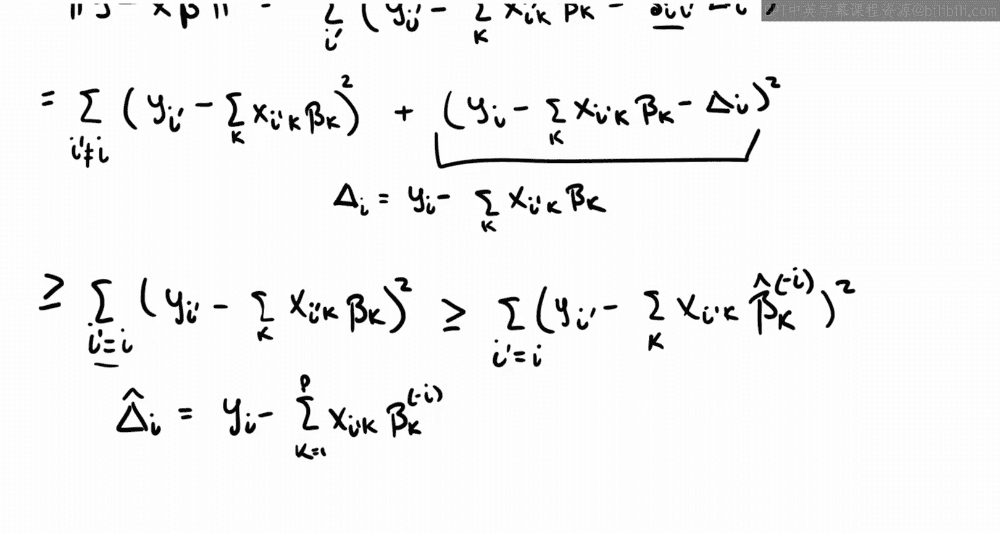
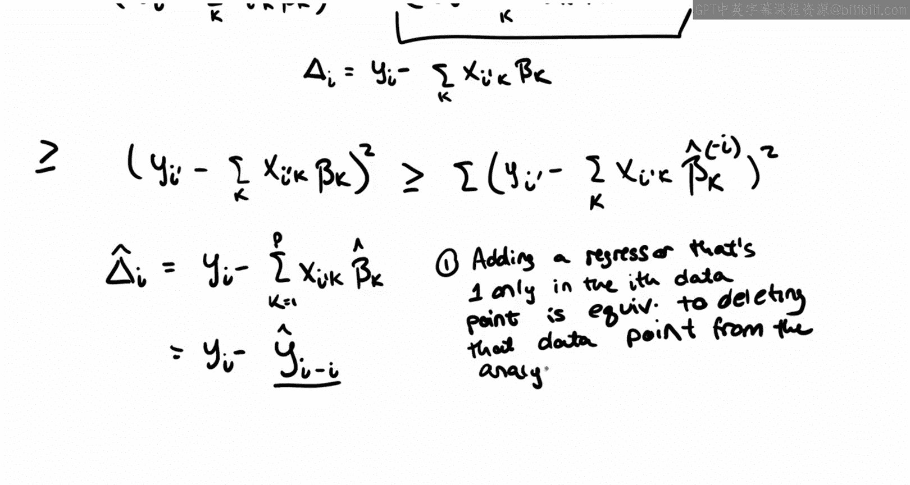
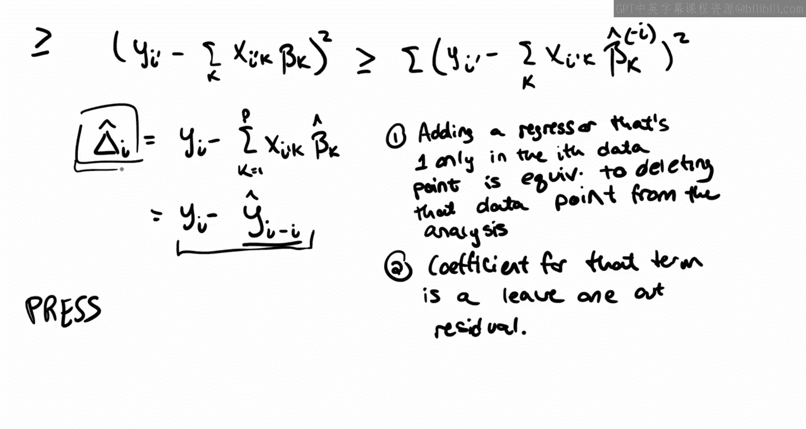

# 约翰霍普金斯大学《数据科学的高级统计｜Advanced Statistics for Data Science》中英字幕（deepseek p132 21_留一法残差.zh_en -BV1htPjeYEFH_p132-

Let's consider a different kind of residual， so consider the model y equal to x tilde。

 beta tilde plus epsilon。Where x tilde is equal to my。Traditional design matrix X。

 and then a vector Delta I。Delta I is a bunch of zeros and a1 only in the I position。

 so that's in position I。Okay。And then my beta tilde vector。Is my normal vector beta？

That I almost always have and then a parameter delta。

 and let me put a little I there just to indicate that's delta。

 the parameter just devoted to the I data point。Okay。Now， I could。Equivalently write my。

 my least scarce criteria right， is， nor， let's figure out what the M L E is when we just add this extra term。

 My， I could write this as y minus x tilde beta tilde。Squared， okay。

But I could equivalently write that as。The summation。Of why， I。mininus。The summation over K。

 the summation over I， summation over K， let's say X I K up。

 and let me use I prime just so we're not。Missing up with the I， the index that we fixed earlier。

Okay， times beta k。Minus。Delta。So I evaluated at the index I prime。Times Delta， I squared。Okay。

So this is going to be equal for all those。Elements of the sum that are not equal to I， this index。

 this vector right here， the elements of this vector are going to be 0。

 except in the instance when I equals I prime。 So for I not equal to I prime。

This is just going to be summation Y I prime。Minus summation over K X， I prime k。Beta k。

And then plus the one instance where i prime equals I。Yi minus summation over k up squared。

X， I prime K。Betake。Minus。Delta， I。Squared。Okay， now this is going to be greater than or equal to if I were to get this term right here equal to 0。

 but one way I can set a linear constraint and make that term equal to 0 is to set delta I equal to Yi minus summation over k X I prime K。

Beta k。Okay， so then that term is0。And then we're left with the term the summation over all points。

 I prime not equal to I Y I prime minus summation over K X I prime K。Beta K squared。

 When we know when this is minimized， that's going to be greater than equal 2 if I were to just plug in my least squares estimate。

Where in this case， notice this sum is over everything you except the I datata point。

 so if I just plug in my least squares estimate for my vector x where I've deleted the i prime data points。

 so let me just call that beta hat K minus I， just meaning the least squares estimate where I've deleted the I theta point。

Then that will be minimized and then my Delta I hat。Is going to be equal to Y I minus summation。X。

 I prime K。Beta K， minus I。Okay。

Equal 1 to P。 So let's look at this term Delta now。

So， notice。This， the format of this， this is y I minus， let's say， up in hat， Y I minus I。Hat。

 so what do I mean by that？ So this is the fitted value for the I data point。

Where the I data point wasn't used in the fitting， so there's a couple of interesting points to make out of this one。

Adding adding a regressor。That's just one。That's。1， only in the I data point。Is equivalent。

To deleting that data point。From the analysis。So that's an interesting way to delete a data point。

And then2。The， the coefficient。For that term。The coefficient。Is a leave one out residual。And so。

This residual right here， the difference between。The I data point outcome and what you would predict for the I data point if the I data point wasn't allowed to actually influence the model is called a press residual。

Or a leave one out cross validation residual residual。The other interesting fact about this is that。

 first of all， that you can obtain the leave one out cross validation residual by fitting a model with this extra termine。

 Another interesting fact is that the coefficient table for the deelta I，That T test is a test。

 sort of an outlier test for the I data point。 If it if you need a coefficient that's devoted just for that data point。

 then that data point is an outlier。 and the T test for this is actually a。A validid T test。

 so that gives us a form of standardized residual for the I theta point that is distributed T distributed。

So there's a lot of interesting facts about this and one fact that we'll cover later on is that you don't even actually have to fit this model or in any way delete the I data point in order to obtain these residuals that you don't actually in order to get to leave one out cross-valated residuals。

 you don't actually have to leave one out is a surprising thing in linear models。

 but these residuals are quite useful for a variety of reasons。

 one is they have this motivation as a mean shift observation specific mean shift two is the cross-valated residuals like this have an obvious intuitive interpretation of well how different is my outcome。

T what my model would predict where that data point hasn't been allowed to impact a model fitting is a very powerful idea for assessing things like model fit。

And then finally， the standardized the T test that you get from fitting this model with this extra term for the I datata point yields a form of standardized residuals that's a kind of useful form of standardized residual that is exactly t distributed so we could establish cutoffs for thresholding them and so on Okay so now we're going to go through some coding examples and then we're going to delve into these press residuals a little bit more。

