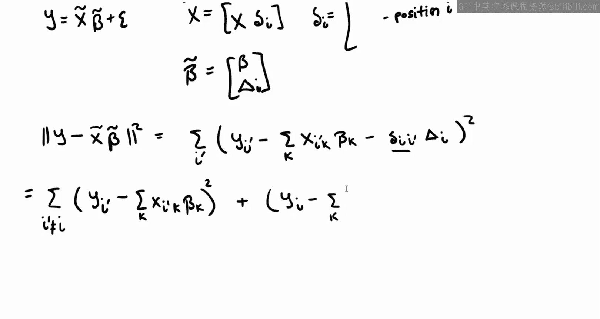
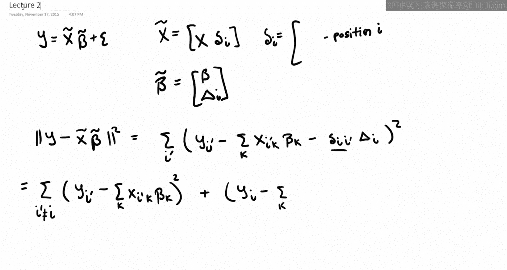
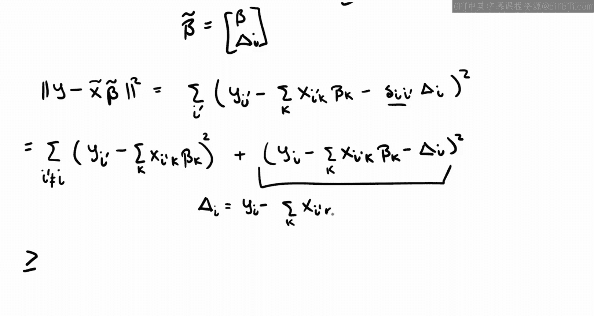
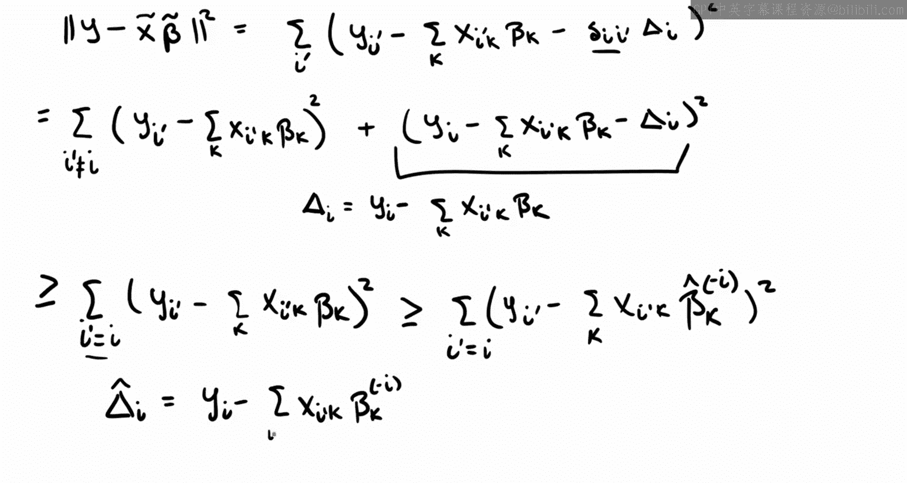
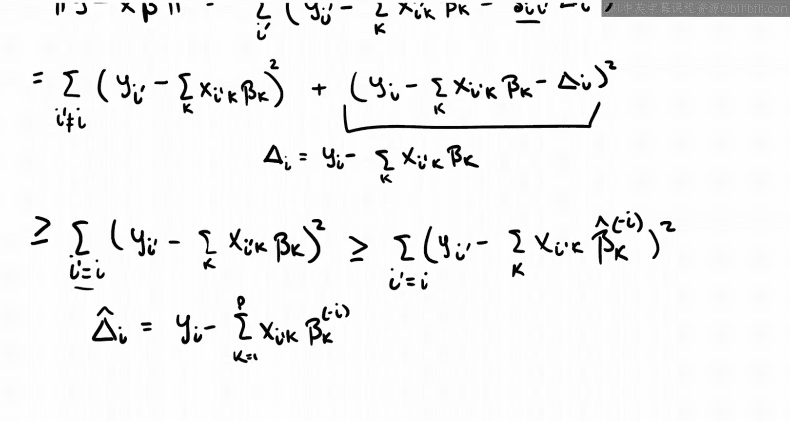
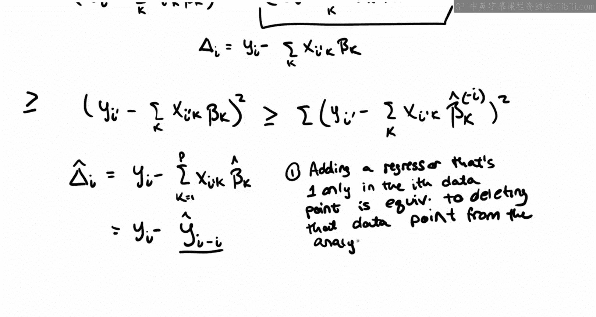
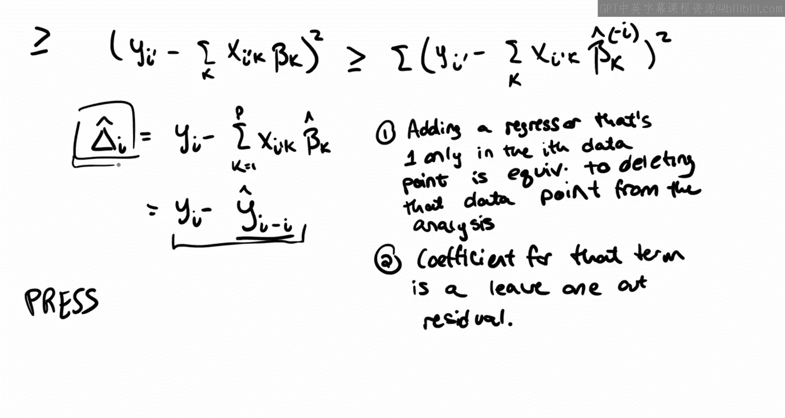

# 高级统计：P132：留一法残差 🧮

在本节课中，我们将学习一种特殊的残差——留一法残差（PRESS Residuals）。我们将探讨其数学定义、统计性质，并理解它如何通过为每个数据点添加一个特定参数，等价于在拟合模型时删除该数据点。

---

## 模型设定与最小二乘准则

考虑一个扩展的线性模型：

**y = X̃β̃ + ε**

其中，设计矩阵 **X̃** 由传统的设计矩阵 **X** 和一个额外的向量 **Δᵢ** 拼接而成。**Δᵢ** 是一个仅在位置 *i* 处为1，其余位置为0的向量。

参数向量 **β̃** 则包含我们通常的系数向量 **β** 和一个专门为第 *i* 个数据点设置的参数 **δᵢ**。

因此，我们可以将最小二乘准则写为：

**||y - X̃β̃||²**

---

## 目标函数分解

上一节我们定义了扩展模型，本节中我们来看看如何最小化其目标函数。我们可以将目标函数具体展开：

**∑ᵢ‘ (yᵢ‘ - ∑ₖ xᵢ‘ₖ βₖ - δᵢ * 1{ i‘ = i } )²**

这里，**1{ i‘ = i }** 是指示函数，当 i‘ 等于我们选定的 i 时为1，否则为0。

因此，这个求和可以分解为两部分：
1.  当 i‘ ≠ i 时，该项为 **(yᵢ‘ - ∑ₖ xᵢ‘ₖ βₖ)²**。
2.  当 i‘ = i 时，该项为 **(yᵢ - ∑ₖ xᵢₖ βₖ - δᵢ)²**。

---

## 参数估计与等价关系

为了使整个目标函数最小化，一个直接的方法是让包含 δᵢ 的那一项为零。这可以通过设置：

**δᵢ = yᵢ - ∑ₖ xᵢₖ βₖ**

来实现。此时，目标函数简化为对除第 *i* 点外所有数据点的残差平方和：

**∑ᵢ‘≠ᵢ (yᵢ‘ - ∑ₖ xᵢ‘ₖ βₖ)²**

这个和式在我们将 **β** 取值为基于**删除第 i 个数据点后**的数据集所得到的最小二乘估计 **β̂⁽⁻ⁱ⁾** 时达到最小。

由此，我们得到 δᵢ 的估计值：

**δ̂ᵢ = yᵢ - ∑ₖ xᵢₖ β̂ₖ⁽⁻ⁱ⁾**

---

## 核心概念与性质

观察 δ̂ᵢ 的形式，它正是第 *i* 个观测值的实际值 **yᵢ** 与**不包含该观测值**所拟合的模型对其的预测值 **ŷᵢ⁽⁻ⁱ⁾** 之间的差异。

以下是关于留一法残差的关键要点：

*   **等价性**：为第 *i* 个数据点添加一个专属参数（“均值漂移”），在数学上完全等价于在分析中删除该数据点。
*   **定义**：系数 **δ̂ᵢ** 被称为**留一法交叉验证残差**或 **PRESS 残差**。它衡量了当某个数据点不参与建模时，模型对该点的预测误差。
*   **统计检验**：在拟合了这个包含 δᵢ 的扩展模型后，对系数 δᵢ 进行的 **t 检验**，实际上是一种针对第 *i* 个数据点的**离群值检验**。如果这个专属系数显著不为零，则表明该点可能是一个离群值。此检验产生的标准化残差服从 **t 分布**。
*   **计算捷径**：一个有趣的事实是，在线性模型中，你实际上不需要真正地重复拟合 *n* 个（每次删除一个点）模型来计算所有这些留一法残差。存在高效的计算公式，我们将在后续探讨。

---

## 留一法残差的意义

这种残差在多个方面非常有用：
1.  **直观解释**：它直接回答了“如果这个数据点没有影响模型，模型预测它会是什么样？”这个问题，是评估模型拟合优度和稳健性的强大思想。
2.  **离群值诊断**：通过其对应的 t 检验，提供了统计上严格的、服从已知分布的标准化残差，便于我们设定阈值来识别离群值。
3.  **模型验证**：PRESS 残差是交叉验证思想的核心，常用于模型选择，其平方和（PRESS 统计量）可以估计模型的预测误差。

---

## 总结

本节课中，我们一起学习了留一法残差（PRESS Residuals）。我们从为其添加专属参数的扩展模型出发，推导出该参数估计值在数学上等价于删除该点后的预测误差。我们明确了它的定义、统计性质（服从 t 分布）以及其在诊断离群值和评估模型预测能力方面的重要应用。理解这种残差为我们提供了更深入的模型诊断工具。