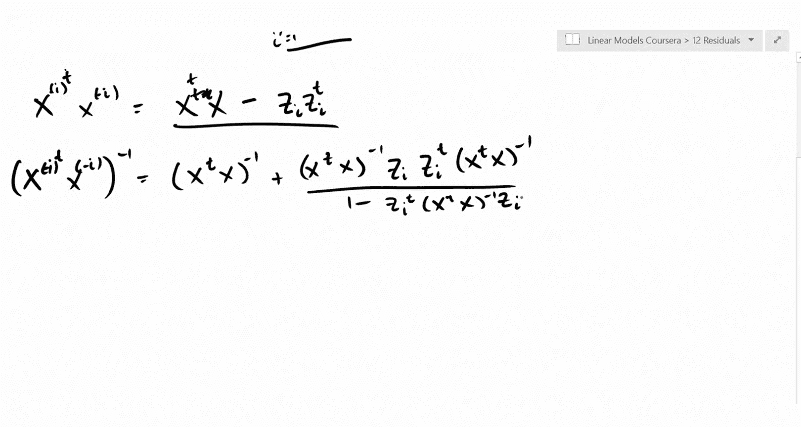
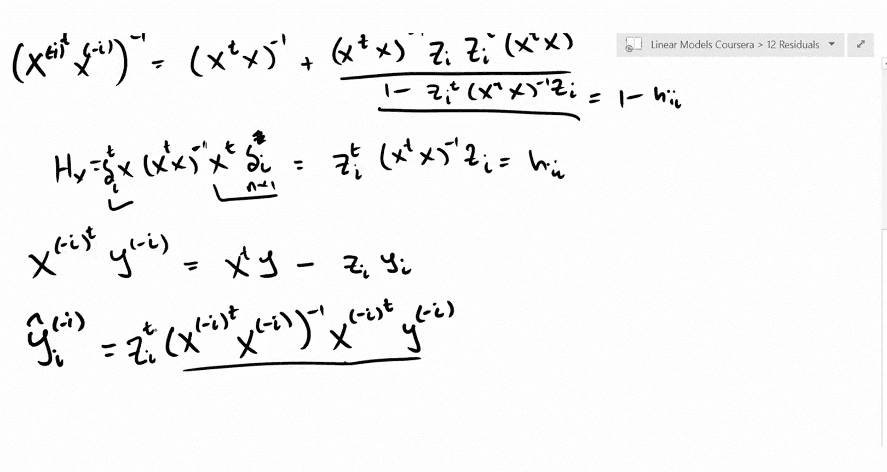
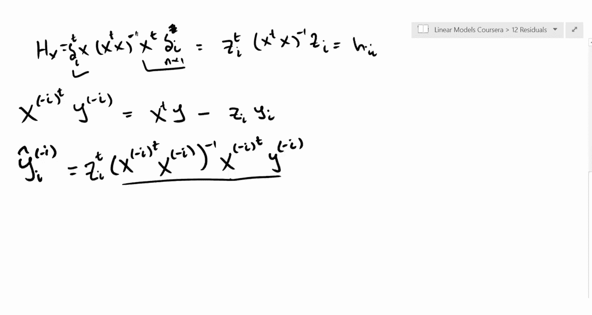
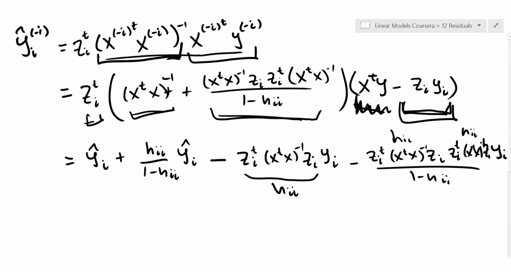
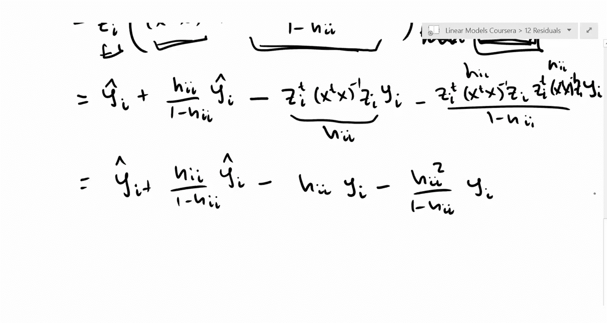
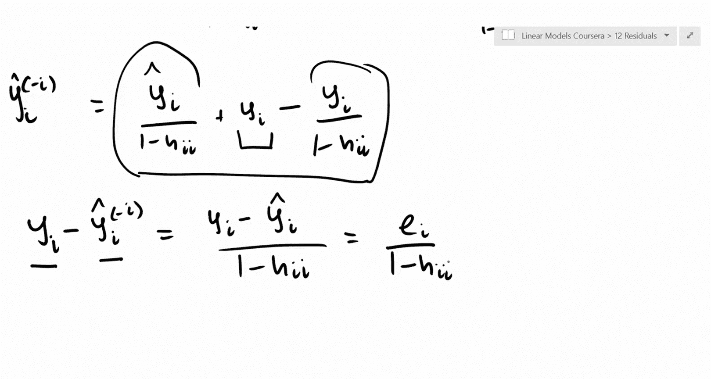

# 约翰霍普金斯大学《数据科学的高级统计｜Advanced Statistics for Data Science》中英字幕（deepseek p133 22_PRESS残差.zh_en -BV1htPjeYEFH_p133-

Okay， so let's work on our press residuals and show that we can fit them without actually reffitting the model。

 just to remind ourselves the press residuals were the I data point minus the fit value for the I data point。

Where that was fitted with the I data point deleted。So to do this。

 there's really two kind of crazy tricks that you would never really think of on your own。

 or at least I wouldn't that。That really just make it work and one of them is how we write some matrix multiplication。

And the second is the Sherman Morrison Woodbury theorem and the Sherman Morrison Woodbury theorem is one of those things that is just kind of really a clever little matrix inversion technique that seems to get used over and over again in regression。

So。Let me let x equal to。Z1 transpose up to Z N transpose。

 So this is different than how we normally partition X。

 where we usually partition X as say x1 up to X P， its columns here。

 I'm partitioning x in terms of its rows。 However， I'm writing each of its rows as a column matrix or as a column vector。

Then consider the matrix x transpose x。That works out to be the summation of the Z transpose。

 given how we've written it out there。So。The x transpo x matrix。Where I've deleted the I data point。

 then。Okay， is just the sum over the， let's let me say。I prime not equal to I。

 where I'm summing over i prime。Of Z I prime， Z I prime transpose， where over here。

 I would say summing over I prime， but I was summing over。Hikical when to N all of the indices。 Okay。

 so I can write。My x transpose x matrix with the ih。Data point deleted。As。X transpose x。嗯。

X transpose x。Minus。Zi。Z I transpose， okay， simply because x transpose x is the sum over all of them and x transpose x minus the I datata point is just the sum minus that extra data point。

Then we can invert this。Ntrix， because remember， if we're going to find the fitted values for having fit with the I theta point deleted。

 we need x transpose x inverse。Okay， so we need。X， I minus I transpose X minus I。

We need that whole thing inverted。And we've written it out like this so we can use the Sherman Morrison Woodbury theorem。

So if you look back to the Sherman Morrison Woodbury theorem。

 this works out to be x transpose x inverse。Plus。X transpose X。Inverse Z i。Z I transpose。

X transpose x inverse， all divided by。1 minus Z， I。Transpose。X transpose x inverse。

CI this denominator here is a scalar。

Now another nifty little fact。If I were to take the hat matrix， H of x， which is x。

X transpose x inverse， x transpose。Okay。And then imagine pre and post。

 if I just wanted to grab the I diagonal of the hat matrix。 Well。

 one way to grab the I diagonal would be to post multiply it by， say， a vector deelta I， which has。嗯。

Let's say Delta I transpose， which are deelta I， which is M by  one， but that also only has a1。

 It's a bunch of zeros with a one in the if data point and then pre multiply it by Delta I transpose。

 which is the same vector again， this will just grab the I diagonal data point of any matrix。

 pre multiplying it by a vector that grabs the I。rowow and post multiplying it by a vector that grabs the I column will just grab the I diagonal。

 Okay， but then we can see that when we multiply here and we multiply here， we get Z I transpose。

X transpose x inverse Z I。 Okay， so this denominator right here。

And let's call that HII for the Ithe diagonal of the hat matrix。

 This diagonal right here is 1 minus H， okay。Now we need to keep working along here。

The second thing we're going to need is x minus I transpose x transpose times the y vector minus I with the eighthh point deleted。

While， using the same technique as before with matrix multiplications。

 we can see that this is the ordinary x transpose y with the full data and the I data point included minus。

Zi。Yhyi。And you can see that using just the same logic as before。Now。We need to get。Why I hat。

Minus I， which is the fitted value for the I data point。

 where the I data point has been removed from the fitting process， okay。

So what is that just by definition that is just。Li。Bm。

The fitted regression coefficients x minus I transpose x minus I。Inverse。X， minus I。

Transpose times y minus I。 would be the this would be the beta coefficient。

I'm sorry this would be the beta coefficient that we obtain by removing the I theta point from both the response and our predictor。

 and then if we want the actual fitted value at it，We would pre multiply it by ZI transpose。

Okay， so that would be what y hat minus i is。

So now let's plug in some of our quantities and show that this simplifies quite a bit。Okay。

So if you go back to our earlier definitions。Okay， there's my Z transpose。

 then my x transpose x inverse， right， I'm going to make a big here is x transpose X。Plus。

X transpo x inverse plus。X transpose X inverse， Z I。ZI transpose。X transpose x inverse。

All over1 minus Hi。Okay， so that takes care of。That part right there。

 And that if I take this part right there， using our。Our work from before。

 that's x transpose y minus Z。Times Y I。 O， now we can get some simplification。

So when I take this quantity and multiply it by x， transpose x inverse。

 and multiply it times that quantity。Okay， I get。Good old fashioned Y I hat the fit of value for the I data point where the I data point was actually included in it。

Now when I take this value again。And I multiply at times this thing。Okay。I am going to get。

And let me just do some scratch work over here。 What I'm going to get is ZI transpose。

Times x transpose X inverse Z。C I transpose X transpose X inverse。Times x transpose y over 1 minus H。

Well， this right here。Is1 minus is just HII。And this right here。Is just Y I hat， okay。erase that。

 so I don't。Theres some room。So what I wind up with is。H I I over1 minus H I I times Y I hat。 Okay。

 so that takes care of multiplying times this guy， okay。

Now let's take this term right here and multiply it through。So we get a minus。Okay。

 and then we get a minus Z transpose。X transpose x inverse。Times Z I。Why I and that。

Quantity right there is H。 Okay， so that takes this term and multiplies it times that one and then times the Z out front。

 Okay， now let's take this term and multiply at times this part。And then we're going to get。

Then we're going to get minus。Z I transpose。X transpose x inverse。Times Z I。

Times Z I transpose x transpose x。Inverse。Times Z I， Y I。And then all over1 minus HI。

And then you'll see that this is HI。And this is H。So what do we get？

We get Y I hat plus H I I over 1 minus Hi times Y I hat。Minus。A。H I， I。Times y I。mininus。H， I。

 I squared over 1 minus H I， I。Times y I。Okay。

Now you can work through the arithmetic here yourself and get that this can work out to be。Why I hat。

Over1 minus H I I。Plus。Y， I minus。Y， I over 1 minus。HI。 And just remember。

 what we're solving for is why I hat。Minus I。Okay。啊。Now。Then if I were to take why。Minus Y I。

 minus Y I hat minus。Hi。Then。When I subtract Y I minus Y I hat this term right here。

 the Y I will just go away， and I just get left with these two terms right here。 that term。

And that term。Okay， and so it works out to be。Y I minus。Why I had。Over 1 minus HII。

Kind of a startling result or or we could just call it the I residual over 1 minus the Ithe hat diagonal。

 So it is kind of a startling result。 If you take the ordinary residuals。

And divide them by 1 minus the hat diagonal， the relevant hat diagonal。 Then you get the same。

Residual that you would obtain by reffitting the model with the I data point removed。Okay。

And then the prediction at that data point。 Okay， so the in other words。

 if you're familiar with cross validation， the in。Linear models。

The leave one out cross validated errors。Actually， do not require you to refit the model。

 So kind of a startling little result。And it also goes back to show that we know exactly what the term would be from our mean shift model that we covered in the previous lectures where in the other way where we motivated the press residuals。

 So I find this to be a tremendously useful result， especially in big data sets。

And something that I happen to use all the time and it turns out that it's just a consequence of some clever tricks。

 you know， not tricks that would be easy to just come up with on the spot， but after you see them。

 they're not hard at all Okay， great， so now let's do some computing experiments。

