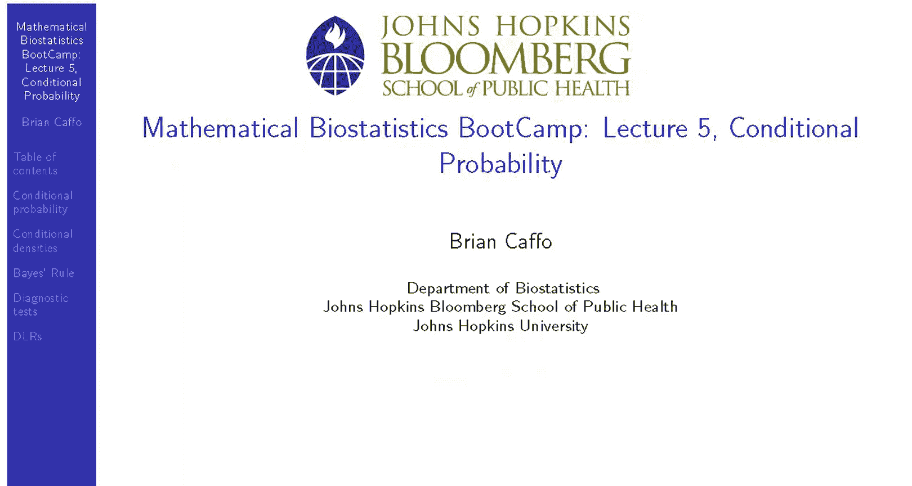
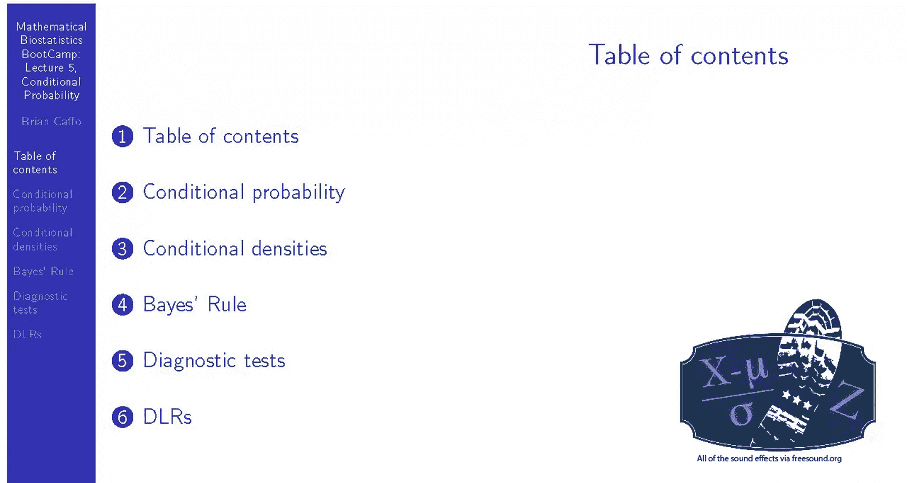
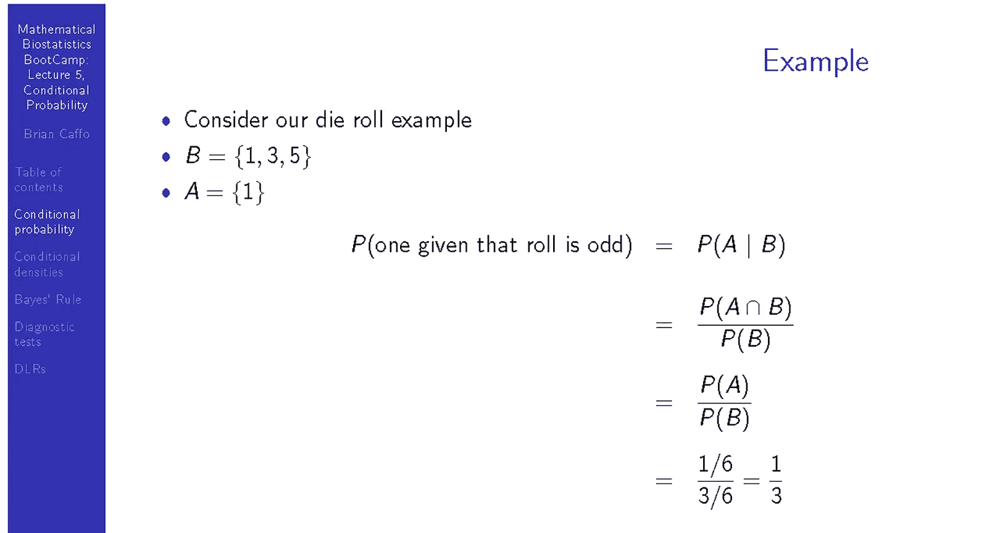
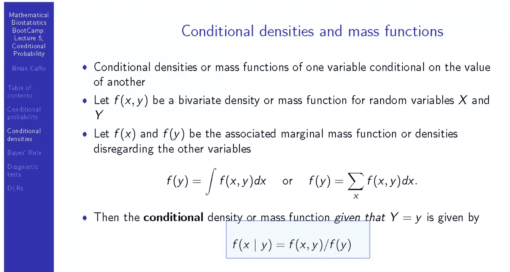
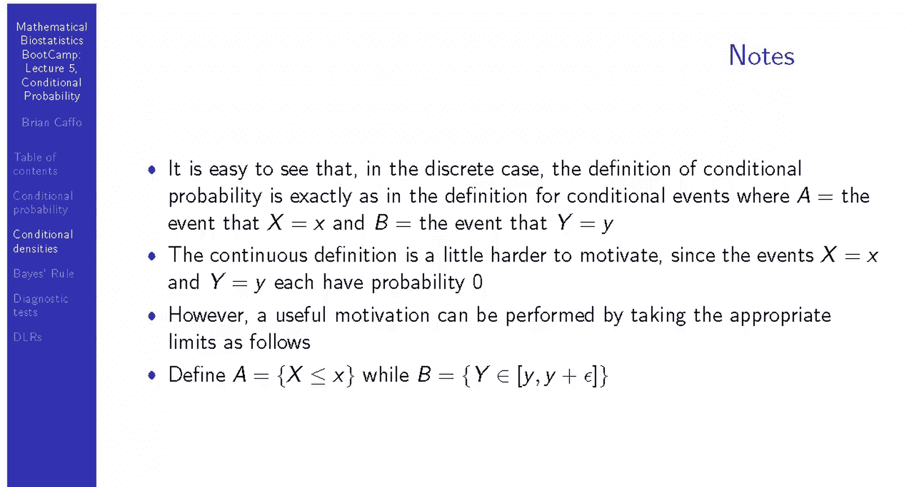
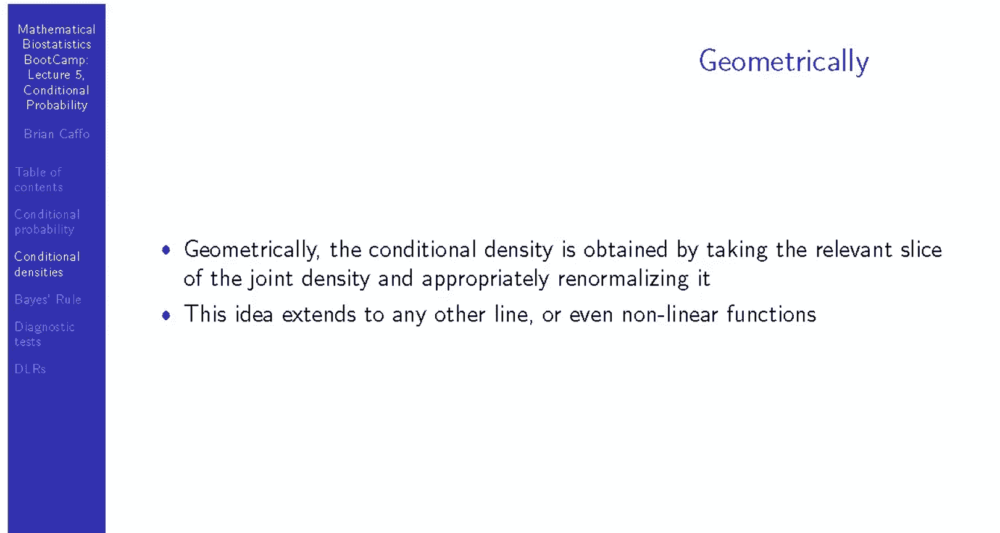
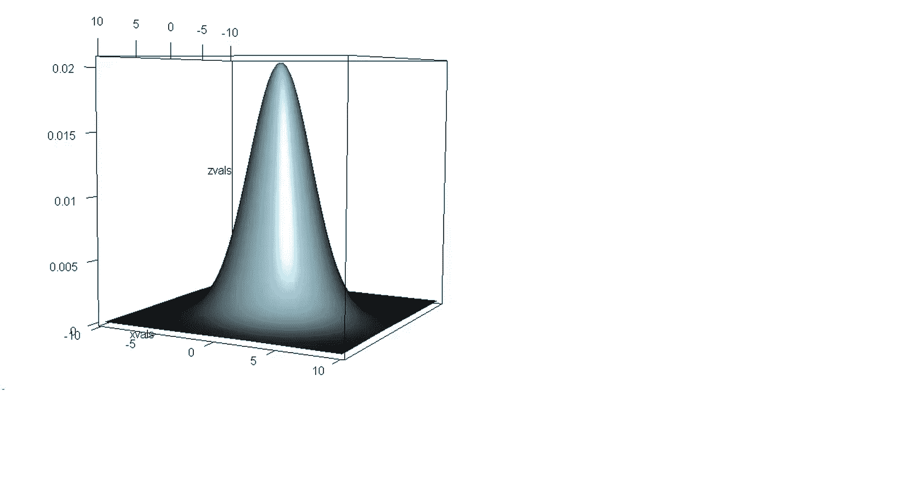
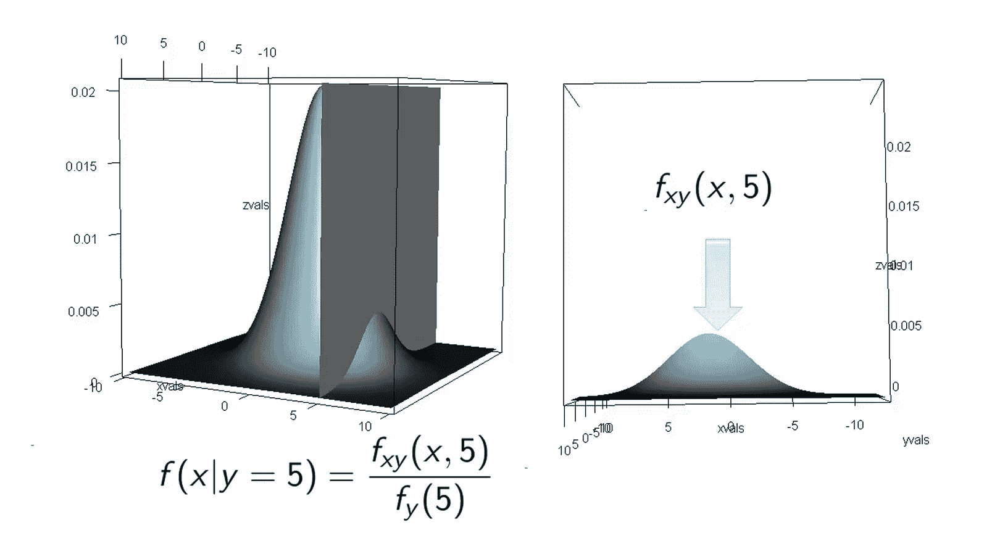
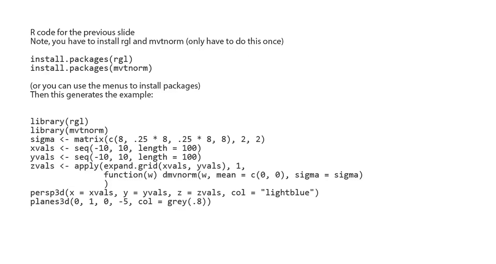
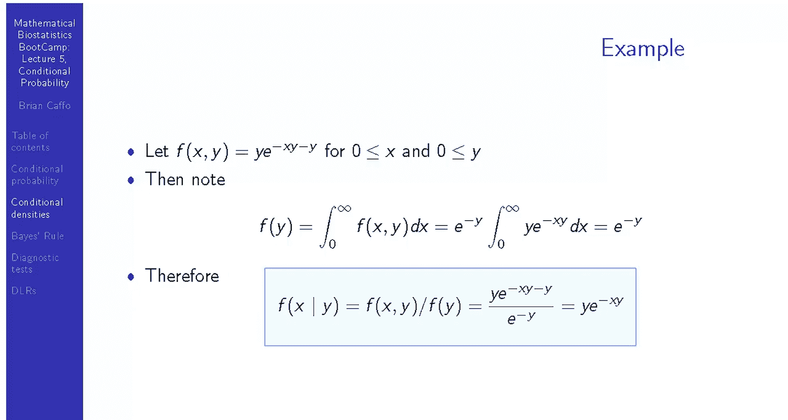

# 约翰霍普金斯大学《数据科学的高级统计｜Advanced Statistics for Data Science》中英字幕（deepseek p14 13_条件概率与条件密度.zh_en -BV1htPjeYEFH_p14-

Hi， my name is Brian Kaffho and this is Mathe Biosstatistics Boot Campamp Le 5 on conditional probability。

So in this lecture we're going to talk about conditional probabilities and then the associated density functions for calculating conditional probabilities basically just called conditional densities and we'll talk about conditional mass functions for discrete random variables we'll talk about Bay's rule and then briefly talk about an example of Bay's rule using diagnostic tests and then we'll talk a little bit about so-called diagnostic likelihood ratios。

So let me give you some brief motivation for conditional probabilities。

 I think we kind of internally do these things pretty easily。

So imagine rolling a standard die and we're assuming that the probability of each face is 1 sixth。

Suppose you didn't know the outcome of the die， but someone were to give you the information that the die roll was odd。

 so it had to be a one， a three， or a five， a two or a four or six is not possible given this extra information。

Then conditional on this new information， everyone would probably agree that the probability is now one third。

And all we're going to do in the next couple of slides is mathematically develop these ideas a little bit more completely。

So let's develop the notion of conditional probability just generically talking about events。

 so let's let B be any event such that the probability of B is greater than zero。

 this condition is kind of important because it doesn't make any sense to condition on the probability of an event occurring when that event cannot occur。

 so it doesn't make any sense to talk about the probability of a。

 given B occurred if the probability that B occurred is exactly zero， just to put this in words。

 it makes no sense to talk about the probability that a coin is head given that the coin is on its side if you're not going to allow for the possibility for the coin to land on its side。

So the definition of a conditional probability of an event is the probability of the event A occurring。

 given that the event B has occurred is the probability of the intersection divided by the probability of B。

Now notice if A and B are independent， then the probability of a given B。

 well the numerator component， the intersection， a intersect B factors into the product of the two probabilityities。

 probability of a times the probability of B the probability of B cancels out in the numerator and denominator and you're left with the probability of A so this actually makes a lot of sense that if the events A and B are independent。

 then the probability of a， given that B is occurred is simply the probability of a without knowledge of whether or not B has occurred。

 that is the information about whether B has occurred is irrelevant to the calculation of probability of a。

 this matches our intuition as to what independence means and it's nice that the mathematics works out that way In fact。

 in some probability text， this is their definition of independence as opposed to the definition that we gave earlier。

So let's just work through the formula given our example with the die roll just to convince ourselves that it's actually working。

 we want the probability of a one given that the die roll is odd， so in this case B is a1，3 or a5。

A is just a1， so the probability of a， given that B has occurred is the probability of the intersection。

 and in this case， a is the set containing1， B is the set containing 1，3 and 5。

 so a is a subset of B。 so when you intersect the two， you just get a by itself。

 so it works out to be the probability of a divided by the probability of B。

 probability of a by itself is 16， the probability of B is 36。

 and we get one third exactly the answer that our intuition told us。Okay。

 so that ends our very brief discussion of basic conditional probability calculations using the standard events and generic discussion of probability。

Next， we're going to talk about conditional densities。

 which will be our mathematical formulation for conditional probabilities for continuous random variables。

So welcome back troops， we're going to be talking now about conditional densities now that we know a little bit more about conditional probabilities。

 so conditional densities or mass functions are exactly densities in mass functions that govern the behavior of a random variable conditioned on the value。

 the other random variable or another random variable took a different value。

So just to tie this down a little bit， let's let F of x comma y be a bivariate density or mass function。

 and it governs the probabilistic behavior of the random variables， capital X and capital Y。

Now I'm going to abuse notation slightly and let the letter F be the joint density and f of x be the marginal density associated with x and f of y be the marginal density or mass function associated with y and it's probably not the best notation to use F for the joint density f for the two marginals when they are all referring to different things。

 so you know just keep in mind that the arguments are kind of differentiating what I'm talking about here。

 this is exactly very sloppy notation but I'm using it anyway。So just to remind you。

 the marginal density f of y is the joint density， f of x comma y integrated over x。

 or if the random variables happen to be discrete， then f of y is the joint。

Mass function F of x comm a y summed over x。 so in other words， if you want to know。

 regardless of what happened with respect to x， what is the probability behavior of the random variable Y。

 you have to integrate over the random variable x over all the potential values you could take with what probabilities and then you get the marginal behavior of the random variable Y in similar。

 you get the marginal for x F of x is the integral of the joint density over y or the sum of the joint mass function over y。

Well， the conditional density is exactly， say， for example， f of x given y is the joint density。

 f of x comma y or mass function divided by the marginal f of y。

 it follows actually directly from the definition of conditional probabilities that we just gave you a couple slides ago and that we sort of all agreed on made a lot of sense。

Let me elaborate on that point。ItsIn fact， in the discrete case where x can only take so many values。

 1， two，3，4， then this definition of conditional probability is exactly the definition that we used from events where a is the event that x equals x and b is the event that y equals y。

So there's no confusion it exactly agrees with our definition of conditional probability。

 the continuous one is a little bit harder to kind of motivate why this is the definition。

The event that x takes on a specific value or y takes on a specific value has probability0 for continuous random variables。

 And so that kind of fails our basic premise from conditional probability associated with events that the probability of the event that we're conditioning on has to have probability greater than  zero。

 Now note we're talking not about conditional probabilities。

 we're talking about the construction of conditional densities which govern the behavior of conditional probabilities。

 So we haven't violated that rule from earlier， but it still kind of seems to break the spirit of the rule and how do we get at this idea how can we have a meaningful definition of the probabilistic behavior of a random variable given that another random variable takes on a specific value。

 Well here's the motivation that I like So imagine if you define the event a that the random variable x is less than or equal to a specific value。

 little X and the event。B is that the random variable y lies in this interval from y to y plus some small amount。

 say epsilon。Then now A and B are events that have positive probability。

And we can apply our standard definition of conditional probability to talk about the probability of the event A。

 given that the event B has occurred right that would just follow from our standard definition So actually let's formulate this so the probability of a given B is the probability of x being less than equal to little X given that y is in the set y to y plus epsilon and then now in this case nothing as probability zero。

 we can just directly apply the probabilistic formula and I don't think this is terribly important for this class。

 I just wanted this argument to be here for those who want to see it。

 but then you could just follow through the arithmetic or the calculus here and get that basically this construction yields the conditional distribution function associated with the X given that y equals y as we let epsilon gets smaller and smaller so as the conditioning event gets closer and closer to。

Y conditionitioning on it being the specific value Y we limit to a conditional distribution function associated with x。

 and then remember that density functions are derivatives of distribution function。

 So if we just take the derivative of this， then we get the conditional density function so we can see right here that if we differentiate this conditional distribution function we get exactly the definition of the conditional density that we gave you before F of x comma Y divided by F of Y So if you're interested in this at this level then you can go through those arguments carefully and to be fair these only cover。

The definition in the continuous case when we have differentiable distribution functions。

 but this is more than enough for our case， if you're interested in it at a deeper level even than this。

 where you have mixed continuous and discrete densities。

 then you can take an advanced probability course somewhere but for our purposes this is enough and so just to summarize we have the conditional probability definition associated with events that kind of governs all of our thinking about conditional probabilities and that's the probability of a given B。

 is the probability of a intersect B divided by the probability of B。

 and then in the event that you're talking about random variables where we want to talk about the probability of a random variable X。

 given that the random variable Y is taken on a specific value it's the joint density or mass function divided by the marginal。

And it has a nice sort of parallel with the probability associated with events。

 and here we've gone through the arguments to show how we get from these statements about events to this definition for mass functions and density functions。

So conditional densities actually have a very nice geometric interpretation。

 so if you have a joint density f of x comma y， that's a surface。

F yields the z value and x Y is the plane， so f of x comma y is a joint density is a surface and its volume under the surface has to be one for it to be a joint density Well what does it mean to get the conditional density of x given that y takes a particular value。

 the event that y takes a particular value， that's sort of like a plane at the point let's say y is 5 at the point y equals5。

 that's a plane and that plane slices through this surface and yields a function。

That function is just f of x comma y evaluated at the 0。5， f of x comma 5 Okay。

 so we have this surface， we have this plane， the y equal 5 plane that cuts through the surface。

And then we have the function that is on that plane at f of x comma 5。

 and that is exactly the conditional density with the exception of now it doesn't integrate to1。

 so we have to normalize it by something that integrates to1， well。

 that's exactly what we divide by there f of 5。

Let's go through a specific example， we have f of x comma y equals y e to the negative Xy minus y。

For x and y both greater than zero Now the marginal density associated with y。

 let's just perform the integral。 we integrate from0 to infinity of the joint density function over x because we want the marginal associated with y。

 and you can perform the integral it works out to be e to the minus y。

And then our conditional density， then f of x given y is the joint density。

 f of x comma y divided by f of y， so just churn through the calculations and you get ye to the negative x times y。

And so if you wanted to know what's the conditional density。

 the governing behavior of the random variable x， given that y is say 3。

 then that density would be 3 e to the negative x times 3 okay so you just plug in y equal 3 so now this function。

 if you plug in any possible value of y， this function will now give you the associated density function for the random variable x conditioning on the information that y takes on that specific value。

