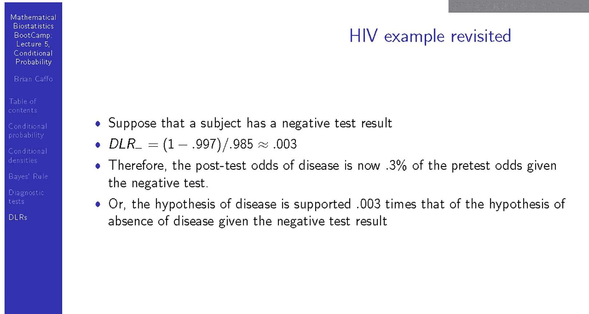

# 约翰霍普金斯大学《数据科学的高级统计｜Advanced Statistics for Data Science》中英字幕（deepseek p15 14_贝叶斯定理与似然比.zh_en -BV1htPjeYEFH_p15-

Okay， welcome back， troops。This is mathematical biostatistics bootot camp Le5。

 and we're going to start talking about Bay's rule。

Bay's rule is one of the most famous results in statistics it comes from a I believe Presbyterian minister named Thomas Bayes who wrote down the rule。

 I believe it was published posthumously much later and it's astoundingly simple rule that has incredible power to it。

 and the idea is basically how can you relate conditional probabilities of the form A given B to probabilities of the form B given A。

 so you reverse the arguments， it's very important right it's saying how can I talk about a given that B has occurred when I only know things about the distribution of B given that A has occurred it's a very important thing and of course you can't do that without a little bit of extra information and we'll talk about it specifically where that extra information comes from。

I wanted to give the mathematical， the probability， density and mass function version of it first。

 and then we'll talk about the kind of classical treatment with events。

But let's let f of x given y be a conditional density or mass function for x given that y has occurred and has taken the value y。

 and f of y being the marginal density for y。Then if y is continuous。

 then Bay's rule basically says that f of y given x is f of x given y times f of y。

Divided by F of x given t times F of T dt。And notice that what we needed to know to do this calculation of F of y given x。

iss f of x given y and then this extra argument， f of y by itself。

 and so the idea of bes rules is sort of flipping the arguments。

 and then if y is discreteed f of y given x is f of x given y times f of y divided by the sum over T of f of x given t times f of T。

By's rule again relates f of y given x to f of x given y and then the marginal density f of y。

And if we apply this to events， it takes a kind of familiar form that you may have run into before。

 so a special case of this relationship basically works out to be probability of B。

 given A is the probability of A， given B times the probability of B。

Divided by probability of A given B times the probability of B plus the probability of A given B complement times the probability of B complement。

And you could do this exactly from our previous formula。

 let X be discrete random variable that's the indicator of whether a has occurred。

 y be an indicator that the event B has occurred， then plug into the discrete version of Bay's rule。

 that would be a simple proof if you were willing to stipulate the previous page。

 you can also prove it very easily just by working with the rules of probability and it sets。

 so this numerator is probability of a intersect B。

 this denominator is probability of a intersect B plus probability of a intersect B complement。

 so the numerator works out to be probability of A intersect B。

 the denominator works out to be the probability of A so that's exactly the conditional probability B given A。

So it's quite easy to prove， but I just wanted to by discussing this indicate to you that there's no real distinction between the way we're discussing it in terms of continuous densities or discrete joint mass functions and this kind of traditional method of treatment using probabilities in events。

So that's a very brief treatment of how you can use Bays rule with densities and with mass functions。

 we'll go through several examples next time， but one of the most common and biggest examples that we're going to talk about is associated with diagnostic testing and that's what we'll do next。

Okay， welcome back， Tro， this is Le5 Mathematic Biostatistics boot camp。

 and now we're going to be talking about diagnostic test。So a particular application of Bay's rule。

 its use in so called diagnostic testing。And we'll talk a little bit about the kind of traditional treatment of this。

 but we'll also delve a little bit into the intricacies of these calculations。

 they're a little bit more complex than people usually give them credit for。

 but the simple treatment is as follows so let's let plus and minus be the events that a diagnostic test is either positive or negative respectively。

 so plus being positive of course and minus being negative。

And then let's let D and D complement be the event that a subject of the test does or does not have the disease respectively。

We can make a definition that sensitivity of the test is the probability that the test is positive given that the subject actually has the disease。

 probability of plus given D， that's the sensitivity。

 the specificity is the probability that the test is negative given that the subject does not have the disease。

 that is the probability of a minus given D complement。So let's give a couple more definitions。

 so the positive predictive values is often what a subject would want to know。

That is the probability that a person has the disease given a positive test result and the negative predictive value is another thing that people would very much so like to know in the result of a negative test is the probability that they do not have。

The disease， given that the test is actually negative。

 and then we might declare the prevalence of the disease to be just the marginal probability of disease。

Okay， last set of definitions。The diagnostic likelihood ratio of a positive test and what's called DLR plus is the probability of the test being positive。

 given that the person has the disease divided by the probability of the test is positive given that the person does not have the disease。

 which is exactly sensitivity divided by one minus specificity the diagnostic likelihood ratio of a negative tests labeled DLR minus。

 you can read the formula there probability of negative tests given the disease divided by the probability of negative tests given disease complement which is one minus the sensitivity divided by the specificity okay we'll go through in detail why all these things are useful through a specific example。

 and then we'll come back and talk a little bit about maybe why these calculations are a little bit more subtle than people often discuss。

Okay， so a study comparing the efficacy of HIV tests reports on an experiment which concluded that the antibody tests have a sensitivity of about 99。

7 in a specificity of about 98。5。And I got these numbers from a website。

 but I'm fudging them a little bit because it's kind of more important to just perform the calculations than to talk about specific tests。

And to evaluate them。So imagine these numbers are accurate with respect to a specific test and by the way。

 why Bay's rule is kind of convenient in these sorts of settings。

 it's in principle a little bit easier to get these numbers sensitivity and specificity by virtue of the fact that you would just take blood samples for a set of people that you know are HIV positive and see a proportion of them that with a test comes up positive and take a group of people that you know to be HIV negative and see the proportion that have a negative test result。

And you could get these numbers or get estimates of these numbers and of course that's a very simplistic treatment of how you actually would get a sensitivity and specificities。

 there's lots of issues like how do you actually know if you're working in an area where the tests are difficult。

 how do you actually know whether a person has the disease or not is in question or if you wait so long to where the disease is very clinically relevant then are you evaluating the test in a stage of the disease where it's not interesting for when you would be applying the disease。

 there's a lot of issues in development of test and evaluation of test and constructing their validity that we are going to completely gloss over in this discussion so for our discussion。

 let's just assume these numbers are right that they work well and then also let's assume that there's a 0。

1% prevalence of HIV in the population。And a subject receives a positive test result， Well。

 what is the probabilityvo that this subject has HIV？Well， mathematically。

 what we want is the probability of disease given a positive test result， given the sensitivity。

 the probability of a positive test result given disease， which is 0。997， the specificity。

 probability of negative test result， given disease complement 0。

985 and the prevalence probability of D0。001。So using Bay's formula， we can just plug in， we get 0。

997 times 0。001 divided by 0。997 times 0。001 plus 0。015 times 0。999， this works out to be about 6%。

So it works out that a positive test result only suggests a 6% probability that the subject has the disease。

 or in other words， the positive predictive value is 6% for this test。

Now you might wonder that seems awfully low why is this the case that you know if I take a collection of blood samples that are known to be positive and I apply the test it's 99% or accurately labeled is positive。

 how is this so low and if I take a bunch of blood samples that I know to be negative and I apply the test I get a very high percentage of negative test。

 how is this so low well it's basically the low positive predictive value is due to the low prevalence of disease and the somewhat modest specificity。

 it's not so bad？And in this case， this is what Bay's rule actually does for us。

 you start out with prior information， basically you know。

 a very low probability of thinking that this person has the disease。

Then you update it with the information of the positive test result and that gets codified by updating it with the sensitivity and the specificity associated with the test。

 and that informs the positive predictive value and you get something that's much higher than the prior probability of disease。

 the prevalence， but still isn't terribly high because you started with such a low prior。

And that's how Bays rule works。So for example， here the prevalence we're talking about is some， say。

 national prevalence in the US。But imagine if you knew that the subject was an intravenous drug user and routinely had intercourse with an HIV infected partner。

 Well， you're prior that this person has HIV would be much。

 much higher than the low prevalence that we cited here。

 I don't know what the prevalence is among a population like this。

 but suffice it to say that it's much higher， and then your positive predictive value would be similarly higher。

Which is kind of an interesting discussion， imagine if you were。

Clinian of some sort and you were working with a patient and you saw their positive test result and you'd say。

 yeah， you know， it's a positive test result， but maybe we should run another test or do some other things to evaluate your condition。

 you know that the positive predictive value associated with this test is only 6%。

Well then in the same interview， it came out that the person was an intravenous drug user and routinely had intercourse with an HIV infected partner within the clinician would say。

 oh well the test is very conclusive， we need to start you on antiretrovirals or something like that。

 So from the patient's perspective that might seem a little odd that this external information is what kind of changed the conclusion。

 the test value didn't change just in the discussion with the clinician only their prevalence changed and only the prevalence in the calculation changed so from the patient's perspective。

 this might seem a little weird。But again， the mathematics are exactly accurate。

 so there's a question as to what is the component of the calculation that does not change regardless of the prevalence。

 and that's ultimately what the diagnostic likelihood ratios are giving you。So take， for example。

 here the probability of having disease given a positive test result。

 we use Bay's rule and you see Bay's formula on the right and the probability of not having disease。

 given the positive test result， and then we see Bay's rule on the right for that setting if you take these two equations and divide them。

 you get the following very， very nifty formula， the probability of disease。

 given a positive test result divided by the probability of not having disease。

 given a positive test result is equal to the diagnostic likelihood ratio。

 times the probability of disease divided by the probability of disease complement。

So just to simplify this formula a little bit， we need to talk about odds。

 so odds has a formal mathematical definition if you say the odds of something is two to one。

That's a ratio of2， right，2 divided by one。 That has an implied probability of two thirds that the event occurs。

 and then one third that the event does not occur。 So the way you go from probabilities to odds is you take the probability and divide it by one minus the probability。

 So in this case， take two thirds and divide it by one third you get two， you get the odds。

To go from odds back to a probability， you take the odds and then divide by one plus the odds in this case we add two。

 take two， divide it by two plus1 or three， you get the probability two thirds and then one minus the probability is one- thirdd So if someone were to say the odds are three to one then that means the probability is three quarters and the probability of the event not occurring is one quarter if the odds are four to one that means the probability that the event occurs is four fifthths and the event that it doesn't occur is one fifthth so hopefully you get the picture work out some examples on pen and paper just to let you know if you go to horse racing in the US it's always the case that they give you the odds against something happening instead of the odds for it So they're defining odds in terms of the odds against rather than the odds4 So anyway that's just a small thing you happen to go gambling this weekend。

Okay， so in this formula has a very specific form then， the post test odds of disease。

 probability of D given positive test result divided by the probability of D complement given to a positive test result。

 the post test odds of D。Is equal to the diagnostic likelihood ratio times。

P of D divided by P of D complement， which is the pretest odds of disease。

 so we have some inkling of whether or not a person has the disease just based on prior knowledge before we administer the test。

We obtain the test and that yields data， well the DLR plus because it's a positive test is the factor by which we multiply our pretest odds to obtain our post test odds so in the discussion I was talking about earlier。

 whether the person is an intravenous drug user and has sex with an HIV positive partner。

Is irrelevant to the DLR right， the DLR says， for example。

 that your odds of disease has increased by X amount by virtue of having a positive test。

 regardless of your prevalence， right， whereas the。

Positive and negative predictive value inherently factor in the prevalence Okay so that's the reason why you get drastically different numbers for these things because they're interpreted in different ways。

 So I also want to talk a little bit about this idea of Bayesian philosophy and and regardless of whether you're a Bayesian statistician Bayesian philosophy is quite appealing and this formula that the post test odds is equal to the likelihood ratio。

 which is the。Probability model in the data combined times the pretest odds。

 it's a very appealing sort of mirror to how we think the scientific process should work you start out with an a priori kind of weighting of a set of hypotheses in this case it's sort of a hypothesis and its complement。

And you collect data and that data informs your belief and then now you have a postt odds of disease and then suppose you were to actually run another test well the likely starting point for your new prior would be the postt odds or the posterior after your first test and it turns out it all works out just fine that if you take two test and they're both positive。

 your diagnostic likelihood ratios just multiply， but in terms of Bayesian think it's the idea that you have a prior you update it with data。

 you get a posterior， now that posterior is your prior it also codifies a lot of scientific discussion if your prior is absolutely fixed at a specific point then the data is irrelevant。

 nothing's going to move you off of it a lot of politics is that way of course。

So I think if you think about political discussions in terms of Bay's rule。

 it's really not very surprising at all。 So at any rate。

 let's just go through our HIV example in more detail， so suppose someone has a positive HIV test。

 the DLR plus was 0。997 divided by 1 minus。985 which works out to be about 66。

So that means that regardless of your prior behavior and the population you're coming from。

 the virtue of this test is that now you have 66 times the pretest odds of having the disease。

Or you could say or equivalently the hypothesis of disease is 66 times more likely supported by the data than the hypothesis of no disease。

And then let's just go through another example， suppose that the subject has a negative test result。

Then the DLR minus is 1 minus 0。997 divided by 0。985， which works out to be about 0。003。

So the DLR minus is telling you about your odds of disease and the result of a negative test result。

 so your factor that you're multiplying by is 0。003 so now your post test odds is 0。

3% of your pretest odds given the negative test I wanted to conclude with a discussion on kind of a very deep point associated with these calculations。

These calculations are done and there tends to be very little discussion of how much sense they actually make so if you are in fact a Bayesian then none of this has any problem whatsoever assigning a probability to the event that an individual has a disease offers no complications in Bayesian thinking a probability to a Bayesian is not as much of an objective thing it's a quantification of belief so you have your prior belief you have the component that is。

Independent of your prior in the diagnostic likelihood ratio。

 and then you have your posterior belief and that if you're consistent with respect to Bay's rule。

 then your posterior belief has been multiplied appropriately by the diagnostic likelihood ratio Via V the data。

And then you wind up with a very consistent picture if you're a frequentist。

 then it's a little bit harder to think about these things because the standard frequententist sort of boilerplate line is that the person either has the disease or they don't there's no probability associated with it and if you're not being a Bayesian and that probability。

 it's not a mathematical codification of a belief， then it takes on a different character。

 you can still interpret the calculations， though I would contend maybe some hardcorebaesians would still find issue with how I'm proposing to interpret it as a frequentist but still I would say you're not talking about the probability that this specific subject has the disease in the frequentist sense because they either have the disease or they don't there's no probability left but what you're talking about is this idea of potential fictitious repetitions of this experiment and using the probability as a contextual entity to。

Iuate this person's probability of disease as context。

 it's probability if lots of people exactly like this person took this test what would be the long run percentage of positive test results that we got that sort of thinking is what I'm proposing was the way you could shoehorn these calculations into frequentist thought and I think it's probably fine either way churn through the mathematics in the same exact manner。

 but the interpretation is quite dicey and I think it's probably fair to say that most statistics test kind of gloss over some of these finer details because you know admittedly they're quite difficult to think about。

The other thing I wanted to briefly touch on is the nature of actually collecting data to inform these calculations and I've touched on this a little bit before。

 but it's very difficult to know conclusively whether or not someone has a disease when you're developing a test usually and it's very difficult to develop things like actual real prevalence estimates that are relevant to the person that you're talking about with respect to the disease。

 it's also very difficult to have whatever samples you're using to develop sensitivity and specificity be indicative of the population of samples that the test will be applied to in actual clinical practice so in the process of saying this even though these calculations are very simple and they actually highlight Bayes rule quite nicely actually that's the primary point of the lectures that they highlight Bayes rule and we've churn through some Bayase rules calculation but I don't want to give you the sense。

That this is all there is to the world of diagnostic testing and validation， which is a very。

 very deep subject and quite a fun subject I might add。

 but involves quite a bit more than Baye's rule so thanks for attending the lecture we'll see you next time。

嗯。🎼。🎼ていい。

