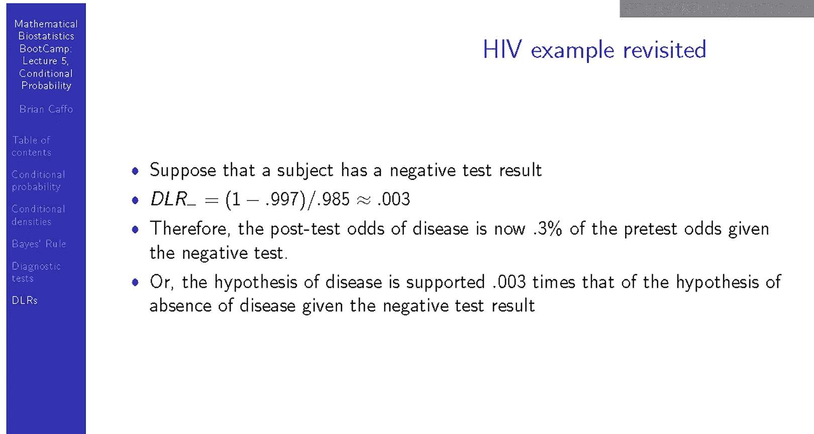

# 高级统计学：第5讲：贝叶斯定理与似然比 🧮

在本节课中，我们将学习统计学中最著名的成果之一——贝叶斯定理。我们将从数学公式和概率事件两个层面理解它，并探讨其在诊断测试中的具体应用，特别是如何通过似然比来解读测试结果。

## 贝叶斯定理的数学表述 📐

上一节我们介绍了条件概率的基本概念。本节中，我们来看看如何将条件概率中的事件顺序“翻转”，这正是贝叶斯定理的核心。

贝叶斯定理由托马斯·贝叶斯提出，它建立了形如 **P(A|B)** 与 **P(B|A)** 这两种条件概率之间的关系。要进行这种转换，我们需要一些额外的信息。

首先，我们来看其在概率密度函数和概率质量函数中的一般形式。

*   设 **f(x|y)** 为给定 **Y=y** 时 **X** 的条件密度（或质量）函数。
*   设 **f(y)** 为 **Y** 的边际密度。

若 **Y** 是连续的，则贝叶斯定理表述为：
**f(y|x) = [f(x|y) * f(y)] / ∫ f(x|t) * f(t) dt**

若 **Y** 是离散的，则贝叶斯定理表述为：
**f(y|x) = [f(x|y) * f(y)] / Σ_t [f(x|t) * f(t)]**

以上公式表明，要计算 **f(y|x)**，我们需要知道 **f(x|y)** 以及边际密度 **f(y)**。

## 应用于事件的贝叶斯定理 🎲

将上述一般形式应用于具体事件，可以得到一个更熟悉的公式。

以下是贝叶斯定理在事件上的一个特例：
**P(B|A) = [P(A|B) * P(B)] / [P(A|B) * P(B) + P(A|B^c) * P(B^c)]**

这个公式很容易证明。分子 **P(A|B)P(B)** 等于 **P(A ∩ B)**。分母是 **P(A ∩ B) + P(A ∩ B^c)**，即 **P(A)**。因此，整个分式就等于 **P(B|A)**。

这表明，我们在处理连续密度、离散联合质量函数时使用的贝叶斯定理，与处理事件概率的传统方法是统一的。

接下来，我们将通过一个最重要的应用实例——诊断测试，来具体运用贝叶斯定理。

## 诊断测试中的贝叶斯定理 🩺

现在，我们来看贝叶斯定理的一个具体应用场景：诊断测试。我们将讨论传统的计算方法，并深入探讨其中一些比通常认知更为复杂的细节。

首先，我们定义一些关键概念：
*   设 **+** 和 **-** 分别表示诊断测试结果为阳性和阴性的事件。
*   设 **D** 和 **D^c** 分别表示受试者患有和不患有该疾病的事件。

基于此，我们定义以下指标：

以下是诊断测试的核心评价指标：
1.  **灵敏度**：患者确实患病时，测试结果为阳性的概率。即 **P(+|D)**。
2.  **特异度**：患者确实未患病时，测试结果为阴性的概率。即 **P(-|D^c)**。
3.  **阳性预测值**：测试结果为阳性时，受试者真正患病的概率。即 **P(D|+)**。这是受试者最想知道的信息之一。
4.  **阴性预测值**：测试结果为阴性时，受试者真正未患病的概率。即 **P(D^c|-)**。
5.  **患病率**：人群中患有该疾病的边际概率，即 **P(D)**。

此外，还有两个不依赖于患病率的重要指标：

以下是诊断似然比的定义：
1.  **阳性似然比**：记为 **DLR+**。公式为 **P(+|D) / P(+|D^c)**，即 **灵敏度 / (1 - 特异度)**。
2.  **阴性似然比**：记为 **DLR-**。公式为 **P(-|D) / P(-|D^c)**，即 **(1 - 灵敏度) / 特异度**。

我们将通过一个具体例子来说明这些指标的用途和区别。

## 实例分析：HIV检测 🦠

假设一项研究指出，某种HIV抗体检测的灵敏度为99.7%，特异度为98.5%。同时，假设人群中的HIV患病率为0.1%。现在，一名受试者的检测结果为阳性，他真正感染HIV的概率是多少？

我们要求的是 **P(D|+)**。根据贝叶斯公式：
**P(D|+) = [P(+|D) * P(D)] / [P(+|D) * P(D) + P(+|D^c) * P(D^c)]**
代入数值：灵敏度=0.997，特异度=0.985，则 **P(+|D^c) = 1 - 0.985 = 0.015**。患病率 **P(D)=0.001**, **P(D^c)=0.999**。
计算得：**P(D|+) ≈ (0.997 * 0.001) / (0.997*0.001 + 0.015*0.999) ≈ 0.062**

这意味着，即使检测结果为阳性，该受试者真正患病的概率也只有约6%。换言之，此测试的**阳性预测值**仅为6%。

这个结果可能出乎意料。原因在于疾病的**患病率很低**，而测试的**特异度并非绝对完美**。贝叶斯定理在此的作用是：我们以很低的先验概率（患病率0.1%）为起点，然后用检测结果（数据）更新我们的判断，更新过程由灵敏度和特异度决定。虽然更新后的概率（6%）比先验概率高了很多倍，但由于起点太低，最终的后验概率仍然不高。

这引出了一个重要观点：如果受试者是静脉注射吸毒者，或经常与HIV感染者发生性关系，那么他患病的先验概率（患病率）将远高于普通人群的0.1%。在这种情况下，即使使用同样的检测，计算出的阳性预测值也会高得多。这对临床解读至关重要：同样的阳性结果，对于高危人群和低危人群的意义截然不同。

那么，有没有一个指标能独立于患病率，单纯衡量检测结果所提供的“证据力度”呢？这就是**诊断似然比**。

## 似然比与几率 🎯

上一节我们提到了阳性预测值依赖于患病率。本节中我们来看看如何用一个不依赖于患病率的指标——诊断似然比，来量化检测结果的影响。

通过贝叶斯公式，我们可以推导出一个简洁的关系式：
**P(D|+) / P(D^c|+) = DLR+ * [P(D) / P(D^c)]**

为了理解这个公式，我们需要引入“几率”的概念。
*   如果某事件发生的概率是 **p**，那么它发生的**几率**定义为 **p / (1-p)**。
*   例如，概率为2/3，则几率为 (2/3) / (1/3) = 2，即“2比1”。

利用几率，上面的公式可以解读为：
**后验几率 = 似然比 × 先验几率**

其中：
*   **后验几率**：获得检测结果后，患病与不患病的几率比，即 **P(D|+) / P(D^c|+)**。
*   **先验几率**：获得检测结果前，患病与不患病的几率比，即 **P(D) / P(D^c)**，由患病率决定。
*   **似然比**：**DLR+** 就是连接先验与后验的乘数因子。

回到HIV例子：
*   **DLR+ = 灵敏度 / (1-特异度) = 0.997 / 0.015 ≈ 66.5**
这意味着，一个阳性检测结果，将使你对患病的相信程度（以几率表示）提升为原来的约66.5倍。这个因子**不依赖于**受试者来自何种人群（患病率高低）。

对于阴性结果：
*   **DLR- = (1-灵敏度) / 特异度 = 0.003 / 0.985 ≈ 0.003**
这意味着，一个阴性检测结果，将使患病的后验几率降至先验几率的约0.3%。

这种“先验信念 → 收集数据 → 更新为后验信念”的框架，非常符合科学的认知过程，也是贝叶斯哲学的核心。

## 关于解释的深入思考 💭

最后，我们简要探讨一下这些计算背后的哲学解释差异，这是诊断测试中一个深刻但常被忽略的点。

*   **贝叶斯视角**：将概率视为信念的量化。先验几率 **P(D)/P(D^c)** 表示初始信念，似然比 **DLR+** 是数据提供的证据强度，两者结合得到后验几率，更新了信念。在此框架下，计算和解释没有障碍。
*   **频率主义视角**：一个具体的人要么患病要么没病，不存在“概率”。此时，可以将计算解释为：在大量与此人类似的虚构重复实验中，阳性结果里真正患病的长期比例。这种解释试图将计算纳入频率主义的框架，但不如贝叶斯解释那样直接自然。

此外，在实际中，获取这些计算所需的参数（如真实的灵敏度、特异度、特定人群的患病率）本身就是一个复杂课题，涉及许多流行病学和临床试验设计的考量。

本节课中我们一起学习了贝叶斯定理的数学形式及其在诊断测试中的关键应用。我们掌握了灵敏度、特异度、预测值等概念的计算，并重点理解了**诊断似然比**作为独立于患病率的证据强度指标，如何通过“先验几率 × 似然比 = 后验几率”的框架来解读检测结果。虽然计算本身简洁优美，但我们也认识到其在哲学解释和实际参数获取上的深度与复杂性。