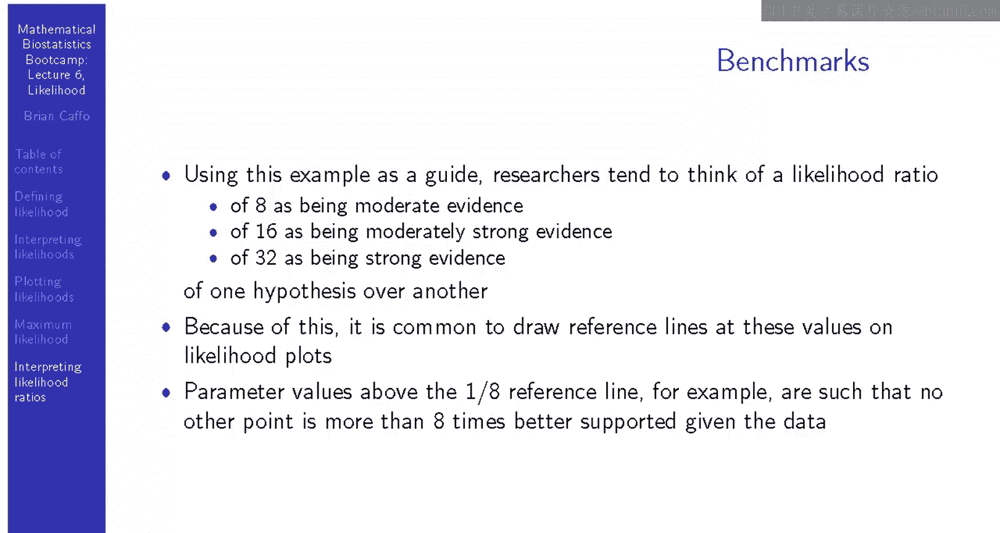

# 约翰霍普金斯大学《数据科学的高级统计｜Advanced Statistics for Data Science》中英字幕（deepseek p16 15_似然函数.zh_en -BV1htPjeYEFH_p16-

Hi， my name is Brian Kaffho and this is Matheal Biosstatistics bootot Campamp， Le6 on Lilihood。

In this lecture， we're going to define what a likelihood is。

 which is a mathematical construct that is used to relate dated to a population。

We're going to talk about how we interpret it likelihoods。

Talk about plotting them and then talk about maximum likelihood。

 which is a way of using likelihoods to create estimates。

And then we'll talk about likelihood ratios and how to interpret them likelihoods arise from a probability distribution and a probability distribution is what we're going to use to connect our data to a population So the idea behind this and a lot。

 but not all of statistics follows this rubric is to assume that the data come from a family of distributions。

And those distributions are indexed by a unknown parameter that represents a useful summary of the distribution to give you an example。

 imagine if you assume that your data comes from a normal distribution。

 so calledled Gaussian distribution， so a bell shaped curve to completely characterize a bell shaped curve。

 all you need is its mean and its variance， so the probability distribution。

 the Gaussian distribution or the bell shaped curve has two unknown parameters。

 the mean and the variance， and then the goal is to use the data to infer the mean in the variance。

And the idea is that the mean and the variances from the Gaussian distribution are unknown population parameters because the Gaussian distribution is our model for the population。

 and the data our sample parameters is what we're going to use to estimate the unknown parameters so the nice part about this approach other than quite a bit of other directions and statistics is that the sample mean。

 the sample variance， these are all estimators with the population model you actually have ests。

 the sample mean is actually estimating something， it's not just a statement about the data。

 it's an estimate of the population and that's what we're going to be talking about today we're going to be talking about a particular way of approaching estimation and summarizing evidence in the data when you assume a probability distribution using likelihood。

Likelihood is a mathematical function has a particular definition and it's just the joint density of the data evaluated as a function of the parameters with the data fixed and we'll go through an example before we go through our example。

 I want to talk about what it is the likelihoods are attemptingting to accomplish and how we might interpret them so I'm going to put forward a particular theory of how likelihoods can be interpreted and how they can be used and I guess I should stipulate that maybe not everyone agrees with this theory。

But the theory I'm going to put forward is that ratios of likelihood values measure relative evidence of one value of an unknown parameter relative to another。

 so if you evaluate the likelihood with the parameter at a specific value， you get the number。

 and then you take the ratio with the likelihood evaluated a different number， that ratio。

 if it's bigger than one， it's supporting the hypothesized value of the parameter and the numerator。

 if it's less than one， it's supporting the hypothesized value of the parameter and the denominator。

So this is a somewhat controversial interpretation of likelihoods。

 but it's the one I'm going to put forward， the second point is similarly controversial though there is a mathematically correct proof that at least it motivates to。

 it actually doesn't prove to， but，TheThe statement I'm making in too is that given a statistical model。

 So given a probability model and observed data， there is a theorem called the likelihood principle that says all of the relevant information contained in the data regarding the unknown parameter is contained in the likelihood。

 Now the likelihood principle has a mathematically correct proof。

 but not everyone technically agrees on its applicability and its interpretation， but nonetheless。

 I'm going to put this forward as a way that in this class we're going to interpret likelihood so that。

Once you collect the data， if you assume a statistical model。

 then the likelihood is going to contain all of the relevant information。

 it's interesting that this point2 has very far reaching consequences to the field of statistics if you believe it。

 things like P values and much of hypothesis testing and other staples of statistics。

 become questionable if you take point two as being true。

 so you know for today's lecture we're going to take it as being true and we'll talk a little bit about maybe some of the controversy associated with it。

Probably from a much more practical point of view is03， which says and we already know this。

 but let's state it in the term of likelihood， so when we have a bunch of independent data points Xi。

 then the joint density is the product of the individual densities so equivalently as we said that the likelihood is nothing other than the density evaluated as a function of the parameter。

 it's also true that their likelihoods multiply， so independence makes things multiply。

 it makes the joint density multiply it makes the likelihood multiply。

So I summarize that here in the statement that is the likelihood of the parameters given all of the x's is simply the product of the individual likelihoodlis。

The last point I'd like to make on this slide。Is that especially points one and two。

 the likelihood assumes these interpretations of likelihoods。

 one negative aspect of them is that you have to actually have the statistical model specified correctly and of course we don't know the statistical model really ever if we assume that our data is Gaussian。

 that's an assumption it's not generally something we know maybe in some rare cases like in for example。

 radioactive decay， there's some physical theory that suggests that that data is poson for example。

 but in most cases， we don't actually know that the statistical family is a correct representation of the mechanism that would generate data if we were to draw from the population。

So I think the way in which people still rationalize using likelihoodbased inference in these cases is that they say well。

 given that we assume this is the statistical model。

 then we will adhere to the use of the likelihood to summarizing the evidence in the data。

 let's go through a specific example， one of the more important examples and it's very illustrative so let's do it。

 consider just flipping a coin， but this coin， let's say it's an oddly shaped coin。

 maybe it's a little bent or something like that so you don't actually know what's the probability of a head。

 let's label that probability of a head as theta。And then recall that the mass function for an individual coin flip is theta to the x1 minus theta to the1 minus x here in this case。

 the theta has to be between0 and 1。So if x is zero， it's a tails and x is1， it's a head。

So if we flip the coin and the result is ahead， then the likelihood is simply the mass function with the one plugged in。

 right so in this case we get theta to the 1，1 minus theta to the1 minus1 which works out to be theta。

 so the likelihood function is the line theta where theta takes values between 0 and 1。

And if you accept our law of the likelihood and likelihood principle and interpretations of likelihood that I sort of outlined in the previous page。

 then this says that consider two hypotheses the hypothesis that the coins true success probability is 50%0。

5 versus the hypothesis that the coin's true success probability is 0。

25 in the light of the data right the one head that we flipped and obtained the question is what is the relative evidence supporting the hypothesis that the coin is fair 0。

5 to the coin is unfair with the specific success probability of 0。25。

 we would take the likelihood ratio which is then 0。5 divided by 0。

25 which works out to be2 so if you accept our interpretation of likelihoods this would say there's twice as much evidence supporting the hypothesis that theta equals 0。

5 to the hypothesis that theta equals 0。25 so that's the idea behind using likelihood。

s for the analysis of data Now let's just extend this example。

 So suppose we flip our coin from the previous example。

 but instead of flipping it just once we get the sequence 1011 I have kind of a funny notation here I'm going to write scriptl is the likelihood and L is a function of theta but it depends on the data that we actually observe 1011 and so we're assuming our coin flips are independent And so what happens with likelihood well we take the product So here I have the first coin flip theta to the 11 minus theta to the 1 minus1 here I have the second coin flip theta to the 0。

1 minus theta to the 1 minus0 and so on so I take the product of all of those and you get theta cubed to the 1 minus theta raised to the first power。

And that's the likelihood for this particular configuration of ones and zeros from four coin flips。

 Notice， however， that the order of the ones and the zeroes。Doesn't matter， regardless of the order。

 as long as we got three， ones and one tail， the likelihood was going to be equivalent it was going to give you theta to the three。

1 minus theta to the 1。So that is a property of likelihoodlis。

 it's illustrating that if you have a coin， the particular configurations of zeros and ones doesn't matter all of the relevant information about the parameter theta is contained only in the fact that we got a specific number of heads and a specific number of tails。

 it doesn't depend on the order whatsoever。And in this case。

 because we know how many coin flips we have， all we need to know is the specific number of heads。

So instead of writing likelihood of theta， depending on 1011。

 we might write it as likelihood of theta depending on getting one tail and three heads because it's the same thing the order is irrelevant This。

 by the way， raises the idea of so-called sufficiency in this case。

 you know the number of heads in the total coin flips is sufficient for making inferences about theta。

 you don't need to know the data actually all you need to know is the total number of heads and the number of coin flips so often that total number of heads you know conditioning on the fact that we know the total number of coin flips is called a sufficient statistic it's saying that there's a reduction in the data to make inferences about the parameter you only need to know a summary of it a function of it and in this case a function that we need to know is the sum total number of heads so let's do a likelihood calculation again。

 let's take the likelihood supporting the coin is fair that theta is 0。5。

And divided by the likelihood， assuming that the coin is unfair specifically with a 25% chance of heads。

 and we get the a ratio of 5。33。 So in other words。

 there's over five times as much evidence supporting that hypothesis that theta is 0。

5 over the hypothesis that theta is 0。25。 Now that relative values of likelihoods measure evidence。

 well， that's useful， but we're not particularly interested in say 0。25。 I mean， the 0。

5 is kind of interesting because the coin is fair。 but you know most of the other points。

 you know we're not interested in 0。25 anymore than we're interested in 0。24 or so on。

So we'd like a way to consider likelihood ratios of all values。

Of the parameter theta and this is just simply a likelihood plot that simply plots theta by the likelihood value。

 And remember that likelihoods are really interpreted in terms of relative evidence So it's the fact that the ratio of the likelihood at 0。

5 to the likelihood at 0。25 is5 is what's saying that we have five times as much evidence So it actually doesn't matter constants that don't depend on theta don't matter in the likelihood right because when you take the ratio if there's a constant that doesn't depend on theta if it's in the numerator and the denominator。

 it'll just cancel out the likelihood in their interpretation should be invariant to constants that are not a function of the parameter So because of that the raw absolute value of the likelihood isn't altogether that informative so we need to pick a rule for kind of normalizing it and so why don't we just divide it by its maximum value so that its's height is 1。

And that seems to be a pretty reasonable rule and it helps with interpretations， I think。And again。

 I just want to reiterate this last point because likelihoods， you know。

 if you're going to buy into this sort of likelihood paradigm of interpreting likelihoodlis。

Everyone agrees that they measure relative evidence rather than absolute evidence。

 so you know dividing the curve by its maximum value or any other value you know it doesn't change its interpretation it's actually an interesting question I might add to try and think of could someone create an absolute measure of evidence in statistics and I'm not aware of any。

 but so we'll have to stick with relative measures for right now？

So here on the next page is a likelihood plot， we have theta on the horizontal axis。

 and we have the likelihood value with the maximum one on the vertical axis。

 in this case this is exactly the likelihood for the four coin flips that we saw。

So the peak value is1。And as the likelihood goes down。

 those values of theta are worse and worse supported。

Now it's kind of interesting that the peak value， right。

 the likelihood value at which we divided the likelihood by is the best supported point in the data。

So that's kind of interesting right because that point has the highest likelihood value so no matter what you divide by you're always going to get a likelihood ratio bigger than one so that point seems kind of special and in fact we give it a name we call it the maximum likelihood point and it's a maximum likelihood turns out to be a very useful technique and in fact you might not know this but the vast majority of statistical estimators you use maximum likelihood estimators are very close to them so the way you would interpret this plot for example is take any two points。

 say if you take 0。4 you get a height at 04 and take value say 0。6 and you get a height that 0。

6 the ratio between those values is the relative evidence and then because we divide it by the maximum every value that we look at is the relative evidence of that specific value of theta when compared to the point that is best supported by the data。

 the maximum likelihood point so the fact that。The value of a fair coin 0。5 Well。

 it actually has surprisingly a likelihood value of about 0。5， which means that the hypothesis。

 if you were to divide the likelihood at the maximum likelihood value by the likelihood at the fair coin value。

 you get a ratio of about 0。5， and that gives the relative evidence supporting the point for which you have the maximum likelihood。

 which turns out to be 0。75 relative to 0。5。So we might draw a horizontal line and let's say we drew a horizontal line at18。

 I think that's what this top line is at it's at 18th what does that mean what every point that falls between the endpoints of this line is such that there's no other point that's more than eight times better supported so take this point where the curve meets this line that's exactly 18。

 what does that mean that point is exactly eight times worse supported given the data then 0。

75 which is the maximum likelihood value。And。Take any point in this interval that falls between the ends of this line and you can't find another point that's more than eight times better supported。

 take， for example， 0。4， it has a likelihood value that is about 0。3 or whatever。

 but its ratio relative to the maximum is less than 18。

So its ratio with everything else is going to be less than that。

 So you're not going to be able to find for 0。4 another point anywhere on this curve that's more than eight times better supported than it。

 So that's the idea behind drawing a line at say1/8 or whatever if you draw a line。

 the collection of theta values that lie on that horizontal line。

Between the points where it intersects the likelihood curve are well supported。 And， of course。

 as you draw the line as you go up and up and up， fewer points stay in the interval to the point where if you draw it high enough。

 then you only have the maximum likelihood value surviving the threshold。

 So just to reiterate some of the points we made on the previous slide。

 the value of theta where the curve reaches its maximum is the maximum likelihood estimate。

 And if we wanted to write it out mathematically。 the M is the argument maximum over theta of the likelihood having plugged in the data X。

 And a nice interpretation of the M is it's the value of the parameter that would make the data that we observed most probable。

 So in this case， we have。Three heads and one tail and the question is what's the success probability of the coin that we could pick that would make the data that we observe most probable and that's a nice interpretation of the MLE as well Well。

 it turns out and I think I've eluded this because I kept saying that the likelihood MLE in the previous example was 0。

75 How did I get that Well there was three heads out of four tails so that's a proportion of heads of 0。

75。Well， it turns out that if you have independent identically distributed coin flips。

 then the MLE for theta is always the proportion of heads that you get and again。

 I think if anyone were to give a single point est for the success probability of that coin they would all give the proportion of heads So to be honest the fact that maximum likelihood yields that is not so much a booster for using the proportion of heads as an estimator。

 it's more fact that it motivates the use of MLE perhaps in more complicated settings where we don't have great intuition already as to what the kind of logical estimator should be that's kind of the benefit of MLE is that in a lot of the cases where we have a really good idea of what should be the right estimator the MLE returns estimators that exactly mirror intuition and that gives us some hope that it would be a useful thing to do in these settings where we don't know what the best estimator is。

Then in addition to that， there's been， I think it's fair to say。

 tomes of theory that have been developed in support of MLes as you let say， for example。

 the number of data points go to infinity。 So let's actually just prove this fact that if you have a binomial or if you have n Bnoulli coin flips that the maximum likelihood estimator is the number the proportion of heads。

 So let n be the number of trials and let's let x be the number of heads。

 And remember that in this case， the likelihood is theta to the x1 minus theta to the n minus x So theta to the number of heads1 minus theta to the number of tails。

 And then if we want to find the argument maximum of this function。

 it turns out it's definitely easier to maximize the log likelihood。

And this is almost a general principle in statistics that when you have a bunch of independent things and you want to maximize the likelihood。

 you're better off maximizing the log likelihood， you know because if you maximize the log of the function you've maximized the function because log is an increasing monotonic function and then in addition to that the fact that you have a bunch of independent things means that you've multiplied a bunch of things to get the joint density or mass function。

 So if you multiply things， things get raised to powers and so on。

 and these are all kind of complicated things to work with。

 addition is much easier to work with so log kind of converts products into sums and that's really quite useful So which is a power is now just is no longer a power on the log scale and you get x log theta plus n minus x log1 minus theta。

 which is a much easier function to work with but in this case you can do it either way。

 it's no problem but one of the reasons it helps in general is that it takes care of the annoying products that you。

From independence and multiplying a bunch of densities or mass functions together。

If we take the derivative， we get x over theta n minus x over1 minus theta and if we want to solve for the inflection point。

 we'd set this equal to0 and we set it equal to0 and I'm not going to churn through the calculations if you actually set it equal to zero and just bring the two terms on either side it's pretty clear that theta equal to x over n solves that equation。

 you have1 minus x over n times theta plus equal to1 minus theta times x over n。

 it's pretty clear if you plug in x over n that you're going to get a valid equality there。

But you could turn through the calculations and get to the fact that theta is solved at x over n So in other words。

 the value of theta that makes the observed data most likely in IID Berulli trials is the proportion of heads Now in below I check the second derivative condition to make sure the likelihood is concave So you know this technically doesn't handle if you got all failures or all successes。

 but maybe just do those cases on your own。So what constitutes strong evidence if we're going to treat the likelihood is our arbiter of evidence and likelihood ratios as measures of evidence。

 we would like to maybe build up some intuition and you know a friend and a faculty member here taught me this idea of well why don't we just use kind of coin flipping as the mechanism for building up our intuition with strength of evidence So imagine an experiment where a person is considering three possible hypothesistheses with coin flipping the coin has tails on both sides in other words theta equals 0 the coin is fair theta equals 0。

5 versus the coin has heads on both sides theta equals 1 and so here we have hypothesis 1 Hyth2 and hypothesis3 and now I have this table for the possible outcomes So let's suppose I flip the coin and its head and I've done this experiment unfortunately it's difficult to do this experiment in this setting。

I've done it in class and you'll just have to take my word for it on one coin flip。

Pretty much no one's willing to ditch the hypothesis that the coin is fair， so at one coin flip。

 let's suppose you get ahead。The probability of a head。

 given the first hypothesis that the coin has tails on both sides is zero。The probability of a head。

 given that the hypothesis that the coin is fair is 05 and the probability of a head。

 given the hypothesis 3， that the coin is。Two headed， then that's one。

 So the likelihood ratio of hypothesis1 to hypothesis 2 is 0。

And the likelihood ratio for hypothesis 3 relative to hypothesis 2 is 2。 And， of course。

 this is exactly what we would hope to happen， right， If the coin is too tailed。

 it can't produce a head so that if we get one head。

 it should have a likelihood ratio of 0 for supporting the two tailed hypothesis。 Okay， so two。

 there's twice as much evidence supporting the hypothesis that the coin is fair and the coin is too headed。

 given a single coin flip that's a head。So it's clear that two is not terribly strong evidence。

 especially given either way if you flip the coin once something's got to happen。

 so the 50% probability of getting a head is not that compelling So let's suppose we got two heads in a row Okay now I'm going to quit talking about hypothesis 1 because you can't get two heads in a row under hypothesis one。

 but here I outline all the different possibilities that you could get head head head tail tailhead tailt and I go through the likelihood ratio for all of them。

But in this case， it's 0。25 for two consecutive heads。

If the coin is fair and it's 100% of getting two heads， if the coin is too headed。

 so the likelihood ratio is now four four times as much evidence supporting the hypothesis that the coin is too headed then the hypothesis that the coin is fair。

 if you get two consecutive heads。 Now， let's suppose we get three consecutive heads。

And then the probability of getting three heads， if the coin is fair is 0。125。

 probability of getting three consecutive heads， if the coin is two head it is 100%。

 you get a likelihood ratio。Of。8And in this case， that means that there's eight times as much evidence supporting the hypothesis that the coin is too headed relative to the hypothesis that the coin is fair。

And so let me tell you what happens when I do this in a class。

 I have a two headed coin and I play this game and people are willing to keep considering the hypothesis that the coin is fair because I guess because most of the time people aren't aware that two headed coins are easy to buy so around three heads。

 a substantial fraction of the class has started to believe that the coin is too headed now。

4 consecutive heads， which within the likelihood ratio would be 16， Of course，5 consecutive heads。

 it would be 32 and so on。 by four consecutive heads。

 the vast majority of the class is believing that it's too headed and then by five consecutive heads basically 100% of the class always agrees that it's too headed。

 and I've done games where I have a fair coin in an unfair coin and I show the class that one of them's fair and one of them unfair。

 jumble them up in my hand and then they don't know which one I'm flipping so that they know I'm not trying to trick them。

 Well， I am trying to trick them。 but I not in an obvious way。 I'm trying to trick them actually。

 you can kind of tell by the weight， which one's fair and which one's not。

 So I always grab the unfair one。 These create sort of useful benchmarks right So8 you is sort of being moderate evidence。

 So the idea behind this is to use this coin flipping an easy experiment that we can understand to build up context for what likelihood ratios means So8 sort of。

erate it's sort of like getting three consecutive heads on a coin right 16 is being strong evidence is like getting four consecutive heads and the evidence against the coin being fair and then 32 is being quite strong evidence。

And you know these are admittedly， the coin is useful context， but these are no more arbitrary。

 say than the existing threshold that say is used on P values where people just arbitrarily pick 5% as their cutoff or type 1 error rates if you're aware of this sort of thing So any rate this is why。

 for example I draw lines likelihood plots at the value of 18 and so that way parameter values above the1/8 reference line are such that no other point is more than eight times better supported given the data that's the end of the kind of technical component of this lecture I wanted to spend a little bit of time just talking about the consequences of kind of adopting this style of analysis。

So。Pretty much every major paradigm in statistics， Bayesianism， frequentism， likelihood。

 this likelihood paradigm， pretty much every paradigm in statistics agrees。

 if you assume a probability model and act as if it's true。

 then the likelihood ratio is a central component to the theory。

 if you take enough mathematical statistics you'll see this。

 the particular paradigm that I'm discussing today。

 then goes beyond this relatively benign use of likelihood ratios that occur in the other areas。

 what I'm talking about today right is that not just that the likelihood ratio is useful。

 but that likelihood ratios measure relative evidence。

 and that given a statistical model and observed data。

 all of the relevant information is contained in the likelihood。

And this has kind of far reaching consequences to the field of statistics。

 if you go beyond just saying likelihoods are useful to going to say not only are they useful。

 but they have these properties， but then it changes quite a bit of statistics， so for example。

Much of statistics is devoted to things like hypothesis testing and P values and other variants of statistics where the interpretation of the statistics involves potentially fictitious repetitions of an experiment so for example。

 if you've ever heard of a confidence interval the interpretation of a confidence intervals quite confusing but something along the lines of if you were to use this technique over and over again。

 you would obtain these intervals that contain the things that they're trying to estimate。

 say 95% of the time Well， if you kind of adopt this strong variant of interpreting likelihoods。

 then that suggests that that interpretation can't be valid because it involves potentially fictitious repetitions of the experiment which do not depend on the likelihood for the data at hand so it cannot possibly be useful it cannot have any additional evidence。

So some of the things that get disputed if you adopt this paradigm are P values， hypothesis testing。

 multiple corrections， and these are the big ones that come to the top of my head。

 which is very disputed because in many ways these techniques seem very central to the idea of statistics。

So I really just wanted at this point to introduce people to these concepts。

 state the consequences of this theory， I think for the purposes of this class。

 what I would hope you would know after this lecture is what the likelihood is。

 you would know that regardless of what kind of paradigm statistics you're in higher likelihoods generally refer to better supportive values of the parameter and I would hope that you would understand about the principle of maximum likelihood。

Thank you for listening， this was Mathe Biosstatistics Boot Camp Leture 6。

 and I look forward to seeing you for the next lecture。

🎼て。

