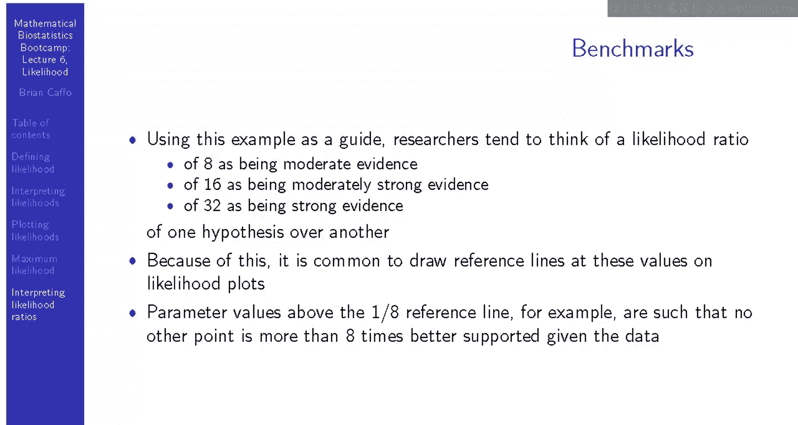

# 高级统计：第6讲：似然函数 📊

在本节课中，我们将学习似然函数。这是一个用于将数据与总体联系起来的数学构造。我们将讨论如何解释似然函数，如何绘制似然图，以及最大似然估计法——一种利用似然函数进行参数估计的方法。最后，我们将探讨似然比及其解释。

## 似然函数的概念与作用

似然函数源于概率分布。概率分布是我们用来连接数据与总体的工具。许多统计学方法遵循一个基本思路：假设数据来自一个分布族，这些分布由一个未知参数索引，该参数代表了分布的有用摘要。

例如，假设数据来自正态分布（即高斯分布或钟形曲线）。要完全描述一条钟形曲线，只需要其均值和方差。因此，高斯分布有两个未知参数：均值和方差。我们的目标是利用数据来推断这些参数。这里的均值和方差是总体模型的未知参数，而样本统计量（如样本均值、样本方差）则用于估计这些未知参数。这种方法的好处在于，样本统计量是在估计总体参数，而不仅仅是描述数据本身。

## 似然函数的定义与解释

似然函数是一个数学函数，其定义为：在数据固定的情况下，将数据的联合密度函数视为参数的函数。我们将通过一个例子来具体说明。

在深入例子之前，我们先讨论似然函数试图实现的目标以及我们如何解释它。这里提出一个关于似然函数解释和使用的理论（需注意，并非所有人都同意此理论）：

1.  **似然比值衡量相对证据**：一个参数值相对于另一个参数值的似然比值，衡量了支持前者的证据相对于后者的强度。如果比值大于1，则支持分子中的参数假设值；如果小于1，则支持分母中的参数假设值。
2.  **似然原则**：给定一个统计模型和观测数据，一个称为“似然原则”的定理指出，数据中关于未知参数的所有相关信息都包含在似然函数中。虽然该定理有数学证明，但其适用性和解释存在争议。然而，在本课程中，我们将以此方式解释似然函数。
3.  **独立数据的似然**：当我们有多个独立数据点时，联合密度是各个密度的乘积。相应地，参数的似然函数也是各个数据点似然的乘积。独立性使得密度和似然都表现为乘积形式。

需要指出的是，上述解释（特别是第1和第2点）的一个潜在缺点是，必须正确指定统计模型。实际上，我们很少能确切知道数据背后的真实分布。尽管如此，在假设了统计模型的前提下，我们将使用似然函数来总结数据中的证据。

## 一个具体例子：抛硬币 🪙

考虑抛一枚形状奇特的硬币（例如有点弯曲），我们不知道正面朝上的概率。将这个概率记为 θ。

回顾一下，单次抛硬币的质量函数（概率质量函数）是：
`P(X=x) = θ^x * (1-θ)^(1-x)`
其中，θ 必须在0和1之间。如果 x=0 是反面，x=1 是正面。

*   如果我们抛一次硬币，结果是正面（x=1），那么似然函数就是代入 x=1 后的质量函数：`L(θ) = θ`。因此，似然函数是 θ 在 [0,1] 区间上的一条直线。
*   根据我们之前概述的似然解释，考虑两个假设：硬币是公平的（θ=0.5） vs. 硬币是不公平的（θ=0.25）。在观测到一次正面的数据下，支持 θ=0.5 相对于 θ=0.25 的相对证据是多少？我们计算似然比：`0.5 / 0.25 = 2`。这意味着，支持“硬币公平（θ=0.5）”假设的证据是支持“硬币不公平（θ=0.25）”假设的证据的两倍。

现在扩展这个例子。假设我们抛这枚硬币四次，得到序列：1, 0, 1, 1（正面、反面、正面、正面）。假设抛掷是独立的，那么似然函数是每次抛掷概率的乘积：
`L(θ | 数据) = θ^1*(1-θ)^0 * θ^0*(1-θ)^1 * θ^1*(1-θ)^0 * θ^1*(1-θ)^0 = θ^3 * (1-θ)^1`

值得注意的是，正面和反面的顺序并不重要。只要得到三次正面和一次反面，无论顺序如何，似然函数都是 `θ^3 * (1-θ)^1`。这说明了似然函数的一个性质：关于参数 θ 的所有相关信息仅包含在我们得到了特定次数的正面和反面这一事实中，而不依赖于顺序。这引出了“充分统计量”的概念——在这里，已知总抛掷次数时，正面总数就是关于 θ 的充分统计量。

再次进行似然比计算：比较 θ=0.5（公平）和 θ=0.25 的假设。
`L(0.5) = 0.5^3 * 0.5^1 = 0.0625`
`L(0.25) = 0.25^3 * 0.75^1 ≈ 0.01171875`
似然比约为 `0.0625 / 0.01171875 ≈ 5.33`。换句话说，支持 θ=0.5 假设的证据是支持 θ=0.25 假设的证据的5倍多。

## 似然图与最大似然估计 📈

虽然比较特定参数值的相对证据有用，但我们通常对参数的所有可能值都感兴趣。这时就需要绘制似然图：以参数 θ 为横轴，似然值为纵轴。

由于似然值解释为相对证据，其绝对值本身信息量不大（乘以一个不依赖于 θ 的常数不会改变比值）。因此，通常将似然函数除以其最大值进行归一化，使其最大高度为1。这有助于解释。

归一化后的似然图如下所示（针对四次抛掷，三次正面的例子）：
*   峰值在 θ=0.75 处，似然值为1。
*   随着似然值下降，对应的 θ 值得到的支持越来越弱。
*   峰值点具有最高的似然值，我们称之为**最大似然估计（MLE）**。它是使观测数据出现概率最大的参数值。

我们可以这样解释此图：取任意两点，例如 θ=0.4 和 θ=0.6，它们的高度比值就是这两个参数值之间的相对证据。由于我们除以了最大值，图上任何点的值都代表了该 θ 值相对于数据最支持点（MLE点）的相对证据。

例如，公平硬币的值 θ=0.5 对应的似然值约为0.5。这意味着，支持 MLE 点（θ=0.75）的证据是支持公平硬币假设（θ=0.5）的证据的约 `1/0.5 = 2` 倍。

我们还可以在图上画一条水平线，比如在高度为 1/8 处。这条线与似然曲线相交两点之间的区间内的所有 θ 值，其性质是：找不到另一个点，其证据强度超过区间内点的8倍。这个区间可以看作是参数值的一个“合理”或“得到较好支持”的范围。

## 最大似然估计的性质与计算

最大似然估计（MLE）是使似然函数最大化的参数值。数学上表示为：
`θ_MLE = argmax_θ L(θ; X)`

MLE 的一个直观解释是：它是使得我们实际观测到的数据最有可能出现的参数值。

在上面的抛硬币例子中，MLE 是 θ=0.75（3次正面/4次抛掷）。一般来说，对于独立同分布的伯努利试验（抛硬币），θ 的 MLE 总是正面出现的比例（`#正面 / #总试验数`）。这个结果与直觉相符，也增强了我们在更复杂、缺乏直观估计量的场景中使用 MLE 的信心。

此外，有大量的理论支持 MLE 的良好性质，例如当数据量趋于无穷时的一致性等。

让我们简单证明一下这个结论：设 n 为试验次数，x 为正面次数。似然函数为 `L(θ) = θ^x * (1-θ)^(n-x)`。为求最大值，通常最大化**对数似然函数**更为方便，因为对数将乘积转化为求和，且是单调函数，不改变极值点位置。
对数似然：`l(θ) = log L(θ) = x*log(θ) + (n-x)*log(1-θ)`
求导并令导数为零：
`dl/dθ = x/θ - (n-x)/(1-θ) = 0`
解此方程可得 `θ = x/n`。因此，MLE 确实是正面比例。

## 似然比与证据强度 ⚖️

如果我们把似然比作为证据的衡量标准，那么什么构成了“强”证据呢？我们可以通过一个简单的抛硬币思想实验来建立直觉。

考虑一个人面对三种假设的硬币：
*   H1：硬币两面都是反面（θ=0）
*   H2：硬币是公平的（θ=0.5）
*   H3：硬币两面都是正面（θ=1）

现在进行抛掷实验：
*   **抛一次得到正面**：在 H1 下概率为0，H2 下为0.5，H3 下为1。H3 相对于 H2 的似然比为 `1/0.5=2`。一次正面提供的证据并不强。
*   **连续两次得到正面**：H2 下概率为0.25，H3 下为1。似然比为 `1/0.25=4`。
*   **连续三次得到正面**：H2 下概率为0.125，H3 下为1。似然比为 `1/0.125=8`。根据课堂经验，此时相当一部分人开始相信硬币是两面正面的。
*   **连续四次得到正面**：似然比为16。此时绝大多数人相信硬币是两面正面的。
*   **连续五次得到正面**：似然比为32。此时几乎所有人都同意硬币是两面正面的。

这为我们提供了关于似然比证据强度的直观基准：
*   **似然比 8**：中等强度的证据（类似连续三次正面）。
*   **似然比 16**：强证据（类似连续四次正面）。
*   **似然比 32**：非常强的证据（类似连续五次正面）。

这就是为什么在之前的似然图中，我们有时会以 1/8 作为参考线来界定参数值的合理区间。

## 采用似然分析范式的后果

几乎所有主要的统计学范式（贝叶斯、频率主义、似然主义）都同意，在假设概率模型并视其为真的前提下，似然比是理论的核心组成部分。

然而，本讲所讨论的特定范式（强调似然比衡量相对证据，且似然包含所有相关信息）超越了其他领域相对温和地使用似然比的做法。这种强解释对统计学领域有深远影响。

例如，许多统计学内容致力于假设检验、P 值等，这些方法的解释通常涉及对实验可能进行的虚构重复（例如，置信区间的解释是：如果重复使用该方法，得到的区间有特定概率包含真值）。如果采纳本讲所述的强似然解释，那么这类解释就可能是无效的，因为它们依赖于与当前数据似然无关的虚构重复。

因此，如果采纳这种范式，一些受到质疑的统计概念包括：P 值、假设检验、多重比较校正等。这些在传统统计学中看似核心的技术，其基础可能会被动摇。

## 总结

本节课我们一起学习了似然函数的核心概念。我们了解到，似然函数是在给定数据下，将概率模型的参数视为变量的函数。无论遵循哪种统计学范式，更高的似然值通常意味着参数值得到数据更好的支持。我们重点掌握了最大似然估计（MLE）的原理，它是使似然函数最大化的参数值，在许多情况下具有良好的性质并与直觉相符。我们还通过抛硬币的例子，建立了对似然比作为相对证据衡量标准的直观理解。最后，我们探讨了强调似然解释的统计学范式可能带来的深远影响。希望本讲能帮助你理解似然函数的基本原理及其在统计推断中的重要作用。

感谢收听 Matheal 生物统计学训练营第6讲，我们下节课再见。