# 约翰霍普金斯大学《数据科学的高级统计｜Advanced Statistics for Data Science》中英字幕（deepseek p17 16_伯努利分布与二项试验.zh_en -BV1htPjeYEFH_p17-

Hi， my name is Brian Kaffho， I'm in the Department of Biosstatistics。

 the Johns Hopkins Bloomberg School of Public Health。

 and this is Mathematical Biostatistics boototcamp Le 7 in this lecture I'm going to talk about some common distributions。

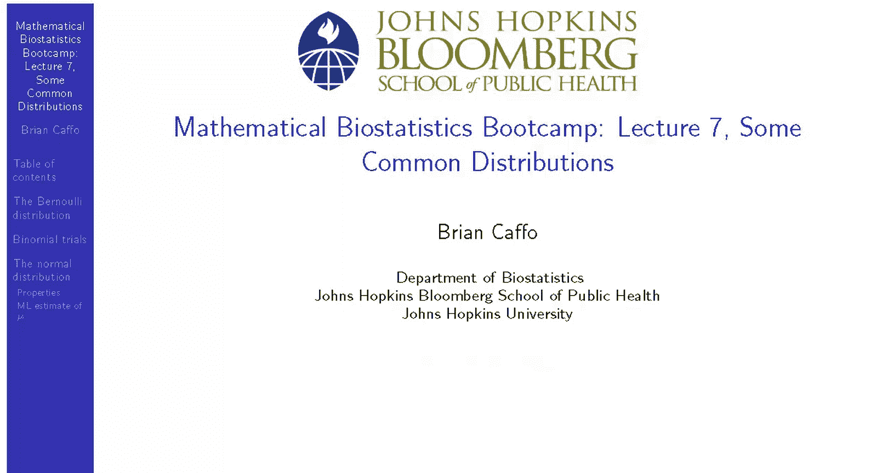

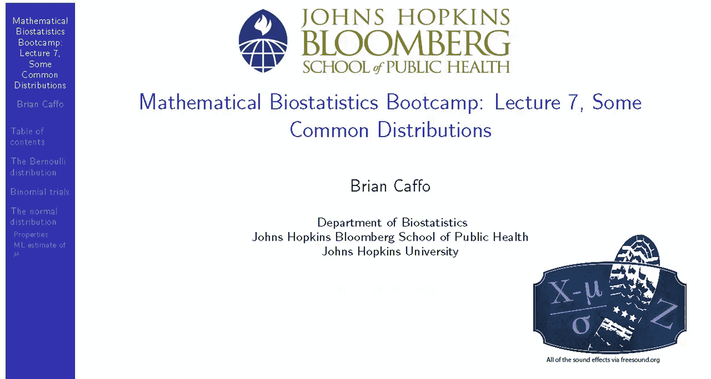

So in this lecture I'm going to talk about basically three distributions and really two if you kind of think about it。

 so the Bernoulli distribution is one， the binomial distribution。

 which is a distribution based on the Bernoulli distribution and then I'll talk about the Gaussian or normal distribution which is a very important one as well。

 in fact， I think if all the distributions were to get together and nominate a king。

 it would definitely be the normal distribution。

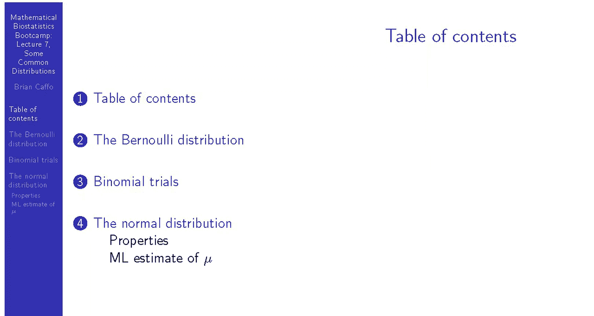

So the Bernoulli distribution is named after Jacob Bernoulli， we've already talked about it before。

 but let's formalize it a little bit and remind ourselves of some of the notation。

So Berulli random variable is just a fancy name for a coin flip。

 so Berulli random variable takes values 0 and 1 with probabilities p and 1 minus p where p is some number between 0 and 1。

So the probability mass function for Bernoulli random variable we've seen before。

 it's the probability that x takes the specific value 0 or1。

 and it's p to the x 1 minus p to the 1 minus x The mean of a Bernoulli random variable is simply p and the variance is p times 1 minus p facts that we've proven before。

 but we're just restating them now。And in general， for Bernoulli random variables。

 if you code a coin fliplip as a one or a head， it's often people call that a success and zero is a failure and they tend to do this regardless of whether the classification is actually something that's actually successful。

 so we might call a you know a person getting side effects from a medication。

 a success in terms of the Bernoulli coin flip， it's just a little bit of odd nomenclature， I guess。

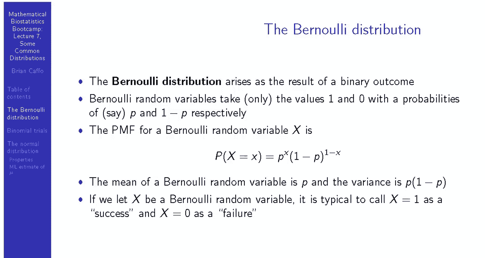

We've also already talked about the Bernoulli likelihood function。

 so if we have x1 to Xn our observed data points。So the x1 xn in this slide are numbers that we recorded a collection of zeros and1s。

 then the likelihood is the product because we're going to model these as independent coin flips。

 the product of p to the X 1 minus p to the 1 minus X。

 we've already talked about this equals P to the summation X 1 minus p to the n minus summationxi。

So notice again that the。Likelihood only depends on the sum of the x's so the total each x is01 so the sum of the x' is is just the total number of successes and then n minus the sum of the x's is the total number of failures so if you know n and you know the total number of successes。

 then you know the Bulli likelihood it doesn't matter what order the heads or tails occurred as far as information is contained in the data about the parameter P。

Because n is fixed and assume known， this implies that the sample proportion contains all the relevant information that you need to know about P insofar as the likelihood codifies it。

 simply because sumation X and summation X over N or1 to one you can get from one to the other easily by either multiplying or dividing by N so the sufficiency result is basically that the proportion of successes is all the relevant information you need to make Bernoulli inference about a parameter Now again。

 this all depends on the model being correct that you have correctly modeled the data as IID Bnoulli we also when we talked about maximum likelihood。

 we also showed that if you maximize the Bernoulli likelihood over P then you obtain that P hat which is summation X over N is the maximum likelihood estimator。

And here's you know， we went over an example， so here。

 just to give you an example of Bernoulli likelihoods and what they look like。

 imagine if we flipped a coin four times。

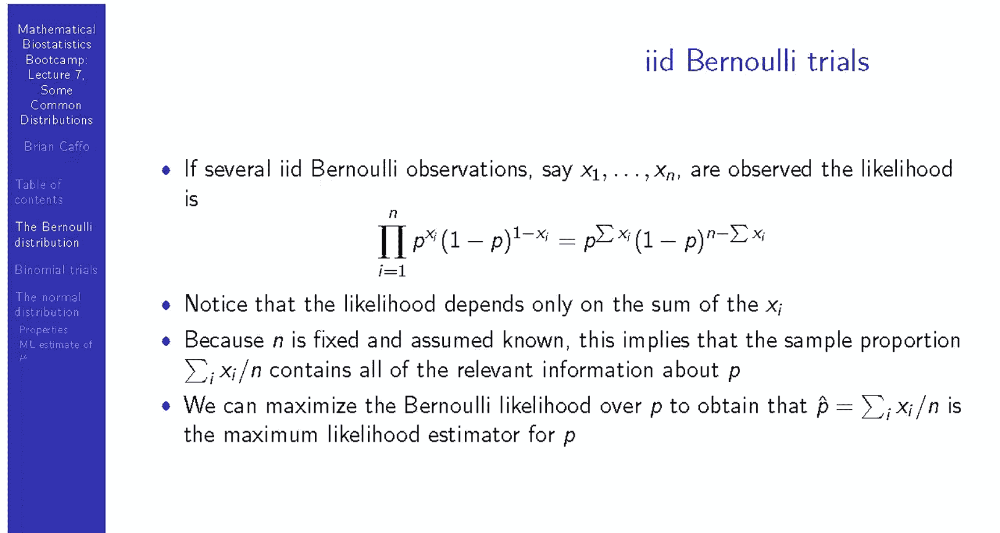

So if we flipped the coin four times， there's only four possible sufficient statistics that we could obtain。

 we could get zero heads， one head out of the core coin flips。2 heads out of the four coin flips。

 three heads out of the four coin flips or four heads out of the four coin flips。

 And here is the four possible likelihoods that you could obtain from this experiment。

 and they're all normalized to have height1。 So heres on the leftmost one is the likelihood you get if you had no heads。

 the second one， you see it shifted a little bit to the right， right。

 and its peak is going to be right at P hat at a quarter。 Okay， And then if you get two heads。

 then you see the peak， the ME in this case is right at 0。5。

 and the likelihood shifts a little bit to the right。 And if you've gotten three heads。

 it shifts a little bit more to the right。 And if you've gotten four heads。

 then it shifts closer to one。 noticeice even in the event that you get all tails or all heads。

 the likelihood is not。Entirely at0 or entirely at one， right， there's substantial uncertainty。

 right， The likelihood is correctly codifying the information that it's possible even if the coin is say fair。

 you know， here's the likelihood point right here， even if the coin is fair to get for consecutive tails。

And you know， it's just much less likely than if the coin is unfair towards some value near closer to zero。

 so the likelihood， you know it's not entirely shoved up against the vertical line at zero and it just gets closer and closer to that vertical line as you continue to flip and get tail after tail after tail。

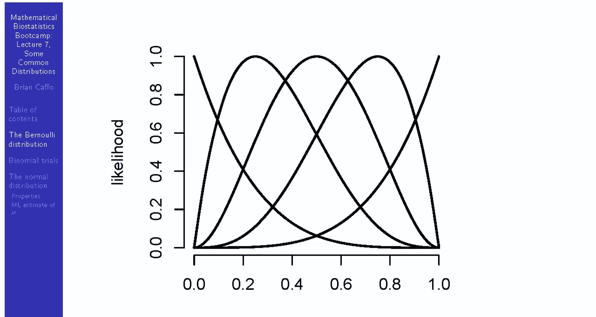

Binomial random variables are nothing other than the sum of IID Bernoulli trials。

 we've seen that the key variable from a Bernoulli experiment is the number of heads。

 so why don't we just create a random variable that is the number of heads。So in specific。

 if x1 to xn are II Berulli， then the random variable x defined as the sum of the individual Xxi is a so called binomial random variable。

And the binomial mass function is just the probability x takes any specific value is n choose x p to the x1 minus p to the n minus x where p is the probability from each of the Bernoulli coin flips here the values that x can take are zero if every single coin flip was a tail。

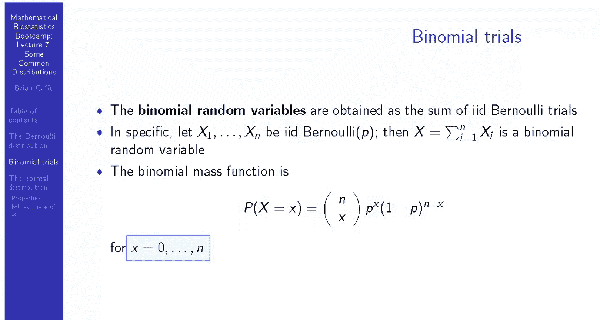

All the way up to n where every single coin flip was ahead。

 just to remind everyone the notation N choose X， right， this parentheses， n over x n parentheses。

This is n factorial over x factorial n minus x factorial here。

 zero factorial we're going to treat as one。This formula counts the number of ways of selecting X items out of N without replacement disregarding the order of the items Okay。

 so let's consider an example。Imagine I have pen necks and I pick out three。And。putut them on my bed。

 let's say and I'm not caring about what ordered on my bed from left to right or something like that and so 10 choose three is the number of different configurations of ties that I could have obtained by picking three ties out of my 10 possible so that that's an example I can't think of any reason why you would want to do this with your neck ties but whatever。

So it's very easy in fact， certain special cases are very easy so imagine if I was only picking one neckie right how many different combinations can I get well intuitive we know that that answer has to be 10 right because you know there's only 10 possibilities Well you know if you plug into the formula you have 10 factorial divided by one factorial which is just one n minus x factorial which is 10 minus1 or9 factorial so we have 10 factorial divided by9 factorial which is just 10 okay you know another quite useful one is choose two how many ways can you pick two things out of n objects that one seems to come up a lot in my daily life for some reason and so that's in this case would be 10 factorial over two factorial which is just two right two times one then divided by eight factorial right so that's 10 times9 divided by two so。

Anyway rate， the general rule is for n choose2， you just want to take n times n minus1 over two。

 and at any rate it's one of the ones that it's worthwhile just to memorize the formula for that special case because it seems to pop up a lot。

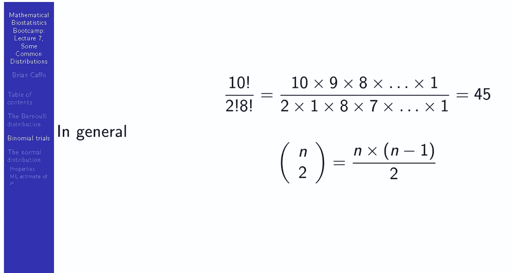

So why is that factor why is n choose x the factor out in front of a binomial mass function so let's now consider the possibility of getting six heads out of 10 coin flips from a coin with success probability P Well if you account for the order if you say what's the probability of getting tail tail tail tail that's four tails then the remaining our heads right in that specific order right we know what that probability is we would just plug into the multivariate Brnoulli mass function obtained by multiplying the Bernoulli mass function for each coin flip in order and we would get p to the6 one minus p to the fourth and as we know because of the fact that it's only the total number of heads that sufficient that if it wasn't just the first four coin flips that were tails if it was the last four coin flips that were tails and first six were heads then we would get the same number we'd get p to the61 minus。

P to the fourth and if we had the four tails sprinkled in any configuration of the six heads。

 then you will still get the same possible answer P to the six1 minus p to the fourth the result is that basically for any collection of instances where you get six heads and four tails no matter what the order is the probability is going to be p to the six so what we need is to count how many。

Such configurations there are well in this case there's 10 flips and with 10 positions that could be heads and we want to know how many different collections of positions we can obtain and that's just 10 to 6 it's just exactly the neckectie problem but now we're picking the position of the coin flip that is a head right and so in this case there's 10 to6 possible orders of six heads in four tails we don't actually have to go through the specific construction of the binomial distribution because I think that's a pretty clear demonstration that's how you would wind up with the probability of the sum of a collection of 10 Brulli random variables being six you would sum over all the possible ways you could get six heads and it turns out that they all have the same probability P to the61 minus p to6 so we just need the number of things that go into that sum and it's pretty clear that it's 1026 So yeah we only did。

This for a specific instance here， I hope you can see that if 10 instead was n and6 instead was x that you would wind up with the same answer n choose x p to the x1 minus p to the n minus x So that's the motivation and you can actually mathematically check that the binomial mass function sums to one in fact it's actually kind of a relatively famous formula。

 the binomial sum and so if you for example look up on Wikipedia， the binomial sum。

 you'll see that it just exactly illustrates that formula by itself tells you exactly that the binomial mass function sums to1。

 but but wherere right now just going to trust that we did our calculation right。

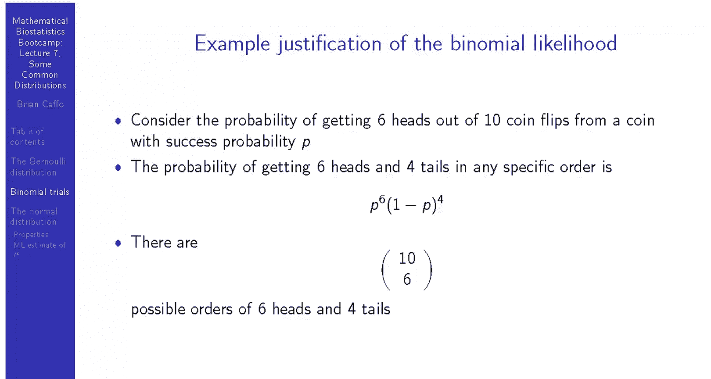

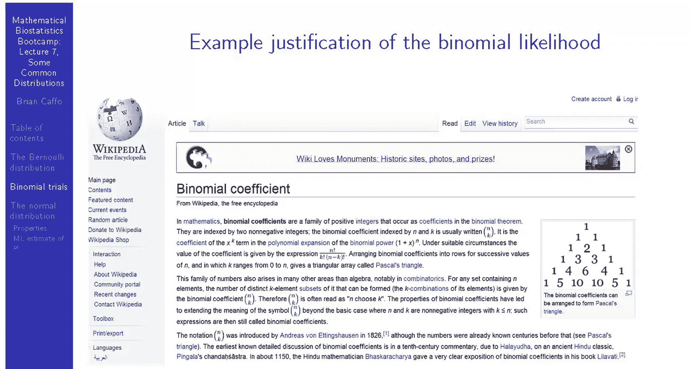

Let's just go through an example of using the binomial mass function。

 so suppose you have an intrepid friend that has eight children and it turns out that seven of them are girls and none of them are twins and let's。

So if you're very parsonicity， let's just forget about all the little parsnicity things that you could possibly think about related to this problem like having twins so let's just think about the problem in the conceptual way we're going to think of every child from this family。

 it's gender being a coin flip and the question is what's the chance of getting7 out of8 children that are girls if it really is the case that every child their gender is independent from the other children and that there's a 50% probability at each birth of having a girl and so what's the probability of getting seven or more Well that's the probability of seven or more is the probability of getting seven girls out of eight plus the probability of getting eight girls out of8 and so in this case for the fair coin it would be 827。

5 to the 71 minus。5 to the1 and then8 chooses 8。5 to the81 minus。

5 to0 and you know check with your calculator or even better with。

you know that you can get this number it's about 4% that this is an example of using the binomial formula I wanted to mention this particular example because this calculation is an example of a so-called P value and a P value is always the probability under a null hypothesis of getting a result as extreme or more extreme than the one actually obtained so the logic behind the P value in this specific instance。

Is that you have this evidence here that you think wow， seven girls out of eight children。

 that seems pretty odd， maybe the 50% chance of girls versus boys for this particular family is off for whatever the reason so the P value is saying okay well why don't we calculate the probability。

 if the nu hypothesispo was true of getting an event this extreme。

 and if that probability is very low， then maybe that's an indication that our hypothesis that the 50% is correct is not right。

 So anyway rate we'll talk about P values later， well I hope we'll get to talking about P values later。

 but I just wanted to mention that that's where the intuition behind this calculation is coming from right now we're only using it as an illustration of plugging into the binomial formula but I wanted to foreshadow kind of an important statistical technique。

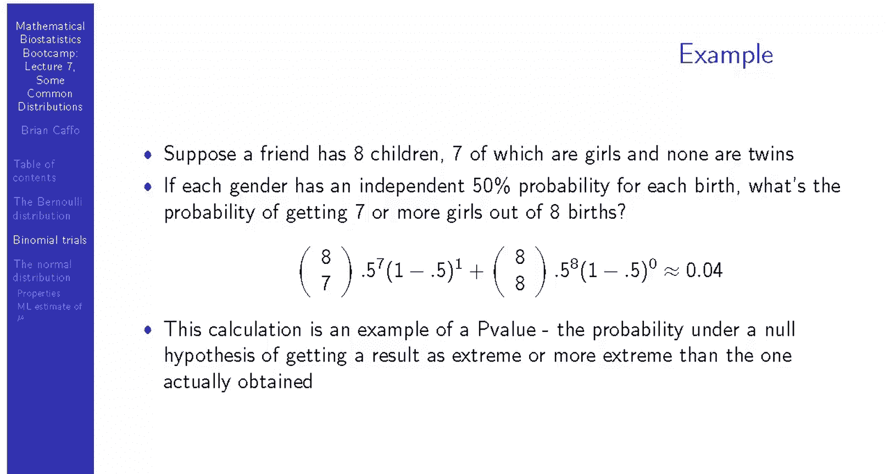

And then here in this page is the likelihood associated with P for this particular binomial experiment if we're willing to model births as if they were binomial。

And so here， you can see， you， 0。5 is in the 116th likelihood， but not in the 18th likelihood。

 and then you can see that this likelihood is far more peaked around seven/8 or it reaches its maximum at 78th and then the curvature of it sort of gives you a sense of the relative evidence for the collection of possible values of P。

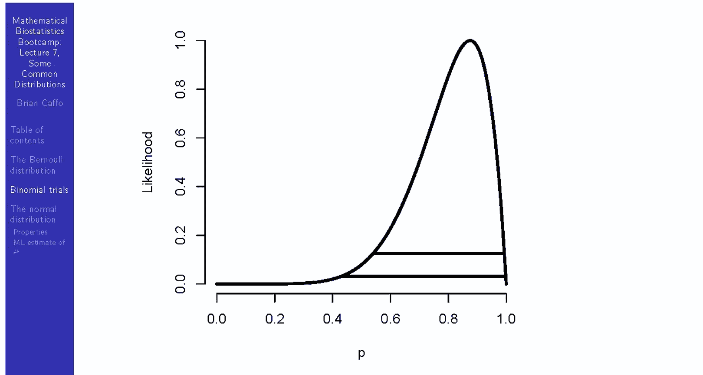